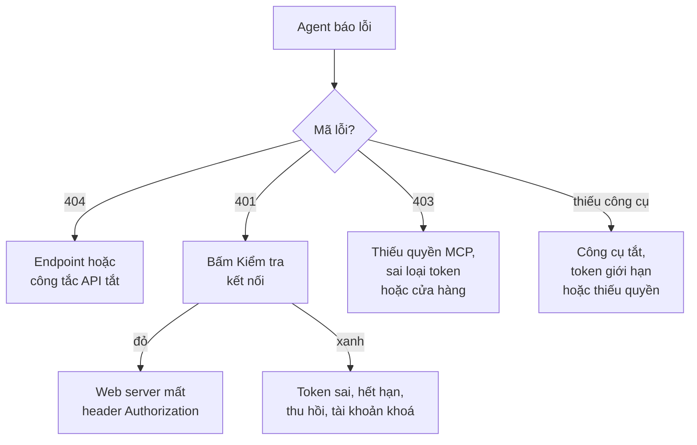

> 🌐 **Ngôn ngữ:** 🇻🇳 Tiếng Việt (hiện tại) · [🇬🇧 English](./mcp-troubleshooting.md) · [🇯🇵 日本語](./mcp-troubleshooting_ja.md)

# Xử lý sự cố MCP

## Giới thiệu

Trang này giúp bạn **tự tìm và sửa lỗi** khi AI agent không kết nối được hoặc không làm được việc với MCP của GP247. Tài liệu dành cho chủ
site, nhân viên dùng agent và người phụ trách kỹ thuật. Tra theo **triệu chứng** bạn thấy, hoặc theo **mã lỗi** agent báo (401, 403, 404…);
mỗi dòng nói nguyên nhân và cách sửa. Chưa kết nối lần nào? Bắt đầu ở [Bắt đầu nhanh](./mcp-quickstart_vi.md).

## Nhìn nhanh

Phần lớn sự cố nằm ở một trong bốn chỗ — đi theo thứ tự này là nhanh nhất:



- **Nút Kiểm tra kết nối** ở cuối màn **MCP Server** phân biệt được lỗi do máy chủ web hay do token.
- **Mọi lỗi ở cổng đều có `code`** trong thân trả về (ví dụ `forbidden_origin`) — tra ở [Tra theo mã lỗi](#tra-theo-mã-lỗi).
- **Nhật ký thao tác quản trị** (dòng `MCP`) cho biết lần gọi công cụ nào bị từ chối và vì sao.

## Tra theo triệu chứng

| Triệu chứng | Nguyên nhân thường gặp | Cách sửa |
| --- | --- | --- |
| Không thấy menu **Cấu hình hệ thống → MCP Server** | Thiếu quyền **"MCP server — use (own tokens)"**, hoặc site chưa có gói MCP | Nhờ chủ site gán quyền; site cũ: [Thêm MCP vào site cũ](./mcp-administration_vi.md#thêm-mcp-vào-site-cài-từ-s-cart-cũ) |
| Nút **Đọc + ghi** bị mờ khi tạo token | Site chưa bật công cụ ghi nào | Bật công cụ ghi cần dùng trong **Cấu hình MCP Server** |
| Agent kết nối được nhưng **không thấy công cụ cần dùng** | Công cụ đang tắt; token giới hạn công cụ khác; chủ token thiếu quyền màn tương ứng | Kiểm cả ba chỗ ([Danh mục công cụ](./mcp-tools_vi.md#bảng-tổng-hợp)) |
| Agent báo **không tìm thấy** đơn / sản phẩm có thật | Bản ghi thuộc cửa hàng khác với phạm vi tài khoản | Dùng tài khoản có quyền cửa hàng đó, hoặc nối agent tới tên miền cửa hàng đó |
| **Mã xác nhận** bị từ chối | Mã hết hạn (5 phút), đã dùng, hoặc tham số khác với lúc xem trước | Bảo agent xem trước lại để lấy mã mới |
| `recent_changes` trả **chưa bật** | Nhật ký sự kiện của REST API đang tắt | Bật ở màn quản lý API ([Đồng bộ dữ liệu](../api/api-sync_vi.md)) |
| Agent **ngừng chạy sau khi đổi mật khẩu** | Đổi mật khẩu thu hồi mọi token MCP của tài khoản | Tạo token mới, cập nhật vào agent |
| Thao tác ghi luôn bị chặn | Site đang ở chế độ demo chỉ-đọc | Tắt chế độ demo nếu đây là site thật |
| `composer require gp247/mcp` báo lỗi phụ thuộc (*fixed to 3.8.x by a partial update*) | Core đang khoá ở bản cũ hơn 3.9 | Chạy lại kèm `-W` để Composer được nâng core: `composer require gp247/mcp -W` |

## Tra theo mã lỗi

Lỗi ở cổng MCP trả JSON dạng `{"error": 1, "msg": "...", "code": "..."}`:

| HTTP | `code` | Nghĩa | Cách sửa |
| --- | --- | --- | --- |
| `404` | — | Endpoint tắt, hoặc công tắc tổng REST API tắt | Bật **Bật endpoint MCP**; kiểm công tắc tổng trên màn quản lý API |
| `401` | `unauthenticated` | Không có token, token sai, hết hạn, đã thu hồi, hoặc tài khoản bị khoá | Kiểm token; bấm **Kiểm tra kết nối** ([xem bên dưới](#máy-chủ-web-làm-mất-header-authorization)) |
| `403` | `insufficient_scope` | Tài khoản thiếu quyền "MCP server — use", hoặc token không phải token MCP | Gán quyền; dùng token tạo ở màn **MCP Server** (token REST API không dùng được) |
| `403` | `store_scope_denied` | Site nhiều cửa hàng: tài khoản không được dùng MCP ở cửa hàng / tên miền này | Xem [Site nhiều cửa hàng](./mcp-security_vi.md#site-nhiều-cửa-hàng) |
| `403` | `forbidden_origin` | Request từ trình duyệt với origin không được phép | Thêm origin vào **Origin trình duyệt được phép thêm** |
| `405` | — | Gọi bằng `GET` / `DELETE` | Bình thường — MCP chỉ nhận `POST`; agent đúng chuẩn tự xử lý |
| `413` | `payload_too_large` | Request lớn hơn giới hạn (mặc định 64 KB) | Tăng **Kích thước request tối đa (KB)** nếu thật cần |
| `429` | `too_many_attempts` / — | Vượt giới hạn theo IP hoặc theo token (mặc định 60/phút) | Chờ theo header `Retry-After`; tăng **Số request mỗi phút cho mỗi token** nếu cần |

> ℹ️ **Thông tin:** lỗi **trong lúc chạy công cụ** (thiếu quyền màn quản trị, tham số sai, tồn kho không đủ…) không phải lỗi HTTP: agent nhận
> thông báo lỗi của công cụ và thường tự giải thích lại cho bạn.

## Máy chủ web làm mất header Authorization

Một số cấu hình Apache (CGI / FastCGI) không chuyển header `Authorization` tới PHP, nên mọi request bị `401` dù token đúng. **Kiểm tra kết nối**
báo **đỏ** trong trường hợp này.

1. Mở file `public/.htaccess` của site, đảm bảo còn đủ hai dòng sau (Laravel có sẵn, đôi khi bị xoá khi chỉnh sửa):

   ```
   RewriteCond %{HTTP:Authorization} .
   RewriteRule .* - [E=HTTP_AUTHORIZATION:%{HTTP:Authorization}]
   ```

2. Lưu file, quay lại màn **MCP Server**, bấm **Kiểm tra kết nối**.

   Nếu thành công, kết quả chuyển **xanh**.
3. Vẫn đỏ? Nhờ nhà cung cấp hosting bật `CGIPassAuth On` cho site (hoặc cấu hình tương đương với Nginx / LiteSpeed).

## Ba kết quả của nút Kiểm tra kết nối

Nút này cho site tự gọi tới chính địa chỉ MCP của nó (theo `APP_URL`) và báo:

| Kết quả | Nghĩa | Làm gì tiếp |
| --- | --- | --- |
| **Xanh** | Truy cập được, header `Authorization` tới được PHP | Lỗi còn lại (nếu có) nằm ở token hoặc quyền |
| **Đỏ** | Máy chủ web làm mất header `Authorization` | Làm theo mục [phía trên](#máy-chủ-web-làm-mất-header-authorization) |
| **Vàng** | Site không tự gọi được chính nó | Endpoint đang tắt, `APP_URL` sai, hoặc hosting / tường lửa chặn gọi vòng — thử thẳng bằng agent |

> 💡 **Mẹo:** màn MCP Server còn cảnh báo khi site không chạy **HTTPS** — nên sửa trước, vì token đi kèm mỗi request.

## Điều kiện & ràng buộc (hiểu trước khi thao tác)

- **Lỗi `401` cố ý giống nhau cho mọi nguyên nhân** — không phân biệt token sai, hết hạn hay tài khoản khoá, để không ai dò được tài khoản. Tự kiểm token và tài khoản trên trang quản trị.
- **Bản ghi ngoài phạm vi cửa hàng trả "không tìm thấy"**, không phải "không có quyền" — cố ý, để không lộ dữ liệu cửa hàng khác.
- **Việc liệt kê công cụ và lỗi `401` không ghi nhật ký từng lần** — muốn biết vì sao bị từ chối ở cổng, xem mã lỗi agent báo.

## Hỏi & Đáp (Q&A)

**Câu 1: Token chắc chắn đúng mà vẫn 401?**

→ Bấm **Kiểm tra kết nối**. Đỏ: sửa header theo [mục trên](#máy-chủ-web-làm-mất-header-authorization). Xanh: kiểm tài khoản tạo token có bị
khoá, vừa đổi mật khẩu, hay token đã hết hạn / bị thu hồi.

**Câu 2: Agent báo 404 dù tôi đã bật endpoint?**

→ Kiểm công tắc tổng REST API trên màn quản lý API — nó tắt luôn MCP. Kiểm cả địa chỉ: phải là `https://<tên-miền>/api/core/mcp`.

**Câu 3: Agent báo 403 `insufficient_scope`?**

→ Hoặc tài khoản thiếu quyền **"MCP server — use (own tokens)"**, hoặc bạn đang dùng token của REST API. Tạo token ở màn **MCP Server**.

**Câu 4: Agent không thấy công cụ `search_customers`?**

→ Công cụ đang tắt, token giới hạn công cụ khác, hoặc tài khoản tạo token không có quyền màn Khách hàng. Sửa một trong ba chỗ đó.

**Câu 5: Agent báo 429 liên tục?**

→ Agent gọi quá nhiều lần mỗi phút. Chờ hết thời gian ghi ở `Retry-After`, hoặc tăng **Số request mỗi phút cho mỗi token** trong cấu hình.

**Câu 6: Kiểm tra kết nối báo vàng nhưng agent vẫn chạy?**

→ Bình thường trên một số hosting chặn site tự gọi chính nó. Agent chạy được nghĩa là kết nối thật ổn.

**Câu 7: Mã xác nhận luôn báo sai?**

→ Mã chỉ sống 5 phút, dùng một lần và gắn với đúng thay đổi đã xem trước. Nếu agent đổi tham số (ví dụ trạng thái khác) giữa hai bước, phải xem trước lại.

**Câu 8: Xem lần gọi bị từ chối ở đâu?**

→ Nhật ký thao tác quản trị, dòng có phương thức `MCP`: ghi tên công cụ, token, kết quả `denied` và mã lỗi.

**Câu 9: Lỗi chỉ xảy ra trên một tên miền của site nhiều cửa hàng?**

→ MCP xác định cửa hàng theo tên miền bạn gọi tới. Quản lý cửa hàng phải nối agent tới tên miền của cửa hàng mình; sai tên miền thì nhận `403 store_scope_denied`.

---

<sub>📅 **Cập nhật lần cuối:** 2026-11-04 · ✍️ **Tác giả (Author):** GP247</sub>
