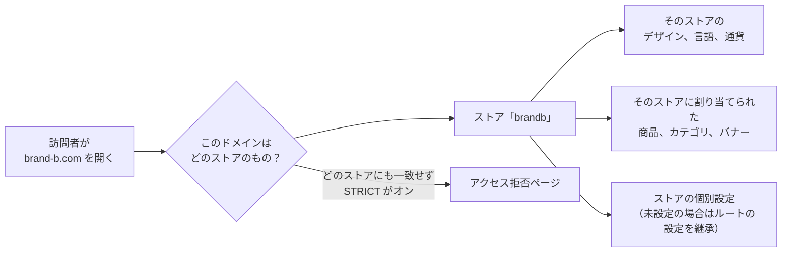
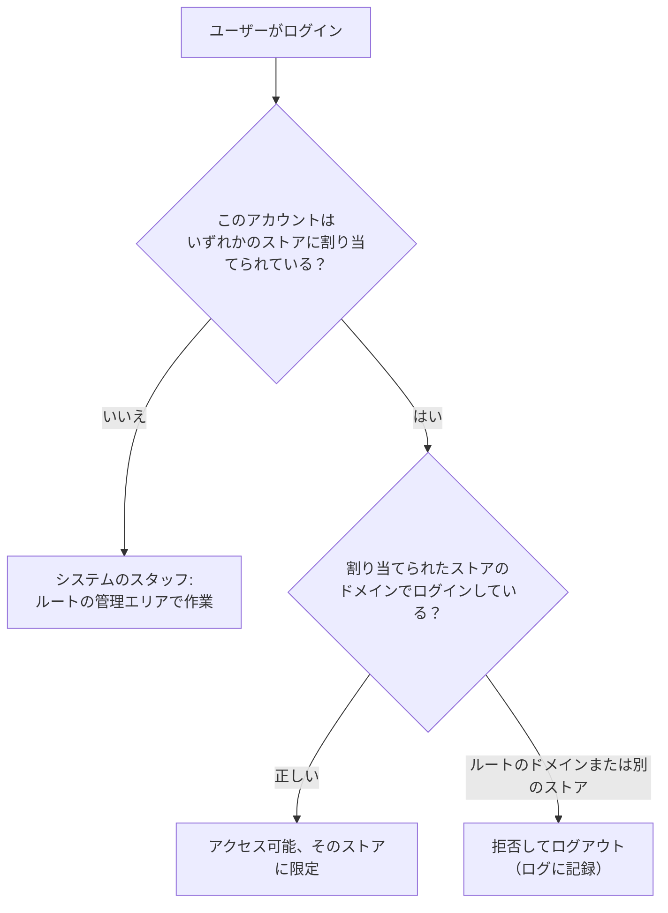

> 🌐 **言語:** [🇻🇳 Tiếng Việt](./multi-store-operations_vi.md) · [🇬🇧 English](./multi-store-operations.md) · 🇯🇵 日本語（現在）

# Multi-Store — パート2: 複数ストアの運用

## はじめに
このドキュメントでは、**マルチストアのシステムを実際に運用する方法** を説明します。ストアごとのデータと共有のデータ、階層化された設定の仕組み、ストアを専任の管理者に任せる方法、元の商品を複数のストアに展開する方法、集計レポートの確認、ストアのロックと削除です。システムオーナーと運用スタッフの方を対象としています。読み終えると、各操作がどのストアに影響し、システムが何をブロックするのかがわかります。インストールについては [パート1 — インストール](./multi-store-setup_ja.md) を参照してください。

**(Pro)** と記載された機能は、無料版に加えて Pro 版のインストールが必要です。

## システムはどのようにストアを識別するか
すべては **リクエストのドメイン** から始まります。

顧客が注文したドメインのストアに注文が記録されるため、発生した時点から売上をきちんと分けられます。

## ストアごとのデータと共有データ
運用を始める前に、最も重要なポイントです。

| データの種類 | 仕組み |
| --- | --- |
| **商品、カテゴリ** | 1つのレコードが **複数のストアに属する** ことができます — 作成・編集時にストアを選びます。ストアから外しても商品は削除されません。 |
| **バナー、コンテンツページ、リンクグループ** | 商品と同じ仕組みで、ストアごとに割り当てます。 |
| **レイアウトブロック** | ストアごとに **完全に独立** — 各ストアが自分のトップページを配置します。 |
| **注文** | 注文が発生したストアに記録されます。ストア間で移動しません。 |
| **顧客、ニュースレター購読者** | 登録したストアに属します。 |
| **仕入先、ブランド、属性、税** | 商品に使う基本データで、管理画面で管理し、対応する範囲で割り当てます。 |
| **放棄カート、SEO リダイレクト** | ストアごとに独立しています。 |

ルートの管理者が、ストアごとのデータを持つ画面を開くと、絞り込みや割り当てのための **ストア選択欄** が表示されます。この欄はルートシステムの管理者にだけ表示されます。ストア管理者（Pro）は、もともと自分のストアの中だけで作業するため、この欄は表示されません。

## 階層化された設定
すべての設定がストアごとに分かれているわけではありません — すべて分けると、ストアごとに何もかも設定し直す必要があるからです。システムは3つの階層に分かれています。

| 階層 | 意味 | 例 |
| --- | --- | --- |
| **システム全体** | 値は1つだけで、ルートの管理者だけが変更できる | システムのメール送信モード、メールキュー、商品カテゴリの設定（カタログ構造） |
| **継承 + 上書き** | ルートストアが基本値を持ち、各ストアは必要なときに個別に設定。設定しなければ基本値を使う | 一般情報、メール/SMTP 設定、顧客設定、注文設定 |
| **ストアごと** | ストアごとに独立した値を持つ | デザイン、言語、通貨、連絡先情報、ロゴ、メンテナンスページ、バナー、レイアウトブロック |

設定場所: ストアの「マルチストア」→「ストア一覧」→「設定」。この画面には、そのストアのすべての設定が1か所にまとまっており、そのストア自体に適用される一般設定と販売設定のタブも含まれます。

**ストアの設定に含まれるもの:**
- ストア情報: 言語ごとの名前、説明、SEO キーワード。ロゴ、アイコン、SNS 共有用の画像。
- 連絡先: 電話番号、ホットライン、メールアドレス、営業時間、住所、事務所、倉庫。
- ドメイン、言語、通貨、**テンプレート**。
- 言語ごとの **メンテナンスページ** の内容。
- ストアのメール設定と、有効/無効にする自動メールの種類。
- ストアに適用する販売設定: 顧客、注文、表示、キャプチャ。

> ⚠️ **注意:** **ストアのテンプレートの変更は重い操作です**。システムはそのストアの古いテンプレートのデータを削除し、新しいテンプレートのデータを構築するため、実行前に確認が必要です。ストア独自のレイアウトブロックの配置は、新しいテンプレートに合わせてやり直す必要があります。

### ストアごとのプラグイン
一部のプラグイン（決済、配送、プロモーション、ニュース、商品レビューなど）は、**ストア単位** で動作することを宣言しています。これらのプラグインは、プラグイン管理画面で **ストアごとに** 有効/無効と設定を行えます — たとえば、小売ストアではオンライン決済を受け付け、卸売ストアでは銀行振込のみにする、といった使い方ができます。

## ストアごとの専任管理者（Pro）
すべてのストアを自分で管理するわけではない場合に、大きな違いを生む機能です。

**ストアを担当者に任せる方法** —「ストア管理者」画面を開きます（システムの管理者だけがアクセスできます）。

1. 割り当てる **ユーザー** を選びます（システム管理者のアカウントは不可）。
2. 割り当てる **ストア** を選びます（ルートストアは選べません）。
3. **ロール** を選びます — 2つのサンプルロールが用意されています。
   - **Store Admin**: ストアのすべての業務。そのストアの設定とレポートを含みます。
   - **Store Member**: 日々の運用 — 商品、注文、顧客、コンテンツ。

   別のロールを作成して選ぶこともできます。
4. 「ストア管理者を割り当て」をクリックします。割り当てを外すには「解除」ボタンを使います。

**割り当てられた担当者は:**
- ルートのドメインではなく、**自分のストアのドメインで** ログインします。
- そのストアのデータだけを見られます。
- アドレスを直接入力しても、**ルートの管理エリアには入れません**。

**境界はシステムが守っており、権限の設定方法には左右されません。** どのようなロールや権限を与えられていても、ストア管理者はシステムレベルの操作を **常にブロック** されます: プラグインとテンプレートのインストール/アンインストール、ユーザー・ロール・権限の管理、システム全体の設定、ストア一覧の管理です。**自分のストア** の設定と、そのストアの Web サイト情報は編集できます（ドメイン欄を除く — システムオーナーのものです）。

1つのアカウントが **ルートシステムのスタッフとストア管理者を兼ねることはできません**。両方の役割が必要な場合は、別々のアカウントを使ってください。

## ストアへの商品同期（Pro）
複数のストアで同じ商品を販売しつつ、価格、在庫、説明を変えたい場合でも、一から入力し直す必要はありません。

**操作方法** —「ストアへの商品同期」画面を開きます: 元の商品を選び、対象ストアを選び、対象カテゴリを選んで「公開」をクリックします。

結果: 対象ストアには **そのストア専用の独立した商品のコピー** が作られ、同時にシステムは元の商品との **リンクを保持** します。あとで元の内容が変わったら、「再同期」をクリックすると、ストアが独自に設定した部分には触れずに内容を更新できます。

**覚えておきたい3つのこと:**
- **単品の商品にのみ適用されます** — バンドル商品とグループ商品にはまだ対応していません。
- **公開したコピーは、初期状態で下書き・価格0です** — 価格を設定してから販売を開始する必要があります。うっかり価格0のまま商品が店頭に並ぶことが絶対にないよう、意図的にこうしています。
- **再同期しても、ストアの価格と在庫は常に保持されます** — システムが同期するのは内容（名前、説明、選択した場合は画像）だけです。

元の商品1つにつき、各ストアのコピーは **1つだけ** です。もう一度公開しても、既存のコピーが返され、重複したコピーは作られません。

## システム全体のレポート（Pro）

**統合ダッシュボード** — 選択した期間（今月／過去30日間／今年／全期間）でストア同士を比較する画面です: ストアごとの売上、注文数、**平均注文額** を表示し、Excel に出力できます。売上は販売機能と同じ計算方法を使います — キャンセルされた注文と失敗した注文を除外し、注文時の為替レートで同じ通貨に換算します。

**商品別売上レポート** — 元の商品を **合算した総売上** の順に並べます: ルートストアでの売上 **に加えて**、他のストアに公開したすべてのコピーの売上を合計します。元の商品ごとに、各ストアのコピーを子の行として開き、そのコピー自体の売上を確認できます。これにより、ある商品が1つの Web サイトだけでなく、システム全体で実際にどれだけ売れているかがわかります。

この2つの画面は **システムの管理者** 向けです。ストア管理者は開けません。

## ストアのロックと削除

### ストアのロック（Pro）
ロックは、すべてのデータを保持したまま、ストアの **表示を一時停止** する方法です。そのドメインでは Web サイトが開かなくなりますが、商品、注文、顧客はそのまま残り、いつでもロックを解除できます。

- 操作は「ストア一覧」の「ロック」列で行います。
- ロック/ロック解除ができるのは **システムの管理者だけ** です。
- **ルートストアはロックできません** — システム全体の土台なので、ロックするとすべてが停止します。
- Pro 版をインストールしていない場合、この列は Pro ラベル付きで無効になっています。

### ストアの削除
削除は **元に戻せない** 操作のため、システムは2重の保護を設けています。

**次のものが残っている場合、システムは削除を拒否します:**
- **注文** — 財務の履歴が1回の操作で消えてはいけないため。
- **顧客** — 実在する人の個人アカウントのため。
- **仕入先** — 共有の商品が参照している基本データのため。

エラーメッセージには、種類ごとに残っているレコードの数が表示されます。先にそれらを移動または削除してください。

**削除できる場合**、システムは1つのトランザクションで後片付けをします。
- 商品、カテゴリ、バナー、コンテンツページは **削除しません** — 複数のストアに属している可能性があるため、このストアへの **リンク** だけを外します。
- そのストアだけが所有するものは **完全に削除します**: レイアウトブロック、ニュースレター購読者、SEO リダイレクト、放棄カート、ストアの説明と設定。

**常にブロックされる操作**: **ルートストア** の削除と、**現在作業中のストア自体** の削除。

## 条件と制約（操作の前に確認）

**ストアの作成・編集時**
- **コードとドメインは一意です** — システムはドメインでストアを識別するため、2つのストアで同じドメインは使えません。
- **言語、通貨、テンプレート、タイトルは必須です**。
- **無料版はルートストアを含めて3ストアまで** — ボタンを隠すだけでなく、サーバー側でチェックされます。
- **テンプレートの変更は、そのストアの古いテンプレートのデータを破棄する操作です** — 確認が必要で、レイアウトブロックの配置はやり直しになります。

**ストア管理者の割り当て時（Pro）**
- **ルートストアは誰にも割り当てられません** — ルートストアはシステムオーナーのものです。
- **システム管理者のアカウントにはストアを割り当てられません** — 2つの役割は排他的です。両方必要な場合は2つのアカウントを使います。
- **ストア管理者は自分のストアのドメインでのみログインできます** — ルートのドメインや別のストアにアクセスすると、拒否されてログアウトされ、ログに記録されます。
- どのような権限を与えられていても、**システムレベルの操作は常にブロックされます** — プラグインとテンプレートのインストール/アンインストール、ユーザー/ロール/権限、システム全体の設定、ストア一覧の管理。
- **開けるのは自分のストアの設定だけです** — 別のストアの設定のアドレスを直接入力してもブロックされます。

**ストアへの商品同期時（Pro）**
- **元はルートストアの商品である必要があります** — ストアからストアへの相互公開はできません。
- **単品の商品のみ** — バンドル商品とグループ商品にはまだ対応していません。
- **公開したコピーは常に下書き・価格0から始まります** — 店頭に並べる前に、価格を設定して販売を開始してください。
- **再同期しても、ストアの価格、在庫、ストア独自の基本データ（ブランド、仕入先、税）は上書きされません**。
- **元の商品1つにつき、各ストアのコピーは1つだけです** — もう一度公開すると既存のコピーが返されます。

**ストアのロック時（Pro）**
- **ルートストアはロックできません**。
- ロック/ロック解除ができるのは **システムの管理者だけ** です。
- **ロックされたストアは、そのドメインでの表示を停止します** — データはそのまま残り、ロックを解除すれば再び動作します。

**ストアの削除時**
- **ルートストアも、現在作業中のストアも削除できません**。
- **注文、顧客、仕入先が残っている場合は削除できません** — 先にそれらを処理してください。
- **商品/カテゴリ/バナー/ページは削除されず**、ストアとのリンクがなくなるだけです。
- **ストアのレイアウトブロック、ニュースレター購読者、SEO リダイレクト、放棄カートは完全に削除されます** — 復元できません。

**ドメインのチェック（STRICT）を使う場合**
- **ドメインを登録していないのに STRICT をオンにすると、そのドメイン自体が拒否されます** — すべて登録してからオンにしてください。
- **`.env` のルートドメインは常に受け付けられます** — そのため、自分自身がシステムから締め出されることはありません。

## よくある質問（Q&A）
**Q1: 2つのストアで販売する商品の在庫はどう管理しますか？**

→ 方法は2つあります。両方のストアに **同じ商品** を割り当てると、2つのストアで在庫と価格を共有します。**ストアへの商品同期**（Pro）を使うと、各ストアが価格と在庫を独立して持つ専用のコピーを持ちます。

**Q2: ストア A で登録した顧客は、ストア B でログインできますか？**

→ 顧客のアカウントは、登録したストアに属します。顧客にとって、各ストアは別々の Web サイトだと考えてください。

**Q3: ルートストアでメール設定を変更すると、他のストアも変わりますか？**

→ 個別に設定していないストアは変わります — 基本値を継承しているためです。個別の値を設定したストアは、その値を保持します。

**Q4: システムのメール送信モードをオフにするとどうなりますか？**

→ システム全体の設定なので、どのストアもメールを送信できなくなります。この設定はルートストアにあり、システムの管理者だけが変更できます。

**Q5: ストア管理者は、自分のストアにプラグインをインストールできますか？**

→ いいえ。プラグインとテンプレートのインストール/アンインストールはシステムレベルの操作で、ストア管理者には常にブロックされます。ルートの管理画面でインストールし、該当するストアでそのプラグインを有効にしてください。

**Q6: どのストアが一番売れているかを確認したいのですが？**

→ **統合ダッシュボード**（Pro）を使います: 同じ期間のストアごとの売上、注文数、平均注文額を表示し、Excel に出力できます。

**Q7: 3つのストアで販売している商品の、実際の総売上を知るにはどうすればよいですか？**

→ **商品別売上レポート**（Pro）を使います: 元の商品の売上と各ストアのすべてのコピーの売上を合算し、コピーごとの明細も確認できます。

**Q8: 誤ってストアを削除した場合、復元できますか？**

→ できません。そのため、注文、顧客、仕入先が残っている場合、システムは削除をブロックします。一時的に止めたいだけなら、削除ではなくストアを **ロック**（Pro）してください。

**Q9: ストア間で注文が混ざることはありますか？**

→ ありません。各注文には発生したストアが記録されます。管理画面の注文一覧はストアで絞り込むことができ、ストア管理者には自分のストアの注文だけが表示されます。

---

⬅️ [パート1 — インストール](./multi-store-setup_ja.md) · [目次](./multi-store_ja.md) · [パート3 — カスタマイズ](./multi-store-customize_ja.md) ➡️

---

📅 **最終更新:** 2026-10-22 · ✍️ **作成者 (Author):** GP247
