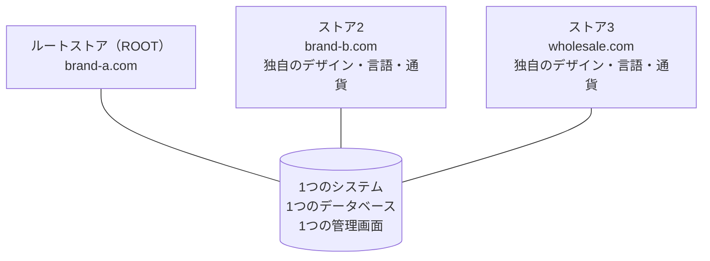

> 🌐 **言語:** [🇻🇳 Tiếng Việt](./multi-store_vi.md) · [🇬🇧 English](./multi-store.md) · 🇯🇵 日本語（現在）

# Multi-Store — 1つの管理画面で複数の販売サイトを

> 🚀 **MultiStore PRO のリンク:** [https://gp247.net/en/product/multi-store-pro.html](https://gp247.net/en/product/multi-store-pro.html)

## はじめに
このドキュメントでは **Multi-Store** を紹介します。Multi-Store は、**1つの管理システムで複数の販売サイトを運営** できるようにするプラグインです。ストアごとに独自のドメイン、デザイン、言語、通貨を持ちながら、1つのプラットフォームと1つの管理場所を共有します。**経営者と運営担当者** の方を対象としています。このページを読むと、プラグインでできること、無料版でどこまでできるか、Pro 版で何が追加されるか、そして最初から正しいモデルを選べるよう Multi-Store と Multi-Vendor の違いがわかります。

これは Multi-Store ドキュメントセットの **目次ページ** です。残りの3つのパートで、インストール、運用、カスタマイズを詳しく説明します。

## このドキュメントセットの目次

| パート | 内容 | 対象 |
| --- | --- | --- |
| **このページ** | マルチストアのモデル、プラグインでできること、Free/Pro の比較、Multi-Vendor との比較 | ストアの追加を検討している方 |
| [パート1 — インストール](./multi-store-setup_ja.md) | プラグインのインストール、最初のストアの作成、ドメインの向け先設定、Pro 版の追加インストール、確認、トラブルシューティング | Web サイトをインストールする方 |
| [パート2 — 運用](./multi-store-operations_ja.md) | ストアごとのデータと共有データ、階層化された設定、ストア管理者、商品の同期、レポート、ストアのロックと削除、条件と制約 | システムオーナーと運用スタッフ |
| [パート3 — カスタマイズ](./multi-store-customize_ja.md) | ストアごとのデザイン、表示テキスト、スタッフの権限設定、開発者向けの注意事項 | 管理者と開発者 |

> 👉 デモサイトで実際に試せます: **https://demo.s-cart.org**

## Multi-Store が解決すること
**複数の異なるストア/Web サイト** を持ちたい場合 — ブランドごとにドメインを分けたい、市場ごとに言語/通貨を分けたい、卸売サイトと小売サイトを分けたい — 一般的な方法は、Web サイトを個別にいくつも構築することです。その結果、データが分散し、何か所にもログインする必要があり、維持費がかさみ、全体を把握しにくくなります。

Multi-Store は、すべてを **1か所** にまとめます。

- **複数のストア、1つの管理画面。** ストアごとに独自のドメイン、デザイン（テンプレート）、言語、通貨を持ちますが、管理は1つの管理画面だけで行います。
- **プラットフォームを共有。** 商品、注文、顧客は1つのシステムにまとまっています。Web サイトごとに一から構築し直す必要はありません。
- **費用と手間を節約。** インストールは1回、運用も更新も1か所で済みます。別々の Web サイトをいくつも維持する必要はありません。
- **少しずつ拡張。** 1つのストアから始めて、必要になったらシステムを作り直さずに新しいストアを追加できます。

訪問者がアクセスすると、システムは開かれている **ドメイン** を識別し、対応するストアを表示します。そのストアのデザイン、言語、通貨、商品カタログが正しく表示されます。

## プラグインでできること

**無料版** は、最大3つのストアで実際に運用するのに十分な機能を備えています。

- **新しいストアの作成**: コード、ドメイン、デザイン、言語、通貨、言語ごとの説明を個別に設定できます。
- **ストアごとの個別設定**: 連絡先情報、ロゴ、SNS 用の画像、メンテナンスページ、メール設定、そのストアの販売設定。
- **データをストアに割り当て**: 商品、カテゴリ、バナー、コンテンツページをどのストアに属させるかを選べます。
- **ドメインの厳格チェック（STRICT）**: 登録済みのドメインだけで Web サイトを開けます。未登録のドメインは拒否されます。
- **安全なストアの削除**: 注文、顧客、仕入先が残っているストアは、システムが削除をブロックします。

**Pro 版** は、本格的に複数のストアを運営するときに必要な機能を追加します。

- **ストアごとの専任管理者**: ストアごとに担当者を割り当てます。担当者はそのストアのドメインでログインし、自分の担当範囲だけを見られます。
- **ストアへの商品同期**: 1つの元の商品を複数のストアに公開します。各ストアには独立したコピーが作られますが、元の商品とのリンクは保持され、あとで再同期できます。
- **統合ダッシュボード**: ストア間で売上、注文数、平均注文額を比較し、Excel に出力できます。
- **システム全体の商品別売上レポート**: 元の商品を合計売上順に並べ、各ストアのコピーごとの売上もあわせて表示します。
- **ストアのロック／ロック解除**: データを削除せずに、ストアの表示を一時停止できます。

## 無料版と Pro 版の比較

| 機能 | 🆓 **Free** | ⭐ **Pro** |
|---|:---:|:---:|
| ストア数 | 最大 **3**（ルートストアを含む） | **無制限** |
| 複数ドメイン、ストアごとのデザイン | ✅ | ✅ |
| ストアごとの言語と通貨 | ✅ | ✅ |
| ストアごとの個別設定 | ✅ | ✅ |
| ドメインの厳格チェック（STRICT） | ✅ | ✅ |
| 商品／カテゴリ／バナー／ページのストアへの割り当て | ✅ | ✅ |
| **ストアごとの専任管理者**（そのストアのドメインでログイン、サンプルロール2つ付き） | — | ✅ |
| **ストアへの商品同期**（元の商品とのリンクを保持、再同期可能） | — | ✅ |
| **統合ダッシュボード**（ストア間の売上／注文数／平均注文額、Excel 出力） | — | ✅ |
| システム全体の **商品別売上レポート**（各ストアのコピーを含む） | — | ✅ |
| **ストアのロック／ロック解除** | — | ✅ |
| サポート | コミュニティ | GP247 の有料サポート窓口 |

- **Free を選ぶ場合:** これから始める方、ストアが最大3つで足り、すべてを自分で管理する方。
- **Pro にアップグレードする場合:** ストアが3つより多く必要な方、ストアごとに専任の管理者を置きたい方、システム全体の集計レポートが必要な方。

Pro 版は無料版に **追加で** インストールするもので、置き換えるものではありません。インストールすると、メニューでロックされていた *(Pro)* 項目から実際の画面がそのまま開くようになり、既存のストアのデータもそのまま保持されます。インストール方法: [パート1 — インストール](./multi-store-setup_ja.md)。

> 🚀 **MultiStore PRO のリンク:** [https://gp247.net/en/product/multi-store-pro.html](https://gp247.net/en/product/multi-store-pro.html)

## Multi-Store と Multi-Vendor の違い
どちらのプラグインも「複数のストア」を扱いますが、**2つの異なるビジネスモデル** であり、同じ Web サイトに **一緒にインストールすることはできません**（ストアのデータが壊れるのを防ぐため、システムがブロックします）。最初から正しく選んでください。

| 観点 | 🏢 **Multi-Store** | 🛒 **Multi-Vendor** |
|---|---|---|
| 商品の所有者 | **1人のオーナー** — あなたの会社自身 | 独立した **複数の販売者** が一緒に販売 |
| モデル | 同じオーナーのチェーン店／複数ブランド | EC マーケットプレイス |
| ドメイン | **ストアごとに独自のドメイン** | **ドメインは1つだけ**。各ショップは `/shop/{コード}` のページ |
| 商品を登録する人 | あなたが登録し、どのストアに属させるかを選ぶ | 各販売者が自分で登録し、マーケットプレイスが承認 |
| お金の流れ | お金はあなたの会社に直接入り、誰とも分配しない | マーケットプレイスが顧客から代金を受け取り、**手数料を差し引いて**、期間ごとに販売者に支払う |
| 管理画面にログインする人 | あなた（Pro 版では各ストアの管理者も） | 販売者は専用のエリアに入り、自分のショップだけを見る |
| 向いている場合 | **同じ会社** のために複数の Web サイト/ドメインを持ちたい | **他の人を招いて** 販売してもらい、手数料を得たい |

簡単に言えば、**Multi-Store = あなた自身の複数のストア、Multi-Vendor = 多くの販売者のための1つの市場** です。マーケットプレイスのモデルが必要な場合は、[Multi-Vendor ドキュメントセット](../multi-vendor/multi-vendor_ja.md) を参照してください。

> ⚠️ **注意:** **2つのプラグインは互いに排他的です。** Web サイトにマルチベンダープラグインがある場合、インストーラーは Multi-Store のインストールを拒否し（逆も同様）、何も書き込む前にその場で停止します。モデルを変更したい場合は、先にもう一方のプラグインをアンインストールする必要があります。

## システム要件
- PHP **8.3** 以上、Composer、MySQL/MariaDB。
- S-Cart **3.x**（`gp247/core` **3.0**）、および `gp247/shop` がインストール済みであること。
- 同じ Web サイトにマルチベンダープラグインが **インストールされていない** こと。
- **ストアごとに、このシステムに向けたドメインが1つ必要です** — [パート1 — インストール](./multi-store-setup_ja.md) を参照してください。
- 一般的な共有ホスティングで動作します。cron、キューワーカー、WebSocket は **不要** です。

## よくある質問（Q&A）
**Q1: ストアごとに別々の Web サイトを構築する必要がありますか？**

→ いいえ。インストールするシステムは1つだけです。各ストアは同じシステムに向けたドメインで、1つの管理画面でまとめて管理します。

**Q2: ストアごとに独自のデザイン、言語、通貨を設定できますか？**

→ はい。プラットフォームを共有していても、ストアごとにテンプレート、言語、通貨、さまざまな個別設定を構成できます。どの設定がストアごとで、どれが共有かは [パート2 — 運用](./multi-store-operations_ja.md) を参照してください。

**Q3: Multi-Store と Multi-Vendor のどちらを選べばよいですか？**

→ すべてのストアがあなたのものであれば Multi-Store を選びます。さまざまな販売者にマーケットプレイスで販売してもらい、手数料を得たい場合は Multi-Vendor を選びます。

**Q4: 無料版ではストアをいくつ使えますか？**

→ **ルートストアを含めて** 最大3つです。それ以上必要な場合は Pro（無制限）にアップグレードしてください。

**Q5: Pro 版で追加される最も価値のある機能は何ですか？**

→ ストアごとの専任管理者、複数ストアへの商品同期、統合ダッシュボード、システム全体の売上レポート、ストアのロックです。いずれも、実際に複数のストアを同時に運営するときに必要になる機能です。

**Q6: 無料版から Pro にアップグレードすると、データは消えますか？**

→ いいえ。Pro は同じプラットフォーム上で無料版に追加インストールされます。既存のストア、商品、注文、設定はそのまま保持されます。

**Q7: マルチベンダープラグインと一緒にインストールできないのはなぜですか？**

→ 2つのモデルはストアのデータを異なる方法で共有するため、一緒に動かすとデータが壊れます。システムがあなたを守るために積極的にブロックしています。合うモデルを1つだけ選んでください。

**Q8: 決める前に試してみたいのですが、どこで見られますか？**

→ 公開デモサイト: https://demo.s-cart.org

---

📅 **最終更新:** 2026-10-22 · ✍️ **作成者 (Author):** GP247
