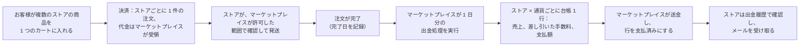
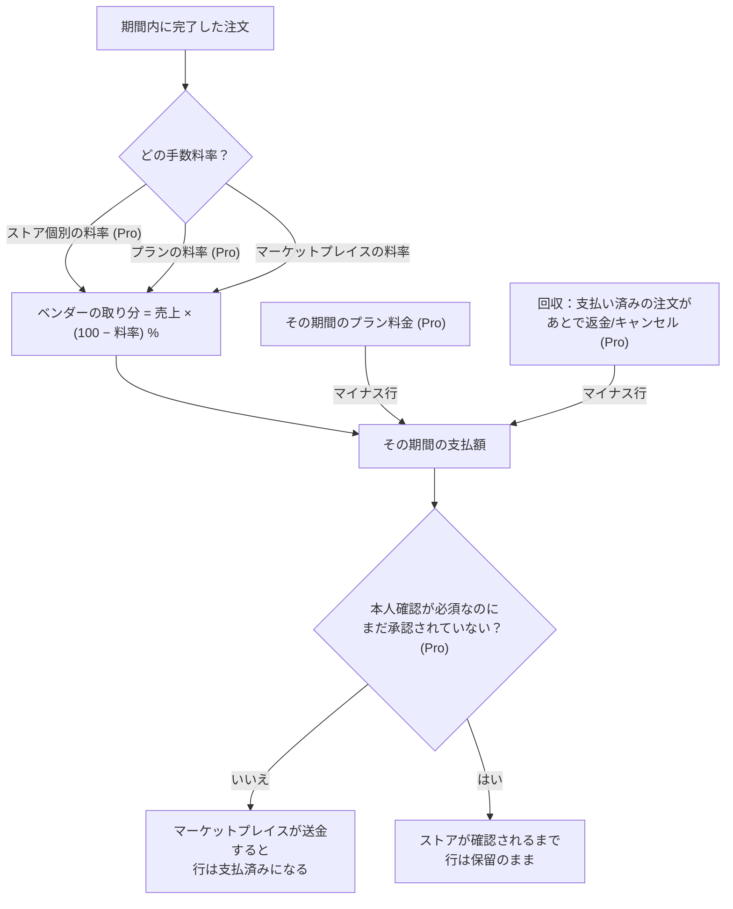
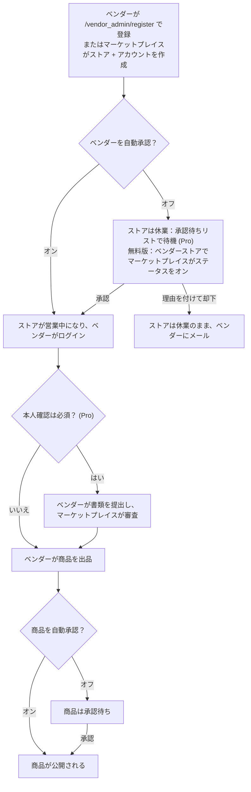
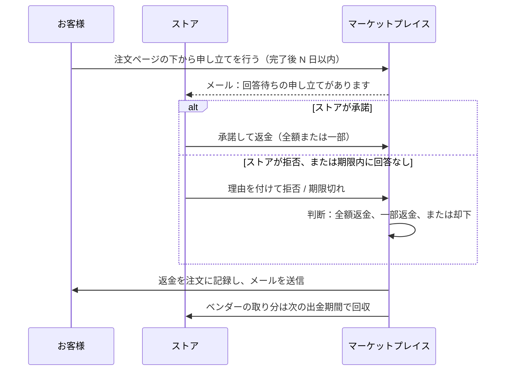

> 🌐 **言語:** [🇻🇳 Tiếng Việt](./multi-vendor-operations_vi.md) · [🇬🇧 English](./multi-vendor-operations.md) · 🇯🇵 日本語（現在）

# Multi-Vendor — 第 2 部：マーケットプレイスの運用

## はじめに
このドキュメントでは、**Multi-Vendor マーケットプレイスが実際にどう運用されるか** を説明します。誰が何をできるか、どの設定がどこにあるか、お金がお客様からベンダーへどう流れるか、そして操作の前に知っておくべき条件です。対象はマーケットプレイス運営者と運用スタッフです。読み終えると、ベンダーにマーケットプレイスを開放する前に何を設定すべきか、よくある状況（審査、出金、申し立て、返金）をどう処理するかがわかります。インストールについては [第 1 部 — インストール](./multi-vendor-setup_ja.md) をご覧ください。

**(Pro)** と書かれた機能を使うには、無料版に加えて Pro 版をインストールする必要があります。

## URL と主な画面

| 役割 | URL / 場所 |
| --- | --- |
| ストア一覧（お客様向け） | `/shop` — 名前、商品数、レビューで検索 |
| ストアページ（お客様向け） | `/shop/{コード}` — カバー画像、ロゴ、名前、商品数、レビュー、登録日、連絡先 + 3 つのタブ **商品** / **レビュー** / **ストア情報** |
| ストアごとのクイック注文 (Pro) | `/shop/{コード}/quick-order` — マーケットプレイスで「クイック注文」をオンにした場合 |
| ベンダー管理画面 | `/vendor_admin` |
| マーケットプレイスの管理 | S-Cart の管理画面、**マーケットプレイス** メニュー：ベンダーストア ・ ベンダーユーザー ・ クイック設定 ・ 支払い、さらに (Pro) の画面 レポート ・ 手数料レポート ・ 承認待ちリスト ・ 申し立て ・ ショッププラン |

## 4 つの主な流れ
次の 4 つの流れが、マーケットプレイスのお金と信頼を支えています。

**1. お客様のカートからベンダーの手元にお金が届くまで**

**2. ストアへの支払額の計算方法**

**3. ベンダーをマーケットプレイスに迎えるまで**

**4. お客様が注文について申し立てを行う (Pro)**

## 誰が何をできるか

### お客様
- 1 つのウェブサイトで全ストアの商品を閲覧して購入できます。**ストア一覧** は `/shop` です。各ストアには **専用ページ** があります：ブランドのヘッダー、バナー、**商品** タブ（ストア内検索、カテゴリの絞り込み、並べ替え）、**レビュー** タブ（そのストアが販売する全商品のレビュー。*Product Rating & Review* プラグインが必要）、**ストア情報** タブ。
- カート、お気に入り、比較、注文履歴など、S-Cart のお客様向け機能をすべて使えます。
- ストアごとの **クイック注文（B2B）**（Pro、マーケットプレイスでオンにした場合） — [代理店向け卸売](#代理店向け卸売-pro) をご覧ください。

### ベンダー
- 専用の管理画面 `/vendor_admin` にログインします（アカウントはマーケットプレイスの管理者アカウントとは別です）。
- **ダッシュボード**：注文数、商品数、顧客数。過去 30 日と月別の注文グラフ。
- **商品**：S-Cart の管理画面と同じように商品を作成・編集できます（単品、グループ、バリエーション）。商品は常に自分のストアに属します。
- 独自の **ストアのカテゴリ**、**バナー**、**仕入先**。
- **注文**：自分のストアの注文を確認（キーワード、ステータス、日付で絞り込み）。**配送ステータス** の更新、マーケットプレイスが許可した範囲での **注文の確認**、**配送業者 + 追跡番号** の入力、**納品書の印刷**。変更はすべて注文履歴に記録されます。
- **ストア情報**：名前、説明、ロゴ、カバー画像、住所、連絡先。
- **出金履歴**：累計売上、受取済み、残額。送金先と取引参照番号付きの期間ごとの明細。日付範囲を指定した Excel の **明細のエクスポート**（Pro）。
- **出金口座**（Pro）：方法（銀行振込 / PayPal / その他）、銀行、口座名義、口座番号 — **暗号化して保存** され、末尾の数桁だけが表示されます。
- 新しい注文が入ると **メールを受け取ります**。承認されたとき、マーケットプレイスが支払ったとき、調整があったときのメールも届きます（Pro）。
- ベンダー画面の Pro の画面：**マイプラン**、**本人確認**、**価格グループ**、**新規注文**、**レビュー**、**ストアのプラグイン**。

### マーケットプレイス運営者
- **ストア**（コード、名前、説明、営業/休業のステータス）と **ベンダーアカウント**（メールアドレス、パスワード、紐付けるストア、ステータス）の作成・編集。
- ベンダーの自己登録のオン/オフ。**新しいストア** と **新規/編集された商品** を自動承認するか手動承認するかの選択。
- マーケットプレイス共通の **手数料率** と **ストア個別の料率**（Pro）の設定。
- 期間ごとの **出金処理** と出金台帳の管理（ステータス、支払日、取引参照番号、メモ）。
- Pro の画面：**承認待ちリスト**、**申し立て**、**ショッププラン**、**レポート**、**手数料レポート**、**一括支払い**。
- S-Cart の管理画面から、全ストアの商品と注文を完全に管理できます。

## マーケットプレイスの設定
管理画面 → **マーケットプレイス** → **クイック設定** を開きます。マーケットプレイス単位の設定は **これですべて** です。

**キー** 列は `admin_config` テーブルの行名です。管理画面の外で値を確認・修正する必要があるとき（データベースのクエリ、アップグレード用スクリプト、サポート窓口とのやり取りなど）に使います。表示ラベルは言語によって変わりますが、キーは変わりません。

| 設定 | キー（`admin_config`） | 意味 | 初期値 | 版 |
| --- | --- | --- | --- | --- |
| 手数料率（%） | `MultiVendor_commission` | ベンダーに支払う前に、完了した注文の合計からマーケットプレイスが **差し引く** 割合 | 0 | Free |
| ベンダー登録を許可 | `MultiVendor_allow_register` | オン：誰でも `/vendor_admin/register` で自分で登録できます。オフ：アカウントは管理者だけが作成します | オフ | Free |
| ベンダーを自動承認 | `MultiVendor_vendor_auto_approve` | オフ：新しいストアは、管理者が営業中にするまで **承認待ち**（休業）になります | オフ | Free |
| 商品を自動承認 | `MultiVendor_product_auto_approve` | オフ：ベンダーが作成 **または編集** した商品は、管理者が承認するまでマーケットプレイスに表示されません | オフ | Free |
| 新規注文時にベンダーへメール送信 | `MultiVendor_mail_order_created` | ストアの注文が入ると、そのストアの有効なアカウント全員に送信します | オン | Free |
| クイック注文 | `MultiVendor_quick_order` | ストアごとの大量注文ページをオンにします | オフ | Pro |
| ベンダーの注文操作 | `MultiVendor_vendor_order_scope` | **配送ステータスのみ** ・ **確認 + 配送** ・ **確認 + 配送 + 完了**（注文は次の出金期間に入ります） | 確認 + 配送 | Pro（無料版は常に *確認 + 配送*） |
| ベンダーの本人確認（KYC）を必須にする | `MultiVendor_kyc_required` | オン：確認が済んでいないストアは **商品を公開できず**、出金行は保留になります | オフ | Pro |
| 申し立て受付期間（注文完了後の日数） | `MultiVendor_dispute_window_days` | お客様はこの日数の間だけ申し立てを行えます | 14 | Pro |
| ベンダーの回答期限（日数） | `MultiVendor_dispute_vendor_days` | 期限を過ぎてもストアが回答しない場合、申し立ては自動的にマーケットプレイスに引き継がれます | 3 | Pro |
| 審査待ち時に管理者へメール送信 | `MultiVendor_mail_pending_review` | 承認待ちのストアや商品があるとマーケットプレイスに通知します | オン | Pro |
| 承認時にベンダーへメール送信 | `MultiVendor_mail_vendor_approved` | ストアが営業中になったときにベンダーに通知します | オン | Pro |
| 出金完了時にベンダーへメール送信 | `MultiVendor_mail_payout_done` | 出金期間が支払済みになったときに通知します | オン | Pro |
| 出金調整時にベンダーへメール送信 | `MultiVendor_mail_payout_clawback` | 回収行が発生したときに通知します | オン | Pro |
| 申し立てのメール通知 | `MultiVendor_mail_dispute` | 申し立ての各段階で関係者に通知します | オン | Pro |
| ベンダーによる設定：… | `MultiVendor_vendor_plugin_<プラグインコード>` | マーケットプレイスがストアに設定を許可するプラグインごとに 1 行 | どのプラグインも開放しない | Pro |

> ⚠️ マーケットプレイスのメールは、S-Cart 共通のメール設定を通して送られます。システムの **メール送信のON/OFF** がオフの場合、上のフラグがオンでも **メールは 1 通も送信されません**。

ロックされたスイッチには、以前に保存した値ではなく **実際に動いている状態**（オフ / *配送ステータスのみ*）が表示されます。以前の値は残っており、Pro 版を有効にすると元に戻ります。

無料版では、Pro 専用のスイッチは説明とリンク付きで **ロック** された状態で表示されます。Pro の画面もメニューに残り、Pro 版を追加でインストールするまでは説明ページが開きます。

## ストアごとの設定
すべての設定がマーケットプレイス単位というわけではありません。次の表は **ストアごとに個別に** 設定するものと、設定する人です。

| 設定 | 設定する場所 | 設定する人 |
| --- | --- | --- |
| ストアのステータス（営業/休業） | マーケットプレイス → ベンダーストア | マーケットプレイス運営者 |
| ストア情報（名前、説明、ロゴ、カバー画像、住所、連絡先） | ベンダー画面 → ストア情報 | ベンダー |
| 個別の手数料（%） | マーケットプレイス → ストア → ストア設定 | マーケットプレイス運営者（Pro） |
| ショッププラン | マーケットプレイス → ストア → ストア設定（プランは *ショッププラン* で作成） | マーケットプレイス運営者（Pro） |
| ストアが自分で設定できるプラグイン | マーケットプレイスが **クイック設定** でチェックし、ベンダーが自分の画面で調整 | 運営者が開放し、ベンダーが調整（Pro） |
| 出金口座（銀行、口座名義、口座番号） | ベンダー画面 → 出金履歴 | ベンダー（Pro） |
| 代理店向けの価格グループと割引率 | ベンダー画面 → 価格グループ | ベンダー（Pro） |
| ストアのバナー、独自のカテゴリ | ベンダー画面 → バナー / カテゴリ | ベンダー |

ストアを休業にすると、ベンダーはログインできず、ストアページもお客様に表示されません。

## お金：手数料、プラン、出金

### 手数料は順番に決まる
期間を台帳に記録するたびに、システムは次の順に確認します。

1. **ストア個別の料率**（Pro） — *マーケットプレイス → ストア → ストア設定* で設定します。0〜100 の数値で、空欄なら設定なしです。
2. ストアが利用している **プランの料率**（Pro）。プランがある場合のみです。
3. クイック設定の **マーケットプレイス共通の料率**。

先に見つかったものが適用されます。これにより、同じマーケットプレイスで、重要な代理店は 5%、新しいベンダーは 15% といった設定ができます。**新しい料率は、変更後に処理する期間** から、その期間のすべての注文に適用されます。区別したい場合は、現在の期間の出金処理を先に実行してから変更してください。

### ベンダーへの支払いの流れ
1. **注文が「完了」ステータスである必要があります。** 注文が完了になると、システムは完了日を記録します。完了から別のステータスに戻すと、この日付は消えます。
2. **マーケットプレイスが処理を実行します。** **マーケットプレイス** → **支払い** を開き、**処理日** を入力して処理ボタンをクリックします。
3. **システムが集計して台帳に記録します。** 完了日が処理日以前（かつ前回処理した期間より後）の完了した注文を、すべて **ストア別・通貨別** に集計します。グループごとに、そのストアの手数料率を取得し、台帳に 1 行を作成します：注文数、売上合計、ベンダーの取り分（= 100 − 手数料）、**支払額** = 売上合計 × ベンダーの取り分。支払額は **通貨の小数桁に合わせて丸められます**（VND は小数なし、USD は小数 2 桁）。ベンダーが登録した送金先も記録されます。
4. **マーケットプレイスが送金して記録します。** 台帳の情報に従ってシステム外で送金したあと、台帳の行を修正します：ステータスを支払済み、**取引参照番号**、メモ。システムが支払日と記録した人を残します。ベンダーにはメールが届き、**出金履歴** で結果を確認できます。

> 例：手数料 10%、ストア A に期間内の完了注文が 3 件で合計 5,000,000 VND → 台帳の記録：3 件、合計 5,000,000、取り分 90%、支払額 **4,500,000 VND**。

### 一括支払い (Pro)
1 つのバッチ = （処理日、通貨）です。プレビュー画面には、ストア数、合計金額、そして **除外された一覧とその理由**（本人確認が未完了 ・ 出金口座が未登録 ・ 金額がプラスでない ・ 支払済み）が表示されます。**銀行振込ファイル**（CSV/Excel）をダウンロードし、銀行で振り込んでから、**1 つの参照番号でバッチ全体を支払済みとして記録** します。双方は日付範囲を指定した **Excel 明細** で照合します。

振込ファイルには実際の口座番号が含まれるため、**ダウンロードできるのは管理者アカウントだけで、ダウンロードのたびにログが記録されます**。

> プラグインは銀行のゲートウェイを通じて **自動で送金することはありません**。振込ファイルの準備と台帳の記録を行うだけです。送金はあなたが銀行で行います。

### ショッププラン (Pro)
**ショッププラン** メニューで作成します。各プランには、商品数の上限（空欄 = 無制限）、プラン独自の手数料（空欄 = マーケットプレイスに従う）、**期間料金**（月または年）と通貨、そして *デフォルトプラン* のフラグと *ベンダーが選択可能* のフラグがあります。

- マーケットプレイスはストア設定画面で **プランを割り当てます**。期間はすぐに始まります。
- **プラン料金は別途請求しません**。システムはストアの出金台帳に **マイナス行** を記録し、**次の出金期間で相殺** します。請求書の発行も督促もありません。
- **期間が終わっても自動更新されません**。マーケットプレイスが *更新* をクリックする（新しい期間、新しい料金）まで、ストアはデフォルトプランに戻ります。
- 商品数の上限に達すると、ベンダーは **新しい商品を追加できません**。既存の商品は編集できます。
- *ベンダーが選択可能* をオンにすると、ベンダーは **マイプラン** でプランの一覧を見て、自分で変更できます。

### 支払い済みの注文が返金またはキャンセルされたときの回収 (Pro)
- マーケットプレイスが **お金の返還を求めることはありません**。システムは、その注文でベンダーが受け取った取り分とちょうど同じ額の **回収行（マイナス）** を記録し、**次の期間で相殺** します。料率は現在の料率ではなく、**支払い済みの期間** の料率です。
- **一部返金** では、該当する分だけ調整します。そのあと残りを返金した場合は、差額だけを追加で回収します。
- **注文が再開された場合**：まだ相殺されていない回収行は取り消されます。すでに相殺済みの場合は、**取消** 行（プラス）を記録します。
- 調整行はすべて、出金履歴、明細、手数料レポートにはっきり表示されます。

## 信頼：審査、申し立て、本人確認

### ベンダーと商品の審査
無料版では、ストア一覧と商品一覧から審査します。Pro 版では **承認待ちリスト** が追加されます。承認待ちの新しいストア、承認待ちの商品、審査待ちの本人確認書類の 3 つを 1 つの画面にまとめたものです。承認または却下には **理由が必須** で、判断は **ログに記録** され、ベンダーにメールで通知されます。項目がリストに戻ってきたときは、「前回の却下」列が表示されます。

### 2 段階の申し立て (Pro)
- **ログインした** お客様は、自分の注文ページのすぐ下から申し立てを行えます：問題の種類を選び、10 文字以上で内容を書き、希望の返金額（任意）を入力します。対象は、キャンセル・返金されておらず、支払い済みまたは完了した注文で、**注文完了後 N 日以内**（初期値 14）に限られます。1 件の注文で進行中の申し立ては 1 件だけです。ベンダーが回答する前なら、お客様は取り下げられます。
- **まずベンダーが** N 日以内（初期値 3）に回答します：*承諾して返金*（全額または一部、返金可能額を超えない範囲）または、理由を付けて *拒否* ⇒ マーケットプレイスに引き継がれます。期限内に回答がない場合は ⇒ **自動的にマーケットプレイスに引き継がれます**（画面を開いたときにチェックされるため、cron は不要です）。
- **最終的な判断はマーケットプレイスが** **申し立て** メニューで行います：全額返金 / 一部返金 / 却下。メモの入力は必須です。
- 返金の判断は **注文の台帳に直接記録されます**（全額返金の場合、注文は *返金済み* になります）。**ベンダーの取り分は次の期間で自動的に回収されます**。お客様への返金は、マーケットプレイスが元の支払い方法で行います。ベンダーへの支払いと同じく、システムの外で行います。

### 本人確認 — KYC (Pro)
- ベンダーは **本人確認** メニューから **テキスト形式の書類** を提出します（個人または法人：正式名称、税務番号または身分証明書番号 — **暗号化して保存**、代表者、住所、メモ）。書類の画像をアップロードする必要はありません。
- マーケットプレイスは承認待ちリストの **本人確認** タブで審査します。却下には 5 文字以上の理由が必要で、ベンダーは再提出できます。
- **本人確認を必須にする** フラグがオンのとき、承認されていないストアは、**商品を公開できず**（マーケットプレイスが商品の自動承認をオンにしていても）、**出金行は保留になります**（金額は台帳に記録されますが、まだ支払われません）。
- 承認されたストアには、ストアページ、ストア一覧、マーケットプレイスの一覧で **「確認済み」バッジ** が表示されます。フラグをオフにすると何もブロックされませんが、バッジは表示されたままです。

## 代理店向け卸売 (Pro)

### クイック注文
各ストアの `/shop/{コード}/quick-order` ページで、**クイック注文** スイッチでオンにします。

- SKU/商品名、またはストアのカテゴリで検索し、複数の商品の数量を一度に入力できます。
- お客様のファイルから **「SKU, 数量」のリストを貼り付け** られます。
- そのストアでのお客様自身の **過去の注文から再注文** できます（ログインが必要です）。
- **Excel の見積書を出力** できます。

システムはカートに追加する前に各行をチェックし、**すべての行が有効な場合にだけ追加します**。エラーのある行は、SKU ごとに理由とともに表示されます。

### 代理店向けの価格グループ
- 各ストアは自分で **価格グループ**（ストアの全商品に対する 1 つの割引率）を作成し、**お客様のアカウントを 1 件ずつ** グループに割り当てます。
- 割引は **（お客様、商品のストア）の組み合わせ** に属します。ストア A の代理店は、同じカートで購入しても、ストア B の商品では割引を **受けられません**。
- どのグループにも属さないお客様は **一般のお客様** です。代理店価格は **公開されません**。
- **プロモーションとは併用されません** — お客様は 2 つの価格のうち **安いほう** を支払います。
- 価格はショップの層で計算されるため、商品ページ、商品一覧、クイック注文、カート、決済、見積書の価格は **常に一致します**。

### ベンダーによるお客様の代理注文
ベンダー画面の **新規注文** 画面：お客様を選び、自分のストアの商品を追加すると、価格が **そのお客様のグループに合わせて自動入力** されます。電話や対面で受けた注文に使います。

## ベンダーのセルフサービス (Pro)
- **マイプラン**：利用中のプラン、使用中の商品数 / 上限、料金と有効期限を確認できます。マーケットプレイスが許可していれば、自分でプランを変更できます。
- **ストアのプラグイン**：**マーケットプレイスがチェックして開放した** プラグインのオン/オフと、パラメーター（例：送料、送料無料の基準額）の **独自設定** ができます。変更していない値はマーケットプレイスの初期値を継承し、初期値に戻すボタンもあります。**決済ゲートウェイは決して開放されません** — 代金はマーケットプレイスが受け取り、ベンダーは決済キーを入力しません。マーケットプレイスの秘密情報はベンダー画面に表示されません。
- **レビュー**：自分のストアが販売する商品のレビューを読み、**公開で返信** できます（*Product Rating & Review* プラグインが必要）。レビューの承認、却下、削除は引き続きマーケットプレイスが行います。

## レポート (Pro)
- **レポート**：日付 / ストア / ステータスで絞り込み、注文数によるストアのグラフ、Excel 出力。
- **手数料レポート**：期間（今月 / 先月 / 四半期 / 年 / カスタム）と **集計基準** — *完了した注文*（出金台帳と一致）または *受け付けた注文*（売上） — を選びます。ストア × 通貨ごとに、注文数、売上、適用中の手数料率、マーケットプレイスの取り分、ベンダーへの支払額、**支払済み**（台帳による）、**未払い** が表示されます。1 つのストアを選ぶと月別に表示します。Excel で出力できます。

## 条件と制約（操作の前に確認）

**ベンダーが商品を出品するとき**
- **マーケットプレイスが「商品を自動承認」をオフにしている場合、商品は常に未承認の状態で保存されます**。ベンダー自身が承認にチェックしても同じです — 最終的な審査の権限はマーケットプレイス運営者にあります。
- **却下された商品は未承認のままです**。ベンダーが編集して保存し直すと、再び審査に回ります。前回の却下理由は管理者に表示されます。
- **プランの商品数の上限に達すると（Pro）、新しい商品は追加できません**。既存の商品は編集できます。

**審査するとき**
- **却下には 5 文字以上の理由が必要です** — 理由はメールでベンダーに送られ、記録として残ります。
- **ストアを却下してもストアは削除されません** — ストアは休業のまま残り、管理者はあとで再承認するか、手動で削除できます。
- **ベンダーはストアの通貨/言語を変更できません** — マーケットプレイス全体で価格と税金をそろえるためです。

**ストア個別の手数料を設定するとき (Pro)**
- **0 から 100 までの数値だけを受け付けます** — マーケットプレイスが差し引く割合です。それ以外の値は拒否されます。
- **新しい料率は、変更後に処理する期間から** その期間のすべての注文に適用されます — 区別したい場合は、現在の期間の出金処理を先に実行してから変更してください。

**ベンダーが注文を処理するとき**
- **マーケットプレイスが許可した範囲でしかステータスを変更できません**（初期値：新規/保留 → 処理中） — ベンダーが自分で注文を出金期間に入れたり、お金や在庫を動かしたりするのを防ぐためです。
- **ベンダーは、確定した注文のキャンセル、返金、再開を決して行えません** — これらの操作はお金と在庫を変えるため、マーケットプレイスだけが行えます。
- **キャンセル/返金された注文では、配送情報や配送ステータスを変更できません** — 注文はすでにベンダーの手を離れています。
- **配送業者と追跡番号は最大 100 文字、メモは 255 文字です** — どの配送業者のコードにも十分な長さです。

**出金を処理するとき**
- **集計されるのは完了した注文だけです** — まだキャンセルや返金の可能性がある注文に支払わないためです。
- **処理日は今日より前である必要があります** — その日の注文がすべて確定しているようにするためです。
- **処理済みの日付は再処理できません** — 同じ注文を二重に記録しないよう、システムがブロックします。
- **支払額は通貨の小数桁に合わせて丸められます**（VND：整数、USD：小数 2 桁） — S-Cart が注文金額を保存する方法と一致させるためです。
- **送金はマーケットプレイスがシステムの外で行います**。ベンダーが登録した情報に従います — プラグインは出金ゲートウェイを通じて自動で送金しません。
- **本人確認が済んでいない（KYC がオンの場合）、または出金口座が未登録のストアは、一括支払いから除外されます** — プレビュー画面に理由が表示されます。

**お客様がクイック注文をするとき (Pro)**
- **すべての行が有効な場合にだけカートに追加されます** — エラーのある行は SKU ごとに理由とともに表示されます。代理店には正確なリストが必要なため、行が欠けたカートは受け付けません。
- **数量は 1 以上の整数で、商品の「最小数量」を下回れません** — 最小数量はベンダーが商品ごとに設定します。
- **在庫を超えて注文できません**（ストアが在庫管理をオンにし、「在庫切れでも購入を許可」をオフにしている場合）。
- **そのストアの商品だけが対象です** — 他のストアの SKU は「このストアの商品ではありません」と表示されます。
- **過去の注文からの再注文は、そのストアでのお客様自身の注文だけが対象です**（ログインが必要）。販売終了した行はスキップしたと表示されます。

**お客様が申し立てを行うとき (Pro)**
- 対象は **自分の注文** で、キャンセル・返金されておらず、支払い済みまたは完了しており、**完了後 N 日以内** のものに限られます。
- **1 件の注文で進行中の申し立ては 1 件だけです**。ベンダーが回答する前なら、お客様は取り下げられます。
- **マーケットプレイスの最終判断にはメモが必須です** — あとで双方が照合するときの根拠にするためです。

**ベンダーがプラグインを設定するとき (Pro)**
- ベンダー画面に表示されるのは **マーケットプレイスがチェックして開放したプラグインだけ** です。**決済プラグインは決して開放されません**。
- **変更はすべてベンダー自身のストアにだけ適用されます**。変更していない値はマーケットプレイスの初期値を継承し、「デフォルトを使用」ボタンで元に戻せます。
- **マーケットプレイスの秘密情報はベンダー画面に表示されません** — パスワード/キーの欄が空なのは、共通の設定を使っているという意味です。

**マーケットプレイスがショッププランを使うとき (Pro)**
- **プラン料金は出金台帳のマイナス行として記録され**、次の期間で相殺されます。別途の請求はありません。
- **期間が終わっても自動更新されません**：マーケットプレイスが *更新* をクリックするまで、ストアはデフォルトプランに戻ります。
- ベンダー自身によるプラン変更は、次の 3 つの場合に拒否されます：プランが選択可能になっていない、料金支払い済みの期間中である（二重請求を防ぐため）、現在の商品数より上限が低いプランに下げようとしている。

## よくある質問（Q&A）
**Q1: 出金処理を実行しても、行が 1 つも作成されません。**

→ 次の 3 点を確認してください：注文が完了ステータスになっているか、完了日が処理日以前か、その日付がすでに処理済みでないか。

**Q2: ストアごとに異なる手数料を設定するにはどうすればよいですか？**

→ マーケットプレイス → ストア → ストア設定 で、**ストア手数料（%）** を入力します（Pro）。空欄ならマーケットプレイスの料率に従います。ベンダーは適用中の料率を出金履歴で確認できます。

**Q3: あるストアに個別の手数料を設定しましたが、そのストアにはプランもあります。どちらが適用されますか？**

→ ストア個別の料率が優先されます。順番は、個別の料率 → プランの料率 → マーケットプレイスの料率です。

**Q4: ベンダーに支払ったあとで注文が返金された場合はどうなりますか？**

→ システムは、ベンダーが受け取った取り分とちょうど同じ額（支払い済みの期間の料率による）の回収行を記録し、次の期間で相殺します。あなたがお金を取り戻す必要はありません。

**Q5: マーケットプレイスで複数の通貨を扱う場合、出金台帳はどうなりますか？**

→ 台帳は注文の通貨ごとに行を分けます。累計も通貨ごとに表示されます。一括支払いも通貨ごとに分かれます。

**Q6: ベンダーは注文の何を変更できますか？**

→ 配送ステータス、クイック設定でマーケットプレイスが設定した範囲での注文の確認、配送業者と追跡番号、納品書の印刷です。キャンセル、返金、注文の再開、支払いステータスはマーケットプレイス運営者が処理します。

**Q7: 「ベンダーの本人確認（KYC）を必須にする」をオンにすると、既存のベンダーもブロックされますか？**

→ はい。新旧を問わず、確認が済んでいないストアはすべて、新しい商品の公開がブロックされ、出金行が保留になります。事前にベンダーに知らせ、書類を速やかに審査してください。

**Q8: 代理店価格が他のお客様に見えてしまうことはありますか？**

→ いいえ。割引は、そのストアでグループに割り当てられたお客様のアカウントにだけ適用され、お客様がログインしたときにだけ表示されます。

**Q9: 振込ファイルで自動的に送金されますか？**

→ いいえ。プラグインは銀行にアップロードするためのファイルを作成します。銀行での送金が終わったら、1 つの参照番号でバッチ全体を支払済みとして記録します。

**Q10: 新しい注文が入ると、ベンダーにメールが届きますか？**

→ はい。ストアの有効なアカウント全員にメールが届きます。S-Cart の **メール送信のON/OFF** と、クイック設定の該当するフラグをオンにしておく必要があります。

---

⬅️ [第 1 部 — インストール](./multi-vendor-setup_ja.md) · [目次](./multi-vendor_ja.md) · [第 3 部 — カスタマイズ](./multi-vendor-customize_ja.md) ➡️

---

📅 **最終更新:** 2026-10-22 · ✍️ **作成者 (Author):** GP247
