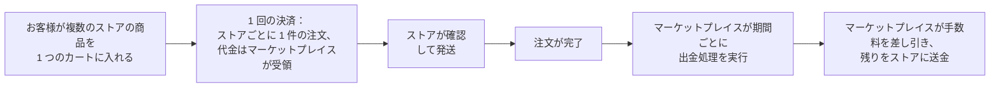

> 🌐 **言語:** [🇻🇳 Tiếng Việt](./multi-vendor_vi.md) · [🇬🇧 English](./multi-vendor.md) · 🇯🇵 日本語（現在）

# Multi-Vendor — S-Cart 向けの複数ベンダー型マーケットプレイス

> 🚀 **Link MultiVendor PRO:** [https://gp247.net/en/product/multi-vendor-pro.html](https://gp247.net/en/product/multi-vendor-pro.html)

## はじめに
このドキュメントでは **Multi-Vendor** を紹介します。S-Cart のウェブサイトを **1 つのドメインで動く複数ベンダー型の EC マーケットプレイス** に変えるプラグインです。多くのベンダー（出店者）が 1 つのストアフロントに商品を出品し、お客様は複数のストアの商品を 1 回の決済でまとめて購入できます。代金はマーケットプレイスが受け取り、手数料を差し引いてからベンダーに支払います。対象は、マーケットプレイスの開設を検討している **事業者と S-Cart サイトの運営者** です。このページを読むと、プラグインでできること、無料版でできる範囲、Pro 版で追加される機能、そして Multi-Vendor と Multi-Store の違いがわかり、最初から正しいモデルを選べます。

このページは Multi-Vendor ドキュメントセットの **目次ページ** です。残りの 3 部で、インストール、運用、カスタマイズを詳しく説明します。

## ドキュメント一覧（目次）

| 部 | 内容 | 対象 |
| --- | --- | --- |
| **このページ** | マーケットプレイスのモデル、プラグインでできること、Free/Pro の比較、Multi-Store との比較 | マーケットプレイスの開設を検討している方 |
| [第 1 部 — インストール](./multi-vendor-setup_ja.md) | S-Cart のインストール、無料プラグインのインストール、Pro 版の追加インストール、最初のストアの作成、URL の変更、トラブルシューティング | ウェブサイトをインストールする方 |
| [第 2 部 — 運用](./multi-vendor-operations_ja.md) | マーケットプレイスの設定、手数料とプラン、ベンダーへの支払いの流れ、審査、申し立て、本人確認、レポート、条件と制約 | マーケットプレイス運営者と運用スタッフ |
| [第 3 部 — カスタマイズ](./multi-vendor-customize_ja.md) | 表示テキストとメール内容の変更、ストアページのデザイン変更、スタッフの権限設定、安全にアップデートするための原則 | 管理者と開発者 |

> 👉 実際に動いているマーケットプレイスをデモサイトで試せます：**https://m-vendor.s-cart.org**

## モデル：1 つのドメインに 1 つのマーケットプレイス
マーケットプレイスの動き方は、次の 5 つの点で決まります。

1. **すべてのベンダーで 1 つのストアフロントを共有します。** すべてのストアの商品が、あなたのウェブサイトにまとめて表示されます。各ストアには `/shop/{コード}` に専用ページがあり、カバー画像、ロゴ、独自のカテゴリ、そして「商品」・「レビュー」・「ストア情報」の 3 つのタブがあります。ストア一覧は `/shop` にあります。
2. **カートはストアごとに分かれます。** お客様は複数のストアの商品を 1 つのカートに入れて 1 回で支払います。システムが自動的に **ストアごとに 1 件の注文** に分けます。
3. **代金はマーケットプレイスが受け取ります。** 決済ゲートウェイを設定できるのはマーケットプレイス運営者だけです。ベンダーは決済キーを入力せず、お客様から直接代金を受け取ることもありません。
4. **マーケットプレイスは期間ごとにベンダーへ支払います。** 運営者は定期的に出金処理を実行します。システムが各ストアの **完了した** 注文を集計し、手数料を差し引いて、支払うべき金額を台帳に記録します。
5. **通貨と言語はマーケットプレイスに従います。** ストアはマーケットプレイスと同じ通貨と言語を使います。これにより、ウェブサイト全体で価格と税金がそろいます。

ベンダーには `/vendor_admin` に **専用の管理画面** があり、マーケットプレイスの管理画面とは完全に分かれています。ベンダーに見えるのは、自分のストアの商品、注文、数値だけです。

## プラグインでできること

**お客様向け** — 本物のマーケットプレイスと同じように買い物できます。1 つのウェブサイトで全ストアの商品を閲覧し、ストア一覧を見て、各ストアの専用ページを開き、レビューを読み、複数のストアの商品を 1 つのカートに入れて 1 回で支払えます。

**ベンダー向け** — 充実した管理画面があります。注文グラフ付きのダッシュボード、商品の管理、独自のカテゴリとバナー、自分のストアの注文処理（注文の確認、配送ステータスの更新、追跡番号の入力、納品書の印刷）、出金口座の登録、支払い履歴の確認ができます。

**マーケットプレイス運営者向け** — お金と権限を握ります。誰が出店できるか、どの商品を公開するかを決め、手数料率を設定し、期間ごとの出金を実行し、ストア別のレポートを確認できます。S-Cart の管理画面から、全ストアの商品と注文を完全に管理できます。

Pro 版では、出店者が増えたときに必要なツールが追加されます。期間ごとに料金がかかるショッププラン、返金された注文の回収、申し立ての対応窓口、本人確認、一括支払い、手数料レポート、代理店向けの卸売です。

### 機能一覧（分野別）
**Pro** と書かれた機能を使うには、無料版に加えて有料プラグインをインストールする必要があります。

**マーケットプレイスでの販売**

| 機能 | 内容 | 版 |
| --- | --- | --- |
| ストア一覧とストアページ | `/shop` にすべてのストアを表示します。各ストアには `/shop/{コード}` に専用ページがあり、カバー画像、ロゴ、バナー、独自のカテゴリ、「商品」・「レビュー」・「ストア情報」の 3 つのタブがあります | Free |
| 商品へのベンダー表示 | 商品カードに、その商品を販売しているストアの名前とアイコンを表示します | Free |
| ストアごとのカート分割 | お客様は複数のストアの商品を 1 回の決済で購入できます。システムはストアごとに別々の注文を作成します | Free |
| 公開の信頼指標 | 申し立て率、発送準備にかかる時間、申し立て回答率、レビューを表示します。過去 90 日間で計算し、注文数が足りないストアでは表示しません | Free |
| 代理店向け卸売 | ストアごとのクイック注文ページ（「SKU, 数量」のリストを貼り付け、過去の注文を再注文、Excel の見積書を出力）。代理店向けの価格グループは各ストアが自分で設定します。ベンダーはお客様に代わって、そのお客様の価格で注文を作成できます | Pro |

**お金の流れ**

| 機能 | 内容 | 版 |
| --- | --- | --- |
| マーケットプレイスが代金を受領 | 決済ゲートウェイを設定できるのは運営者だけです。ベンダーはお客様から直接代金を受け取りません | Free |
| 期間ごとの出金台帳 | 完了した注文を期間ごとに集計します：手数料差し引き後の支払額、ベンダーの出金口座、取引参照番号 | Free |
| マーケットプレイス共通の手数料 | すべてのストアに 1 つの料率を適用します | Free |
| ストア個別の手数料 | 次の順に決まります：ストア個別の料率 → プランの料率 → マーケットプレイスの料率 | Pro |
| ショッププラン | 商品数の上限、プラン手数料、そして次回の出金から直接差し引かれる期間料金。手数料に次ぐ 2 つ目の収入源になります | Pro |
| 一括支払い | 複数のストア分をまとめた 1 つの銀行振込ファイル、双方が照合するための Excel 明細 | Pro |
| 自動回収 | 支払い済みの注文が返金またはキャンセルされると、マイナスの調整行を作成し、次の期間で相殺します | Pro |
| レポート | ストア別の注文、ストア別・期間別の手数料、Excel 出力 | Pro |

**管理と運用**

| 機能 | 内容 | 版 |
| --- | --- | --- |
| ベンダー専用の管理画面 | `/vendor_admin`：ダッシュボード、商品、カテゴリ、バナー、仕入先、注文、ストア情報、支払い履歴 | Free |
| ベンダーと商品の審査 | ベンダーの自己登録を許可または禁止します。ストアと商品ごとに、自動承認か手動承認かを選べます | Free |
| 承認待ちリスト | ストア、商品、本人確認書類を 1 つの画面に集めます。却下には理由が必須で、ログに記録されます | Pro |
| ベンダーの注文操作の範囲 | 運営者が選びます：配送ステータスのみ ・ 注文の確認まで ・ 注文の完了まで | Pro（Free は確認 + 配送まで） |
| 2 段階の申し立て | お客様は注文ページのすぐ下から申し立てを行えます。まずベンダーが回答し、最後にマーケットプレイスが判断します。返金は注文に直接記録されます | Pro |
| 本人確認（KYC） | 書類は暗号化して保存され、「確認済み」バッジが付きます。確認が完了するまで、商品の公開を止めたり出金を保留したりもできます | Pro |
| ベンダーによるプラグイン設定 | 配送、プロモーションなどを、マーケットプレイスが開放した範囲で設定できます。決済ゲートウェイは常にマーケットプレイスのものです | Pro |
| メール通知 | Free：新しい注文が入るとベンダーにメールが届きます。Pro：ストアの承認、出金、調整、申し立てのメールと、マーケットプレイス向けの承認待ち通知が加わります | Free ・ Pro |

## 無料版と Pro 版の比較
**Pro を購入するのは** マーケットプレイス運営者です。ベンダーとお客様は何も支払わず、アップグレードの案内を目にすることもありません。無料版は、各 Pro 機能がどこに入るかを運営者にだけ示し、クリックすると説明ページが開きます。

無料版は **最大 3 ストアまで実際に動くマーケットプレイス** です。Pro 版は、無料版の **上に追加で** インストールする 2 つ目のプラグインです。インストールすると、ロックされていた入口がそのまま実際の画面になります。再インストールもデータ移行も不要です。

| | **無料版** | **Pro 版** |
| --- | --- | --- |
| ストア数 | 最大 3 | 無制限 |
| ストアページ、ストア一覧、信頼指標、ストアごとのカート分割 | あり | あり |
| 手数料 | マーケットプレイス共通の 1 つの料率 | + **ストア個別の料率** とプランの料率 |
| ショッププラン（商品数の上限、プラン手数料、出金から差し引く期間料金、ベンダー自身によるプラン選択） | — | あり |
| 期間ごとの出金台帳 | あり | + ベンダーの **出金口座**（暗号化）、双方の **Excel 明細**、**一括の銀行振込ファイル**、バッチ全体の支払済み記録を 1 回で |
| 出金後の回収（支払い済みの注文が返金・キャンセルされた場合） | — | 自動、次の期間で相殺 |
| マーケットプレイス経由の申し立て / 返金リクエスト | — | 2 段階の窓口：ベンダーが回答し、マーケットプレイスが判断し、返金は注文に記録 |
| ベンダーの本人確認（KYC） | — | 暗号化された書類、確認済みバッジ、商品と出金の保留（任意） |
| 審査 | ストア一覧と商品一覧から | ストア、商品、本人確認書類をまとめた **承認待ちリスト**。却下には理由が必須でログに記録 |
| ベンダーによる注文処理 | 配送ステータス | + 運営者が選んだ範囲で確認 / 完了 |
| ベンダーによるお客様の注文作成 | — | あり。価格はお客様の価格グループから自動入力 |
| 代理店向けの価格グループ（顧客グループ別の割引） | — | あり。ログインしたお客様には自分の価格だけが表示されます |
| ベンダーによる自分のストアのレビューへの返信 | — | あり（Product Rating & Review プラグインと併用） |
| マーケットプレイスが開放したプラグインのベンダー設定（配送、プロモーションなど） | — | あり。決済ゲートウェイは常にマーケットプレイスのもの |
| ストアごとの B2B クイック注文 | — | あり |
| ストア別の注文レポートと期間別の手数料レポート、Excel 出力 | — | あり |
| メール | ベンダー：新しい注文 | + ストアの承認、出金完了、回収、本人確認の結果、申し立ての各段階。マーケットプレイス：承認待ち |
| サポート | コミュニティ | GP247 の有料チャネル |

無料版の上に Pro 版をインストールする方法は [第 1 部 — インストール](./multi-vendor-setup_ja.md) をご覧ください。

> 🚀 **Link MultiVendor PRO:** [https://gp247.net/en/product/multi-vendor-pro.html](https://gp247.net/en/product/multi-vendor-pro.html)

## Multi-Vendor と Multi-Store の違い
どちらのプラグインも「複数のストア」を扱いますが、**ビジネスモデルがまったく異なります**。また、1 つのウェブサイトに **一緒にインストールすることはできません**（ストアのデータが壊れないよう、システムが防ぎます）。最初から正しいほうを選んでください。

| 項目 | 🛒 **Multi-Vendor** | 🏢 **Multi-Store** |
|---|---|---|
| 商品の持ち主 | あなたのマーケットプレイスで販売する **複数の独立したベンダー** | **1 人の所有者** — あなた自身の会社 |
| モデル | EC マーケットプレイス | 同じ所有者のストアチェーン / 複数ブランド |
| ドメイン | **1 つのドメインだけ**。各ストアは `/shop/{コード}` のページ | **ストアごとに独自のドメイン** |
| 商品を出品する人 | 各ベンダーが自分で出品し、マーケットプレイスが承認 | あなたが出品し、どのストアに属するかを選択 |
| お金の流れ | マーケットプレイスが代金を受け取り、**手数料を差し引いて**、期間ごとにベンダーへ支払い | 代金はあなたの会社に直接入り、誰とも分けない |
| 管理画面にログインする人 | ベンダーは専用の `/vendor_admin` を使い、自分のストアだけを見る | あなた（Pro 版では各ストアの管理者も） |
| 向いているケース | **他の人を招いて** 販売してもらい、手数料を得たい | **1 つの会社** のために複数のウェブサイト/ドメインがほしい |

ひと言でいうと、**Multi-Vendor は多くのベンダーのための市場、Multi-Store はあなた自身の複数のストア** です。商品がすべて自社のもので、複数のドメインが必要なだけなら、Multi-Store を使ってください：[gp247.net/en/product/multi-store-pro.html](https://gp247.net/en/product/multi-store-pro.html)。

> ⚠️ **Multi-Vendor と Multi-Store は同時に使えません。** Multi-Store があるサイトでは、インストーラーは Multi-Vendor のインストールを拒否し（逆も同じ）、何かを書き込む前に停止します。モデルを切り替えるには、先にもう一方のプラグインをアンインストールしてください。

## システム要件
- PHP **8.3** 以上、Composer、MySQL/MariaDB。
- S-Cart **3.x**（`gp247/core` **3.0** と `gp247/shop` がインストール済み）。
- 同じウェブサイトに Multi-Store プラグインが **インストールされていない** こと。
- 一般的な共有ホスティングで動作します。cron、キューワーカー、WebSocket は **不要** です。

## よくある質問（Q&A）
**Q1: Multi-Vendor と Multi-Store はどこが違いますか？**

→ Multi-Store は、ストアごとに 1 つのドメインを持ち、商品はすべてあなたのものです。Multi-Vendor は、1 つのドメインに 1 つの共通マーケットプレイスがあり、外部のベンダーが登録して販売します。代金はマーケットプレイスが受け取り、手数料を差し引いてから支払います。詳しい比較表は上の項目にあります。2 つのプラグインは一緒にインストールできません。

**Q2: ベンダーは自分のウェブサイトやドメインを持てますか？**

→ いいえ。すべてのストアはマーケットプレイスのドメイン上にあり、`/shop/{ストアコード}` でアクセスします。

**Q3: お客様の代金は誰が受け取りますか？**

→ マーケットプレイスです。ベンダーは決済ゲートウェイのキーを入力しません。マーケットプレイスが手数料を差し引いたうえで、期間ごとにベンダーへ支払います。[第 2 部 — 運用](./multi-vendor-operations_ja.md) をご覧ください。

**Q4: 無料版で始めて、あとから Pro に移行すると何か失いますか？**

→ いいえ。Pro は無料版の上に追加でインストールします。ストア、ベンダーアカウント、注文、出金台帳はそのまま残ります。以前に設定したストア個別の手数料率も保存されており、Pro をインストールした時点で有効になります。

**Q5: ベンダーやお客様がアップグレードの案内を目にすることはありますか？**

→ いいえ。Pro の項目が見えるのはマーケットプレイスの管理者だけです。ベンダーが Pro 機能に触れた場合は、その機能がマーケットプレイスの Pro 版に含まれること、そしてマーケットプレイスに依頼するよう案内が表示されるだけです。

**Q6: マーケットプレイスには cron や高性能なサーバーが必要ですか？**

→ いいえ。プラグインは一般的な共有ホスティングで動作し、cron、キューワーカー、WebSocket は不要です。期限のある処理（たとえば回答期限を過ぎた申し立て）は、該当する画面を開いたときにチェックされます。

**Q7: 決める前に試してみたいのですが、どこで見られますか？**

→ 公開デモのマーケットプレイスです：https://m-vendor.s-cart.org — 実際のお客様と同じように、ストアページ、ストア一覧、購入の流れを試せます。

---

📅 **最終更新:** 2026-10-22 · ✍️ **作成者 (Author):** GP247
