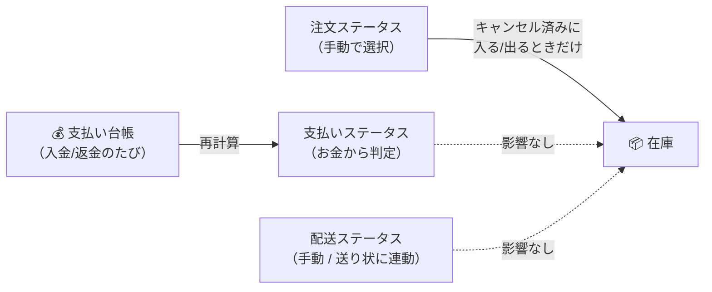
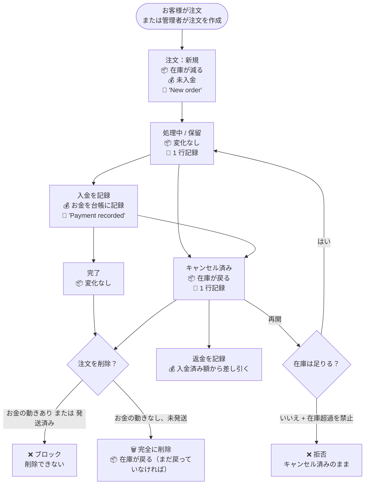

> 🌐 **言語:** [🇻🇳 Tiếng Việt](./order-lifecycle_vi.md) · [🇬🇧 English](./order-lifecycle.md) · 🇯🇵 日本語（現在）

# GP247 の注文のライフサイクル — 各段階の在庫、お金、履歴

## はじめに
このドキュメントでは、GP247 における **注文のライフサイクル全体** を説明します。注文の受付から、処理、入金、キャンセル、再開、
返金、削除までです。**各段階** で、常にセットで動く 3 つのもの、つまり **在庫** がどう変わるか、
**お金** がどう記録されるか、**注文履歴** に何が残るかがはっきりわかります。対象はストアのオーナー、経理担当者、
運用スタッフです。読み終えると、システムがなぜそう動くのかを理解し、どの操作が安全で、どの操作が元に戻せないかが
わかります。

## 1. 注文には独立した 3 つのステータスがある

ここが最も混乱しやすい点です。注文には「1 つのステータス」があるのではなく、**3 つ** あり、それらは **互いに自動で
連動しません**。

| ステータス | 値 | 設定する人 |
|---|---|---|
| **注文ステータス** | 新規 ・ 処理中 ・ 保留 ・ **キャンセル済み** ・ 完了 ・ 失敗 ・ 返金済み | あなたが手動で選択 |
| **支払いステータス** | 未払い ・ 一部支払い ・ 支払い済み ・ 返金 | **システムがお金から自動で判定**（手動で変更することも可能） |
| **配送ステータス** | 未発送 ・ 発送中 ・ 発送完了 ・ 返送済み | あなたが手動で選択 — または、配送業者の送り状がある注文では **送り状に合わせて自動で変更** |

> ⚠️ **注文ステータスを変えても、支払いステータスや配送ステータスは自動で変わりません。** 注文を「完了」にしても
> 「支払い済み」にはならず、「キャンセル済み」にしてもお客様に自動で返金されることはありません。3 つの軸は別々の作業です。

> 🚚 **送り状のある注文：** 配送ステータスは、配送業者から届くステータスに合わせて **自動で変わります** — 集荷待ち / キャンセル →
> *未発送*、輸送中のあらゆるステータス（集荷済み、輸送中、配達中、配達失敗、返送中、例外） →
> *発送中*、配達済み → *発送完了*、返送完了 → *返送済み*。送り状の
> ない注文では、これまでどおり手動で選びます。[GP247 の配送](../shipping/shipping_ja.md) の A5 をご覧ください。
>
> ℹ️ **対応バージョン:** gp247/shop 3.1.4

**在庫に副作用があるステータスは「キャンセル済み」ただ 1 つです。** それ以外の値はすべてラベルにすぎません。

## 2. ライフサイクルの全体図

## 3. 段階ごと：在庫、お金、履歴

### 3.1. 注文の受付

| | 何が起こるか |
|---|---|
| 📦 **在庫** | 注文数だけ **減ります**。バンドル商品は、構成する各商品の在庫を減らします。 |
| 💰 **お金** | **まだ何も入金されていません**（お客様がオンライン決済を選んだ場合も同じです — お金はゲートウェイから通知が届いたときにだけ記録されます）。支払いステータス = *未払い*。 |
| 📝 **履歴** | `New order` の 1 行。 |
| ステータス | 注文 = *新規*、配送 = *未発送*。 |

管理画面で作成した注文も、ストアフロントでお客様が注文した場合と **まったく同じように在庫を減らします** — 例外はありません。

### 3.2. 注文の編集（明細の追加/削除/変更）

| | 何が起こるか |
|---|---|
| 📦 **在庫** | 行を追加 → **減ります**。行を削除 → **戻ります**。数量を変更 → **差分だけ** 減る/戻る。 |
| 💰 **お金** | 注文の合計を再計算します。値引きは各行に配分し直され、税金は値引き後の金額で再計算されます。**入金済みの額は変わりません** — 変わるのは未払い残高だけです。 |
| 📝 **履歴** | 操作ごとに 1 行（`Add product: …`、`Remove item …`、`Edit product #…`）。 |

### 3.3. 入金

注文のお金は **台帳** であり、1 つの数字ではありません。入金のたびに、日付、金額、
支払い方法、取引番号を持つ **個別の行** になります。

| | 何が起こるか |
|---|---|
| 📦 **在庫** | 変化なし。 |
| 💰 **お金** | 台帳に入金の行を 1 つ追加します。`受領額` = 入金合計 − 返金合計。`残額` = 注文合計 − 受領額。 |
| 📝 **履歴** | `Payment recorded: <金額> (<日付>)`。 |
| ステータス | 支払いは **自動で判定** されます：入金なし → *未払い*、一部入金 → *一部支払い*、全額 → *支払い済み*、過入金 → *返金*。 |

決済ゲートウェイ（例：PayPal）は、成功を通知したときに入金を自動で記録します — 手入力は不要です。同じ取引が
何度通知されても、記録されるのは **1 回だけ** です。

### 3.4. 返金

| | 何が起こるか |
|---|---|
| 📦 **在庫** | **変化なし** — 返金は商品が戻ってきたことを意味しません。商品を在庫に戻したい場合は **注文をキャンセル** します。 |
| 💰 **お金** | 台帳に返金の行（マイナスの金額）を 1 つ追加します。**一部** 返金は一部の金額だけを記録し、注文は残りの額を入金済みの状態のままです。 |
| 📝 **履歴** | `Refund recorded: <金額> (<日付>)`。 |

### 3.5. 注文のキャンセル — **商品が在庫に戻る**

| | 何が起こるか |
|---|---|
| 📦 **在庫** | 注文の全明細を **すべて戻します**。**ちょうど 1 回だけ** です。システムはどの注文の商品が在庫にあるかを記憶しているため、キャンセルを繰り返しても在庫が何度も加算されることはありません。 |
| 💰 **お金** | **自動では返金されません。** お客様がすでに支払っている場合は、別途 **返金を記録** する必要があります。 |
| 📝 **履歴** | ステータス変更を記録する 1 行。 |

> ℹ️ **v3.0 以降**：以前はキャンセルしても在庫には何も起こらず、商品を取り戻す唯一の方法は **注文の削除** でした。つまり
> キャンセルのたびに証憑まで失っていました。現在は、キャンセルすると記録が残り、削除は本来存在すべきでない注文のためのものになりました。

### 3.6. キャンセルした注文の再開 — **商品が在庫から出る。拒否されることもある**

注文を *キャンセル済み* から他のステータスに変更することです。

| | 何が起こるか |
|---|---|
| 📦 **在庫** | 全明細を **再び減らします** — ただし **先に在庫を確認します**。 |
| 💰 **お金** | 変化なし。 |
| 📝 **履歴** | ステータス変更を記録する 1 行（成功した場合のみ）。 |

注文が *キャンセル済み* の間、商品は在庫に戻っており、**他の人に売れてしまっている可能性があります**。そのため再開するときは：

- **在庫が足りる** → 在庫を減らし、通常どおりステータスを変更します。
- **足りない**、かつ「在庫切れでも購入を許可」が **オフ** → システムは **拒否** し、理由を表示し、**何も
  変更しません**。どの行も減らさず、注文は *キャンセル済み* のままです。

この「全部か、ゼロか」の拒否は意図的なものです。いくつかの行だけ減らして途中で止まると、在庫はずれたのに注文は
古いステータスのまま、という状態になり、誰も原因をたどれなくなります。

### 3.7. 注文の削除 — **完全に消えるが、商品は在庫に戻る**

| | 何が起こるか |
|---|---|
| 📦 **在庫** | **戻ります** — まだ戻っていなければ。すでにキャンセルされていた注文では、商品が戻っていることをシステムが把握しているため、**二重には加算しません**。 |
| 💰 **お金** | **お金の動きがあった注文は削除できません** — システムがブロックします。 |
| 📝 **履歴** | 注文と一緒に削除され、復元できません。 |

注文を削除すると、明細、合計金額の行、すべての履歴も一緒に削除されます。**ゴミ箱はなく、復元できません。**

> ✅ **覚えておくべき順番はありません。** 先にキャンセルしてから削除する必要はありません — 削除すると商品は自動で在庫に戻り、
> すでに戻っているかどうかも自動で判断されます。

> 🚫 **発送済みの注文は削除できません。** 配送ステータスが *発送中* または *発送完了* のとき、システムは削除を
> ブロックします — 削除すると、商品がお客様の手元にあるのに在庫に加算されてしまうからです。根本的には、荷物が実際に出荷済みなら、
> **記録を削除することそのものが間違い** であり、在庫のずれは症状にすぎません。

**では、キャンセルと削除はどう使い分けるのでしょうか？**

| | 使う場面 |
|---|---|
| **注文のキャンセル** | 実在する注文だが、もう販売しない — お客様のキャンセル、配達失敗など。記録を残して後から確認できます。 |
| **注文の削除** | **本来存在すべきでない** 注文 — 入力ミス、テスト注文、重複など。痕跡を残す必要がありません。 |

## 4. 一覧表 — どの操作が何に影響するか

| 操作 | 📦 在庫 | 💰 お金 | 📝 履歴 | 元に戻せる？ |
|---|---|---|---|---|
| 注文の受付 | **減る** | — | あり | はい（キャンセル/削除） |
| 明細の追加 | **減る** | 合計が変わる | あり | はい |
| 明細の削除 | **戻る** | 合計が変わる | あり | いいえ |
| 数量の増減 | **差分** | 合計が変わる | あり | はい |
| 入金の記録 | — | **受領額が増える** | あり | 返金を記録することでのみ |
| 返金の記録 | — | **受領額が減る** | あり | いいえ |
| **注文のキャンセル** | **戻る** | — | あり | はい（在庫が足りれば再開） |
| **キャンセルした注文の再開** | **減る** | — | あり | はい（再びキャンセル） |
| その他のステータス変更 | — | — | あり | はい |
| 配送ステータスの変更（手動、または送り状に連動） | — | — | あり | はい |
| **注文の削除** | **戻る**（まだ戻っていなければ） | お金の動きがあればブロック | **すべて消える** | **いいえ** |
| **発送済み** の注文の削除 | ブロック | ブロック | — | — |

## 条件と制約（操作の前に確認）

**注文の受付 / 明細の追加時**
- 「在庫切れでも購入を許可」をオフにしている場合、**在庫を超えて注文できません** — ストアフロントのお客様にも、
  管理画面のあなたにも同じように適用されます。実際にある数以上に売らないためです。
- **値引きは商品代金（税抜）を超えられません** — 商品代金より大きく値引きすると、合計がマイナスの注文になり、
  後続のどの画面でも処理できません。超えた値を入力すると、商品代金と同じ額に切り詰められます。

**お金を記録するとき**
- **金額は 0 より大きくなければなりません** — 逆方向を記録したい場合は返金機能を使い、マイナスの数値は入力しないでください。
- **決済ゲートウェイは実際に受け取った金額を記録します**。注文合計と異なる場合でも同じです。差がある場合、注文は一部支払いの
  状態になり、照合できるようログが記録されます — システムが金額を丸めて合わせることはありません。
- **締め済みの会計期間には記録できません**（InOut プラグインを使っている場合、その期間に属する日付）。

**キャンセルした注文を再開するとき**
- **十分な在庫が必要です**（「在庫切れでも購入を許可」をオンにしている場合を除く） — キャンセル時に商品は在庫に戻っており、他の人に
  売れている可能性があるからです。足りない場合、操作は **すべて拒否され**、途中までの処理は行われません。

**注文を削除するとき**
- **お金の動きがあった注文は削除できません** — 返金後に残高が 0 に戻った場合でも同じです。注文を削除すると、そのお金の
  証拠まで消えてしまいます。お金の動きがある注文は **キャンセル** し、削除しないでください。
- **発送済みの注文は削除できません** — 商品は在庫ではなくお客様の手元にあります。削除すると在庫に誤って加算されます。
- **削除は永久的です** — 明細、合計金額、履歴がすべて消えます。商品は在庫に戻ります。

## よくある質問（Q&A）

**Q1: 注文を「完了」にすると、自動で「支払い済み」になりますか？**

→ いいえ。3 つのステータス（注文 ・ 支払い ・ 配送）は互いに独立しています。支払いステータスは、注文に
**お金を記録** したときにだけ変わります。

**Q2: 注文をキャンセルすると、お客様に自動で返金されますか？**

→ いいえ。キャンセルで在庫に戻るのは **商品** だけです。お金については、別途 **返金** を記録する必要があります。

**Q3: 注文をキャンセルしたあと、もう一度キャンセルを押すと、在庫が二重に加算されますか？**

→ いいえ。システムはどの注文の商品が在庫にあるかを記憶しているため、商品はそれぞれの方向にちょうど 1 回だけ動きます。

**Q4: キャンセルした注文を再開できないのはなぜですか？**

→ 現在の在庫が、再び減らすのに足りないからです（注文がキャンセルされている間に、他の人に売れてしまった）。さらに「在庫切れでも
購入を許可」がオフになっています。在庫を補充するか、そのオプションをオンにしてください。

**Q5: 注文を削除すると、在庫は自動で戻りますか？**

→ **はい**。すでにキャンセルされていた注文なら、二重には加算されません。キャンセルと削除の順番を覚える必要はありません。ただし
**発送済み** の注文は削除できません。

**Q6: 注文を削除できないのはなぜですか？**

→ 理由は 2 つです：(1) 注文に **お金の動きがある** — 削除するとお金の証拠が消えてしまう。(2) 注文が **発送済み** —
商品がお客様の手元にあるため、在庫に加算できない。どちらの場合も、削除の代わりに注文を **キャンセル** してください。

**Q7: お客様が PayPal で支払った場合、金額を手入力する必要がありますか？**

→ いいえ。決済ゲートウェイは、成功を通知したときに入金を自動で記録します。同じ取引が何度通知されても、記録されるのは
1 回だけです。

**Q8: 一部返金すると、注文全体が「返金済み」になりますか？**

→ いいえ。返金は実際の金額どおりに記録され、注文は残りの入金済みの額をそのまま保持します。

**Q9: 誤って注文を削除しました。復元できますか？**

→ **できません。** 注文の削除は永久的で、明細も履歴も消えます。お金の動きがある注文の削除がブロックされているのはこのためであり、
迷ったときは削除ではなく **キャンセル** すべき理由でもあります。

**Q10: 注文履歴には何が記録されますか？**

→ ステータスの変更、明細の追加/編集/削除、合計金額の行の編集、入金または返金の記録です。それぞれ 1 行ずつ、
操作した人と日時とともに記録されます。ただし **キャンセルや再開による商品の在庫への出入り** は、現在のところ
ステータス変更の行から推測するしかなく、専用の行はありません。

## 変更履歴
<!-- ロジック/動作が変わったときだけ記録します。最新の行が一番上です。1 日 1 行です。 -->

| 日付 | GP247 バージョン | 変更内容 |
| --- | --- | --- |
| 2026-10-18 | gp247/shop 3.1.4 | 配送業者の送り状がある注文では、配送ステータスが **送り状に合わせて自動で変わる** ようになりました。送り状のない注文はこれまでどおり手動で選びます |
| 2026-08-29 | v3.0 | 新規ドキュメント。v3.0 以降のライフサイクルを反映：**キャンセルで在庫が戻る**、**削除でも在庫が戻る**（まだ戻っていない場合のみ）が **発送済みならブロック**、**キャンセルした注文の再開** は在庫を確認し、不足ならすべて拒否、注文のお金は入金/返金ごとの **支払い台帳**、お金の動きがあった注文は **削除できない** |

---

📅 **最終更新:** 2026-10-22 · ✍️ **作成者 (Author):** GP247
