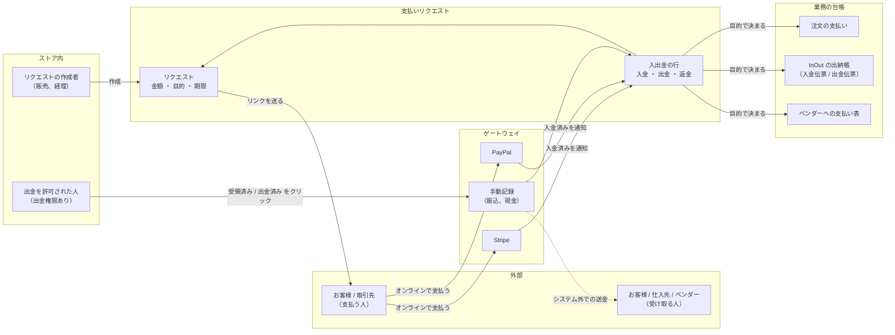
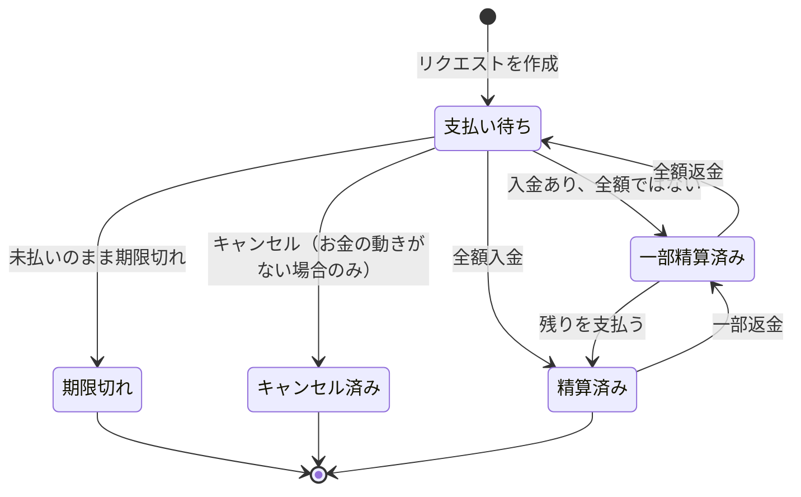
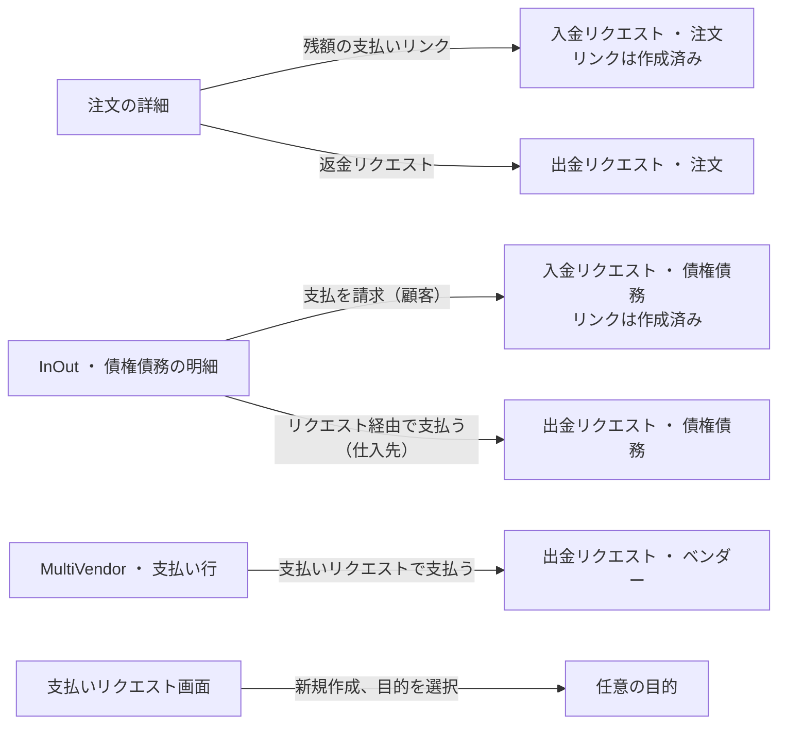
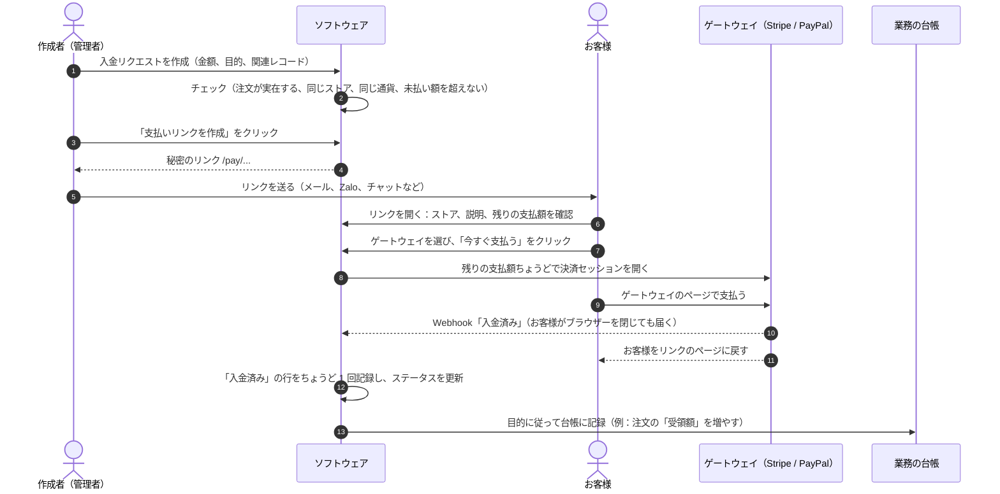
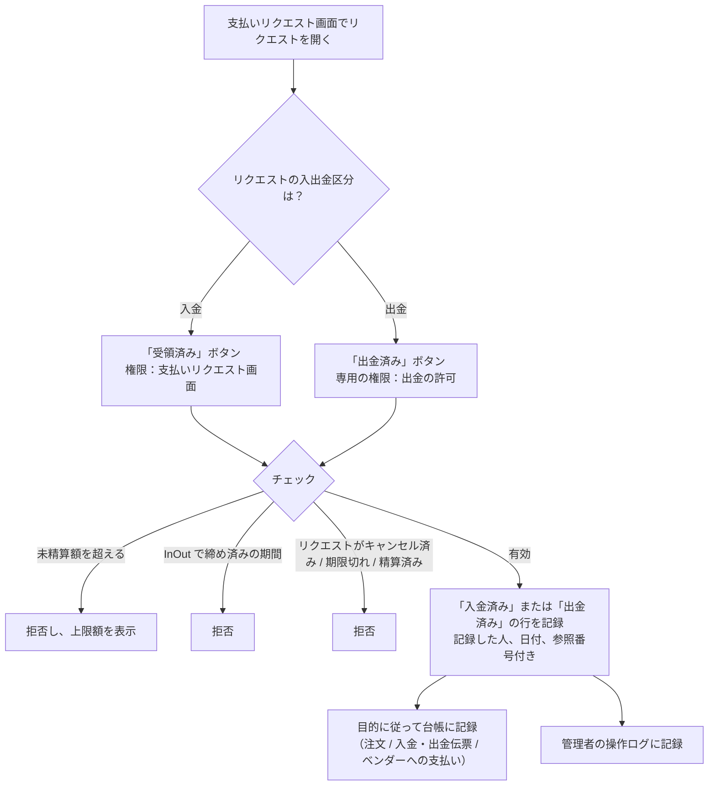
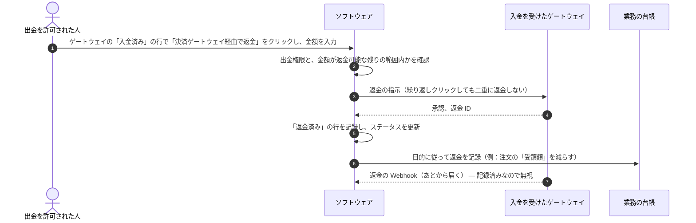
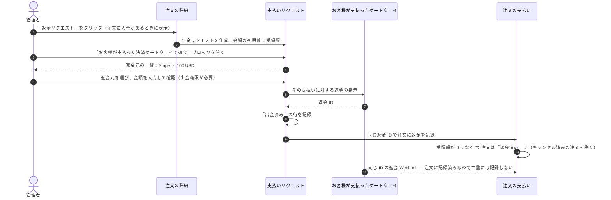

> 🌐 **言語:** [🇻🇳 Tiếng Việt](./payment-request_vi.md) · [🇬🇧 English](./payment-request.md) · 🇯🇵 日本語（現在）

# 支払いリクエスト（Payment Request） — カート以外のお金の流れ

## はじめに
このドキュメントでは、**支払いリクエスト** 機能を業務の言葉で説明します。何のための機能か、お金がどの
経路で動くか、そして各金額がどの台帳に記録されるかです。対象はストアのオーナー、経理担当者、運用スタッフです。読み終えると、
リクエストの作成、オンライン決済用のリンクをお客様に送る方法、振込/現金の記録、返金のしかたがわかり、システムが
一部の操作をブロックする理由も理解できます。

## 1. 支払いリクエストとは

ストアのカートでお金を受け取れるのは、お客様が注文したときだけです。しかし実際には、**カートに含まれない** お金が多くあります。
手付金を受け取ってから残りを支払ってもらう、商品が足りなかったので一部を返金する、卸売のお客様から売掛金を回収する、仕入先に支払う、マーケットプレイスで
ベンダーに売上を支払う、個別のサービス料金を受け取る、などです。

**支払いリクエスト** は、**誰が** 支払うか受け取るか、**いくら**、**どの通貨で**、**何の
ために**、**いつまでに** を記録する「伝票」です。お金が実際に動くたび（お客様が Stripe で支払う、経理が振り込むなど）に、その伝票の下に
**入出金の行** として記録されます。お金が入ると、ソフトウェアは対応する業務の台帳にも自動で記録します：注文の
支払い、InOut の出納帳、またはベンダーへの支払い表です。

| 🟢 **入金** | 🔴 **出金** |
|---|---|
| お客様 / 取引先がストアに支払う | ストアがお客様 / 取引先 / ベンダーに支払う |

**ストアにとってのメリット**
- **カートでは受け取れないお金を受け取れます** — お客様はリンクを開いてオンラインで支払うだけです。アカウントも再注文も不要です。
- **すべての入出金に記録が残ります** — 誰が、いつ、どのゲートウェイで、どの参照番号で記録したか。月末の照合で、メッセージや明細を探し回る必要がありません。
- **二重入力がありません** — 注文の代金はそのまま注文に加算され、売掛金・買掛金の支払いは出納帳の入金/出金伝票になり、ベンダーへの支払いは出金期間を締めます。
- **お金の誤りを防ぎます** — 回収すべき額を超えて手動で記録することはできず、入金額を超えて返金することもできません。また **出金** の権限は、リクエストを作成する権限とは別になっています。

## 2. このドキュメントで使う用語

| 用語 | 意味 |
|---|---|
| **リクエスト** | お金を請求する伝票（入金）、または支払いの伝票（出金）。金額、通貨、目的、関連レコード、期限を持ちます。 |
| **入出金区分** | **入金** = お金がストアに入る。**出金** = お金がストアから出る（支払い、返金）。 |
| **目的** | リクエストが対応する業務。お金が動いたときにどの台帳に記録するかを決めます：自由入力、注文、InOut の債権債務、ベンダーへの支払い。 |
| **関連レコード** | リクエストが紐付くレコード：注文 ID、顧客 / 仕入先の ID、ベンダーの出金行 ID。 |
| **入出金の行** | お金が実際に動いた 1 回分：**入金済み**、**出金済み**、または **返金済み**。各行には、ゲートウェイまたは手動で記録した人の参照番号があります。 |
| **ゲートウェイ** | お金を動かす方法：Stripe、PayPal（オンライン — 決済プラグインによるもの）、または **手動記録**（システム外での振込 / 現金）。 |
| **支払いリンク** | 支払う人に送る秘密の URL `/pay/…`。開くと支払う金額が表示され、オンラインのゲートウェイを選べます。 |
| **Webhook** | 決済ゲートウェイがあなたのサーバーに直接送る通知で、「入金済み / 返金済み」を知らせます — お客様がブラウザーを閉じたあとでも届きます。 |

## 3. 全体像

関わるのは 3 つのグループです。リクエストを作成・記録する **ストアの人**、外部の **支払う人 / 受け取る人**、そしてお金を動かす
**ゲートウェイ** です。ソフトウェアがリクエストと入出金の行を中央で管理し、対応する業務の台帳に通知します。



目的が **自由入力（関連レコードなし）** の場合は、他の台帳には記録しません。お金はリクエスト上にだけあり、注文、
債権債務、ベンダーのどれにも属さない金額に使います。

## 4. リクエストのライフサイクル

ステータスは **動いたお金から自動で計算され**、誰も手動で変更しません。

| ステータス | いつ |
|---|---|
| **支払い待ち** | まだ 1 円も記録されていない。 |
| **一部精算済み** | お金は入ったが、請求額に満たない。 |
| **精算済み** | 請求額が全額記録された。 |
| **期限切れ** | 支払い期限があり、期限が過ぎたのに、リクエストがまだ 1 円も受け取っていない。システムが自動で表示するため、定期実行のタスクは不要です。 |
| **キャンセル済み** | あなたがリクエストをキャンセルした（まだお金の動きがない場合のみ可能）。 |



- リクエストにお金の動きがあると、**入出金区分、金額、通貨はロックされます**。説明、取引先、期限は引き続き変更できます。
- お金の動きがあるリクエストは **キャンセルも削除もできません**。お金を戻したい場合は、返金の流れ（8 章、9 章）を使ってください。
- 期限切れまたはキャンセル済みのリクエストには手動で記録できず、リンクからも支払えなくなります。ただし、ゲートウェイで **実際に受け取った** お金は
  記録されます（「条件と制約」をご覧ください）。

## 5. 目的と対応する台帳

目的によって、リクエストをどのレコードに紐付けるか、そして **お金をどの台帳に記録するか** が決まります。目的を選ぶと、**関連
レコード** 欄のラベルが自動で変わり（例：「注文ID」）、入力が間違っていればすぐ下に赤字でエラーが表示されます。プラグインの目的は、
そのプラグインがインストールされ、有効になっている場合にだけ表示されます。

| 目的 | 対応バージョン | 入出金区分 | 紐付け先 | お金が動いたときの記録先 | 例 |
|---|---|---|---|---|---|
| **自由入力（関連レコードなし）** | 標準 | 🟢 入金 ・ 🔴 出金 | 任意 | リクエスト上のみ | 設置料金、イベントの手付金、紹介した取引先への手数料 |
| **注文：残額の回収** | 標準 | 🟢 入金 | 注文ID（例：`OD-SZz76cP2`） | 注文の支払い：「受領額」が増え、「残額」が減り、支払いステータスが自動で更新されます。注文ステータスは自動では変わりません | 30% の手付金を受けた注文の残り 70%、管理画面で作成したまだ入金のない注文 |
| **注文：お客様への返金** | 標準 | 🔴 出金 | 注文ID | 注文の支払い：返金を 1 回記録し、「受領額」が減ります。0 になると注文は **返金済み** になります（キャンセル済みの注文を除く） | 商品不足で 20% を返金、返品された注文の全額を返金 |
| **取引先の債権債務 (InOut)** | InOut プラグイン | 🟢 顧客からの回収 ・ 🔴 仕入先への支払い | 顧客 / 仕入先の ID | 出納帳：その取引先の入金伝票または出金伝票が 1 枚作成され、債権債務が自動で減ります。この伝票は出納帳での編集/削除がロックされます | 月末に卸売のお客様から売掛金を回収、仕入先に商品代金を支払う |
| **ベンダーへの支払い（マーケットプレイス）** | MultiVendor プラグイン | 🔴 出金 | 期間の支払い行 ID | ベンダーへの支払い表：全額を支払うと、その期間の行が取引参照番号付きで **支払済み** になり、ベンダーに通知が届きます | マーケットプレイスが 1 つのストアに 9 月分の売上を支払う |

### リクエストを作成する入口



**業務の画面から作成するのが最も安全な方法です**：金額、通貨、ストア、支払う人、関連レコードが元のレコードから
自動入力されます。注文の詳細では、**残額の支払いリンク** ボタンは注文に未払いがあるときだけ、**返金
リクエスト** ボタンは注文に入金があるときだけ表示されます。

**支払いリクエスト画面で直接作成する場合**：
1. **システム設定 → 支払いリクエスト** メニューを開きます。
2. **入出金区分** を選びます：*入金（回収）* または *出金（支払い・返金）*。
3. **目的** を選び、目的が求める場合は **関連レコード** を入力します（欄の下の案内に従ってください）。
4. **金額** を入力し、ストアの通貨一覧から **通貨** を選びます。
5. **取引先**（支払う人/受け取る人の名前）を入力し、必要に応じてメールアドレス、電話番号、**説明**（お客様は支払いページで説明を見ます）、**有効期限** を入力します。
6. 保存をクリックします。

   成功すると、リクエストが **リクエスト一覧** に **支払い待ち** のステータスで表示され、作成者と作成日時も
   表示されます。別のリクエストを作成するには **新規リクエスト** をクリックします。

## 6. 流れ A ・ 支払いリンクで入金を受け取る

お客様に **自分でオンライン決済** してもらいたいときに使います：注文の残額、手付金、売掛金の回収、サービス料金など。

1. **入金** のリクエストを開き、**支払いリンク** の項目で **支払いリンクを作成** をクリックします（注文 / 債権債務の詳細から作成した場合、リンクはすでにあります）。
2. **コピー** をクリックし、リンクをお客様に送ります（メール、Zalo、チャットなど）。
3. お客様がリンクを開くと、ストア名、説明、支払者の名前、**お支払い金額**、期限（ある場合）が表示されます。
4. お客様は **支払い方法を選択してください** でゲートウェイを選び、**今すぐ支払う** をクリックして、ゲートウェイのページで支払います。
5. ゲートウェイが Webhook で通知し、ソフトウェアが **入金済みの行を自動で記録** し、業務の台帳にも記録します。あなたは何もする必要がありません。

   成功すると、リクエストを開き直したときに、ゲートウェイ名と取引番号付きの **入金済み** の行が表示されます。お客様には「お支払いが完了しています。
   ありがとうございました！」と表示されます。



- リンクのページには、**有効で、かつリクエストを所有するストアに設定済みのオンラインゲートウェイ** だけが表示されます。お金は常にそのストアの
  ゲートウェイのアカウントに入ります。**手動記録** がお客様に表示されることはありません。
- リンクが外部に漏れた、または別の人に送ってしまった場合：**リンクを再発行** をクリックします。古いリンクはすぐに使えなくなります。
- リンクのページには、メールアドレス、電話番号、社内メモは **表示されず**、検索エンジンにもインデックスされません。

**支払えないときにお客様に表示される内容**

| お客様に表示される内容 | 意味 |
|---|---|
| 「お支払いが完了しています。ありがとうございました！」 | リクエストは **精算済み** です。 |
| 「この支払いリクエストはキャンセルされました。」 | あなたがリクエストをキャンセルしました。 |
| 「この支払いリンクは有効期限が切れています。ストアにお問い合わせください。」 | リクエストは **期限切れ** です。 |
| 「利用できるオンライン支払い方法がありません。お支払いについてはストアにお問い合わせください。」 | ストアで、入金を受け付けられるオンラインゲートウェイがまだ有効になっていません。 |
| 「現在オンラインでお支払いいただけません。ストアにお問い合わせください。」 | 目的がもう有効ではない（例：関連するプラグインがオフになった）か、支払うものが残っていません。 |
| 「見つかりません」のページ | リンクが間違っている、リンクが再発行された、リクエストが **出金** である、または別のストアのリンクです。どの場合も同じページを返すため、リンクを探る人は何も推測できません。 |

## 7. 流れ B ・ 手動記録（振込、現金）

お金が **システムの外で** 動いたときに使います：お客様が銀行振込や現金で支払った、または経理が仕入先 /
ベンダーに送金した場合です。

1. **支払いリクエスト** 画面でリクエストを開きます。
2. 記録欄で、**金額**（未精算額が自動入力されています）を確認し、**参照番号**（例：銀行の取引番号）と **日付**（今日が自動入力されています）を入力します。
3. **受領済み**（入金リクエスト）または **出金済み**（出金リクエスト）をクリックします。

   成功すると「入出金を記録しました。」と表示され、記録した人、日付、参照番号付きの入出金の行が 1 つ追加されます。



> ⚠️ システムは **記録するだけ** で、自動で送金はしません。**出金済み** をクリックするのは、あなた自身の方法で受け取る人に支払い *済み* であることを
> 確認するという意味です。出金には常に専用の **「出金の許可」権限** が必要です — 出金リクエストを作成した人が、
> 出金済みを記録できる人とは限りません。

## 8. 流れ C ・ リンクで受け取ったお金を返金する

お客様が入金リクエストを Stripe / PayPal で支払い、その一部または全額を返す必要がある場合です。お金は、お客様が使った **カード /
PayPal アカウントにそのまま** 戻ります。

1. リクエストを開き、オンラインゲートウェイの **入金済み** の行で **決済ゲートウェイ経由で返金** をクリックします。
2. **返金額**（その入金のうち返金できる残りが上限）を入力し、**返金** をクリックして確認します。

   成功すると「返金を送信し、記録しました」と表示され、**返金済み** の行が追加され、ステータスは一部 / 支払い待ちに戻ります。ゲートウェイが拒否した場合
   （返金期限切れ、残高不足など）：「決済ゲートウェイが返金を拒否しました。エラーログを確認してください」と表示され、**何も記録されません**。



- **Stripe / PayPal の管理画面で直接** 返金することもできます。Webhook で通知が届き、正しいリクエストに記録されます。
- **手動記録** の入金には、ゲートウェイ経由の返金ボタンはありません（そのお金はどのゲートウェイも通っていないためです）。お客様が振り込んだ金額を返すには、
  **出金** のリクエストを作成し、送金後に **出金済み** をクリックしてください。

## 9. 流れ D ・ 注文時に支払われた注文を返金する

お客様が注文時に（リンクを使わずに）Stripe / PayPal で支払い、それを返金する必要がある場合です。

1. **注文の詳細** を開き、**支払いリクエスト** ブロックで **返金リクエスト** をクリックします。ソフトウェアが、入出金区分 **出金**、
   目的 **注文：お客様への返金** のリクエストを作成します。金額の初期値は、注文の受領額です。
2. そのリクエストを開くと、**お客様が支払った決済ゲートウェイで返金** ブロックに、お客様がその注文でゲートウェイを通じて支払った回（*返金元* と呼びます）が
   一覧表示されます。例：「Stripe ・ 100 USD」。
3. 返金元を選び、金額を入力して確認します（出金権限が必要です）。

   成功すると、お金はお客様のカード/ウォレットにそのまま戻り、注文にはゲートウェイの返金 ID を持つ返金の行が 1 つ追加されます。



**システムの外で** 返金する場合（お客様に振り込んで返すなど）は、流れ B を使います。送金が終わったら **出金済み** をクリックすると、注文に対応する返金が自動で記録されます。

## 10. 業務でよくある場面

| 場面 | 方法 | 台帳での結果 |
|---|---|---|
| お客様が 30% の手付金を払い、受け取り時に残りを支払う | 注文の詳細 → **残額の支払いリンク** → リンクを送る（流れ A） | 注文：受領額 100%、残額 0 |
| お客様が注文の残額を振り込んだ | 注文の入金リクエストを開く → 銀行の取引番号を入れて **受領済み**（流れ B） | 注文：支払いの行が 1 つ追加 |
| 商品が不足し、Stripe で支払われた注文の 20% を返金 | 注文の詳細 → **返金リクエスト** → Stripe の返金元で返金（流れ D） | 注文：Stripe の ID を持つ返金の行が 1 つ。お金が残っているため注文のステータスはそのまま |
| 卸売のお客様から売掛金を回収 | InOut → 顧客の債権債務の明細 → **支払を請求** → リンクを送る、または **受領済み** | 出納帳：入金伝票。顧客の売掛金が減る |
| 仕入先に支払う | InOut → 仕入先の債権債務の明細 → **リクエスト経由で支払う** → 経理が振り込む → 出金権限のある人が **出金済み** をクリック | 出納帳：出金伝票。仕入先の買掛金が減る |
| マーケットプレイスが期間分の売上をベンダーに支払う | MultiVendor → 支払い行 → **支払いリクエストで支払う** → 振り込む → **出金済み** | 支払い行：**支払済み**、ベンダーに通知 |
| お客様が誤って 2 回支払った（タブを 2 つ開いた） | 記録のための操作は不要です：両方の支払いが記録されます。その後、余分な分をゲートウェイ経由で返金します（流れ C） | リクエスト：受領額が超過、照合用のメモ付き |
| どの注文にも属さない金額（設置料金）を受け取る | 支払いリクエスト画面 → 目的 **自由入力（関連レコードなし）** → リンクを作成 | リクエスト上のみ |

## 11. 誰が何をできるか

権限は 2 つあり、他の権限と同じようにロールに割り当てます：**Payment requests**（支払いリクエスト画面）と **Payment
requests - pay out / refund**（出金の許可）です。最上位の管理者アカウントは両方を持っています。

| ロール | できること | できないこと |
|---|---|---|
| **Payment requests** 権限あり | お金の動きがないリクエストの作成、編集、キャンセル。リンクの作成 / 再発行。**入金** の手動記録（受領済み） | 出金済みの記録、返金 |
| さらに **pay out / refund** 権限あり | 上記のすべて + **出金済み**、ゲートウェイ経由の返金、注文の返金元からの返金 | — |
| 注文 / InOut / ベンダーへの支払いを編集する人 | さらに **Payment requests** 権限がある **場合にだけ**、リクエスト作成ボタンが表示される | その権限がない場合のリクエストの作成 |
| リンクを持つお客様 / 取引先 | 支払う金額の確認、ゲートウェイの選択、支払い | メールアドレス、電話番号、社内メモの閲覧。出金リクエストへの支払い。再発行後の古いリンクの使用 |
| 決済ゲートウェイ（Webhook） | 入金済み、返金済みの通知（署名による認証付き） | 署名が正しくない場合のお金の記録 |

出金の権限が **別になっている** のは、販売スタッフがリクエストを作成してお金を受け取れる一方で、出金を自分で記録できないようにするためです。
お金を記録する操作はすべて、管理者の操作ログに残ります。

## 12. 支払いページのデザインのカスタマイズ（テンプレート作成者向け）

初期の支払いページは **独立した 1 ページ** です。独自の CSS を持ち、どのデザイン（テンプレート）にも依存しないため、サイトが
初期のテンプレートを使っていても別のテンプレートを使っていても、常に正しく表示されます。ダークモードにも対応し、スマートフォンでもきれいに表示されます。

ページをサイト独自のデザインにしたい場合は、あなたのテンプレートに同じ名前のファイルを作成します。そのファイルが初期のものの代わりに使われます。

1. 使用中のテンプレートのフォルダー名を確認します。例：`MyTheme`（`app/GP247/Templates/` の中にあります）。
2. サイトのルートフォルダーで **ターミナル** を開き、次を順に実行します（`MyTheme` をあなたのテンプレート名に置き換えます）。

   ```bash
   mkdir -p app/GP247/Templates/MyTheme/screen
   cp vendor/gp247/shop/src/Views/templates/GP247Front/screen/shop_payment_request.blade.php app/GP247/Templates/MyTheme/screen/
   ```

3. ファイル `app/GP247/Templates/MyTheme/screen/shop_payment_request.blade.php` を自由に修正します。
4. 支払いリンクを開いて結果を確認します。初期のものに戻したい場合は、作成したファイルを削除するだけです。

> フォーム内のゲートウェイの選択欄（`name="gateway"`）、送信ボタン、`@csrf` はそのまま残してください。そうしないと、お客様が支払えなくなります。
> 初期ファイルの先頭には、使える変数（支払う金額、合計、ステータス、ゲートウェイの一覧など）のメモがあります。

## 13. インストール

- `gp247/shop` を **新規インストール** したサイト：機能は標準で入っており、何もする必要はありません。
- **稼働中** のサイトでは、`gp247/shop` パッケージをアップデートしたあと、サイトのルートフォルダーで次を実行します。

  ```bash
  php artisan gp247:shop-update
  ```

  成功すると、**システム設定 → 支払いリクエスト** メニューが表示されます。このコマンドは、不足しているテーブル、メニュー、権限、ラベルを追加するだけです
  — データを削除したり上書きしたりはせず、何度実行しても安全です。このコマンドをまだ実行していない場合、支払い
  リクエスト画面には実行方法の案内が表示され、注文 / InOut / MultiVendor の画面のリクエスト作成ボタンは自動で非表示になります — エラーページは出ません。

`gp247/shop` をアンインストールしても、支払いリクエストのデータは **削除されません**。再インストールしたときに、お金の履歴がそのまま残るようにするためです。

## 条件と制約（操作の前に確認）

**リクエストの作成 / 編集時**
- **金額は 0 より大きく**、通貨の小数桁に合わせて丸められます — 伝票の金額を、実際に受け取る金額と一致させるためです。
- **通貨はストアの通貨一覧にあるものでなければなりません** — 通貨コードの入力ミスを防ぐためです。
- **目的は、選んだ入出金区分を許可している必要があります** — 例：*注文：残額の回収* は入金にしか使えません。
- **関連レコードは、実在し、同じストア、同じ通貨のレコードでなければなりません** — お金を正しい台帳に記録するためです：
  - 注文：入金額は **注文の残額** を、返金額は **注文の受領額** を超えられません。
  - InOut の債権債務：**出納帳の基本通貨** だけを受け付けます（出納帳は 1 つの通貨で記帳します）。
  - ベンダーへの支払い：**未払いで金額 > 0** の支払い行だけが対象で、行の金額を超えられません。実行できるのは **マーケットプレイス（ルートストア）** だけです。
- **お金の動きがあると、入出金区分、金額、通貨は変更できません** — 台帳はこれらの値で記録済みのため、ここで変えると台帳がずれます。

**手動で記録するとき（受領済み / 出金済み） — 厳密なチェック**
- **未精算額を超えられません** — 「このリクエストの未精算額は … のみです。」と表示されます。さらに受け取る場合は、新しいリクエストを作成してください。
- **キャンセル済み、期限切れ、精算済みのリクエスト**、または目的がもう有効でないリクエストには記録できません。
- **InOut で締め済みの期間には記録できません** — 締めた期間の数値が変わらないようにするためです。
- **出金済みには出金権限が必要です。**

**お金がオンラインゲートウェイを通るとき**
- **各金額はちょうど 1 回だけ記録されます** — 入出金の各行はゲートウェイの取引番号を持ちます。Webhook の重複送信、お客様がページに戻るのと同時に
  Webhook が届く、繰り返しクリックなど、どの場合も 1 回だけ記録されます。
- **ゲートウェイで受け取ったお金は必ず記録されます** — 請求額を超えた場合、リクエストがキャンセル/期限切れになった直後の場合、InOut の締め済みの
  期間にあたる場合（このときは今日の日付で記録）でも同じです。その行には照合用のメモが付くので、あなたが処理（例：余分な額の返金）します。理由：お金は実際に
  口座に入っているため、記録を拒むと台帳が実際の口座とずれてしまうからです。
- **リクエストをキャンセルしても、お客様がゲートウェイのページで開いている決済セッションは閉じません。** お客様がそのまま支払った場合、お金は照合用のメモ付きで記録されるので、
  あなたが返金してください。
- **正しいストアのアカウントを使います** — Stripe / PayPal へのすべての呼び出しは、リクエストを所有するストアの設定を使います。

**返金するとき**
- **ゲートウェイ経由の返金は、返金に対応したゲートウェイで受け取った入金にだけ** 行えます。各返金は元の入金に紐付きます — **1 件の入金に対する返金
  合計は、その入金額を超えられません**。
- 返金には **出金権限** が必要です。

**キャンセル / 削除するとき**
- **キャンセルまたは削除できるのは、お金の動きがないリクエストだけです** — お金の動きがあるリクエストは証憑であり、削除するとお金の痕跡が失われます。リクエストが作成した InOut の
  出納帳の伝票も、出納帳での編集/削除がロックされます — 処理はリクエスト側で行ってください。

**支払いリンク**
- まだお金を受け付けている **入金** のリクエストにだけあります。
- **リンクを持っている人は誰でも、その金額を支払えます** — 正しい相手にだけ送ってください。漏れた場合は **リンクを再発行** します。リンクのコードは長く推測できず、
  システムはハッシュ化・暗号化した形でしか保存しません。
- リンクは、リクエストを所有する **正しいストア** のドメインでしか開けません。

## よくある質問（Q&A）

**Q1: お客様がすでに振り込んでくれました。どうすればよいですか？**

→ リクエストを開き、記録欄に銀行の取引番号を入力して **受領済み** をクリックします（流れ B、7 章）。

**Q2: 「出金済み」をクリックすると、システムが自動で送金しますか？**

→ いいえ。「出金済み」は、あなたが自分の方法で支払ったことを記録するだけです。システムが自動で送金するのは、オンラインの **ゲートウェイ経由で返金** するときだけです。

**Q3: リクエストの金額を変更できないのはなぜですか？**

→ リクエストにお金の動きがあるため、台帳がずれないよう入出金区分、金額、通貨がロックされています。差額については新しいリクエストを作成してください。

**Q4: 支払いページに「利用できるオンライン支払い方法がありません」としか表示されません。**

→ ストアに、有効で入金を受け付けられるオンラインゲートウェイがまだありません。そのストアで決済プラグイン（例：StripePayment、
PaypalExpress）をインストールして有効にしてください。

**Q5: 間違って別の人にリンクを送ってしまった場合は？**

→ リクエストで **リンクを再発行** をクリックします。古いリンクはすぐに無効になります。新しいリンクを正しい相手に送ってください。

**Q6: お客様がゲートウェイで 2 回支払った場合、台帳にはどう記録されますか？**

→ お金は実際に入っているため、2 回とも記録され、余分な行には照合用のメモが付きます。余分な行で **決済ゲートウェイ経由で返金** を使ってお客様に返してください（流れ C）。

**Q7: Stripe/PayPal の管理画面で直接返金しました。記録し直す必要はありますか？**

→ 支払いリンクで支払われた金額であれば、不要です。ゲートウェイが Webhook で通知し、返金は正しいリクエストに記録されます。

**Q8: 目的「取引先の債権債務」/「ベンダーへの支払い」が表示されない、または注文の画面にリクエスト作成ボタンがありません。**

→ プラグインの目的は、InOut / MultiVendor プラグインがインストールされ、有効になっている場合にだけ表示されます。業務の画面のリクエスト作成ボタンには
**Payment requests** 権限が必要で、注文では、未払いがある（入金）か入金がある（返金）場合にだけ表示されます。

**Q9: 有効期限は何のためにありますか？**

→ まだ 1 円も受け取っていないリクエストは、期限を過ぎると **期限切れ** になり、リンクからの支払いを受け付けなくなります。期限を設定しなければ、
全額が支払われるかキャンセルされるまで、リンクを使えます。

**Q10: 支払いページがサイトのデザインと合いません。変更できますか？**

→ できます。あなたのテンプレートに `screen/shop_payment_request.blade.php` ファイルを作成してください（12 章）。そのファイルを削除すれば初期のものに戻ります。

---

<sub>📅 **最終更新:** 2026-10-22 · ✍️ **作成者 (Author):** GP247</sub>
