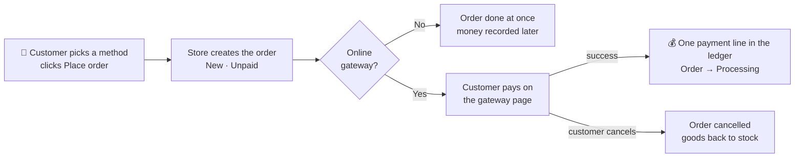
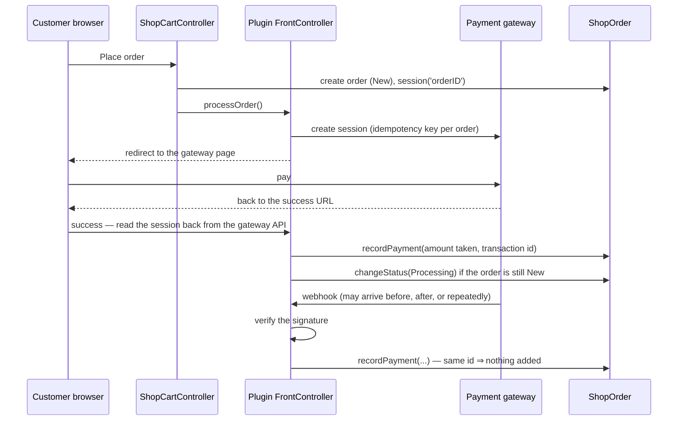

> 🌐 **Language:** [🇻🇳 Tiếng Việt](./payment_vi.md) · 🇬🇧 English (current)

# Payments in GP247 — store setup and developer guide

## Introduction

This document explains how GP247 takes the customer's money: from the moment the customer picks a method at checkout,
through the payment gateway, until the money is recorded on the order. **Part A** is for store managers: installation,
gateway settings, watching and recording money on orders, with a diagram of the whole flow. **Part B** is for
developers: what GP247 already provides, where it lives, and what to do when integrating a new gateway or customising.
After reading, a store owner can switch online payments on safely; a developer knows exactly which seams to use so
money is never recorded wrongly or twice.

---

## Part A — For store managers

### A1. Concepts to know

| Concept | In plain words |
|---|---|
| **Payment method** | A **payment plugin** installed in the store (*Payment* group). Each enabled plugin is one choice at checkout. |
| **Payment without a gateway** | The order is done once placed and the money comes later: pay on delivery, bank transfer by instructions. Example: the `CashPayment` plugin. |
| **Online payment gateway** | The customer is sent to the gateway's secure page (card, e-wallet…) and back to the store. Examples: `StripePayment`, `PaypalExpress`. |
| **Order payment ledger** | Every payment or refund is **one line** in the order's ledger (date, amount, method, transaction id). The order's **Received** and **Balance** are computed from it. |
| **Payment status** | Unpaid · Partial payment · Paid · Refund — **derived by the system from the ledger**, you do not pick it. |
| **Webhook** | The gateway "calls back" the website when money comes in or goes back — the order is recorded even if the customer closes the browser before returning. |
| **Test environment (sandbox/test)** | The gateway's test account: fake payments, no real money. Always try here before switching to live. |

### A2. The big picture: one customer payment

- **Without a gateway** (on delivery, bank transfer): the money is recorded later — by you when it arrives, or by the
  carrier's COD reconciliation.
- **Through a gateway**: the money is recorded when the gateway confirms it (the customer returns **and/or** the
  webhook); the same transaction reported many times is recorded **once**. The payment status is recomputed; the order
  moves to the status you chose (usually *Processing*).
- **Customer cancels on the gateway page**: the standard plugins cancel the order and return the goods to stock.

Afterwards every **refund** (made in the gateway's dashboard or from the store) is also written as one line in the
ledger. See money and stock at each stage in [Order lifecycle](../order-processing/order-lifecycle.md).

### A3. Setting up an online gateway step by step

1. **Install the plugin.** Go to **Admin → Plugins**, find the payment plugin (*Payment* group), click **Install** then
   **Enable**. With several stores, enable it for the right store.
2. **Open the plugin's settings screen** (the settings button on the plugin's row).
3. **Choose the Test (Sandbox) environment** and paste the **test keys** from the gateway's dashboard. Secret key fields
   are **encrypted** when saved; afterwards the field only shows "a value is set", never the key itself — to change it,
   type a new one.
4. **Copy the webhook URL** shown on the settings screen, paste it into the webhook section of the gateway's dashboard,
   and (if the gateway asks) paste the gateway's **webhook signing secret** back into the plugin.
5. **Choose the order status after a successful payment** (usually *Processing*) and, if offered, the status on refund.
6. Click **Save**. Expected result: a saved notice; some plugins check the connection right away.
7. **Place a test order** on the storefront and pay with the gateway's test card/account.
   Expected result: back on the thank-you page; in the order detail, **Received** equals the order total, payment status
   is *Paid*, and the order status changed as set in step 5.
8. **Also test closing the browser** before returning: the order must still be recorded thanks to the webhook. If not,
   recheck step 4.
9. When everything works, **switch to the Live environment**, enter the live keys and update the webhook on the gateway
   side for live.

> How to get the keys and each gateway's own fields are in that plugin's README (e.g. `StripePayment`, `PaypalExpress`).
> Gateways only accept certain currencies — check that the store's currency is supported.

**Payment without a gateway** (e.g. `CashPayment`): just install, enable and enter the **instruction note** shown to the
customer (bank account, a reminder to prepare cash…). The order is placed unpaid; the money is recorded when you receive it.

### A4. Watching and recording money on the order

Open **Admin → Orders → order detail**, the totals area:

- **Received / Balance**: computed from the payment ledger, updated automatically when the gateway reports money.
- **Record money received**: for money that arrives outside a gateway (bank transfer, cash). Enter the amount, date
  and method; each entry is one line in the ledger.
- **Record money refunded**: records money you gave back. A refund does **not** return goods to stock — to
  bring goods back, cancel the order.
- **Payment requests**: **Payment link for the balance** to send the customer for paying the rest online, or **Refund
  request**. See [Payment Request](../order-processing/payment-request.md).

### A5. Cash on delivery (COD) together with shipping

When the customer picks **pay on delivery** (by default the `CashPayment` plugin) and you book a shipment with a carrier
that collects cash, the COD amount is taken as the order's **outstanding balance**. When the carrier reports the cash
reconciled, the money can be recorded in the order's ledger automatically — depending on the Shipping tab setting. See
[Shipping in GP247](../shipping/shipping.md), section A6.

---

## Part B — For developers

### B1. What GP247 already provides, and where

Payments live in the `gp247/shop` package (`vendor/gp247/shop/src/`). **Do not edit inside `vendor/`** — every
customisation goes through a plugin.

| Component | Location | What it does (you do not rewrite it) |
|---|---|---|
| Checkout hand-off | `Controllers/ShopCartController.php` (after the order is created) | Creates the order, sets `session('orderID')`, calls the plugin's `processOrder()` if any, otherwise completes the order; `completeOrder()` / `cancelOrder()` for return pages |
| Payment ledger | `Models/ShopOrder.php` → `recordPayment()`, `recordRefund()`; table `shop_order_transaction` | Writes one payment/refund line, de-duplicated by transaction id, recomputes *Received*, *Balance*, payment status |
| Status change | `ShopOrder::changeStatus()` | Returns stock on cancel, writes history, fires events; refuses an invalid transition |
| Payment requests | `Payment/` — `PaymentRequestService.php`, `GatewayRegistry.php`, `Contracts/PaymentGateway.php` | Pay links and refunds outside the cart; gateways join by registering a driver |
| Gateway list | config key `gp247-config.payment.gateways` | Where plugins declare their driver and `collect` / `refund` / `payout` capabilities |
| Cash on delivery | config key `gp247-config.shop.cod_payment_methods` | Which methods mean "pay on delivery" so the shipment carries the COD amount |
| Secret encryption | `password` fields of the core `ConfigForm`, flag `security = 1` | Gateway keys encrypted at rest, never sent back to the browser |

### B2. The contract a payment plugin follows

| Task | The right way | Why |
|---|---|---|
| Show at checkout | `configCode: "Payment"` in `gp247.json`; `AppConfig::getInfo()` (add a `note` key for instructions) | Checkout lists enabled plugins by `configCode` |
| Send the customer to the gateway | `Controllers\FrontController::processOrder()`: read `session('orderID')`, create the payment session **with an idempotency key per order**, redirect | Sent twice still gives one session |
| Record money | `$order->recordPayment($amount, '<Key>', $providerTxnId, …)` — amount in the **order's currency**, only what the gateway **confirmed** | A repeated webhook records once; *Received* is always right |
| Refunds | `$order->recordRefund(…)` keyed by the gateway's refund id; when fully refunded, move the order to *Refunded* yourself with `changeStatus()` | The order status does not follow the money by itself |
| Change status | `$order->changeStatus($statusId, $history)` and check its result; only move an order still *New* | Stock and history are never skipped; a late webhook does not overwrite what the admin did |
| Webhook | Route **outside** the storefront middleware group, generous throttle, **verify the signature on the raw body before touching the database** | Storefront middleware may answer with a redirect page the gateway counts as "delivered" |
| Pay links (optional) | Implement `PaymentGateway` (`key`, `capabilities`, `availableFor`, `collect`, `refund`), register in `gp247-config.payment.gateways`; record money with `PaymentRequestService::recordMovement()` | Shares the store's Payment Request screen |
| Cash on delivery (optional) | Add the plugin key to `gp247-config.shop.cod_payment_methods` | Shipments know to collect cash |

**Never** write the order's `status`, `payment_status` or `received` yourself with `update()`.

### B3. The data flow in code

### B4. Your job, case by case

**Integrating a new gateway**

1. Create the plugin: `php artisan gp247:make-plugin --name=MyGateway --download=0`, set `configCode: "Payment"`,
   `requireComposerPackages: ["gp247/shop"]`.
2. A `ConfigForm` settings screen: test and live keys as two separate `password` fields (encrypted), a test-mode switch,
   the order status after payment. When handling a webhook, read settings for the **order's** store (`$order->store_id`).
3. Write `processOrder()`, the return / cancel routes (inside the storefront group, throttled) and the webhook (outside
   the storefront group).
4. Record money and change status as in table B2; catch the duplicate-key error when two reports arrive at once and treat
   it as "already recorded".
5. If the gateway has a refund API and you want the Payment Request screen: implement `PaymentGateway`.
6. Test without calling the real gateway: `Http::fake()` and signed sample webhooks — including a repeat, a bad
   signature and a wrong amount.

**Upgrading an old payment plugin**: remove every place that writes the order's status/amount directly, move to the
payment ledger and `changeStatus()`; move the webhook outside the storefront group. See
[Converting a plugin from v1 to v2](../../extension/convert-plugin-v1-to-v2.md), Step 8d.

**Writing your own theme**: if you override the checkout step, keep the method list (`$paymentPlugins`) and the
method-selection call as in the original at `vendor/gp247/shop/src/Views/templates/GP247Front/livewire/shop_checkout-wizard.blade.php`.

**Public reference code**: `CashPayment` (no gateway call), `StripePayment` and `PaypalExpress` (gateway + webhook +
pay links).

### B5. Working with an AI agent

> 💡 Use the **`gp247-payment-plugin-create`** skill from the [gp247-skills](https://github.com/gp247net/gp247-skills)
> repository (copy the skill folder into your agent's skills folder, for example `.claude/skills/` for Claude Code). The
> skill probes the site's version and capabilities before writing code, builds the plugin on the money contract above,
> and is updated together with `gp247/shop` whenever the payment contract changes. For a shipping plugin use
> `gp247-shipping-plugin-create`; for other plugins, `gp247-plugin-create`. General plugin guide:
> [create-plugin.md](../../extension/create-plugin.md).

---

## Conditions & Rules (know before you act)

**When the customer pays**
- **The order is created before the customer goes to the gateway** — if the customer abandons, the order stays *New /
  Unpaid* for you to cancel or follow up; if the customer cancels on the gateway page, the standard plugins cancel the
  order and return the goods to stock.
- **Money is recorded only when the gateway confirms it**, and **one transaction is recorded once** however many times
  the gateway reports it — so money is never counted twice.
- **The gateway takes an amount different from the order total** (with the standard plugins) → the real amount is
  recorded with a mismatch note and the order is **not** marked paid, so you reconcile instead of hiding the difference.
- **A late webhook does not change an order you already handled** — only orders still *New* are moved automatically.

**When working on an order**
- **A refund does not return goods to stock** — two separate things; cancel the order to bring goods back.
- **An order that has money recorded cannot be deleted** — so the books never lose a payment.
- **Orders that are Done, Canceled or Refunded are locked for editing** — the order is closed.

**When configuring**
- **Secret keys are encrypted and never shown again** — to change one, enter a new key; leaving it empty keeps the old one.
- **Uninstalling the plugin does not delete recorded money** — ledger lines belong to the store's books.

---

## Q&A

**Q1: The customer paid but the order is still "Unpaid"?**

→ Usually the webhook is not set up correctly (webhook URL or signing secret). Recheck step 4 of A3 and the system log,
then use the gateway dashboard's **resend event** feature — the money will be recorded exactly once. **Do not record it
by hand**: the manual form has no gateway transaction id, so when the webhook arrives later the money is recorded twice.

**Q2: The gateway reported twice — is the money counted twice?**

→ No. Each transaction has its own id; the ledger keeps one line per id.

**Q3: If I set the order to "Done", does it become "Paid"?**

→ No. Payment status is computed only from the money in the ledger. See [Order lifecycle](../order-processing/order-lifecycle.md).

**Q4: If I refund in the gateway's dashboard, does the store know?**

→ Yes, with gateways that send refund webhooks (e.g. Stripe, PayPal): the refund is written to the order's ledger. A full
refund moves the order to *Refunded*.

**Q5: The customer wants to pay the rest online?**

→ In the order detail, click **Payment link for the balance** and send the link to the customer. See
[Payment Request](../order-processing/payment-request.md).

**Q6: Can each store use its own gateway account?**

→ Yes, with plugins that support per-store settings: pick the store on the plugin's settings screen and enter its own keys;
a store without keys uses the shared account.

**Q7: How do I test without spending real money?**

→ Use the gateway's Test (Sandbox) environment with test keys and the test cards the gateway provides. Switch to Live only
after also testing a browser closed halfway.

**Q8: I want to write a plugin for another payment gateway?**

→ See Part B. If you work with an AI agent, use the `gp247-payment-plugin-create` skill — it builds the plugin on
`gp247/shop`'s money contract instead of letting the agent guess.

**Q9: With pay on delivery, when is the money recorded?**

→ When you record it by hand after receiving it, or automatically when the carrier reports the COD cash reconciled (if you
turned the auto-record setting on in the Shipping tab).

**Q10: Does uninstalling a payment plugin lose the money history of old orders?**

→ No. Recorded payments live in the order's payment ledger and stay as they are; uninstalling only removes the plugin's
settings.

---

📅 **Last updated:** 2026-10-18 · ✍️ **Author:** GP247
