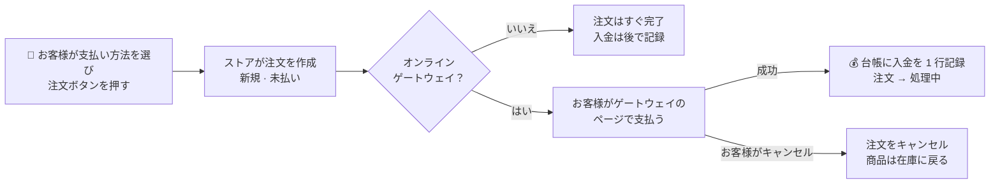

> 🌐 **言語:** [🇻🇳 Tiếng Việt](./payment_vi.md) · [🇬🇧 English](./payment.md) · 🇯🇵 日本語（現在）

# GP247 の決済 — ストアの設定と日々の運用

## はじめに

このドキュメントでは、GP247 がお客様からお金を受け取る仕組みを説明します。お客様が決済ページで支払い方法を選んでから、
決済ゲートウェイを通り、注文に入金が記録されるまでの流れです。**パート A** はストア管理者向けです。インストール、決済
ゲートウェイの設定、注文の入金の確認と記録を扱い、全体の流れを図で示します。読み終えると、オンライン決済を安全に
有効にでき、各注文の入金がいつ記録されるかがわかります。決済プラグインを作成・修正したい開発者の方は
**パート B** をご覧ください。[拡張機能](../../extension/create-payment-plugin_ja.md)セクションの技術ドキュメントを案内しています。

---

## パート A — ストア管理者向け

### A1. 知っておきたい用語

| 用語 | わかりやすく言うと |
|---|---|
| **支払い方法** | ストアにインストールした **決済プラグイン**（*Payment* グループ）です。有効なプラグインごとに、決済ページの選択肢が 1 つ表示されます。 |
| **ゲートウェイを使わない決済** | お客様は注文するだけで完了し、お金は後で受け取ります。代金引換や、案内に沿った銀行振込などです。例：`CashPayment` プラグイン。 |
| **オンライン決済ゲートウェイ** | お客様はゲートウェイの安全なページ（カード、電子ウォレットなど）へ移動し、支払い後にストアへ戻ります。例：`StripePayment`、`PaypalExpress` プラグイン。 |
| **注文の入出金台帳** | 入金や返金は 1 回ごとに、注文の台帳の **1 行** になります（日付、金額、支払い方法、取引 ID）。注文の **入金済み** と **残額** はこの台帳から計算されます。 |
| **支払いステータス** | 未払い · 一部支払い · 支払い済み · 返金 — **システムが台帳から自動で判定します**。手で選ぶ必要はありません。 |
| **Webhook** | 入金や返金があったとき、ゲートウェイがウェブサイトへ自動で「通知」します。お客様がストアに戻る前にブラウザを閉じても、注文に入金が記録されます。 |
| **テスト環境（sandbox/test）** | ゲートウェイのテスト用アカウントです。支払いは模擬で、実際のお金は動きません。本番（live）に切り替える前に、必ずここで試してください。 |

### A2. 全体像：お客様の 1 回の支払い

- **ゲートウェイを使わない場合**（代金引換、銀行振込）：入金は後で記録します。受け取ったときに手で記録するか、
  配送業者の代金引換の精算で記録されます。
- **ゲートウェイを使う場合**：ゲートウェイが確認したときに入金が記録されます（お客様が戻ったとき **および／または**
  Webhook）。同じ取引が何度通知されても、記録されるのは **1 回だけ** です。支払いステータスは自動で再計算され、注文は
  あなたが選んだステータス（通常は *処理中*）に変わります。
- **お客様がゲートウェイのページでキャンセルした場合**：標準のプラグインは注文をキャンセルし、商品を在庫に戻します。

その後の **返金**（ゲートウェイの管理画面で行うものも、ストアから行うものも）も、台帳の 1 行として記録されます。
各段階でのお金と在庫の動きは [注文のライフサイクル](../order-processing/order-lifecycle_ja.md) をご覧ください。

### A3. オンライン決済ゲートウェイの設定手順

1. **プラグインをインストールします。** **管理画面 → プラグイン** を開き、決済プラグイン（*Payment* グループ）を探して
   **インストール**、続けて **有効にする** を押します。複数のストアがある場合は、使うストアで有効にしてください。
2. **プラグインの設定画面を開きます**（プラグインの行にある設定ボタン）。
3. **テスト環境（Test / Sandbox）を選び**、ゲートウェイの管理画面で取得した **テスト用キー** を貼り付けます。秘密キーの
   欄は保存時に **暗号化** されます。保存後は「値が設定済み」とだけ表示され、キーそのものは再表示されません。変更するには
   新しいキーを入力します。
4. 設定画面に表示される **Webhook の URL をコピー** し、ゲートウェイの管理画面の Webhook 欄に貼り付けます。
   （ゲートウェイが求める場合は）ゲートウェイの **Webhook 署名シークレット** をプラグイン側に貼り付けます。
5. **支払い成功後の注文ステータスを選びます**（通常は *処理中*）。項目があれば、返金時のステータスも選びます。
6. **保存** を押します。期待される結果：保存成功のメッセージが表示されます。プラグインによっては、保存時に接続を確認します。
7. ストアで **テスト注文をします。** ゲートウェイのテスト用カード／アカウントで支払います。
   期待される結果：サンクスページに戻ります。注文詳細では **入金済み** が注文合計と同じになり、支払いステータスは
   *支払い済み*、注文ステータスは手順 5 の設定どおりに変わります。
8. **お客様が戻る前にブラウザを閉じたケースも試します。** Webhook によって、注文に入金が記録されるはずです。記録されない
   場合は、手順 4 を見直してください。
9. 問題がなければ、**本番環境（Live）に切り替え**、本番用キーを入力し、ゲートウェイ側の Webhook も本番用に更新します。

> キーの取得方法や各ゲートウェイ固有の項目は、そのプラグインの README（例：`StripePayment`、`PaypalExpress`）にあります。
> ゲートウェイが受け付ける通貨は限られています。ストアの通貨にゲートウェイが対応しているか確認してください。

**ゲートウェイを使わない決済**（例：`CashPayment`）は、インストールして有効にするだけです。プラグインの設定画面で入力した
メッセージ（`CashPayment` の場合は **チェックアウト時にお客様へ表示するメモ** 欄で、ストアごとに入力できます）は、お客様が
その支払い方法を選ぶとすぐ下に表示され、注文前の **確認** ステップでも再表示されます。メッセージはプレーンテキスト
（書式なし、リンクなし）です。「商品受け取り時に現金でお支払いください」や口座番号のような短い案内に向いています。お客様が
正しく振り込めるよう **金額と注文番号** を表示したい場合は、注文後にプラグインが専用の案内ページを作ります。
[銀行振込プラグイン](../../extension/create-payment-plugin_ja.md) の例をご覧ください。注文は未払いの状態で作成され、
受け取ったときに入金を記録します。

> ℹ️ **対応バージョン:** gp247/shop 3.1.4（それより古いバージョンでは支払い方法の名前だけが表示されます）。決済ステップを
> オーバーライドしているカスタムテンプレートは、更新しないとメッセージが表示されません。

### A4. 注文の入金を確認・記録する

**管理画面 → 注文 → 注文詳細** を開き、合計金額の部分を見ます。

- **入金済み / 残額**：入出金台帳から計算され、ゲートウェイから入金の通知があると自動で更新されます。
- **入金を記録**：ゲートウェイ以外で入金があったとき（お客様の銀行振込、現金払い）に使います。金額、入金日、支払い方法を
  入力します。1 回の記録が台帳の 1 行になります。
- **返金を記録**：お客様に返したお金を記録します。返金しても商品は在庫に **戻りません**。商品を在庫に戻したい場合は、
  注文をキャンセルしてください。
- **支払いリクエスト**：**残額の支払いリンク** を作ってお客様に送り、残りをオンラインで支払ってもらいます。または
  **返金リクエスト** を作ります。[支払いリクエスト（Payment Request）](../order-processing/payment-request_ja.md) をご覧ください。

### A5. 代金引換（COD）と配送の組み合わせ

お客様が **代金引換** を選び（既定は `CashPayment` プラグイン）、代金引換に対応した配送業者で送り状を作成すると、代金引換の
金額は注文の **未払い残額** が自動で使われます。配送業者が精算済みと通知すると、配送タブの設定に応じて、注文の台帳に入金を
自動で記録できます。[GP247 の配送](../shipping/shipping_ja.md) の A6 をご覧ください。

---

## パート B — 開発者向け

このドキュメントでは使い方だけを扱います。技術的な内容 — `gp247/shop` に用意されている接続ポイント、プラグインが守るべき
お金の契約、サンプルコード — は次にあります。

- [決済プラグインの作成](../../extension/create-payment-plugin_ja.md) — コード付きの手順（銀行振込プラグイン、Webhook 付きの
  オンラインゲートウェイ）。セクション 5 は `gp247/shop` に何が用意され、どこにあるかの早見表です。
- [プラグインを v1 から v2 へ変換](../../extension/convert-plugin-v1-to-v2_ja.md)、ステップ 8d — 古い決済プラグインのアップグレード。

> 💡 AI エージェントと作業する場合：リポジトリ
> [gp247-skills](https://github.com/gp247net/gp247-skills) のスキル **`gp247-payment-plugin-create`** を使ってください。
> エージェントに推測させず、`gp247/shop` の契約どおりにプラグインを作ります。

---

## 条件と制約（操作の前に確認）

**お客様が支払うとき**
- **注文はお客様がゲートウェイへ移動する前に作成されます。** お客様が途中でやめた場合、注文は *新規 / 未払い* のまま残り、
  キャンセルするか連絡するかをあなたが判断します。お客様がゲートウェイのページでキャンセルした場合、標準のプラグインは
  注文をキャンセルし、商品を在庫に戻します。
- **入金はゲートウェイが確認したときだけ記録されます。** また、ゲートウェイから何度通知があっても **1 つの取引は 1 回だけ**
  記録されます。お金を二重に数えないためです。
- **ゲートウェイが注文合計と異なる金額を受け取った場合**（標準のプラグイン）→ 実際に受け取った金額を差異のメモ付きで記録し、
  注文を支払い済みには **しません**。差額を隠さず、あなたが照合できるようにするためです。
- **遅れて届いた Webhook は、あなたが処理済みの注文のステータスを変えません。** 自動で変わるのは、まだ *新規* の注文だけです。

**注文を操作するとき**
- **返金しても商品は在庫に戻りません。** 2 つは別の作業です。商品を在庫に戻したい場合は注文をキャンセルします。
- **入出金が発生した注文は削除できません。** 受け取ったお金の記録が帳簿から消えないようにするためです。
- **完了、キャンセル、返金済みの注文は編集がロックされます。** 注文が確定しているためです。

**設定するとき**
- **秘密キーは暗号化され、再表示されません。** 変更するには新しいキーを入力します。空欄のままにすると、古いキーが保持されます。
- **プラグインをアンインストールしても、記録済みの入金は消えません。** 入出金台帳の行はストアの帳簿の一部です。

---

## よくある質問（Q&A）

**Q1: お客様は支払ったのに、注文が「未払い」のままです。なぜですか？**

→ 多くの場合、Webhook の設定（Webhook の URL や署名シークレット）が正しくありません。A3 の手順 4 とシステムログを確認し、
ゲートウェイの管理画面の **イベント再送** 機能を使ってください。入金は正確に 1 回だけ記録されます。この入金を **手で記録しないで
ください。** 手入力の欄にはゲートウェイの取引 ID がないため、後で Webhook が届くと入金が二重に記録されます。

**Q2: ゲートウェイから 2 回通知がありました。入金は二重に加算されますか？**

→ いいえ。取引にはそれぞれ固有の ID があり、台帳には 1 つの ID につき 1 行だけ記録されます。

**Q3: 注文を「完了」にすると、「支払い済み」になりますか？**

→ いいえ。支払いステータスは台帳のお金だけから計算されます。[注文のライフサイクル](../order-processing/order-lifecycle_ja.md) をご覧ください。

**Q4: ゲートウェイの管理画面で返金した場合、ストアにも伝わりますか？**

→ はい。返金の Webhook に対応したゲートウェイ（例：Stripe、PayPal）なら、返金が注文の台帳に記録されます。全額返金すると、
注文は *返金済み* になります。

**Q5: お客様が不足分をオンラインで支払いたい場合は？**

→ 注文詳細で **残額の支払いリンク** を押し、リンクをお客様に送ってください。
[支払いリクエスト](../order-processing/payment-request_ja.md) をご覧ください。

**Q6: ストアごとに別のゲートウェイアカウントを使えますか？**

→ ストアごとの設定に対応したプラグインなら使えます。プラグインの設定画面でストアを選び、専用のキーを入力します。キーを
入力していないストアは、共通のアカウントを使います。

**Q7: 実際のお金を使わずにテストするには？**

→ ゲートウェイのテスト環境（Test / Sandbox）で、ゲートウェイが提供するテスト用キーとテスト用カードを使います。途中で
ブラウザを閉じるケースも試してから、本番に切り替えてください。

**Q8: 別の決済ゲートウェイ用のプラグインを自分で作りたいのですが？**

→ [決済プラグインの作成](../../extension/create-payment-plugin_ja.md) をご覧ください。AI エージェントと作業する場合は、スキル
`gp247-payment-plugin-create` を使ってください。エージェントに推測させず、`gp247/shop` のお金の契約どおりにプラグインを作ります。

**Q9: 代金引換の場合、入金はいつ記録されますか？**

→ お金を受け取った後にあなたが手で記録したときです。または、配送業者が代金引換の精算済みを通知したときに自動で記録されます
（配送タブで自動記録の項目を有効にしている場合）。

**Q10: 決済プラグインをアンインストールすると、過去の注文の入金履歴は消えますか？**

→ いいえ。記録済みの入出金は注文の入出金台帳にあり、そのまま残ります。アンインストールで削除されるのはプラグインの設定だけです。

---

## 変更履歴
<!-- ロジック／動作に変更があった場合のみ記録します。最新の行を一番上にします。1 日 1 行：同じ日の変更は既存の行にまとめ、新しい行に分けません。 -->

| 日付 | GP247 バージョン | 変更内容 |
| --- | --- | --- |
| 2026-10-18 | gp247/shop 3.1.4 | ゲートウェイを使わない決済：プラグインのメッセージ `note`（例：`CashPayment`）が、お客様が選んだ支払い方法の下と確認ステップに表示されるようになりました。金額／注文番号が必要な案内は、引き続きプラグイン専用のページを使います。決済プラグイン作成ガイドへのリンクを追加しました |

---

📅 **最終更新:** 2026-10-22 · ✍️ **作成者 (Author):** GP247
