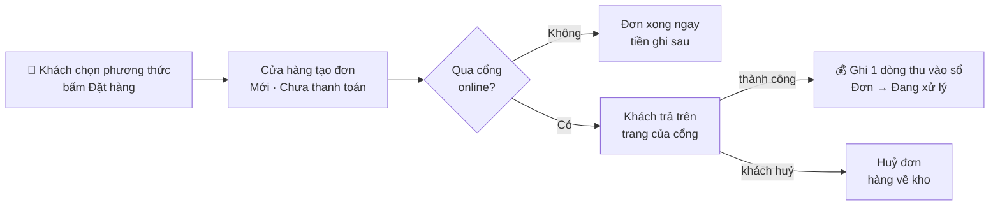
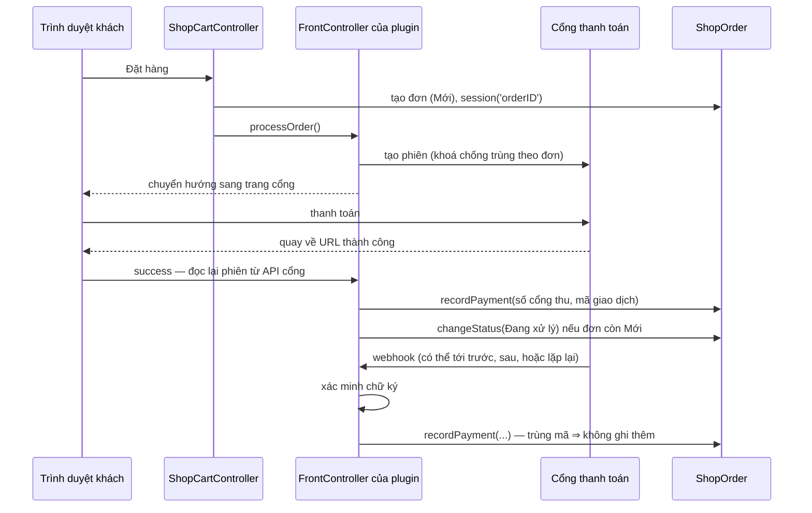

> 🌐 **Ngôn ngữ:** 🇻🇳 Tiếng Việt (hiện tại) · [🇬🇧 English](./payment.md)

# Thanh toán trong GP247 — thiết lập cho cửa hàng và hướng dẫn cho lập trình viên

## Giới thiệu

Tài liệu này giải thích cách GP247 nhận tiền của khách: từ lúc khách chọn phương thức ở trang thanh toán, qua cổng
thanh toán, tới khi tiền được ghi vào đơn. **Phần A** dành cho người quản lý cửa hàng: cài đặt, thiết lập cổng thanh
toán, theo dõi và ghi nhận tiền trên đơn, có sơ đồ để hình dung toàn bộ luồng. **Phần B** dành cho lập trình viên:
GP247 đã có sẵn những gì, nằm ở đâu, và cần làm gì khi tích hợp một cổng mới hay chỉnh sửa. Đọc xong, chủ cửa hàng tự
bật được thanh toán online an toàn; lập trình viên biết chính xác điểm nối nào phải dùng để tiền không bị ghi sai hay
ghi hai lần.

---

## Phần A — Dành cho người quản lý cửa hàng

### A1. Các khái niệm cần biết

| Khái niệm | Nghĩa đời thường |
|---|---|
| **Phương thức thanh toán** | Một **plugin thanh toán** cài vào cửa hàng (nhóm *Payment*). Mỗi plugin đang bật hiện thành một lựa chọn ở trang thanh toán. |
| **Thanh toán không qua cổng** | Khách đặt đơn xong là xong, tiền thu sau: thanh toán khi nhận hàng, chuyển khoản theo hướng dẫn. Ví dụ plugin `CashPayment`. |
| **Cổng thanh toán online** | Khách được chuyển sang trang bảo mật của cổng (thẻ, ví điện tử…) rồi quay về cửa hàng. Ví dụ plugin `StripePayment`, `PaypalExpress`. |
| **Sổ thanh toán của đơn** | Mỗi lần thu hoặc hoàn tiền là **một dòng** trong sổ của đơn (ngày, số tiền, phương thức, mã giao dịch). **Đã nhận** và **Còn lại** của đơn được tính từ sổ này. |
| **Trạng thái thanh toán** | Chưa thanh toán · Thanh toán 1 phần · Đã thanh toán · Hoàn tiền — **hệ thống tự suy ra từ sổ**, bạn không phải chọn. |
| **Webhook** | Cổng tự "gọi về" website khi có tiền vào/hoàn — đơn vẫn được ghi tiền kể cả khi khách đóng trình duyệt trước khi quay lại. |
| **Môi trường thử (sandbox/test)** | Tài khoản thử của cổng: thanh toán giả, không mất tiền thật. Luôn chạy thử ở đây trước khi chuyển sang thật (live). |

### A2. Toàn cảnh: một lần khách thanh toán

- **Không qua cổng** (khi nhận hàng, chuyển khoản): tiền ghi sau — bạn ghi tay khi nhận, hoặc hãng vận chuyển đối
  soát tiền thu hộ.
- **Qua cổng**: tiền được ghi khi cổng xác nhận (khách quay về **và/hoặc** webhook); cùng một giao dịch báo về nhiều
  lần vẫn chỉ ghi **một lần**. Trạng thái thanh toán tự tính lại; đơn chuyển sang trạng thái bạn chọn (thường *Đang xử lý*).
- **Khách huỷ trên trang cổng**: các plugin chuẩn huỷ đơn và trả hàng về kho.

Sau đó, mọi khoản **hoàn tiền** (làm trên trang quản trị của cổng hoặc từ cửa hàng) cũng được ghi thành một dòng
trong sổ. Xem chi tiết tiền và tồn kho ở từng chặng tại [Vòng đời đơn hàng](../order-processing/order-lifecycle_vi.md).

### A3. Cài đặt một cổng thanh toán online từng bước

1. **Cài plugin.** Vào **Admin → Plugins**, tìm plugin thanh toán (nhóm *Payment*), bấm **Cài đặt** rồi **Bật**. Có
   nhiều cửa hàng thì bật cho đúng cửa hàng cần dùng.
2. **Mở màn cấu hình của plugin** (nút cấu hình ngay trên dòng plugin).
3. **Chọn môi trường Thử (Test / Sandbox)** và dán **khoá thử** lấy từ trang quản trị của cổng. Các ô khoá bí mật
   được **mã hoá** khi lưu; sau khi lưu, ô chỉ hiện "đã có giá trị" chứ không hiện lại khoá — muốn đổi thì gõ khoá mới.
4. **Sao chép địa chỉ webhook** hiển thị trên màn cấu hình, dán vào phần webhook trên trang quản trị của cổng, và
   (nếu cổng yêu cầu) dán ngược **mã ký webhook** của cổng vào plugin.
5. **Chọn trạng thái đơn sau khi thanh toán thành công** (thường là *Đang xử lý*) và, nếu có, trạng thái khi hoàn tiền.
6. Bấm **Lưu**. Kết quả mong đợi: thông báo lưu thành công; một số plugin kiểm tra kết nối ngay khi lưu.
7. **Đặt thử một đơn** ở trang cửa hàng, thanh toán bằng thẻ/tài khoản thử của cổng.
   Kết quả mong đợi: quay về trang cảm ơn; trong chi tiết đơn, **Đã nhận** bằng tổng đơn, trạng thái thanh toán là
   *Đã thanh toán*, trạng thái đơn đổi theo bước 5.
8. **Thử cả trường hợp khách đóng trình duyệt** trước khi quay về: đơn vẫn phải được ghi tiền nhờ webhook. Nếu không,
   kiểm tra lại bước 4.
9. Khi đã ổn, **chuyển sang môi trường Thật (Live)** và nhập khoá thật, cập nhật webhook bên cổng cho môi trường thật.

> Cách lấy khoá và các ô riêng của từng cổng nằm trong README của plugin đó (ví dụ `StripePayment`, `PaypalExpress`).
> Cổng chỉ nhận một số đồng tiền nhất định — kiểm tra đồng tiền của cửa hàng có được cổng hỗ trợ.

**Thanh toán không qua cổng** (ví dụ `CashPayment`): chỉ cần cài và bật. Lời nhắn bạn nhập ở màn cấu hình của plugin
(với `CashPayment` là ô **Ghi chú hiển thị cho khách khi thanh toán**, nhập riêng được cho từng cửa hàng) hiện ngay dưới
phương thức khi khách chọn nó, và được nhắc lại ở bước **Xác nhận** trước khi đặt. Lời nhắn là chữ thường (không định
dạng, không link) — hợp với hướng dẫn ngắn như "Trả tiền mặt khi nhận hàng" hay số tài khoản. Cần hiện **số tiền và mã
đơn** để khách chuyển khoản đúng thì plugin dựng trang hướng dẫn riêng sau khi đặt — xem ví dụ
[plugin chuyển khoản](../../extension/create-payment-plugin_vi.md). Đơn đặt xong ở trạng thái chưa thanh toán; tiền
được ghi khi bạn nhận.

> ℹ️ **Có từ:** gp247/shop 3.1.4 (bản cũ hơn chỉ hiện tên phương thức). Template tuỳ biến có override bước thanh toán
> phải được cập nhật theo thì mới hiện lời nhắn.

### A4. Theo dõi và ghi nhận tiền trên đơn

Mở **Admin → Đơn hàng → chi tiết đơn**, phần tổng tiền:

- **Đã nhận / Còn lại**: tính từ sổ thanh toán, cập nhật tự động khi cổng báo tiền về.
- **Ghi nhận tiền đã thu**: dùng khi tiền đến ngoài cổng (khách chuyển khoản, trả tiền mặt). Nhập số tiền, ngày
  thu, phương thức; mỗi lần ghi là một dòng trong sổ.
- **Ghi nhận tiền hoàn lại khách**: ghi khoản bạn đã trả lại khách. Hoàn tiền **không** trả hàng về kho — muốn hàng
  về kho thì huỷ đơn.
- **Yêu cầu thanh toán**: **Tạo link thu phần còn lại** gửi khách trả nốt online, hoặc **Tạo yêu cầu hoàn tiền**.
  Xem [Yêu cầu thanh toán (Payment Request)](../order-processing/payment-request_vi.md).

### A5. Thanh toán khi nhận hàng (COD) kết hợp vận chuyển

Khi khách chọn **thanh toán khi nhận hàng** (mặc định là plugin `CashPayment`) và bạn tạo vận đơn với một hãng có
thu hộ, số tiền thu hộ tự lấy bằng **số còn phải trả** của đơn. Khi hãng báo đã đối soát, tiền có thể được ghi tự
động vào sổ của đơn — tuỳ thiết lập ở tab Vận chuyển. Xem [Vận chuyển trong GP247](../shipping/shipping_vi.md), mục A6.

---

## Phần B — Dành cho lập trình viên

### B1. GP247 đã có sẵn những gì, nằm ở đâu

Phần thanh toán nằm trong package `gp247/shop` (`vendor/gp247/shop/src/`). **Không sửa trong `vendor/`** — mọi tuỳ
biến đi qua plugin.

| Thành phần | Vị trí | Việc nó làm (bạn không phải viết lại) |
|---|---|---|
| Chuyển giao từ checkout | `Controllers/ShopCartController.php` (sau khi tạo đơn) | Tạo đơn, đặt `session('orderID')`, gọi `processOrder()` của plugin nếu có, không có thì hoàn tất đơn; `completeOrder()` / `cancelOrder()` cho trang quay về |
| Sổ thanh toán | `Models/ShopOrder.php` → `recordPayment()`, `recordRefund()`; bảng `shop_order_transaction` | Ghi một dòng thu/hoàn, chống trùng theo mã giao dịch, tính lại *Đã nhận*, *Còn lại*, trạng thái thanh toán |
| Đổi trạng thái đơn | `ShopOrder::changeStatus()` | Hoàn kho khi huỷ, ghi lịch sử, phát sự kiện; từ chối chuyển trạng thái không hợp lệ |
| Yêu cầu thanh toán | `Payment/` — `PaymentRequestService.php`, `GatewayRegistry.php`, `Contracts/PaymentGateway.php` | Link thanh toán và hoàn tiền ngoài giỏ hàng; cổng tham gia bằng cách đăng ký driver |
| Danh sách cổng | khoá config `gp247-config.payment.gateways` | Nơi plugin khai báo driver và năng lực `collect` / `refund` / `payout` |
| Thu hộ | khoá config `gp247-config.shop.cod_payment_methods` | Phương thức nào là "thanh toán khi nhận hàng" để vận đơn mang tiền thu hộ |
| Mã hoá bí mật | ô `password` của `ConfigForm` (core), cờ `security = 1` | Khoá cổng mã hoá khi lưu, không gửi lại trình duyệt |

### B2. Hợp đồng mà một plugin thanh toán tuân theo

| Việc | Cách làm đúng | Vì sao |
|---|---|---|
| Hiện ở checkout | `configCode: "Payment"` trong `gp247.json`; `AppConfig::getInfo()` trả `title` và, nếu cần hướng dẫn, `note` (chuỗi chữ thường, đọc theo cửa hàng) | Checkout liệt kê plugin đang bật theo `configCode`; `note` không rỗng hiện dưới phương thức đang chọn và ở bước xác nhận, luôn được escape |
| Chuyển khách sang cổng | `Controllers\FrontController::processOrder()`: đọc `session('orderID')`, tạo phiên thanh toán **có khoá chống trùng theo đơn**, chuyển hướng | Gửi hai lần vẫn chỉ một phiên |
| Ghi tiền | `$order->recordPayment($amount, '<Key>', $providerTxnId, …)` — tiền theo **đồng tiền của đơn**, chỉ số cổng **đã xác nhận** | Webhook lặp chỉ ghi một lần; *Đã nhận* luôn đúng |
| Hoàn tiền | `$order->recordRefund(…)` theo mã hoàn của cổng; hoàn hết thì tự chuyển đơn sang *Đã hoàn tiền* qua `changeStatus()` | Trạng thái đơn không tự đổi theo tiền |
| Đổi trạng thái | `$order->changeStatus($statusId, $history)` và kiểm tra kết quả; chỉ chuyển đơn còn *Mới* | Không bỏ qua hoàn kho / lịch sử; webhook muộn không ghi đè việc admin đã làm |
| Webhook | Route **ngoài** nhóm middleware storefront, throttle rộng, **xác minh chữ ký trên body thô trước khi chạm database** | Middleware storefront có thể trả trang chuyển hướng mà cổng coi là "đã nhận" |
| Link thanh toán (tuỳ chọn) | Implement `PaymentGateway` (`key`, `capabilities`, `availableFor`, `collect`, `refund`), đăng ký vào `gp247-config.payment.gateways`; tiền ghi bằng `PaymentRequestService::recordMovement()` | Dùng chung màn Yêu cầu thanh toán của cửa hàng |
| Thu hộ (tuỳ chọn) | Thêm khoá plugin vào `gp247-config.shop.cod_payment_methods` | Vận đơn biết phải thu tiền mặt |

**Không bao giờ** tự ghi `status`, `payment_status` hay `received` của đơn bằng `update()`.

### B3. Luồng dữ liệu trong code

### B4. Việc của bạn theo từng tình huống

**Tích hợp một cổng thanh toán mới** — hướng dẫn từng bước có code: [Tạo plugin thanh toán](../../extension/create-payment-plugin_vi.md)

1. Tạo plugin: `php artisan gp247:make-plugin --name=MyGateway --download=0`, đặt `configCode: "Payment"`,
   `requireComposerPackages: ["gp247/shop"]`.
2. Màn cấu hình `ConfigForm`: khoá thử và khoá thật là hai ô `password` riêng (mã hoá), công tắc chế độ thử, trạng thái
   đơn sau thanh toán. Đọc theo cửa hàng của **đơn** (`$order->store_id`) khi xử lý webhook.
3. Viết `processOrder()`, route quay về / huỷ (trong nhóm storefront, có throttle) và webhook (ngoài nhóm storefront).
4. Ghi tiền và đổi trạng thái đúng bảng B2; bắt lỗi trùng khoá khi hai lần báo về cùng lúc và coi là "đã ghi".
5. Nếu cổng có API hoàn tiền và bạn muốn dùng màn Yêu cầu thanh toán: implement `PaymentGateway`.
6. Test không gọi cổng thật: `Http::fake()` và webhook mẫu có chữ ký — gồm trường hợp lặp, sai chữ ký, sai số tiền.

**Nâng cấp plugin thanh toán cũ**: bỏ mọi chỗ tự ghi trạng thái/số tiền của đơn, chuyển sang sổ thanh toán và
`changeStatus()`; đưa webhook ra ngoài nhóm storefront. Xem
[Chuyển đổi plugin v1 lên v2](../../extension/convert-plugin-v1-to-v2_vi.md), Bước 8d.

**Tự viết template giao diện**: nếu override bước thanh toán, giữ danh sách phương thức (`$paymentPlugins`), lời
gọi chọn phương thức và phần in `note` (đọc `$info['note'] ?? ''`, in bằng `{{ }}`) như bản gốc trong
`vendor/gp247/shop/src/Views/templates/GP247Front/livewire/shop_checkout-wizard.blade.php`.

**Mã tham khảo công khai**: `CashPayment` (không gọi cổng), `StripePayment` và `PaypalExpress` (cổng + webhook + link
thanh toán).

### B5. Làm việc cùng AI agent

> 💡 Dùng skill **`gp247-payment-plugin-create`** từ repo [gp247-skills](https://github.com/gp247net/gp247-skills)
> (chép thư mục skill vào thư mục skill của agent, ví dụ `.claude/skills/` với Claude Code). Skill tự dò phiên bản và
> năng lực của site trước khi viết code, dựng plugin đúng hợp đồng tiền ở trên, và được cập nhật cùng `gp247/shop`
> mỗi khi hợp đồng thanh toán thay đổi. Plugin vận chuyển: dùng `gp247-shipping-plugin-create`; các plugin khác:
> `gp247-plugin-create`. Hướng dẫn từng bước: [Tạo plugin thanh toán](../../extension/create-payment-plugin_vi.md).

---

## Điều kiện & ràng buộc (hiểu trước khi thao tác)

**Khi khách thanh toán**
- **Đơn được tạo trước khi khách sang cổng** — khách bỏ dở thì đơn nằm ở trạng thái *Mới / Chưa thanh toán* để bạn
  quyết định huỷ hay liên hệ; khách bấm huỷ trên trang cổng thì các plugin chuẩn huỷ đơn và trả hàng về kho.
- **Tiền chỉ được ghi khi cổng xác nhận**, và **một giao dịch chỉ ghi một lần** dù cổng báo về nhiều lần — tránh đếm
  tiền hai lần.
- **Cổng thu số tiền khác tổng đơn** (với các plugin chuẩn) → ghi đúng số thực thu kèm ghi chú lệch và **không** chuyển
  đơn sang đã thanh toán, để bạn đối chiếu thay vì che giấu chênh lệch.
- **Webhook muộn không đổi trạng thái đơn bạn đã xử lý** — chỉ đơn còn *Mới* mới được chuyển tự động.

**Khi thao tác trên đơn**
- **Hoàn tiền không trả hàng về kho** — hai việc riêng; muốn hàng về kho thì huỷ đơn.
- **Đơn đã phát sinh tiền không xoá được** — để sổ sách không mất dấu khoản đã thu.
- **Đơn đã Hoàn thành, Đã huỷ hoặc Đã hoàn tiền bị khoá sửa** — đơn đã chốt.

**Khi cấu hình**
- **Khoá bí mật được mã hoá và không hiện lại** — muốn đổi thì nhập khoá mới; để trống nghĩa là giữ khoá cũ.
- **Gỡ plugin không xoá tiền đã ghi** — các dòng trong sổ thanh toán thuộc sổ sách của cửa hàng.

---

## Hỏi & Đáp (Q&A)

**Câu 1: Khách đã trả tiền nhưng đơn vẫn "Chưa thanh toán"?**

→ Thường do webhook chưa cấu hình đúng (địa chỉ webhook hoặc mã ký). Kiểm tra lại bước 4 của mục A3 và nhật ký hệ
thống, rồi dùng chức năng **gửi lại sự kiện** trên trang quản trị của cổng — tiền sẽ được ghi đúng một lần. **Đừng ghi tay**
khoản này: ô ghi tay không có mã giao dịch của cổng, nên khi webhook tới sau, tiền sẽ bị ghi hai lần.

**Câu 2: Cổng báo về hai lần, tiền có bị cộng đôi không?**

→ Không. Mỗi giao dịch có mã riêng; sổ thanh toán chỉ ghi một dòng cho một mã.

**Câu 3: Tôi đổi đơn sang "Hoàn thành" thì có thành "Đã thanh toán" không?**

→ Không. Trạng thái thanh toán chỉ tính từ tiền trong sổ. Xem [Vòng đời đơn hàng](../order-processing/order-lifecycle_vi.md).

**Câu 4: Hoàn tiền trên trang quản trị của cổng thì cửa hàng có biết không?**

→ Có, với cổng hỗ trợ webhook hoàn tiền (ví dụ Stripe, PayPal): khoản hoàn được ghi vào sổ của đơn. Hoàn hết thì đơn
chuyển sang *Đã hoàn tiền*.

**Câu 5: Khách muốn trả nốt phần còn thiếu online?**

→ Ở chi tiết đơn, bấm **Tạo link thu phần còn lại** và gửi link cho khách. Xem
[Yêu cầu thanh toán](../order-processing/payment-request_vi.md).

**Câu 6: Mỗi cửa hàng dùng tài khoản cổng riêng được không?**

→ Được với plugin hỗ trợ cấu hình theo cửa hàng: chọn cửa hàng trên màn cấu hình plugin rồi nhập khoá riêng; cửa hàng
không nhập thì dùng tài khoản chung.

**Câu 7: Làm sao chạy thử mà không mất tiền thật?**

→ Dùng môi trường Thử (Test / Sandbox) của cổng với khoá thử và thẻ thử do cổng cung cấp. Chỉ chuyển sang Thật khi đã
thử cả trường hợp đóng trình duyệt giữa chừng.

**Câu 8: Tôi muốn tự viết plugin cho một cổng thanh toán khác?**

→ Xem Phần B. Nếu làm cùng AI agent, dùng skill `gp247-payment-plugin-create` — skill dựng plugin đúng hợp đồng tiền của
`gp247/shop` thay vì để agent tự đoán.

**Câu 9: Thanh toán khi nhận hàng thì tiền được ghi lúc nào?**

→ Khi bạn ghi tay sau khi nhận tiền, hoặc tự động khi hãng vận chuyển báo đã đối soát tiền thu hộ (nếu bạn bật ô tự ghi
ở tab Vận chuyển).

**Câu 10: Gỡ plugin thanh toán có mất lịch sử tiền của các đơn cũ không?**

→ Không. Các khoản đã ghi nằm trong sổ thanh toán của đơn và giữ nguyên; gỡ plugin chỉ xoá thiết lập của plugin.

---

## Lịch sử thay đổi
<!-- Chỉ ghi khi có thay đổi về logic/hành vi. Dòng mới nhất ở trên cùng. Mỗi ngày một dòng: cùng ngày thì gộp vào dòng có sẵn, không tách dòng mới. -->

| Ngày | Phiên bản GP247 | Thay đổi |
| --- | --- | --- |
| 2026-10-18 | gp247/shop 3.1.4 | Thanh toán không qua cổng: lời nhắn `note` của plugin (vd `CashPayment`) hiện dưới phương thức khách chọn và ở bước xác nhận; hướng dẫn cần số tiền/mã đơn vẫn dùng trang riêng của plugin; thêm liên kết hướng dẫn tạo plugin thanh toán |

---

📅 **Cập nhật lần cuối:** 2026-10-18 · ✍️ **Tác giả (Author):** GP247
