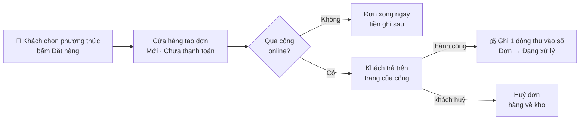

> 🌐 **Ngôn ngữ:** 🇻🇳 Tiếng Việt (hiện tại) · [🇬🇧 English](./payment.md) · [🇯🇵 日本語](./payment_ja.md)

# Thanh toán trong GP247 — thiết lập và vận hành cho cửa hàng

## Giới thiệu

Tài liệu này giải thích cách GP247 nhận tiền của khách: từ lúc khách chọn phương thức ở trang thanh toán, qua cổng
thanh toán, tới khi tiền được ghi vào đơn. **Phần A** dành cho người quản lý cửa hàng: cài đặt, thiết lập cổng thanh
toán, theo dõi và ghi nhận tiền trên đơn, có sơ đồ để hình dung toàn bộ luồng. Đọc xong, bạn tự bật được thanh toán
online an toàn và biết tiền của mỗi đơn được ghi lúc nào. Lập trình viên muốn viết hay sửa plugin thanh toán: xem
**Phần B** — trỏ sang tài liệu kỹ thuật ở mục [Extension](../../extension/create-payment-plugin_vi.md).

---

## Phần A — Dành cho người quản lý cửa hàng

### A1. Các khái niệm cần biết

| Khái niệm | Nghĩa đời thường |
|---|---|
| **Phương thức thanh toán** | Một **plugin thanh toán** cài vào cửa hàng (nhóm *Payment*). Mỗi plugin đang bật hiện thành một lựa chọn ở trang thanh toán. |
| **Thanh toán không qua cổng** | Khách đặt đơn xong là xong, tiền thu sau: thanh toán khi nhận hàng, chuyển khoản theo hướng dẫn. Ví dụ plugin `CashPayment`. |
| **Cổng thanh toán online** | Khách được chuyển sang trang bảo mật của cổng (thẻ, ví điện tử…) rồi quay về cửa hàng. Ví dụ plugin `StripePayment`, `PaypalExpress`. |
| **Sổ thanh toán của đơn** | Mỗi lần thu hoặc hoàn tiền là **một dòng** trong sổ của đơn (ngày, số tiền, phương thức, mã giao dịch). **Đã nhận** và **Còn lại** của đơn được tính từ sổ này. |
| **Trạng thái thanh toán** | Chưa thanh toán · Thanh toán 1 phần · Đã thanh toán · Hoàn tiền — **hệ thống tự suy ra từ sổ**, bạn không phải chọn. |
| **Webhook** | Cổng tự "gọi về" website khi có tiền vào/hoàn — đơn vẫn được ghi tiền kể cả khi khách đóng trình duyệt trước khi quay lại. |
| **Môi trường thử (sandbox/test)** | Tài khoản thử của cổng: thanh toán giả, không mất tiền thật. Luôn chạy thử ở đây trước khi chuyển sang thật (live). |

### A2. Toàn cảnh: một lần khách thanh toán

- **Không qua cổng** (khi nhận hàng, chuyển khoản): tiền ghi sau — bạn ghi tay khi nhận, hoặc hãng vận chuyển đối
  soát tiền thu hộ.
- **Qua cổng**: tiền được ghi khi cổng xác nhận (khách quay về **và/hoặc** webhook); cùng một giao dịch báo về nhiều
  lần vẫn chỉ ghi **một lần**. Trạng thái thanh toán tự tính lại; đơn chuyển sang trạng thái bạn chọn (thường *Đang xử lý*).
- **Khách huỷ trên trang cổng**: các plugin chuẩn huỷ đơn và trả hàng về kho.

Sau đó, mọi khoản **hoàn tiền** (làm trên trang quản trị của cổng hoặc từ cửa hàng) cũng được ghi thành một dòng
trong sổ. Xem chi tiết tiền và tồn kho ở từng chặng tại [Vòng đời đơn hàng](../order-processing/order-lifecycle_vi.md).

### A3. Cài đặt một cổng thanh toán online từng bước

1. **Cài plugin.** Vào **Admin → Plugins**, tìm plugin thanh toán (nhóm *Payment*), bấm **Cài đặt** rồi **Bật**. Có
   nhiều cửa hàng thì bật cho đúng cửa hàng cần dùng.
2. **Mở màn cấu hình của plugin** (nút cấu hình ngay trên dòng plugin).
3. **Chọn môi trường Thử (Test / Sandbox)** và dán **khoá thử** lấy từ trang quản trị của cổng. Các ô khoá bí mật
   được **mã hoá** khi lưu; sau khi lưu, ô chỉ hiện "đã có giá trị" chứ không hiện lại khoá — muốn đổi thì gõ khoá mới.
4. **Sao chép địa chỉ webhook** hiển thị trên màn cấu hình, dán vào phần webhook trên trang quản trị của cổng, và
   (nếu cổng yêu cầu) dán ngược **mã ký webhook** của cổng vào plugin.
5. **Chọn trạng thái đơn sau khi thanh toán thành công** (thường là *Đang xử lý*) và, nếu có, trạng thái khi hoàn tiền.
6. Bấm **Lưu**. Kết quả mong đợi: thông báo lưu thành công; một số plugin kiểm tra kết nối ngay khi lưu.
7. **Đặt thử một đơn** ở trang cửa hàng, thanh toán bằng thẻ/tài khoản thử của cổng.
   Kết quả mong đợi: quay về trang cảm ơn; trong chi tiết đơn, **Đã nhận** bằng tổng đơn, trạng thái thanh toán là
   *Đã thanh toán*, trạng thái đơn đổi theo bước 5.
8. **Thử cả trường hợp khách đóng trình duyệt** trước khi quay về: đơn vẫn phải được ghi tiền nhờ webhook. Nếu không,
   kiểm tra lại bước 4.
9. Khi đã ổn, **chuyển sang môi trường Thật (Live)** và nhập khoá thật, cập nhật webhook bên cổng cho môi trường thật.

> Cách lấy khoá và các ô riêng của từng cổng nằm trong README của plugin đó (ví dụ `StripePayment`, `PaypalExpress`).
> Cổng chỉ nhận một số đồng tiền nhất định — kiểm tra đồng tiền của cửa hàng có được cổng hỗ trợ.

**Thanh toán không qua cổng** (ví dụ `CashPayment`): chỉ cần cài và bật. Lời nhắn bạn nhập ở màn cấu hình của plugin
(với `CashPayment` là ô **Ghi chú hiển thị cho khách khi thanh toán**, nhập riêng được cho từng cửa hàng) hiện ngay dưới
phương thức khi khách chọn nó, và được nhắc lại ở bước **Xác nhận** trước khi đặt. Lời nhắn là chữ thường (không định
dạng, không link) — hợp với hướng dẫn ngắn như "Trả tiền mặt khi nhận hàng" hay số tài khoản. Cần hiện **số tiền và mã
đơn** để khách chuyển khoản đúng thì plugin dựng trang hướng dẫn riêng sau khi đặt — xem ví dụ
[plugin chuyển khoản](../../extension/create-payment-plugin_vi.md). Đơn đặt xong ở trạng thái chưa thanh toán; tiền
được ghi khi bạn nhận.

> ℹ️ **Có từ:** gp247/shop 3.1.4 (bản cũ hơn chỉ hiện tên phương thức). Template tuỳ biến có override bước thanh toán
> phải được cập nhật theo thì mới hiện lời nhắn.

### A4. Theo dõi và ghi nhận tiền trên đơn

Mở **Admin → Đơn hàng → chi tiết đơn**, phần tổng tiền:

- **Đã nhận / Còn lại**: tính từ sổ thanh toán, cập nhật tự động khi cổng báo tiền về.
- **Ghi nhận tiền đã thu**: dùng khi tiền đến ngoài cổng (khách chuyển khoản, trả tiền mặt). Nhập số tiền, ngày
  thu, phương thức; mỗi lần ghi là một dòng trong sổ.
- **Ghi nhận tiền hoàn lại khách**: ghi khoản bạn đã trả lại khách. Hoàn tiền **không** trả hàng về kho — muốn hàng
  về kho thì huỷ đơn.
- **Yêu cầu thanh toán**: **Tạo link thu phần còn lại** gửi khách trả nốt online, hoặc **Tạo yêu cầu hoàn tiền**.
  Xem [Yêu cầu thanh toán (Payment Request)](../order-processing/payment-request_vi.md).

### A5. Thanh toán khi nhận hàng (COD) kết hợp vận chuyển

Khi khách chọn **thanh toán khi nhận hàng** (mặc định là plugin `CashPayment`) và bạn tạo vận đơn với một hãng có
thu hộ, số tiền thu hộ tự lấy bằng **số còn phải trả** của đơn. Khi hãng báo đã đối soát, tiền có thể được ghi tự
động vào sổ của đơn — tuỳ thiết lập ở tab Vận chuyển. Xem [Vận chuyển trong GP247](../shipping/shipping_vi.md), mục A6.

---

## Phần B — Dành cho lập trình viên

Tài liệu này chỉ nói về cách dùng. Phần kỹ thuật — điểm nối có sẵn trong `gp247/shop`, hợp đồng tiền mà plugin phải tuân
theo, code mẫu — nằm ở:

- [Tạo plugin thanh toán](../../extension/create-payment-plugin_vi.md) — từng bước có code (plugin chuyển khoản, cổng
  online có webhook); mục 5 tra cứu nhanh `gp247/shop` có sẵn gì, nằm ở đâu.
- [Chuyển đổi plugin v1 lên v2](../../extension/convert-plugin-v1-to-v2_vi.md), Bước 8d — nâng cấp plugin thanh toán cũ.

> 💡 Làm cùng AI agent: dùng skill **`gp247-payment-plugin-create`** trong repo
> [gp247-skills](https://github.com/gp247net/gp247-skills) — skill dựng plugin đúng hợp đồng của `gp247/shop` thay vì để
> agent tự đoán.

---

## Điều kiện & ràng buộc (hiểu trước khi thao tác)

**Khi khách thanh toán**
- **Đơn được tạo trước khi khách sang cổng** — khách bỏ dở thì đơn nằm ở trạng thái *Mới / Chưa thanh toán* để bạn
  quyết định huỷ hay liên hệ; khách bấm huỷ trên trang cổng thì các plugin chuẩn huỷ đơn và trả hàng về kho.
- **Tiền chỉ được ghi khi cổng xác nhận**, và **một giao dịch chỉ ghi một lần** dù cổng báo về nhiều lần — tránh đếm
  tiền hai lần.
- **Cổng thu số tiền khác tổng đơn** (với các plugin chuẩn) → ghi đúng số thực thu kèm ghi chú lệch và **không** chuyển
  đơn sang đã thanh toán, để bạn đối chiếu thay vì che giấu chênh lệch.
- **Webhook muộn không đổi trạng thái đơn bạn đã xử lý** — chỉ đơn còn *Mới* mới được chuyển tự động.

**Khi thao tác trên đơn**
- **Hoàn tiền không trả hàng về kho** — hai việc riêng; muốn hàng về kho thì huỷ đơn.
- **Đơn đã phát sinh tiền không xoá được** — để sổ sách không mất dấu khoản đã thu.
- **Đơn đã Hoàn thành, Đã huỷ hoặc Đã hoàn tiền bị khoá sửa** — đơn đã chốt.

**Khi cấu hình**
- **Khoá bí mật được mã hoá và không hiện lại** — muốn đổi thì nhập khoá mới; để trống nghĩa là giữ khoá cũ.
- **Gỡ plugin không xoá tiền đã ghi** — các dòng trong sổ thanh toán thuộc sổ sách của cửa hàng.

---

## Hỏi & Đáp (Q&A)

**Câu 1: Khách đã trả tiền nhưng đơn vẫn "Chưa thanh toán"?**

→ Thường do webhook chưa cấu hình đúng (địa chỉ webhook hoặc mã ký). Kiểm tra lại bước 4 của mục A3 và nhật ký hệ
thống, rồi dùng chức năng **gửi lại sự kiện** trên trang quản trị của cổng — tiền sẽ được ghi đúng một lần. **Đừng ghi tay**
khoản này: ô ghi tay không có mã giao dịch của cổng, nên khi webhook tới sau, tiền sẽ bị ghi hai lần.

**Câu 2: Cổng báo về hai lần, tiền có bị cộng đôi không?**

→ Không. Mỗi giao dịch có mã riêng; sổ thanh toán chỉ ghi một dòng cho một mã.

**Câu 3: Tôi đổi đơn sang "Hoàn thành" thì có thành "Đã thanh toán" không?**

→ Không. Trạng thái thanh toán chỉ tính từ tiền trong sổ. Xem [Vòng đời đơn hàng](../order-processing/order-lifecycle_vi.md).

**Câu 4: Hoàn tiền trên trang quản trị của cổng thì cửa hàng có biết không?**

→ Có, với cổng hỗ trợ webhook hoàn tiền (ví dụ Stripe, PayPal): khoản hoàn được ghi vào sổ của đơn. Hoàn hết thì đơn
chuyển sang *Đã hoàn tiền*.

**Câu 5: Khách muốn trả nốt phần còn thiếu online?**

→ Ở chi tiết đơn, bấm **Tạo link thu phần còn lại** và gửi link cho khách. Xem
[Yêu cầu thanh toán](../order-processing/payment-request_vi.md).

**Câu 6: Mỗi cửa hàng dùng tài khoản cổng riêng được không?**

→ Được với plugin hỗ trợ cấu hình theo cửa hàng: chọn cửa hàng trên màn cấu hình plugin rồi nhập khoá riêng; cửa hàng
không nhập thì dùng tài khoản chung.

**Câu 7: Làm sao chạy thử mà không mất tiền thật?**

→ Dùng môi trường Thử (Test / Sandbox) của cổng với khoá thử và thẻ thử do cổng cung cấp. Chỉ chuyển sang Thật khi đã
thử cả trường hợp đóng trình duyệt giữa chừng.

**Câu 8: Tôi muốn tự viết plugin cho một cổng thanh toán khác?**

→ Xem [Tạo plugin thanh toán](../../extension/create-payment-plugin_vi.md). Nếu làm cùng AI agent, dùng skill
`gp247-payment-plugin-create` — skill dựng plugin đúng hợp đồng tiền của `gp247/shop` thay vì để agent tự đoán.

**Câu 9: Thanh toán khi nhận hàng thì tiền được ghi lúc nào?**

→ Khi bạn ghi tay sau khi nhận tiền, hoặc tự động khi hãng vận chuyển báo đã đối soát tiền thu hộ (nếu bạn bật ô tự ghi
ở tab Vận chuyển).

**Câu 10: Gỡ plugin thanh toán có mất lịch sử tiền của các đơn cũ không?**

→ Không. Các khoản đã ghi nằm trong sổ thanh toán của đơn và giữ nguyên; gỡ plugin chỉ xoá thiết lập của plugin.

---

## Lịch sử thay đổi
<!-- Chỉ ghi khi có thay đổi về logic/hành vi. Dòng mới nhất ở trên cùng. Mỗi ngày một dòng: cùng ngày thì gộp vào dòng có sẵn, không tách dòng mới. -->

| Ngày | Phiên bản GP247 | Thay đổi |
| --- | --- | --- |
| 2026-10-18 | gp247/shop 3.1.4 | Thanh toán không qua cổng: lời nhắn `note` của plugin (vd `CashPayment`) hiện dưới phương thức khách chọn và ở bước xác nhận; hướng dẫn cần số tiền/mã đơn vẫn dùng trang riêng của plugin; thêm liên kết hướng dẫn tạo plugin thanh toán |

---

📅 **Cập nhật lần cuối:** 2026-10-22 · ✍️ **Tác giả (Author):** GP247
