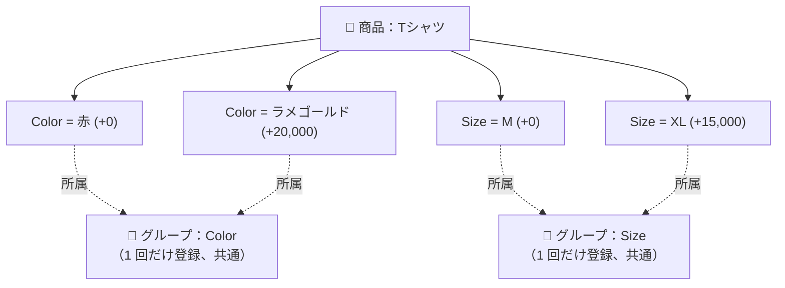
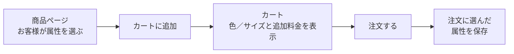

> 🌐 **言語:** [🇻🇳 Tiếng Việt](./product-attribute_vi.md) · [🇬🇧 English](./product-attribute.md) · 🇯🇵 日本語（現在）

# GP247 の商品属性（Product Attribute）

## はじめに
このドキュメントでは、GP247/S-Cart の **商品属性**（Product Attribute）を説明します。たとえば **色** や **サイズ** を選ぶと
追加料金がかかる、といった仕組みです。**技術に詳しくないストアオーナー** の方向けです。読み終えると、属性の 2 層構造が
わかり、管理画面での登録方法、追加料金が価格にどう加算されるか、そして最近強化された価格の安全対策がわかります。

---

## 1. 属性とは？ 2 層のモデル

GP247 の属性は **2 層** でできています。

- **属性グループ（Attribute Group）** — **1 回だけ登録し、すべての商品で共通** に使います。例：`Color`、`Size`。
- **属性値（Attribute value）** — **個々の商品** に付けます。値の名前と **追加料金**（`add_price`）を持ちます。`Color` グループの例：「赤」(+0)、「ラメゴールド」(+20,000)。

> 簡単に言うと、**グループ** は「選択肢の種類」（色、サイズ）です。**値** はその種類の具体的な選択肢で、商品ごとに付け、
> 選択肢ごとに料金を上乗せできます。

**重要な注意：** 属性を使えるのは **単品（Single）** の商品だけです。セット（Bundle）やグループ（Group）の商品では属性を
使いません（[商品の構成](./product-structure_ja.md) をご覧ください）。

---

## 2. 属性の登録（2 ステップ）

### ステップ A — 属性グループを作成する（1 回だけ）

1. 管理画面で **ショップ管理 → 商品・カテゴリ → 属性グループ**（Attribute group）を開きます。
2. 新規追加を押し、**グループ名**（例：`Color`）を入力し、ステータスを **オン** にして保存します。

   成功すると、`Color` グループが一覧に表示されます。商品に値を登録するとき、選択欄にも表示されるようになります。

### ステップ B — 商品に属性値を割り当てる

1. **商品・カテゴリ → 商品** を開き、商品（**単品** のもの）の編集を押します。
2. **「商品属性グループ一覧」**（Product attribute group list）タブを選びます。
3. 各行で次のように入力します。
   - 左側の選択欄：**グループ** を選びます（例：`Color`）。
   - **名前**（Name）欄：**値の名前** を入力します（例：`赤`）。
   - 下の数値欄：**追加料金**（`add_price`）を入力します。料金を上乗せしない場合は `0` のままにします。
4. 値（赤、ラメゴールドなど）ごとに **「+ 商品属性グループ一覧」** を押して、新しい行を追加します。
5. **送信**（Submit）を押して保存します。

   成功すると、ストアフロントで商品を見たお客様に、選択肢が追加料金付きで表示されます（例：「ラメゴールド (+20,000)」）。

> **内部での保存方法（ご安心ください）：** 送信を押すたびに、システムは **古い値をすべて削除してから、入力中の行どおりに
> 作り直します。** グループまたは名前が空の行は無視されます。

---

## 3. 追加料金が価格に加算される仕組み

いちばん大切な原則は、**価格はカートに固定で保存されない** ということです。システムは必要なたびに **再計算** します。

1 行の価格 = **商品の最終価格** + **選んだ属性の追加料金の合計**、これに数量を掛けます。

- 「商品の最終価格」には、特価（実施中の場合）がすでに反映されています。
- **追加料金 `add_price` は特価の後に加算されます。** つまり固定の上乗せ額で、特価の割引率では **割り引かれません**。
- 追加料金は行の **税金** の計算にも含まれます。そのため、注文の税金合計は各行の税金の合計と一致します。

**例：** 価格 100,000 の Tシャツが、特価で 80,000 になっています。お客様が「ラメゴールド (+20,000)」と「Size XL (+15,000)」を
選ぶと、1 枚の価格 = 80,000 + 20,000 + 15,000 = **115,000** です。

---

## 4. カートと注文の流れ

知っておきたい点：

- **属性の選択は必須です：** 属性がある商品は、お客様がカートに **すばやく追加することはできません**。商品ページで選んでから追加します。
- **同じ商品でも選択が違えば、カートの行は別になります：** たとえば「Tシャツ — 赤」と「Tシャツ — ラメゴールド」は別々の 2 行です。同じ商品で同じ選択なら、数量がまとめられます。
- **注文に選択が記録されます：** お客様が注文すると、選んだ属性が注文に保存され、管理画面の注文管理にも表示されます（例：「Tシャツ (Color:ラメゴールド (+20,000))」）。

---

## 5. 価格の安全対策（強化済み）

最近のアップデートで、GP247 は安全性とデータの整合性のために 2 つの点を強化しました。

1. **追加料金はサーバーが決めます（価格改ざん対策）。** 以前は追加料金 `add_price` がお客様のブラウザから送られていたため、
   理論上は安く買うために書き換えることができました。現在は、カートに追加するとき、システムがグループと値の名前をもとに
   **データベースから本当の追加料金を必ず読み直します。** お客様が **その商品にない選択肢** を送ってきた場合、システムは
   **カートへの追加を拒否します。** あなたが何かする必要はありません。すべてのストアが自動で保護されます。
2. **注文の属性情報が途切れなくなりました。** 注文の属性を保存する欄を広げたため、**複数のグループ** や **長い名前** の選択も、
   文字が欠けずに保存できます。

> 技術メモ（読まなくてもかまいません）：この変更は、ストアフロントでお客様が購入する流れに適用されます。**スタッフが管理画面で
> 手動作成する注文** では、引き続き追加料金を直接入力できます（ログインと権限管理がある社内向けの経路のためです）。

---

## よくある質問（Q&A）

**Q1: 「属性グループ」と「属性値」は何が違いますか？**

→ グループは共通で使う選択肢の種類（色、サイズ）で、1 回だけ登録します。値は具体的な選択肢（赤、XL）で、商品ごとに付け、追加料金を設定できます。

**Q2: 商品の編集画面に「商品属性グループ一覧」タブが見当たりません。**

→ 属性は **単品（Single）** の商品だけで使えます。セットやグループの商品にはこの部分がありません。

**Q3: 追加料金（`add_price`）とは何ですか？**

→ お客様がその値を選んだときに上乗せされる金額です。たとえば「ラメゴールド」を選ぶと 20,000 が加算されます。上乗せしない場合は 0 のままにします。

**Q4: 追加料金は特価で割り引かれますか？**

→ いいえ。追加料金は特価の **後に** 加算される固定額で、割引率では減りません。

**Q5: 同じ商品がカートで 2 行になるのはなぜですか？**

→ お客様が違う属性（例：赤とラメゴールド）を選んだからです。選択が違えば別の行になり、同じ選択なら数量がまとめられます。

**Q6: 属性がある商品を、お客様がすばやくカートに追加できないのはなぜですか？**

→ 先に属性（色／サイズ）を選ぶ必要があるからです。お客様は商品ページを開き、選んでからカートに追加します。

**Q7: お客様が追加料金を書き換えて安く買うことはできますか？**

→ できません。カートに追加するとき、システムは必ずデータベースから本当の追加料金を読み直します。その商品にない選択肢は拒否されます。

**Q8: 商品の値や追加料金を変更すると、過去の注文も変わりますか？**

→ いいえ。確定した注文は、購入時点の属性と価格をそのまま保持します。変更は新しい注文だけに適用されます。

**Q9: ある行の名前欄を空にするとどうなりますか？**

→ グループまたは名前が空の行は保存時に無視され、値は作成されません。

**Q10: 属性グループが多い注文（色 + サイズ + …）でも、情報は欠けませんか？**

→ 欠けません。注文の属性を保存する欄が広げられたため、グループが多くても名前が長くても、すべて保存できます。

---

📅 **最終更新:** 2026-10-22 · ✍️ **作成者 (Author):** GP247
