> 🌐 **言語:** [🇻🇳 Tiếng Việt](./product-stock-management_vi.md) · [🇬🇧 English](./product-stock-management.md) · 🇯🇵 日本語（現在）

# GP247 の商品在庫管理

## はじめに
このドキュメントでは、GP247/S-Cart の **在庫（stock）管理の業務ルール** を、**技術に詳しくないストアオーナー** の方向けに説明します。在庫がいつ増減するか、在庫を超えた販売を許可するかを決める 2 つの重要な設定、そして管理画面（admin）で作成した注文も、お客様がストアフロントで出した注文と **まったく同じように** 在庫を引き当てる理由です。読み終えると、自信を持って設定でき、在庫の数字がどう動くかがわかります。

---

## 1. 商品ごとの 2 つの数字

商品ごとに、覚えておきたい数量の数字が 2 つあります。

- **在庫（`stock`）**：現在販売できる数量です。
- **販売数（`sold`）**：これまでに販売した数量です（統計用で、自動で増えます）。

このほかに **最小数量（`minimum`）** があります。お客様が 1 回に購入しなければならない最小の数量です（既定は 1）。

> 注文が発生すると、システムは同じ数量だけ **`stock` を減らし**、**`sold` を増やします**。注文や注文明細を取り除くと、在庫は **戻されます**。

---

## 2. 在庫のライフサイクル図

```mermaid
flowchart TD
    A["📦 商品の在庫（stock）"]
    A -->|"注文の作成（ストアフロント または 管理画面）"| B["stock 減少 · sold 増加<br/>注文数量のぶん"]
    A -->|"管理画面で注文明細を追加／数量を増やす"| B
    B -->|"注文のキャンセル · 明細の削除 · 数量の削減"| A
    A -->|"キャンセルした注文の再開（在庫を確認）"| B
    A -.->|"セット（Bundle）商品"| C["各子商品の在庫を引き当て<br/>セット内の数量のぶん"]
```

> 図が表示されない環境で読んでいる場合は、単純に考えてください：**注文に載っている商品は、倉庫にはありません**。注文すると商品は倉庫から出ます。キャンセルすると倉庫に戻ります。キャンセルした注文を再開すると、商品はまた倉庫から出ます。

---

## 3. 在庫に基づく販売を決める 2 つの設定

**ショップ設定** には、在庫に直接影響するスイッチが 2 つあります。

| 設定 | 場所 | 意味 |
| --- | --- | --- |
| **在庫管理**（`product_stock`） | **商品** の設定 | オンにすると、ストアは在庫を管理します。**オフ** にすると在庫を気にせず、常に購入できます。 |
| **在庫切れでも購入を許可**（`product_buy_out_of_stock`） | **注文** の設定 | オンにすると、お客様は在庫を **超えて** 購入できます（在庫がマイナスになることがあります）。オフにすると、在庫を超える場合は **ブロック** します。 |

システムの「販売できる在庫が十分ある」というルールは次のとおりです。

> **（在庫切れでも購入を許可）** または **（在庫を管理しない）** または **（在庫 ≥ 注文数量）** の場合に、その数量の注文を許可します。

> **上下関係（重要）：** `product_stock` は **マスタースイッチ** です。`product_buy_out_of_stock` は **`product_stock` がオンのときだけ効果があります**。在庫管理をオフにすると、「在庫切れでも購入を許可」の設定は **意味を持ちません**（システムは常に購入を許可します）。2 つのスイッチは **矛盾しません**。「または」で組み合わされます。

関連する設定がほかに 2 つあります（任意）。
- **在庫切れ商品を非表示**（`product_display_out_of_stock`）：在庫管理がオンのとき、在庫が 0 になった商品をストアフロントから隠します。
- **予約注文**（`product_preorder`）：商品がまだなくても予約注文を受け付けます。

---

## 4. 在庫が減るとき、戻るとき

**在庫が減る**（`stock` が減り、`sold` が増える）のは次のときです。
1. お客様が **ストアフロント** で注文を完了したとき（決済の完了）。
2. あなたが **管理画面で注文を作成** したとき（注文作成画面）。
3. あなたが管理画面で注文に明細を **追加** したとき。
4. あなたが明細の **数量を増やした** とき（差分だけ引き当てます）。
5. あなたが **キャンセルした注文を再開** したとき — ステータスを「キャンセル」から別のステータスに変えたときです。キャンセル時に在庫へ戻した商品を、もう一度引き当てます。**この操作では在庫を確認します** — 下の注意をご覧ください。

**在庫が戻る**（`stock` が加算される）のは次のときです。
1. **注文をキャンセル** したとき — ステータスを「キャンセル」にすると、注文の **すべて** の明細の在庫が戻ります。
2. 注文の **明細を 1 行削除** したとき。
3. 明細の **数量を減らした** とき（差分だけ戻ります）。

4. **注文を削除** したとき → **商品がまだ在庫に戻っていなければ** 在庫を戻します（すでにキャンセル済みの注文なら、二重には加算しません）。

**在庫に影響しないもの：**
- **それ以外のステータス変更** すべて。たとえば「新規」→「処理中」→「完了」。在庫が動くのは、「キャンセル」に **入る** ときと「キャンセル」から **出る** ときだけです。

> ℹ️ **v3.0 からの変更 — 以前のやり方に慣れている方はよくお読みください。**
> v3.0 より前は、在庫を取り戻す唯一の方法が **注文の削除** で、ステータスを「キャンセル」にしても何も起きませんでした。現在は **逆** です。
> - **注文をキャンセル**（ステータスを「キャンセル」に変更）→ **商品は在庫に戻り**、注文は記録として残ります。
> - **注文を削除** → 商品は（まだ戻っていなければ）**在庫に戻りますが**、注文は **完全に消えます**。
>
> 理由：以前は在庫を取り戻すために注文を削除する **しかなく**、注文をキャンセルするたびに **伝票も失われていました**。現在は選べます：記録を残したいならキャンセル、そもそも存在すべきでない注文（入力ミス、テスト注文）なら削除です。

> ✅ **操作の順番を覚える必要はありません。** 注文を削除すると商品は自動で在庫に戻ります。注文がすでにキャンセル済みなら、商品が戻っていることをシステムが把握しているので、**二重には加算しません**。

> 🚫 **発送済みの注文は削除できません。** 注文の配送ステータスが「発送中」または「発送完了」の場合、システムは **削除をブロック** します。商品がお客様の手元にあるのに在庫へ戻してしまうからです。この場合は、削除せずに **注文ステータスを変更** してください。

> ⚠️ **キャンセルした注文を再開すると在庫が再び引き当てられ、拒否されることもあります。** 注文が「キャンセル」の間、商品は在庫に戻っており、**ほかの人に売れている可能性があります**。注文を再開すると、システムはまず在庫を確認します。
> - 在庫が十分 → 在庫を引き当て、注文ステータスは通常どおり変わります。
> - **在庫が不足** していて「在庫切れでも購入を許可」が **オフ** → システムは **拒否** し、理由をはっきり表示し、**何も変更しません**：どの明細も引き当てず、注文ステータスは「キャンセル」のままです。再開したい場合は、商品を入荷するか、「在庫切れでも購入を許可」を有効にしてください。
>
> この「すべてか、何もしないか」の拒否は意図的なものです。いくつかの明細だけ引き当てて途中で止まると、在庫は狂うのに注文は元のステータスのまま、という誰も追跡できない状態になるからです。

> ℹ️ **キャンセルを繰り返しても在庫は何度も加算されません。** システムは、どの注文の商品が **現在** 在庫にあるかを記憶しています。キャンセル → 再開 → 再キャンセルをしても、商品の移動は **それぞれの方向に 1 回ずつ** だけです。キャンセルを 2 回押したら在庫が 2 倍になる、ということはありません。

> 重要なポイント：**管理画面で作成した注文も、お客様の注文とまったく同じように在庫を引き当て／戻します**。以前は管理画面の注文が在庫を引き当てず、数字のずれが起きていましたが、現在は統一されています。

---

## 5. セット（Bundle）商品の在庫はどう引き当てられますか？

**セット（Bundle/Build）** 商品は、**1 セット** 売れると、セットに登録した数量に応じて **各子商品** の在庫を引き当てます（セット自身の在庫を管理している場合は、セットの在庫も引き当てます）。

例：「ギフトセット」= お菓子 1 箱 + 飲み物 2 本。1 セット売れる → 在庫から **お菓子 1 箱** と **飲み物 2 本** が引き当てられます。

> セットの作成と設定の詳細は **[セット商品（Bundle/Combo）](./product-bundle_ja.md)** と **[商品の構成](./product-structure_ja.md)** をご覧ください。

---

## 6. 在庫超過のブロック：ストアフロントと管理画面に同じルールを適用

**在庫管理**（`product_stock`）がオンで、「在庫切れでも購入を許可」（`product_buy_out_of_stock`）が **オフ** のとき、注文数量が在庫を超えると次のようになります。

- **ストアフロント（お客様が購入）：** システムが **ブロック** します。在庫を超える注文はできません。
- **管理画面（あなたが注文を作成／編集）：** システムは **ストアフロントとまったく同じようにブロック** します。在庫を超える注文／明細は保存できず、エラーメッセージが表示されます。（新しい注文の作成、明細の追加、明細の数量の増加のすべてに適用されます。）

> 簡単に言うと、**お客様も管理者も** 在庫を超えるとブロックされます。同じルール、同じ `product_buy_out_of_stock` 設定です。
>
> **変更点（2026-08-16 から）：** 以前、管理画面では *警告* が出るだけで、在庫を超える注文を保存できました。現在は、どの経路でも実在庫を超えて売らないよう **同じようにブロック** します。
>
> **それでも管理画面から在庫を超える注文を作りたい場合**（先に販売し、商品は後で入荷・補充する）→ 「在庫切れでも購入を許可」（`product_buy_out_of_stock`）を **オン** にします。すると両方の経路で在庫超過が許可されます（在庫はマイナスになることがあります）。

---

## 7. 設定の手順（初めての方向け）

1. 管理画面にログインし、**ショップ設定** を開きます。
2. **商品** グループを開き、**在庫管理**（`product_stock`）の項目を探します。
   - 在庫数を管理したい場合はオンにします。
   - サービスや数量に上限のない商品を販売する場合はオフにします（常に購入できます）。
3. **注文** グループを開き、**在庫切れでも購入を許可**（`product_buy_out_of_stock`）の項目を探します。
   - 在庫を超える販売をブロックしたい場合は **オフ** にします（物理的な商品にはおすすめです）。
   - 在庫切れでも購入を受け付ける場合はオンにします（在庫がマイナスになることがあります）。
4. 各 **商品** を開き、必要に応じて **在庫（`stock`）** と **最小数量（`minimum`）** を入力します。
5. 保存します。成功すると、更新成功のメッセージが表示され、在庫の数字はすぐにストアフロントに反映されます。

> 確認のヒント：在庫のある商品で管理画面からテスト注文を作り、その商品を開き直して、`stock` が減り `sold` が正しく増えているか確認してください。

---

## よくある質問（Q&A）

**Q1: ストアで在庫を気にしない（常に購入できる）ようにするには？**

→ **在庫管理**（`product_stock`）をオフにします。すると、システムは在庫数を確認せず、常に購入を許可します。

**Q2: 在庫切れのときにお客様が購入できないようにしたいのですが？**

→ **在庫管理** をオンにし、「在庫切れでも購入を許可」（`product_buy_out_of_stock`）を **オフ** にします。在庫が 0 になると、お客様は注文できなくなります。

**Q3: （古いバージョンで）管理画面で注文を作っても在庫が変わらなかったのはなぜですか？**

→ 以前の不具合で、管理画面の注文が在庫を引き当てていませんでした。現在のバージョンでは修正済みで、管理画面の注文もお客様の注文と同じように在庫を引き当て／戻します。

**Q4: 管理画面で在庫を超える注文を作った場合、保存できますか？**

→ **できません**（「在庫管理」がオンで、「在庫切れでも購入を許可」が **オフ** の場合）。**2026-08-16** から、管理画面も **ストアフロントのお客様とまったく同じように** ブロックされ、在庫を超える注文／明細は作成できません。どうしても在庫を超える必要がある場合（先に販売して後で入荷する）は、「在庫切れでも購入を許可」を **オン** にしてください。

**Q5: 在庫がマイナスになることはありますか？**

→ あります。ただし **「在庫切れでも購入を許可」**（`product_buy_out_of_stock`）が **オンのときだけ** です。その場合、お客様も管理者も在庫を超えて注文でき、在庫はマイナスになります（商品が不足している状態です）。この設定が **オフ** なら、**どの経路でも**（管理画面を含む）在庫を超える注文は作成できません。

**Q6: 注文を削除すると、在庫は自動で戻りますか？**

→ **戻ります**。注文がすでにキャンセル済み（商品が在庫に戻っている）なら、二重には加算しません。注意：**発送済み** の注文は削除できません。商品が倉庫ではなくお客様の手元にあるからです。

**Q7: セット（Bundle）商品の在庫はどう引き当てられますか？**

→ 1 セット売れると、セット内の数量に応じて **各子商品** の在庫が引き当てられます。[セット商品](./product-bundle_ja.md) のドキュメントもご覧ください。

**Q8: 「販売数」（`sold`）と「在庫」（`stock`）は何が違いますか？**

→ `stock` は販売できる残りの数量です。`sold` は販売済みの数量で、統計だけに使い、注文があると自動で増えます。

**Q9: ストアフロントで在庫切れの商品を隠したいのですが？**

→ **在庫切れ商品を非表示**（`product_display_out_of_stock`）の設定をオンにします。在庫管理がオンなら、在庫が 0 の商品は表示されません。

**Q10: 最小数量（`minimum`）は何のためにありますか？**

→ お客様に、1 回あたり一定以上の数量を購入してもらうためです（例：卸売で最低 10 個）。既定は 1 です。

## 変更履歴
<!-- ロジック／動作に変更があった場合のみ記録します。最新の行を一番上にします。1 日 1 行。 -->

| 日付 | GP247 バージョン | 変更内容 |
| --- | --- | --- |
| 2026-08-29 | v3.0 | **注文のキャンセル** で在庫が戻るようになりました（以前は戻りませんでした）。**注文の削除** でも引き続き在庫は戻りますが、商品がまだ戻っていない場合だけで、**発送済みの注文は削除がブロック** されます。**キャンセルした注文の再開** では在庫を再び引き当て、在庫不足かつ「在庫切れでも購入を許可」がオフの場合は **拒否** されます。キャンセル／再開／削除を何度繰り返しても、商品の移動はそれぞれの方向に 1 回ずつだけです |

---

📅 **最終更新:** 2026-10-22 · ✍️ **作成者 (Author):** GP247
