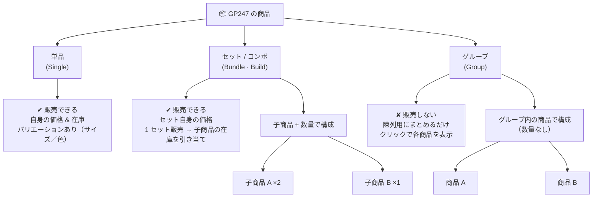

> 🌐 **言語:** [🇻🇳 Tiếng Việt](./product-structure_vi.md) · [🇬🇧 English](./product-structure.md) · 🇯🇵 日本語（現在）

# GP247 の商品の構成：単品 · セット · グループ

## はじめに
このドキュメントでは、GP247（バージョン 2 以降）で **商品を構成する 3 つの方法** を説明します：**単品（Single）**、
**セット／コンボ（Bundle）**、**グループ（Group）** です。**技術に詳しくない** ストアオーナーの方向けです。読み終えると、
3 つの種類を見分けられ、どれが販売でき、どれが陳列専用かがわかり、目的に合った種類を選べるようになります。

---

## 1. 全体の図

> 上の図が表示されない環境で読んでいる場合は、すぐ下の **比較表** をご覧ください。同じ内容です。

---

## 2. かんたん比較表

| 項目 | 単品（Single） | セット / コンボ（Bundle） | グループ（Group） |
| --- | --- | --- | --- |
| **お客様が直接購入できる？** | はい | はい | **いいえ**（閲覧のみ） |
| **販売価格がある？** | はい（自身の価格） | はい（**セット自身の価格**） | いいえ（価格ではなく文言を表示） |
| **在庫** | 自身の在庫 | セット自身の在庫を持つ。**1 セット売れると子商品の在庫を引き当て** | 管理しない |
| **中身は？** | その商品だけ | 複数の **子商品 + 数量** | 複数の **商品** をまとめたもの（数量なし） |
| **バリエーション（サイズ、色）** | **あり** | なし | なし |
| **特価** | あり | あり | なし |
| **カートに追加** | できる | できる | できない（商品ページへ移動） |

---

## 3. 各種類の説明

### 3.1. 単品（Single）
単独で販売する通常の商品です。例：「白い Tシャツ」。いちばんよく使う種類です。**バリエーション**（サイズ、色など）を
使えるのは **単品** だけです。自身の価格と在庫を持ちます。

### 3.2. セット / コンボ（Bundle）
**1 つのパッケージ** として販売する商品で、中に複数の **子商品** と数量が含まれます。例：「テト（旧正月）のギフトセット」=
お菓子 1 箱 + 飲み物 2 本。大切なポイント：
- **価格はあなたがセットに設定します**（GP247 は子商品の価格を自動で合計しません）。
- お客様が 1 セット買うと、システムは登録した数量に応じて **各子商品の在庫を引き当てます**。

> この種類の作成と設定の詳細は、専用のドキュメントをご覧ください：**[セット商品（Bundle/Combo）](./product-bundle_ja.md)**。

### 3.3. グループ（Group）
**陳列用にまとめる** だけで、**直接は販売しません**。例：関連するバージョン／色をまとめ、お客様がクリックで行き来できる
ようにします。グループには価格がなく、在庫も管理せず、購入ボタンもありません。お客様はグループ内の商品をクリックして、
その商品のページへ移動します。

---

## 4. どの種類を選べばよいですか？

1. **単独の商品**（サイズ／色の選択があってもよい）を販売する → **単品（Single）** を選びます。
2. 複数の商品をまとめた **セット** を 1 つの販売単位として販売し、中の商品の在庫を自動で引き当てたい →
   **セット（Bundle）** を選びます。
3. お客様が **見比べやすいようにまとめたい** だけで、まとめて販売はしない → **グループ（Group）** を選びます。

> 注意：商品を作成するときにこの 3 種類の選択肢を表示するには、ショップ設定で **`product_kind` の設定を有効にする** 必要が
> あります。オフの場合、すべての商品は既定で **単品** になり、種類の選択部分は非表示になります。

---

## よくある質問（Q&A）

**Q1: 商品を追加するとき、3 種類の商品を選ぶ場所が見当たりません。**

→ ショップ設定で `product_kind` の設定を有効にする必要があります。オフのときは、すべての商品が単品になり、種類の選択部分は
非表示になります。

**Q2: どの種類が販売でき、どの種類が販売できませんか？**

→ 単品とセット（Bundle）は販売できます。グループ（Group）は直接 **販売しません**。陳列専用です。

**Q3: セット（Bundle）とグループ（Group）は何が違いますか？**

→ Bundle は価格があり、子商品の在庫を引き当てる **販売できるセット** です。Group は **陳列用にまとめる** だけで、価格も
在庫もなく、カートにも追加できません。

**Q4: セットの価格は子商品から自動で合計されますか？**

→ いいえ。セットの価格はあなたが設定します。GP247 は自動で合計しません。

**Q5: バリエーション（サイズ、色）を使えるのはどの種類ですか？**

→ **単品（Single）** だけです。セットとグループではバリエーションを使いません。

**Q6: お客様が 1 セット買うと、在庫はどう引き当てられますか？**

→ セットの在庫から 1 が引かれ、セットに登録した数量に応じて **各子商品** の在庫が引かれます。

**Q7: 複数の商品を 1 つの価格でまとめて売りたい場合は、どの種類ですか？**

→ **セット（Bundle）** を選びます。作成方法の詳細は [セット商品](./product-bundle_ja.md) のドキュメントをご覧ください。

**Q8: 関連する商品をいくつかまとめて見やすくしたいだけで、まとめて販売はしない場合は？**

→ **グループ（Group）** を使います。お客様は各商品をクリックして表示し、グループ全体をまとめて購入することはありません。

**Q9: 作成した後で商品の種類を変更できますか？**

→ できますが、よく検討してください。セット／グループへの変更やセット／グループからの変更は、構成（子商品の一覧／グループ内の
商品）とバリエーションに影響します。変更後に確認してください。

**Q10: セット／グループを作った後で `product_kind` をオフにするとどうなりますか？**

→ 商品は単品として扱われ、種類の選択部分は非表示になります。以前のセット／グループのデータはデータベースに残っています。

---

📅 **最終更新:** 2026-10-22 · ✍️ **作成者 (Author):** GP247
