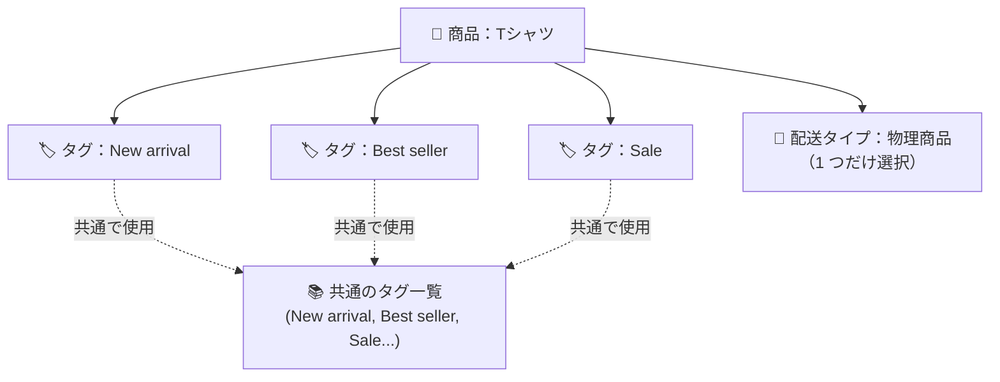

> 🌐 **言語:** [🇻🇳 Tiếng Việt](./product-tag_vi.md) · [🇬🇧 English](./product-tag.md) · 🇯🇵 日本語（現在）

# GP247 の商品キーワードタグ（Product Tag）

## はじめに
このドキュメントでは、GP247/S-Cart の **商品キーワードタグ**（Product Tag）を説明します。`New arrival`、`Best seller`、
`Sale` のようなキーワードを商品に付けて、お客様がタグで絞り込み・検索できるようにする機能です。**技術に詳しくない
ストアオーナー** の方向けです。読み終えると、機能の有効化、タグの作成と管理、商品へのタグの割り当てができるようになり、
**無効化（disable）と削除（delete）の違い** がはっきりわかります。

> ⚠️ **`gp247/shop` バージョン 2.1.6 以降でのみ使えます。** ストアで 2.1.6 より古い `gp247/shop` を使っている場合、この機能は
> **まだありません**。`gp247/shop` パッケージを 2.1.6 以降にアップデートし、`php artisan gp247:shop-update` を実行してください
> （[機能を有効にする](#1-キーワードタグ機能を有効にする) をご覧ください）。

---

## 最初に区別：「キーワードタグ」と「配送タイプ」は別物です

商品の編集画面には、名前が似ている欄が **2 つ** あります。混同しないでください。

- **キーワードタグ（Keyword tags）** — このドキュメントのテーマです。あなたが自由に決める **複数の** キーワード（`New arrival`、
  `Premium` など）で、分類・検索に使います。1 つの商品に **複数の** タグを付けられます。
- **配送タイプ（Delivery type）** — **1 つだけ** 選ぶ選択欄です。商品が **物理商品**、**ダウンロード**、**デジタル** のどれかを
  示します。これは商品の配送のしかたで、キーワードタグでは **ありません**。

> メモ：以前のバージョンでは、「配送タイプ」欄に誤って「Tags」というラベルが付いていて、誤解を招いていました。2.1.6 から
> ラベルが **「配送タイプ」** に修正され、**「キーワードタグ」** と区別されています。



---

## 1. キーワードタグ機能を有効にする

この機能には専用のオン／オフスイッチがあります。既定は **オン** です。

1. 管理画面で **ショップ管理 → ショップ設定**（Shop configuration）を開きます。
2. **商品**（Product）タブを選びます。
3. **「商品キーワードタグを使用（複数タグ）」**（Use product keyword tags (multi-tag)）の行を探し、**チェック** を入れます。
4. **保存**（Save）を押します。

   成功すると、商品の編集画面に **「キーワードタグ」** の入力欄が表示され、ストアフロントにタグが表示されるようになります。

> `gp247/shop` を 2.1.6 にアップデートしたばかりで、この設定の行や「商品タグ」メニューが **見当たらない** 場合は、
> データベースの更新コマンドを 1 回実行してください。
> ```
> php artisan gp247:shop-update
> ```
> このコマンドは、以前からインストールされているサイトに、設定スイッチ、ラベル、メニュー項目を追加します。何度実行しても
> 安全です（データが重複しません）。

---

## 2. タグの管理（追加 / 編集 / 有効・無効 / 削除）

1. **ショップ管理 → 商品・カテゴリ → 商品タグ**（Product tags）を開きます。
2. 左側が **追加／編集フォーム**、右側が **タグの一覧** です。
3. **新しいタグを追加** するには、左側のフォームに入力します。
   - **名前**（Name）— 必須です。例：`New arrival`。
   - **エイリアス**（Alias、URL 用の文字列）— **空欄** でもかまいません。システムが名前から自動で作ります（例：`New arrival`
     → `new-arrival`）。ストアフロントのリンク `/tag/<alias>` に表示される部分です。
   - **並び順**（Sort）— 必須で、0 以上の数値です。並べ替えに使います。
   - **有効**（Active）— チェックすると、タグがストアフロントに表示されます。
4. **送信**（Submit）を押します。

   成功すると、新しいタグが右側の一覧に表示され、商品に割り当てられるようになります。

5. タグを **編集** するには：一覧でタグをクリックし、修正してから送信します。
6. タグを **有効／無効** にするには：タグを編集し、**有効** のチェックを入れる／外します（[無効化と削除の違い](#4-無効化と削除の違い) をご覧ください）。
7. タグを **削除** するには：一覧のタグの行にある削除ボタンを使います。

---

## 3. 商品にタグを割り当てる

1. **商品・カテゴリ → 商品** を開き、商品の **編集** を押します。
2. **「キーワードタグ」** 欄を探します（通常はフォームの下のほう、「配送タイプ」欄の下にあります）。
3. タグ名を入力します。**複数のタグはカンマで区切ります**。例：`New arrival, Best seller, Sale`。
   - 入力欄の下に表示される既存のタグの候補から **クリックで選ぶ** こともできます。
   - **まだ存在しないタグ名** を入力すると、商品を保存したときにシステムが **新しいタグを自動で作成** します。
4. **送信** を押して商品を保存します。

   成功すると、タグはストアフロントの商品詳細ページに「チップ」（角の丸いラベル）として表示されます。各チップはクリック
   でき、同じタグを持つすべての商品の一覧ページへ移動します。

> 重複を防ぐヒント：同じ意味の 2 つの書き方は、同じエイリアスになる場合 **1 つのタグにまとめられます**。たとえば
> `New Arrival` と入力しても `new-arrival` と入力しても、どちらもタグ `new-arrival` になり、2 つの別々のタグは作られません。

---

## 4. 無効化と削除の違い

いちばん混同しやすい部分です。2 つの操作は **まったく異なる** 結果になります。

### 無効化（「有効」のチェックを外す）— 一時的に非表示、データはそのまま

- タグと、**商品とのつながりはすべてそのまま** 残り、**ストアフロントで非表示になる** だけです。
  - タグのページ `/tag/<alias>` は **「見つかりません」（404）** を返します。
  - タグのチップは商品詳細ページに **表示されません**。
  - 商品を編集するとき、無効なタグは **候補に表示されません**（ただし、正確な名前を入力すれば再利用できます）。
- **簡単に元に戻せます：** **有効** のチェックを入れ直すだけで、すべて元どおりになり、つながりは 1 つも失われません。
- 使う場面：タグを **一時的に隠したい** とき（例：`Sale` の期間が終わった）で、後でまた使うために残しておきたい場合。

### 削除（削除ボタン）— タグを完全に消す。ただし商品は削除しない

- タグは **完全に削除** されます。システムは、そのタグと商品との **つながりをすべて自動で外します**。
- **商品は削除されません** — 削除したタグとのつながりがなくなるだけです。
- そのタグのページ `/tag/<alias>` はなくなり、そのタグを指すチップも消えます。
- **自動では元に戻せません：** 後で同じ名前のタグを作り直しても、それは **まだどの商品にも付いていない新しいタグ** です
  （古いつながりは外されています）。各商品を開き直してそのタグ名を保存し直したときだけ、つながりが戻ります。
- 使う場面：タグをシステムから **完全に取り除きたい** とき。

| | 無効化（有効をオフ） | 削除（Delete） |
| --- | --- | --- |
| タグがシステムに残る | ✅ 残る | ❌ 消える |
| 商品とのつながり | ✅ そのまま | ❌ すべて外れる |
| 商品 | 影響なし | 影響なし |
| ストアフロントでの表示 | 非表示 | 非表示（タグが消えるため） |
| 再有効化／復元 | ✅ 有効を入れ直す | ❌ 作成と割り当てをやり直す |

---

## 条件と制約（操作の前に確認）

### 機能をオン／オフにするとき
- **`product_tags` スイッチがオンのときだけ**、タグの入力欄、ストアフロントのチップ、`/tag/<alias>` のページが動作します。
  これが機能全体のマスタースイッチだからです。オフにすると、入力欄は非表示になり、チップは表示されず、すべてのタグページは
  404 を返します（無効にした機能が外部に見えないようにするためです）。
- **一度も設定していない = オンとして扱う** — この設定の行がまだない場合（アップデートしたばかりのサイト）、既定の動作を
  保つため、システムは **オン** とみなします。

### タグを作成／編集するとき
- **名前は必須** で、最大 **100 文字** です。名前がないと保存できません。
- **エイリアスはほかのタグと重複できません**。最大 **120 文字** です。エイリアスはリンク `/tag/<alias>` 上の一意のアドレスなので、
  重複すると 2 つのタグがぶつかってしまいます。空欄にすると、システムが名前からエイリアスを自動で作ります。
- **並び順は必須** で、**0 以上の数値** です。表示の順番を決めるのに使います。

### タグがストアフロントに表示されるとき
- **有効（Active）なタグだけが表示されます。** 無効なタグは、チップ、一覧ページ、リンクのすべてで非表示になります
  （[無効化と削除の違い](#4-無効化と削除の違い) をご覧ください）。

### タグを削除するとき
- **タグを削除しても、つながりが外れるだけで商品は削除されません。** 商品にとっては安全ですが、外れたつながりは
  **元に戻せません**。

---

## よくある質問（Q&A）

**Q1: 「キーワードタグ」欄や「商品タグ」メニューが見当たらないのはなぜですか？**

→ この機能は `gp247/shop` 2.1.6 以降にだけあります。パッケージを 2.1.6 以降にアップデートし、`php artisan gp247:shop-update` を実行して、「商品キーワードタグを使用」スイッチがオンになっているか確認してください。

**Q2: 「キーワードタグ」と「配送タイプ」は何が違いますか？**

→ キーワードタグは、分類・検索のための自由な複数のラベルです（New arrival、Sale など）。配送タイプは 1 つだけ選ぶ選択欄で、物理商品／ダウンロード／デジタルのどれかです。まったく別のものです。

**Q3: エイリアス欄を空欄にするとどうなりますか？**

→ システムがタグ名からエイリアスを自動で作ります（例：`New arrival` → `new-arrival`）。独自のリンクにしたいときだけ、エイリアスを自分で入力してください。

**Q4: 商品の編集中に、まだないタグを入力すると新しいタグが作られますか？**

→ はい。商品を保存すると、まだ存在しないタグ名は新しいタグとして自動で作成されます（対応するエイリアスで作られます）。

**Q5: タグを無効化（disable）するとどうなりますか？**

→ タグはストアフロントで非表示になります（チップ、一覧ページ、リンクは 404）が、商品とのつながりはそのまま残ります。有効を入れ直せば完全に元どおりになります。

**Q6: タグを削除すると、商品も削除されますか？**

→ いいえ。タグを削除しても、タグと商品のつながりが外れるだけで、商品はそのまま残ります。

**Q7: 誤って削除したタグは復元できますか？**

→ 自動では復元できません。同じ名前のタグを作り直しても、まだ商品に付いていない新しいタグになります。各商品を開き直してタグを保存し直し、つなぎ直す必要があります。一時的に隠したいだけなら、削除ではなく無効化を使ってください。

**Q8: 大文字・小文字だけが違う 2 つのタグは、別々のタグとして扱われますか？**

→ 同じエイリアスになる場合は、別々のタグにはなりません。たとえば `New Arrival` と `new-arrival` はどちらも `new-arrival` になり、1 つにまとめられます。

**Q9: 機能全体をオフにする（「商品キーワードタグを使用」のチェックを外す）とどうなりますか？**

→ タグの入力欄が非表示になり、チップは表示されず、すべての `/tag/<alias>` ページは 404 を返します。タグのデータは残っているので、オンに戻せば再び動作します。

**Q10: 1 つの商品にいくつのタグを付けられますか？**

→ 上限はありません。いくつでも（カンマで区切って）入力でき、すべての種類の商品に使えます。

---

<sub>📅 **最終更新:** 2026-10-22 · ✍️ **作成者 (Author):** GP247</sub>
