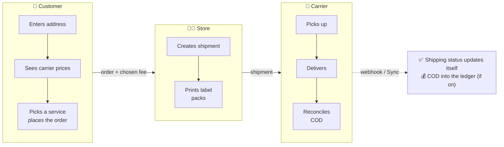
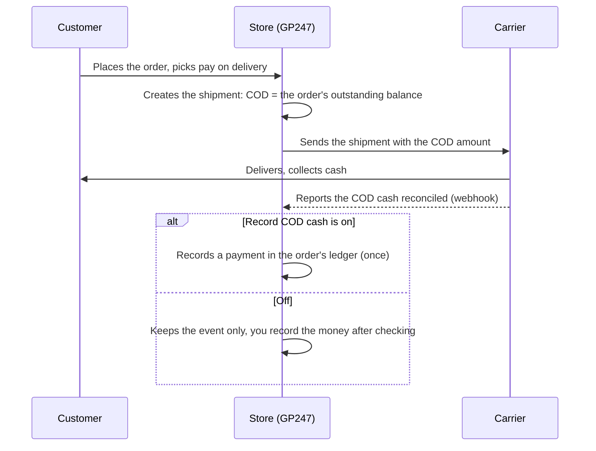

> 🌐 **Language:** [🇻🇳 Tiếng Việt](./shipping_vi.md) · 🇬🇧 English (current)

# Shipping in GP247 — store setup and day-to-day use

## Introduction

This document explains how GP247 prices delivery, books shipments with carriers and tracks parcels to the
customer. **Part A** is for store managers: installation, every setting, day-to-day shipment handling, with
diagrams of the whole flow. After reading, you can switch shipping on correctly and handle shipments day to day.
Developers who want to integrate a new carrier: see **Part B** — it points to the technical guide in the
[Extension](../../extension/create-shipping-plugin.md) section.

> ℹ️ **Available since:** gp247/shop 3.1.4 (the standard shipping layer: several services per carrier, shipments,
> tracking, cash on delivery). On older versions each shipping plugin returns a single fee.

---

## Part A — For store managers

### A1. Concepts to know

| Concept | In plain words |
|---|---|
| **Carrier** | A **shipping plugin** installed in the store. Some plugins only price by rules you set (for example `ShippingStandard`: flat fee, free above an amount); others connect straight to a delivery company's API. |
| **Service** | One delivery option of a carrier: road, express, same-day… Each service is **its own choice** at checkout, with its price and estimated delivery days. |
| **Shipment** | The consignment booked with the carrier for an order — it has a **tracking number**. Only with carriers that support booking. |
| **Pick-up warehouse** | The sender address — the carrier collects parcels here and prices from here. |
| **Cash on delivery (COD)** | The courier collects cash from the customer at delivery and the carrier pays it back to you. |
| **Webhook** | The carrier "calls back" the website whenever a shipment changes state — you do not have to click refresh. |

### A2. The big picture: how the system runs

Each stage is detailed in A3 (setup), A5 (shipments) and A6 (COD). Key point: **the price the customer sees is the
price the carrier quotes for that exact address and cart**. When the
customer changes the address or the cart, the system asks again; the order always keeps exactly the fee the customer
chose.

### A3. Step-by-step setup

1. **Install the carrier plugin.** Go to **Admin → Plugins**, find the shipping plugin (*Shipping* group), click
   **Install** then **Enable**. With several stores, enable it for the right store.
   Expected result: the plugin shows as enabled in the list.
2. **Turn on the customer address fields carriers need.** Go to **Admin → Shop settings → Customer tab** and enable
   **Province/City** and **Ward** (or District). Vietnamese carriers require them.
3. **Open the Shipping tab** (**Admin → Shop settings → Shipping tab**). The tab is always visible, even while shipping
   is off, so you can prepare in advance. At the top, the **Shipping status** box lists enabled carriers and warns
   about anything missing (address fields, pick-up warehouse, no carrier).
4. **Fill in the Pick-up warehouse block**: sender name, phone, country (2-letter code, e.g. `VN`), Province/City,
   Ward, street address. Leave District empty where districts no longer exist (since 2025-07-01).
5. **Fill in the Parcel block**: **Default weight per product (grams)** — used for products without a weight.
6. **Fill in the Tracking and reconciliation block** (only needed when the carrier supports shipments): the minutes
   before shipment status refreshes, and whether COD cash is recorded on the order automatically (see table A4).
7. **Turn on "Enable shipping at checkout"** at the top of the tab, then click **Save**.
   Expected result: the status box shows **ON** and no warnings remain.
8. **Configure the carrier plugin**: in the status box, click the carrier name to open its settings screen (account,
   secret keys, services to sell, test/live environment). If the carrier prices in a currency other than the store's
   base currency (e.g. VND), that currency must exist in **Admin → Currencies**.
9. **Enter weights (and sizes) for products.** A wrong weight makes the carrier charge differently from what the
   customer paid. Downloadable / digital products are not part of the parcel.
10. **Place a test order** on the storefront. Expected result: the Shipping step lists each service with its price and
    estimated days; once one is chosen, the total includes exactly that fee.

### A4. What each field of the Shipping tab means

| Field | What it does | Example |
|---|---|---|
| Enable shipping at checkout | Shows the carrier/service step at checkout. Off: customers do not see this step and orders carry no shipping fee. | On |
| Sender / shop name | Printed on the shipping label | ABC Store |
| Warehouse phone | The courier calls this number at pick-up | 0901234567 |
| Country (2-letter code) | ISO code of the warehouse country | VN |
| Province/City · Ward · District | Warehouse address under the current division | Ho Chi Minh City · Sai Gon Ward · (empty) |
| Street address | House number and street | 12 Le Loi |
| Default weight per product (grams) | Used when a product has no weight | 500 |
| Refresh shipment status after (minutes) | When an order is opened and the last update is older than this, the system asks the carrier again. Useful when the carrier's webhook cannot reach you. No cron needed. | 30 |
| Record COD cash on the order when the carrier reports it reconciled | Turn on if you reconcile COD cash from the carrier's reports. Each shipment is recorded only once. Off by default. | Off |

> With several stores, each store has its own pick-up warehouse and settings; an empty field inherits the shared value.

### A5. Handling shipments day to day

Open **Admin → Orders → order detail**, **Shipping** block. The block always shows the fee and service the customer
chose; the buttons below only appear when an enabled carrier supports the action (book, label, track, cancel):

1. Click **Create shipment**. The form is prefilled from the order: carrier, service the customer chose, recipient,
   declared value, COD amount, weight. You can edit it before sending, e.g. enter the **parcel size** after packing.
2. Send it. Expected result: the notice *Shipment … created* with the **tracking number**; if the carrier's fee differs
   from the fee on the order, the system says so.
3. Click **Download label** to print the parcel label (if the carrier offers one).
4. The status updates through the webhook; to ask right away, click **Sync**. Every event is in **Tracking history**.
5. To cancel: click **Cancel shipment** — the carrier may refuse once the parcel is picked up. Only after cancelling
   can a new shipment be created.

The shipment status maps to the order's **shipping status** by itself:

| Shipment status | Order shipping status |
|---|---|
| Awaiting pick-up · Cancelled | Not sent |
| Picked up · In transit · Out for delivery · Delivery failed · Returning · Exception | Sending |
| Delivered | Shipping done |
| Returned | Refunded |

### A6. The steps of cash on delivery (COD)

COD only applies to orders paid with a **pay-on-delivery** method (by default the `CashPayment` plugin).

---

## Part B — For developers

This document only covers day-to-day use. The technical side — the shipping layer `gp247/shop` already provides, the
capability-based carrier contract, sample code — is in:

- [Creating a shipping plugin](../../extension/create-shipping-plugin.md) — step by step with code (weight-based fee,
  carrier with an API: shipments, tracking, webhook, COD); section 5 is a quick reference of what `gp247/shop` provides
  and where.

> 💡 Working with an AI agent: use the **`gp247-shipping-plugin-create`** skill from the
> [gp247-skills](https://github.com/gp247net/gp247-skills) repository — it probes the site's version and capabilities and builds the plugin on
> `gp247/shop`'s contract.

---

## Conditions & Rules (know before you act)

**When the customer orders**
- **Shipping is on but no carrier can quote that address → the order cannot be placed**, and the customer is asked to
  check the address. The system blocks on purpose so goods are never shipped without a fee.
- **Address or cart changed after a service was chosen → the customer must choose again** ("The shipping price has
  changed"), because the old price no longer fits the new parcel.
- **The currency the carrier prices in must exist in Currencies** — otherwise that carrier's services are dropped,
  because the system cannot convert them into the currency the customer is viewing.

**When saving the Shipping tab**
- Default weight: a whole number **from 1 to 100,000 grams**.
- Status refresh: **from 5 to 1,440 minutes** — frequent enough to keep up, sparse enough not to be blocked by the
  carrier for asking too often.
- Country: exactly **2 letters** (ISO code); warehouse phone up to 30 characters.

**When handling shipments**
- **One active shipment per order** — cancel the old one before creating another, so two parcels are never sent.
- **Orders that are Done, Canceled or Refunded cannot have shipment actions** — the order is closed.
- **The carrier may refuse a cancellation** once the parcel is picked up; contact the carrier then.

**Cash on delivery**
- Recorded automatically only when you turn the setting on, **once per shipment**, and **never above the order's
  outstanding balance**. When the carrier reports a different amount, the system notes it in the order history so you
  can reconcile.

---

## Q&A

**Q1: I installed the plugin but checkout shows no shipping step?**

→ Check that **Enable shipping at checkout** is on in the Shipping tab and saved, and that the plugin is **Enabled** for
the right store.

**Q2: The shipping step says "No delivery service is available for this address"?**

→ Usually something is missing: the customer address has no Province/City or Ward, the pick-up warehouse is incomplete,
the carrier plugin has no account yet, or the carrier's currency is not in Currencies. The **Shipping status** box at the
top of the tab shows what is missing.

**Q3: The carrier charges a different fee from what the customer paid?**

→ Mostly wrong or missing product weights (the default weight is being used). Enter real product weights; when booking,
correct the weight and enter the packed parcel size.

**Q4: Do I need a cron job to update shipment statuses?**

→ No. Statuses arrive by webhook; when the webhook cannot reach you, the system asks the carrier again when you open the
order (after the minutes you set), or you click **Sync**.

**Q5: Does the order's shipping status change by itself?**

→ Yes, for orders with a shipment: it follows what the carrier reports (table in A5). Orders without a shipment are set
by hand as before.

**Q6: Why is there no Create shipment button?**

→ The enabled carrier only prices and cannot book shipments (e.g. `ShippingStandard`), or the order is closed (Done /
Canceled / Refunded), or it already has an active shipment.

**Q7: Does uninstalling a carrier plugin lose the shipments created with it?**

→ No. Shipments and their history are stored by the store; uninstalling only removes the plugin's settings.

**Q8: I want to write a plugin for another delivery company?**

→ See [Creating a shipping plugin](../../extension/create-shipping-plugin.md). If you work with an AI agent, use the
`gp247-shipping-plugin-create` skill — it builds the plugin on
`gp247/shop`'s contract instead of letting the agent guess.

**Q9: Will my old shipping plugin still work after upgrading?**

→ Yes. A plugin that returns its fee through `getInfo()` still shows at checkout as a single service. For several
services or shipments, upgrade the plugin following [Creating a shipping plugin](../../extension/create-shipping-plugin.md).

**Q10: With several stores, can each store use its own carrier account?**

→ Yes. The pick-up warehouse, the Shipping tab settings and the plugin settings (when the plugin supports per-store
settings) are all set per store; an empty field uses the shared value.

---

📅 **Last updated:** 2026-10-18 · ✍️ **Author:** GP247
