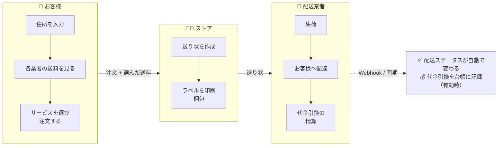
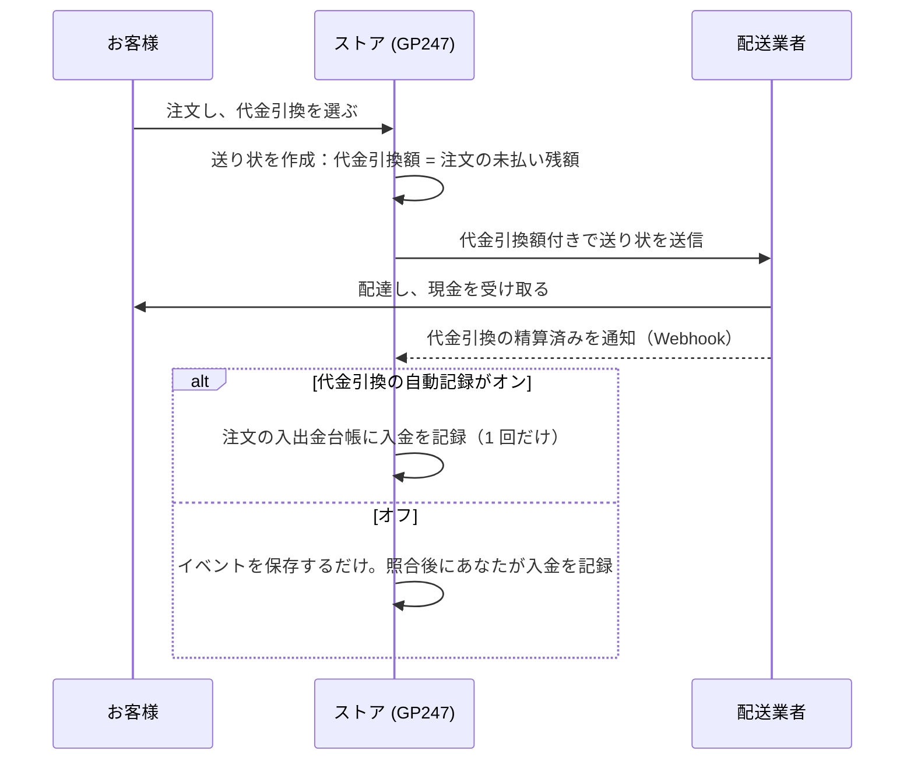

> 🌐 **言語:** [🇻🇳 Tiếng Việt](./shipping_vi.md) · [🇬🇧 English](./shipping.md) · 🇯🇵 日本語（現在）

# GP247 の配送 — ストアの設定と日々の運用

## はじめに

このドキュメントでは、GP247 が送料を計算し、配送業者で送り状を作成し、お客様の手元に届くまで追跡する仕組みを説明します。
**パート A** はストア管理者向けです。インストール、各項目の設定、日々の送り状の処理を扱い、全体の流れを図で示します。
読み終えると、配送を正しく有効にでき、日々の送り状を処理できるようになります。新しい配送業者を連携したい開発者の方は
**パート B** をご覧ください。[拡張機能](../../extension/create-shipping-plugin_ja.md)セクションの技術ドキュメントを案内しています。

> ℹ️ **対応バージョン:** gp247/shop 3.1.4（標準の配送レイヤー：業者ごとに複数のサービス、送り状、追跡、代金引換）。
> それより古いバージョンでは、配送プラグインごとに送料を 1 つだけ返します。

---

## パート A — ストア管理者向け

### A1. 知っておきたい用語

| 用語 | わかりやすく言うと |
|---|---|
| **配送業者** | ストアにインストールした **配送プラグイン** です。あなたが決めたルールで送料を計算するだけのプラグイン（例：`ShippingStandard`：固定送料、一定金額以上で送料無料）もあれば、配送会社の API に直接つながるプラグインもあります。 |
| **サービス** | 配送業者の配送プランです：陸送、速達、当日便など。サービスごとに、決済ページで **別々の選択肢** として価格と配送予定日数付きで表示されます。 |
| **送り状** | 注文ごとに配送業者で作成する発送伝票です。追跡用の **追跡番号** があります。送り状の作成に対応した業者でのみ使えます。 |
| **集荷倉庫** | 差出人の住所です。配送業者はここで集荷し、ここを起点に送料を計算します。 |
| **代金引換（COD）** | 配達員が配達時にお客様から現金を受け取り、配送業者があなたに送金します。 |
| **Webhook** | 送り状のステータスが変わるたびに、配送業者がウェブサイトへ自動で「通知」します。手で更新ボタンを押す必要はありません。 |

### A2. 全体像：システムの動き

各段階の詳細は A3（設定）、A5（送り状）、A6（代金引換）にあります。覚えておきたい点：**お客様に表示される送料は、
その住所とカートの内容に対して配送業者が提示した送料です**。お客様が住所やカートを変えると、システムは送料を
問い合わせ直します。注文には、お客様が選んだ送料がそのまま保存されます。

### A3. 設定の手順

1. **配送業者のプラグインをインストールします。** **管理画面 → プラグイン** を開き、配送プラグイン（*Shipping* グループ）を
   探して **インストール**、続けて **有効にする** を押します。複数のストアがある場合は、使うストアで有効にしてください。
   期待される結果：一覧でプラグインが有効の状態で表示されます。
2. **配送業者が必要とするお客様の住所項目を有効にします。** **管理画面 → ショップ設定 → 顧客 タブ** を開き、
   **都道府県・市区町村** と **区・町域**（または 区・郡）を有効にします。ベトナムの配送業者では、これらの情報が必須です。
3. **配送タブを開きます**（**管理画面 → ショップ設定 → 配送 タブ**）。配送がオフのときでも、事前に準備できるようタブは常に
   表示されます。上部の **配送ステータス** の枠に、有効な配送業者と、不足している項目の警告（住所項目の不足、集荷倉庫の
   不足、配送業者がない）が表示されます。
4. **集荷倉庫のブロックを入力します**：差出人名、電話番号、国（2 文字のコード、例：`VN`）、都道府県・市区町村、区・町域、
   番地などの詳細住所。地域で郡の階層が廃止されている場合（2025-07-01 から）、区・郡は空欄にします。
5. **荷物のブロックを入力します**：**商品 1 点あたりの既定の重量（グラム）** — 重量を入力していない商品に使います。
6. **追跡と精算のブロックを入力します**（配送業者が送り状に対応している場合だけ必要です）：ステータスを自動更新するまでの
   分数と、代金引換の入金を注文に自動で記録するかどうか（表 A4 をご覧ください）。
7. タブ上部の **「チェックアウト時に配送を有効にする」をオン** にし、**保存** を押します。
   期待される結果：ステータスの枠に **有効** と表示され、警告がなくなります。
8. **配送業者のプラグインを設定します**：ステータスの枠で業者名をクリックし、プラグインの設定画面を開きます（アカウント、
   秘密キー、販売するサービス、テスト／本番環境）。配送業者がストアの基準通貨と異なる通貨（例：VND）で送料を計算する場合、
   その通貨が **管理画面 → 通貨** に登録されている必要があります。
9. **商品の重量（とサイズ）を入力します。** 重量が正しくないと、配送業者が請求する送料と、お客様が支払った送料が
   ずれます。ダウンロード／デジタル商品は荷物に含まれません。
10. ストアで **テスト注文をします。** 期待される結果：配送ステップに各サービスが価格と予定日数付きで表示されます。選ぶと、
    合計金額にその送料が正しく加算されます。

### A4. 配送タブの各項目の意味

| 項目 | 何に使うか | 例 |
|---|---|---|
| チェックアウト時に配送を有効にする | 決済ページに配送業者／サービスを選ぶステップを表示します。オフにすると、お客様にはこのステップが表示されず、注文に送料はかかりません。 | オン |
| 差出人名 / ストア名 | 送り状のラベルに印刷されます | ABC ストア |
| 倉庫の電話番号 | 配達員が集荷に来たときにこの番号へ電話します | 0901234567 |
| 国（2 文字のコード） | 倉庫がある国の ISO コード | VN |
| 都道府県・市区町村 · 区・町域 · 区・郡 | 現行の行政区画に基づく倉庫の住所 | Ho Chi Minh City · Sai Gon Ward · （空欄） |
| 詳細住所 | 番地、通り名 | 12 Le Loi |
| 商品 1 点あたりの既定の重量（グラム） | 商品に重量がないときに使います | 500 |
| 送り状のステータスを自動更新するまでの時間（分） | 注文を開いたとき、前回の更新からこの分数が過ぎていれば、システムが配送業者に問い合わせ直します。配送業者の Webhook が届かない場合に役立ちます。cron は不要です。 | 30 |
| 配送業者が精算済みと通知したら、代金引換（COD）の入金を注文に自動で記録する | 配送業者のレポートで代金引換の入金を照合している場合にオンにします。送り状ごとに 1 回だけ記録されます。既定はオフです。 | オフ |

> （複数のストアを使う場合）ストアごとに専用の集荷倉庫と設定を持てます。空欄の項目は共通の値を引き継ぎます。

### A5. 日々の送り状の処理

**管理画面 → 注文 → 注文詳細** の **配送** ブロックを開きます。このブロックには、お客様が選んだ送料とサービスが常に表示
されます。下のボタンは、その操作（送り状の作成、ラベル、追跡、キャンセル）に対応した配送業者が有効なときだけ表示されます。

1. **送り状を作成** を押します。フォームには注文の内容が入力済みです：配送業者、お客様が選んだサービス、受取人、申告価格、
   代金引換額、重量。送る前に修正できます。たとえば、梱包後に **荷物のサイズ** を入力します。
2. 送信します。期待される結果：*送り状 … を作成しました* というメッセージと **追跡番号** が表示されます。配送業者が請求する
   送料が注文の送料と異なる場合は、システムがその旨を表示します。
3. **ラベルをダウンロード** を押して、荷物に貼るラベルを印刷します（配送業者が提供している場合）。
4. ステータスは Webhook で自動更新されます。すぐに確認したい場合は **同期** を押します。すべてのイベントは **配送履歴** に
   あります。
5. キャンセルが必要な場合：**送り状をキャンセル** を押します。すでに集荷済みの場合、配送業者が拒否することがあります。
   キャンセルが完了してから、新しい送り状を作成できます。

送り状のステータスは、注文の **配送ステータス** に自動で変換されます。

| 送り状のステータス | 注文の配送ステータス |
|---|---|
| 集荷待ち · キャンセル済み | 未発送 |
| 集荷済み · 輸送中 · 配達中 · 配達失敗 · 返送中 · 例外 | 発送中 |
| 配達済み | 発送完了 |
| 返送済み | 返品済み |

### A6. 代金引換（COD）の流れ

代金引換は、支払い方法に **代金引換** を選んだ注文だけに適用されます（既定は `CashPayment` プラグイン）。

---

## パート B — 開発者向け

このドキュメントでは使い方だけを扱います。技術的な内容 — `gp247/shop` に用意されている配送レイヤー、機能（ケイパビリティ）
ごとの配送業者の契約、サンプルコード — は次にあります。

- [配送プラグインの作成](../../extension/create-shipping-plugin_ja.md) — コード付きの手順（重量に応じた送料、API を持つ配送
  業者：送り状、追跡、Webhook、代金引換）。セクション 5 は `gp247/shop` に何が用意され、どこにあるかの早見表です。

> 💡 AI エージェントと作業する場合：リポジトリ
> [gp247-skills](https://github.com/gp247net/gp247-skills) のスキル **`gp247-shipping-plugin-create`** を使ってください。
> サイトのバージョンと機能を自動で調べ、`gp247/shop` の契約どおりにプラグインを作ります。

---

## 条件と制約（操作の前に確認）

**お客様が注文するとき**
- **配送がオンなのに、その住所の送料を提示できる配送業者が 1 つもない → 注文できません。** お客様には住所を確認するよう
  メッセージが表示されます。送料を受け取らずに配送してしまわないよう、システムが意図的にブロックしています。
- **サービスを選んだ後に住所やカートが変わった → お客様は選び直す必要があります**（「送料が変更されました」）。前の送料は
  新しい荷物には当てはまらないからです。
- **配送業者が送料に使う通貨は、通貨の一覧に登録されている必要があります。** 登録がないと、その配送業者のサービスは
  除外されます。お客様が表示中の通貨に換算できないためです。

**配送タブを保存するとき**
- 既定の重量：**1 ～ 100,000 グラム** の整数です。
- ステータスの自動更新：**5 ～ 1,440 分** です。状況に追いつける程度に頻繁で、問い合わせすぎて配送業者にブロックされない
  程度に間隔を空けるためです。
- 国：ちょうど **2 文字**（ISO コード）です。倉庫の電話番号は最大 30 文字です。

**送り状を処理するとき**
- **1 つの注文で有効な送り状は 1 つだけです。** 新しく作る前に古い送り状をキャンセルします。同じ荷物を二重に送らないため
  です。
- **完了、キャンセル、返金済みの注文では、送り状を操作できません。** 注文が確定しているためです。
- **集荷済みの場合、送り状のキャンセルを配送業者が拒否することがあります。** その場合は配送業者に連絡してください。

**代金引換の入金**
- 該当する項目をオンにしたときだけ自動で記録されます。記録は **送り状ごとに 1 回** で、注文の **未払い残額を超えません**。
  配送業者が通知した金額が未払い残額と異なる場合は、照合できるよう、システムが注文履歴にメモを残します。

---

## よくある質問（Q&A）

**Q1: プラグインをインストールしたのに、決済ページに配送ステップが表示されません。**

→ 配送タブの **チェックアウト時に配送を有効にする** がオンになって保存されているか、プラグインが正しいストアで **有効**
になっているかを確認してください。

**Q2: 配送ステップに「この住所に対応する配送サービスがありません」と表示されます。**

→ 多くの場合、情報が不足しています：お客様の住所に都道府県・市区町村または区・町域がない、集荷倉庫の情報が足りない、
配送業者のプラグインにアカウントが未入力、または配送業者の通貨が通貨の一覧にない、などです。タブ上部の **配送ステータス**
の枠に、不足している部分が表示されます。

**Q3: 配送業者が請求する送料が、お客様の支払った送料と違います。**

→ ほとんどの場合、商品の重量が正しくないか未入力です（既定の重量が使われています）。商品に実際の重量を入力してください。
送り状を作成するときは、梱包後に重量を修正し、荷物のサイズを入力します。

**Q4: 送り状のステータスを更新するために cron を設定する必要がありますか？**

→ 必要ありません。ステータスは Webhook で届きます。Webhook が届かない場合は、注文を開いたときにシステムが（設定した分数に
従って）配送業者に問い合わせ直します。または **同期** を押します。

**Q5: 注文の配送ステータスは自動で変わりますか？**

→ 送り状がある注文では変わります。配送業者から通知されたステータスに従います（A5 の表）。送り状のない注文は、以前と同じ
ように手で選びます。

**Q6: 「送り状を作成」ボタンが表示されないのはなぜですか？**

→ 有効な配送業者が送料の計算だけで、送り状の作成に対応していない（例：`ShippingStandard`）、注文が確定している（完了／
キャンセル／返金済み）、または注文にすでに有効な送り状がある、のいずれかです。

**Q7: 配送業者のプラグインをアンインストールすると、作成済みの送り状は消えますか？**

→ 消えません。送り状とその履歴はストアが保存しています。アンインストールで削除されるのはプラグインの設定だけです。

**Q8: 別の配送会社用のプラグインを自分で作りたいのですが？**

→ [配送プラグインの作成](../../extension/create-shipping-plugin_ja.md) をご覧ください。AI エージェントと作業する場合は、
スキル `gp247-shipping-plugin-create` を使ってください。エージェントに推測させず、`gp247/shop` の契約どおりにプラグインを
作ります。

**Q9: 古い配送プラグインは、アップグレード後も動きますか？**

→ 動きます。`getInfo()` で送料を返すプラグインは、決済ページに 1 つのサービスとして引き続き表示されます。複数のサービスや
送り状の作成を使いたい場合は、[配送プラグインの作成](../../extension/create-shipping-plugin_ja.md) に沿ってプラグインを
アップグレードしてください。

**Q10: 複数のストアがある場合、ストアごとに別の配送業者アカウントを使えますか？**

→ 使えます。集荷倉庫、配送タブの設定、プラグインの設定（プラグインがストアごとの設定に対応している場合）は、すべて
ストアごとに設定できます。空欄の項目は共通の値を使います。

---

📅 **最終更新:** 2026-10-22 · ✍️ **作成者 (Author):** GP247
