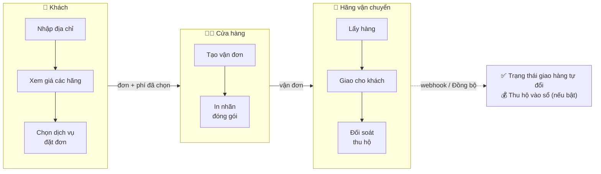
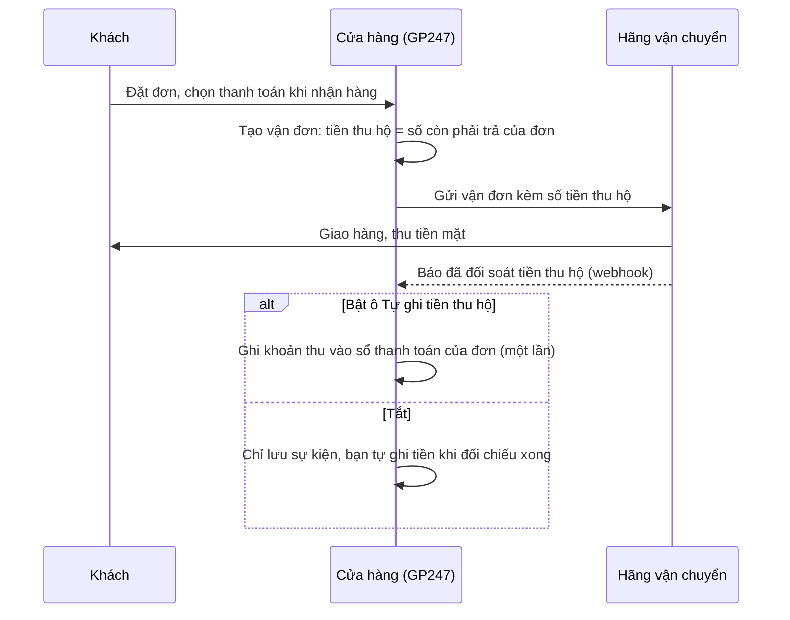

> 🌐 **Ngôn ngữ:** 🇻🇳 Tiếng Việt (hiện tại) · [🇬🇧 English](./shipping.md) · [🇯🇵 日本語](./shipping_ja.md)

# Vận chuyển trong GP247 — thiết lập và vận hành cho cửa hàng

## Giới thiệu

Tài liệu này giải thích cách GP247 tính phí giao hàng, tạo vận đơn với hãng vận chuyển và theo dõi đơn tới
tay khách. **Phần A** dành cho người quản lý cửa hàng: cài đặt, thiết lập từng ô, xử lý vận đơn hằng ngày,
có sơ đồ để hình dung toàn bộ luồng. Đọc xong, bạn tự bật được vận chuyển cho đúng và xử lý được vận đơn hằng
ngày. Lập trình viên muốn tích hợp một hãng mới: xem **Phần B** — trỏ sang tài liệu kỹ thuật ở mục
[Extension](../../extension/create-shipping-plugin_vi.md).

> ℹ️ **Có từ:** gp247/shop 3.1.4 (lớp vận chuyển chuẩn: nhiều dịch vụ mỗi hãng, vận đơn, theo dõi, thu hộ).
> Trên phiên bản cũ hơn, mỗi plugin vận chuyển chỉ trả về một mức phí.

---

## Phần A — Dành cho người quản lý cửa hàng

### A1. Các khái niệm cần biết

| Khái niệm | Nghĩa đời thường |
|---|---|
| **Hãng vận chuyển** | Một **plugin vận chuyển** cài vào cửa hàng. Có plugin chỉ tính phí theo quy tắc bạn đặt (ví dụ `ShippingStandard`: phí cố định, miễn phí từ một mức tiền); có plugin nối thẳng API của hãng giao hàng. |
| **Dịch vụ** | Một gói giao của hãng: đường bộ, nhanh, hoả tốc… Mỗi dịch vụ hiện thành **một lựa chọn riêng** ở trang thanh toán, kèm giá và số ngày giao dự kiến. |
| **Vận đơn** | Phiếu gửi hàng tạo với hãng cho một đơn — có **mã vận đơn** để tra cứu. Chỉ có với hãng hỗ trợ tạo vận đơn. |
| **Kho lấy hàng** | Địa chỉ người gửi — hãng đến đây lấy hàng và tính phí từ đây. |
| **Thu hộ (COD)** | Shipper thu tiền mặt của khách khi giao rồi hãng chuyển lại cho bạn. |
| **Webhook** | Hãng tự "gọi về" website mỗi khi đơn đổi trạng thái — bạn không phải bấm cập nhật. |

### A2. Toàn cảnh: hệ thống chạy thế nào

Chi tiết từng chặng ở A3 (cài đặt), A5 (vận đơn) và A6 (thu hộ). Điểm đáng nhớ: **giá khách thấy là giá hãng báo
cho đúng địa chỉ và giỏ hàng đó**. Khách đổi địa chỉ hay giỏ
hàng thì hệ thống hỏi giá lại; đơn luôn lưu đúng mức phí khách đã chọn.

### A3. Cài đặt từng bước

1. **Cài plugin hãng vận chuyển.** Vào **Admin → Plugins**, tìm plugin vận chuyển (nhóm *Shipping*), bấm
   **Cài đặt** rồi **Bật**. Có nhiều cửa hàng thì bật cho đúng cửa hàng cần dùng.
   Kết quả mong đợi: plugin hiện trạng thái đang bật trong danh sách.
2. **Bật các ô địa chỉ khách cần cho hãng.** Vào **Admin → Cấu hình cửa hàng → tab Khách hàng**, bật
   **Tỉnh/Thành phố** và **Phường/Xã** (hoặc Quận/Huyện). Hãng giao hàng tại Việt Nam bắt buộc các thông tin này.
3. **Mở tab Vận chuyển** (**Admin → Cấu hình cửa hàng → tab Vận chuyển**). Tab luôn hiện, kể cả khi vận chuyển
   đang tắt, để bạn chuẩn bị trước. Phía trên có khung **Trạng thái vận chuyển** liệt kê hãng đang bật và
   các cảnh báo còn thiếu (thiếu ô địa chỉ, thiếu kho lấy hàng, chưa có hãng nào).
4. **Điền khối Kho lấy hàng**: tên người gửi, số điện thoại, quốc gia (mã 2 chữ, ví dụ `VN`), Tỉnh/Thành phố,
   Phường/Xã, địa chỉ chi tiết. Quận/Huyện bỏ trống nếu địa phương đã bỏ cấp huyện (từ 01/07/2025).
5. **Điền khối Gói hàng**: **Khối lượng mặc định mỗi sản phẩm (gram)** — dùng cho sản phẩm chưa nhập khối lượng.
6. **Điền khối Theo dõi và đối soát** (chỉ cần khi hãng hỗ trợ vận đơn): số phút tự cập nhật trạng thái, và có
   tự ghi tiền thu hộ vào đơn hay không (xem bảng A4).
7. **Bật "Bật vận chuyển khi đặt hàng"** ở đầu tab, rồi bấm **Lưu**.
   Kết quả mong đợi: khung trạng thái hiện **ĐANG BẬT** và không còn cảnh báo.
8. **Cấu hình plugin hãng**: trong khung trạng thái, bấm vào tên hãng để mở màn cấu hình của plugin (tài khoản,
   mã bí mật, dịch vụ muốn bán, môi trường thử/thật). Nếu hãng tính giá bằng một đồng tiền khác tiền gốc của
   cửa hàng (ví dụ VND), đồng tiền đó phải có trong **Admin → Tiền tệ**.
9. **Nhập khối lượng (và kích thước) cho sản phẩm.** Khối lượng sai làm phí hãng thu khác phí khách đã trả.
   Sản phẩm tải về / kỹ thuật số không tính vào kiện hàng.
10. **Đặt thử một đơn** ở trang cửa hàng. Kết quả mong đợi: bước Vận chuyển hiện từng dịch vụ kèm giá và số ngày
    dự kiến; chọn xong, tổng tiền cộng đúng phí đó.

### A4. Ý nghĩa từng ô ở tab Vận chuyển

| Ô | Dùng để làm gì | Ví dụ |
|---|---|---|
| Bật vận chuyển khi đặt hàng | Hiện bước chọn hãng/dịch vụ ở trang thanh toán. Tắt: khách không thấy bước này và đơn không tính phí ship. | Bật |
| Tên người gửi / tên cửa hàng | In trên nhãn vận đơn | Cửa hàng ABC |
| Số điện thoại kho | Shipper gọi số này khi đến lấy hàng | 0901234567 |
| Quốc gia (mã 2 chữ) | Mã ISO của nước đặt kho | VN |
| Tỉnh/Thành phố · Phường/Xã · Quận/Huyện | Địa chỉ kho theo địa giới hiện hành | TP. Hồ Chí Minh · Phường Sài Gòn · (trống) |
| Địa chỉ chi tiết | Số nhà, tên đường | 12 Lê Lợi |
| Khối lượng mặc định mỗi sản phẩm (gram) | Dùng khi sản phẩm chưa có khối lượng | 500 |
| Tự cập nhật trạng thái vận đơn sau (phút) | Khi mở đơn mà lần cập nhật trước đã quá số phút này, hệ thống tự hỏi lại hãng. Dùng khi webhook của hãng không về được. Không cần cron. | 30 |
| Tự ghi tiền thu hộ (COD) vào đơn khi hãng báo đã đối soát | Bật nếu bạn đối chiếu tiền COD theo báo cáo của hãng. Mỗi vận đơn chỉ ghi một lần. Mặc định tắt. | Tắt |

> Mỗi cửa hàng (khi dùng nhiều cửa hàng) có kho lấy hàng và thiết lập riêng; ô nào để trống thì kế thừa giá trị chung.

### A5. Xử lý vận đơn hằng ngày

Mở **Admin → Đơn hàng → chi tiết đơn**, khối **Vận chuyển**. Khối luôn hiện phí và dịch vụ khách đã chọn; các nút
bên dưới chỉ có khi đang bật một hãng hỗ trợ việc đó (tạo vận đơn, nhãn, tra cứu, huỷ):

1. Bấm **Tạo vận đơn**. Biểu mẫu điền sẵn từ đơn: hãng, dịch vụ khách đã chọn, người nhận, giá trị khai báo,
   tiền thu hộ, khối lượng. Bạn sửa được trước khi gửi, ví dụ nhập **kích thước kiện** sau khi đóng gói.
2. Bấm gửi. Kết quả mong đợi: thông báo *Đã tạo vận đơn …* kèm **mã vận đơn**; nếu phí hãng thu khác phí trên đơn,
   hệ thống ghi rõ để bạn biết.
3. Bấm **Tải nhãn** để in nhãn dán kiện (nếu hãng có).
4. Trạng thái tự cập nhật qua webhook; muốn hỏi ngay thì bấm **Đồng bộ**. Mọi sự kiện nằm ở **Lịch sử vận chuyển**.
5. Cần huỷ: bấm **Huỷ vận đơn** — hãng có thể từ chối nếu đã lấy hàng. Huỷ xong mới tạo được vận đơn mới.

Trạng thái vận đơn tự quy ra **trạng thái giao hàng** của đơn:

| Trạng thái vận đơn | Trạng thái giao hàng của đơn |
|---|---|
| Chờ lấy hàng · Đã huỷ | Chưa gửi |
| Đã lấy hàng · Đang vận chuyển · Đang giao · Giao thất bại · Đang hoàn hàng · Ngoại lệ | Đang gửi |
| Đã giao | Đã gửi xong |
| Đã hoàn hàng | Đã hoàn |

### A6. Thu hộ (COD) đi qua những bước nào

Tiền thu hộ chỉ áp dụng cho đơn chọn phương thức **thanh toán khi nhận hàng** (mặc định là plugin `CashPayment`).

---

## Phần B — Dành cho lập trình viên

Tài liệu này chỉ nói về cách dùng. Phần kỹ thuật — lớp vận chuyển có sẵn trong `gp247/shop`, hợp đồng hãng theo năng lực,
code mẫu — nằm ở:

- [Tạo plugin vận chuyển](../../extension/create-shipping-plugin_vi.md) — từng bước có code (phí theo khối lượng, hãng có
  API: vận đơn, theo dõi, webhook, thu hộ); mục 5 tra cứu nhanh `gp247/shop` có sẵn gì, nằm ở đâu.

> 💡 Làm cùng AI agent: dùng skill **`gp247-shipping-plugin-create`** trong repo
> [gp247-skills](https://github.com/gp247net/gp247-skills) — skill tự dò phiên bản và năng lực của site, dựng plugin đúng
> hợp đồng của `gp247/shop`.

---

## Điều kiện & ràng buộc (hiểu trước khi thao tác)

**Khi khách đặt hàng**
- **Vận chuyển đang bật mà không hãng nào báo giá được cho địa chỉ đó → không đặt được đơn**, khách thấy thông báo
  kiểm tra lại địa chỉ. Hệ thống cố ý chặn để không giao hàng mà không thu phí.
- **Địa chỉ hoặc giỏ hàng đổi sau khi đã chọn dịch vụ → khách phải chọn lại** ("Phí vận chuyển đã thay đổi"), vì
  giá cũ không còn đúng cho kiện hàng mới.
- **Đồng tiền hãng tính giá phải có trong danh sách Tiền tệ** — nếu thiếu, dịch vụ của hãng đó bị bỏ, vì hệ thống
  không quy đổi được sang tiền khách đang xem.

**Khi lưu tab Vận chuyển**
- Khối lượng mặc định: số nguyên **từ 1 đến 100.000 gram**.
- Tự cập nhật trạng thái: **từ 5 đến 1.440 phút** — đủ dày để theo kịp, đủ thưa để không bị hãng chặn vì hỏi quá nhiều.
- Quốc gia: đúng **2 chữ cái** (mã ISO); số điện thoại kho tối đa 30 ký tự.

**Khi xử lý vận đơn**
- **Mỗi đơn chỉ một vận đơn đang hiệu lực** — huỷ vận đơn cũ trước khi tạo mới, tránh gửi trùng hai kiện.
- **Đơn đã Hoàn thành, Đã huỷ hoặc Đã hoàn tiền thì không thao tác vận đơn được** — đơn đã chốt.
- **Huỷ vận đơn có thể bị hãng từ chối** khi hàng đã được lấy; khi đó liên hệ hãng.

**Tiền thu hộ**
- Chỉ ghi tự động khi bạn bật ô tương ứng, **mỗi vận đơn một lần**, và **không vượt số còn phải trả** của đơn. Hãng
  báo số khác số còn phải trả thì hệ thống ghi chú vào lịch sử đơn để bạn đối chiếu.

---

## Hỏi & Đáp (Q&A)

**Câu 1: Tôi đã cài plugin nhưng trang thanh toán không hiện bước vận chuyển?**

→ Kiểm tra ô **Bật vận chuyển khi đặt hàng** ở tab Vận chuyển đã bật và đã Lưu, và plugin đã **Bật** cho đúng cửa hàng.

**Câu 2: Bước vận chuyển báo "Chưa có dịch vụ giao hàng cho địa chỉ này"?**

→ Thường do thiếu thông tin: địa chỉ khách chưa có Tỉnh/Thành hoặc Phường/Xã, kho lấy hàng chưa đủ, plugin hãng
chưa nhập tài khoản, hoặc đồng tiền của hãng chưa có trong Tiền tệ. Khung **Trạng thái vận chuyển** ở đầu tab chỉ
ra phần còn thiếu.

**Câu 3: Phí hãng thu khác phí khách đã trả?**

→ Hầu hết do khối lượng sản phẩm sai hoặc chưa nhập (đang dùng khối lượng mặc định). Nhập khối lượng thật cho sản
phẩm; khi tạo vận đơn, sửa khối lượng và nhập kích thước kiện sau khi đóng gói.

**Câu 4: Tôi có cần cài cron để cập nhật trạng thái vận đơn không?**

→ Không. Trạng thái về qua webhook; khi webhook không về được, hệ thống tự hỏi lại hãng lúc bạn mở đơn (theo số phút
đã đặt), hoặc bạn bấm **Đồng bộ**.

**Câu 5: Trạng thái giao hàng của đơn có tự đổi không?**

→ Có, với đơn có vận đơn: đổi theo trạng thái hãng báo (bảng ở mục A5). Đơn không có vận đơn thì bạn chọn tay như trước.

**Câu 6: Tại sao không thấy nút Tạo vận đơn?**

→ Hãng đang bật chỉ tính phí, không hỗ trợ tạo vận đơn (ví dụ `ShippingStandard`), hoặc đơn đã chốt (Hoàn thành /
Đã huỷ / Đã hoàn tiền), hoặc đơn đã có một vận đơn đang hiệu lực.

**Câu 7: Gỡ plugin hãng có mất các vận đơn đã tạo không?**

→ Không. Vận đơn và lịch sử của chúng do cửa hàng lưu; gỡ plugin chỉ xoá thiết lập của plugin.

**Câu 8: Tôi muốn tự viết plugin cho một hãng giao hàng khác?**

→ Xem [Tạo plugin vận chuyển](../../extension/create-shipping-plugin_vi.md). Nếu làm cùng AI agent, dùng skill
`gp247-shipping-plugin-create` — skill dựng plugin đúng hợp đồng của `gp247/shop` thay vì để agent tự đoán.

**Câu 9: Plugin vận chuyển cũ của tôi còn chạy sau khi nâng cấp không?**

→ Còn. Plugin trả phí qua `getInfo()` vẫn hiện ở trang thanh toán như một dịch vụ duy nhất. Muốn nhiều dịch vụ hay
tạo vận đơn thì nâng cấp plugin theo [Tạo plugin vận chuyển](../../extension/create-shipping-plugin_vi.md).

**Câu 10: Nhiều cửa hàng thì mỗi cửa hàng dùng tài khoản hãng riêng được không?**

→ Được. Kho lấy hàng, thiết lập tab Vận chuyển và cấu hình plugin (nếu plugin hỗ trợ theo cửa hàng) đều đặt riêng
cho từng cửa hàng; ô nào để trống thì dùng giá trị chung.

---

📅 **Cập nhật lần cuối:** 2026-10-22 · ✍️ **Tác giả (Author):** GP247
