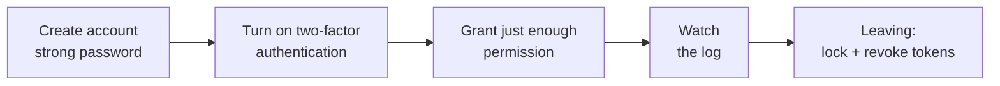

> 🌐 **Language:** [🇻🇳 Tiếng Việt](./security-accounts-and-access_vi.md) · 🇬🇧 English (current) · [🇯🇵 日本語](./security-accounts-and-access_ja.md)

# Accounts & permissions — passwords, two-factor authentication, least permission

## Introduction

This page shows how to keep the **admin accounts** of a GP247 site safe: replace the default account, set a password policy,
turn on two-factor authentication, grant just enough permission, handle staff who leave, and read the activity log. The page is for site owners and
top administrators. Most tasks can be done right in the admin, with no command line.

## At a glance

An admin account goes through four stages; each stage has its own task for you:

- **Task number 1 after install**: replace the default admin account `admin` (everyone knows the default password).
- **The default password policy is very loose** (minimum 6 characters) — raise it on the **Password policy** screen.
- **Two-factor authentication** comes with the free **MFA** plugin — turn it on for every admin account.
- **As few people as possible should hold Administrator**; people who only need to view should get the **View.all** role.

## Replace the default admin account

Every new install comes with the account `admin`, password `admin`, email `admin@gp247.local`. Everyone knows this, so it is the first thing
automated scanners try. Do this right after install:

1. Sign in to the admin with the default account.
2. Go to **Users** and create a new account for yourself: your own username, a real email, a strong password, the **Administrator** role.
3. Sign out and sign in again with the new account to make sure it works.
4. Go back to **Users** and disable (set to inactive) or delete the `admin` account. If you want to keep it, at least change its password
   (**Setting account** at the top) and change the email to a real one.

If it worked, signing in with `admin` / `admin` is refused.

> ⚠️ **Note:** after installing with the web installer, try signing in once with `admin` / `admin`. If it works, do the steps above right away,
> even if you entered a different password in the installer. Also open `/install`: on a finished install this page must redirect to the sign-in page.

## Set a password policy

The **Password policy** screen (Security menu) decides how strong admin passwords must be. The default values are only good enough for a test machine.

| Item | Default | Recommended |
| --- | --- | --- |
| Minimum length | 6 | 12 or more |
| Maximum length | 16 | 64 — so long passphrases can be used |
| Require letters / upper and lower case / digits / special characters | Off | Turn on at least upper-lower case and digits; or just require long passwords |

- **A long, easy-to-remember password beats a short, hard-to-remember one**: a phrase of 4–5 random words is stronger than `P@ss123`.
- **One account per person** — do not share an admin account, or the log cannot tell you who did what.
- **Use a password manager** so you never reuse a password from another site.

## Sign-in limits and forgotten passwords

GP247 blocks password guessing by itself by limiting the number of failed sign-ins.

- **Default**: 5 attempts per minute per account + IP (`GP247_LOGIN_THROTTLE=5,1`), 20 attempts per minute per IP (`GP247_LOGIN_IP_THROTTLE=20,1`). The admin sign-in page and sign-in through the API share the same counter.
- **Want it stricter**: lower the numbers in `.env`, then run `php artisan config:clear`.
- **Admin forgotten password** is on by default (`GP247_ADMIN_FORGOT_PASSWORD=1`) and sends a link to the account's email. If every administrator can recover access through someone else, set `GP247_ADMIN_FORGOT_PASSWORD=0` to remove this page completely.
- **Site behind a proxy / CDN**: set `TRUSTED_PROXIES`, otherwise every visitor is treated as the same IP. See [Production config](./security-production-config.md).

## Turn on two-factor authentication (MFA)

Two-factor authentication asks for an extra 6-digit code from an app on your phone (Google Authenticator, Microsoft Authenticator…). If a password
leaks, the attacker still cannot sign in.

1. Go to **Extension → Plugins**, install and enable the **MFA** plugin (free).
2. Each administrator registers MFA themselves: scan the QR code with an authenticator app and save the **recovery codes** somewhere safe.
3. (Recommended) In the plugin config, **require MFA** for the administrator group.

MFA applies to administrators, customers and vendors (when using a marketplace plugin), for both web sign-in and sign-in through API v2. Details are in the MFA plugin's README.

## Grant just enough permission

Rule: each person has exactly the permissions their job needs. GP247 permissions work by **screen address + type of action** (view / act).

- **Administrator** — can do everything and skips every check. Only for the site owner and the 1–2 most trusted people.
- **View.all** — views every screen but cannot edit. Good for accounting and auditing.
- **Custom roles** — for sales, warehouse and content staff: pick only the screens they need.
- **File management and plugin installation are sensitive permissions**: uploaded files are served publicly on your domain; plugins run code on the server. Grant them only to trusted people.
- **Spending permissions** (payment requests, refunds) are separate from screen access — grant them only to people allowed to spend.

Guide to creating permissions, roles and users: [Admin permissions](../system/permission-and-role.md).

## When a staff member leaves

Do this on the day the person leaves, in this order:

1. **Users** → set a new password for that person's account. Changing the password signs out every session and REST API token of the account ([details](../api/api-authentication.md)).
2. Also in **Users** → disable the account (inactive status). A disabled account cannot sign in, but old log entries keep the name.
3. **Revoke that person's MCP tokens** on the **MCP Server** screen ([details](../mcp/mcp-security.md)).
4. **Change secrets that person knew**: hosting password, database, SMTP, payment gateway keys — if that person had access to see them.
5. If that person ever held the `.env` file: consider changing the encryption key following [Encryption keys & backup](./security-keys-and-backup.md).

## Reading the activity log

The **Log access** screen (Security menu) records administrators' actions: who, when, which address, which IP, what data was sent.

- **On by default** (`GP247_ADMIN_LOG=1`). Passwords, secrets, tokens and licenses are masked before logging; to mask more fields, list them in `GP247_ADMIN_LOG_EXCEPT`.
- **Actions through the admin API and through AI agents (MCP)** are logged too.
- **Failed sign-ins are not logged**, and **old records are not deleted automatically** — review regularly (every week or every month) and clean up when the list gets too long.
- **Warning signs**: actions at odd hours, unknown IPs, accounts that should have been disabled, changes on the **Users** / **Roles** screens or the payment config that no one owns up to.

## Customer accounts

Customers who register on the shop also need protection:

- **Customer sign-in limits failed attempts**, and passwords are stored hashed.
- **Stop spam registrations**: install the **GoogleCaptcha** plugin and turn on captcha for registration, forgotten password, checkout and contact in the shop config.
- **Two-factor authentication for customers** is available through the MFA plugin, optional.

## Conditions & Rules (know before you act)

- **Assigning Administrator or View.all replaces all of that person's other roles** — because these two roles already cover everything.
- **Disabling every Administrator account locks you out** — always keep at least one active Administrator account that you have tested signing in with.
- **Turning off forgotten password (`GP247_ADMIN_FORGOT_PASSWORD=0`)** means an administrator who forgets their password must ask another Administrator to reset it.
- **Requiring MFA** — every administrator must keep their recovery codes; if they lose both the phone and the recovery codes, they must ask another Administrator to remove MFA.
- **The password policy applies when a new password is set** — weak old passwords keep working until they are changed; ask everyone to change their password after you raise the policy.

## Q&A

**Q1: I entered a different password in the installer. Do I still need to replace the `admin` account?**

→ Yes, try signing in with `admin` / `admin`. If it works, replace the account following [Replace the default admin account](#replace-the-default-admin-account).

**Q2: Can I rename the `admin` username?**

→ The safest way is to create a new Administrator account with your own name, then disable or delete `admin`.

**Q3: Is MFA required?**

→ It is not required, but it is strongly recommended for admin accounts. It is the most effective protection when a password leaks.

**Q4: Is it a problem if staff share one admin account?**

→ When something goes wrong, the log cannot tell you who did it. People who leave still know the password. Create one account per person.

**Q5: How do I know if someone is trying to guess passwords?**

→ GP247 blocks after a few failures but does not record the failures. To watch for this, check the access log of your web server or hosting.

**Q6: Can I allow only a few IPs into the admin?**

→ Yes, with the **CheckIP** plugin (allow / block list) or in the web server configuration.

**Q7: I granted a staff member "full" permission for a function. Is that too broad?**

→ "Full" permission lets them view and act on everything in that function. If the staff member only needs to view, grant view permission (GET).

**Q8: Does the log store the passwords people type?**

→ No. Password, secret, token and license fields are masked before logging.

---

📅 **Last updated:** 2026-11-04 · ✍️ **Author:** GP247
