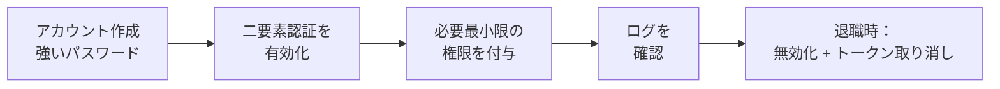

> 🌐 **言語:** [🇻🇳 Tiếng Việt](./security-accounts-and-access_vi.md) · [🇬🇧 English](./security-accounts-and-access.md) · 🇯🇵 日本語（現在）

# アカウントと権限 — パスワード、二要素認証、最小権限

## はじめに

このページでは、GP247 サイトの**管理者アカウント**を安全に保つ方法を説明します：初期アカウントの置き換え、パスワードポリシーの設定、
二要素認証の有効化、必要最小限の権限付与、従業員の退職時の対応、操作ログの確認。対象はサイトオーナーと最上位の管理者です。
ほとんどの作業は管理画面ですぐに行え、コマンドラインは必要ありません。

## ひと目でわかる

管理者アカウントは 4 つの段階を経ます。段階ごとにあなたの作業があります。

- **インストール後の最優先作業**：設定した管理者アカウント（またはインストールコマンドが表示したパスワード）でログインし、パスワードを安全な場所に保管します。
  旧バージョンからインストールしたサイトには、アカウント `admin` / `admin` が残っている場合があります — すぐに置き換えてください。
- **すべての種類のアカウントを 1 つの画面で**：「**パスワードポリシー**」画面で、管理者、顧客（ショップがある場合）、プラグインが追加する
  アカウントの種類ごとにパスワードの強さを設定します。旧バージョンからインストールしたサイトは 6 文字のままの場合があります — 引き上げてください。
- **二要素認証**は無料プラグイン **MFA** で利用できます — すべての管理者アカウントで有効にすることをおすすめします。
- **Administrator を持つ人はできるだけ少なく**。閲覧だけが必要な人には **View.all** ロールを使います。

## 最初の管理者アカウント

新規インストールには、誰もが知っている初期パスワードはもうありません。

| インストール方法 | 最初の管理者アカウント |
| --- | --- |
| Web のインストーラー | ステップ 3 で入力したユーザー名とパスワード（パスワードは 12〜64 文字） |
| `php artisan gp247:install` | コマンドの最後に**一度だけ表示される**ランダムなパスワード — すぐに控えてください。自分で決める場合は `--admin-password="..."` を付けます |

インストール後、そのアカウントでログインし、メールを実際のアドレスに変更して（右上の「**アカウント設定**」）、パスワードをパスワードマネージャーに保管します。

### 旧バージョンからインストールしたサイト：アカウント `admin` / `admin` を置き換える

以前にインストールしたサイトには、アカウント `admin`、パスワード `admin`、メール `admin@gp247.local` が残っている場合があります。この情報は
誰もが知っているため、自動スキャナーが最初に試すものです。このようなアカウントがある間は「**システムアラート**」ページが警告します。すぐに行ってください。

1. 初期アカウントで管理画面にログインします。
2. 「**ユーザー**」(Users) を開き、自分用の新しいアカウントを作成します：独自のユーザー名、実際のメールアドレス、強いパスワード、ロール **Administrator**。
3. ログアウトし、新しいアカウントでログインし直して、動作することを確かめます。
4. 「**ユーザー**」に戻り、アカウント `admin` を無効化（ステータスを無効に設定）または削除します。残したい場合は、少なくともパスワードを変更し
   （右上の「**アカウント設定**」）、メールを実際のアドレスに変更してください。

成功すると、`admin` / `admin` でのログインは拒否されます。

> ⚠️ **注意:** Web のインストーラーでインストールした後、一度 `admin` / `admin` でログインを試してください。ログインできたら、インストーラーで別のパスワードを入力していても、
> すぐに上の手順を行ってください。あわせて `/install` を開いてください：インストールが完了したサイトなら、このページはログインページに切り替わるはずです。

## パスワードポリシーを設定する

「**パスワードポリシー**」画面（「**セキュリティ**」メニュー）で、パスワードにどれだけの強さを求めるかを決めます。画面には**アカウントの種類ごとに 1 つのブロック**があります：
「**管理者**」は常に、「**顧客**」はサイトにショップがある場合、さらに独自のアカウントを持つプラグインのブロック（例：出店者アカウント）。
ポリシーは、その種類のアカウントがパスワードを設定する**すべての場所**に適用されます：アカウント作成、会員登録、パスワード変更、パスワード再設定、API 経由のアプリ。

| 項目 | 管理者（新規インストール） | 顧客（新規インストール） | 推奨値 |
| --- | --- | --- | --- |
| 最小文字数 | 12 | 8 | 管理者 12 以上、顧客 8 以上 |
| 最大文字数 | 64 | 64 | 64 — 長いパスフレーズを使えるように |
| 英字／大文字と小文字／数字／記号の必須 | オフ | オフ | 長いパスワードを優先。従うべき規則で求められる場合は英字と数字を有効に |

- **旧バージョンからインストールしたサイト**は、誰の使い勝手も変わらないよう、動作中の値（管理者・顧客とも通常 6〜16 文字）をそのまま保ちます —
  上の表に沿ってご自身で引き上げてください。管理者の最小文字数が 12 未満の間は「**システムアラート**」ページが知らせます。
- 最小が 6 未満、最大が 72 超、または最小が最大より大きい値は、画面で保存できません。

- **覚えやすい長いパスワードは、覚えにくい短いパスワードより強い**：ランダムな 4〜5 語のフレーズは `P@ss123` より強力です。
- **1 人に 1 つのアカウント** — 管理者アカウントを共有しないでください。共有すると、ログから誰が何をしたかがわからなくなります。
- **パスワードマネージャーを使い**、ほかのサイトのパスワードを使い回さないようにします。

## ログイン制限とパスワードを忘れた場合

GP247 はログイン失敗の回数を制限して、パスワードの推測を自動でブロックします。

- **初期値**：アカウント + IP ごとに 1 分間 5 回（`GP247_LOGIN_THROTTLE=5,1`）、IP ごとに 1 分間 20 回（`GP247_LOGIN_IP_THROTTLE=20,1`）。管理画面のログインページと API 経由のログインは同じカウンターを共有します。
- **より厳しくしたい場合**：`.env` で回数を減らし、`php artisan config:clear` を実行します。
- **管理者のパスワード再設定**は初期状態で有効（`GP247_ADMIN_FORGOT_PASSWORD=1`）で、アカウントのメールアドレスにリンクを送ります。すべての管理者がほかの人を通じて復旧できる場合は、`GP247_ADMIN_FORGOT_PASSWORD=0` を設定してこのページを完全になくします。
- **プロキシ／CDN の背後で動くサイト**：`TRUSTED_PROXIES` を設定してください。設定しないと、すべての訪問者が同じ IP とみなされます。[本番環境の設定](./security-production-config_ja.md)を参照してください。

## 二要素認証（MFA）を有効にする

二要素認証では、スマートフォンのアプリ（Google Authenticator、Microsoft Authenticator など）が表示する 6 桁のコードが追加で求められます。
パスワードが漏れても、攻撃者はログインできません。

1. 「**拡張機能 → プラグイン**」を開き、プラグイン **MFA**（無料）をインストールして有効にします。
2. 各管理者が自分で MFA を登録します：認証アプリで QR コードを読み取り、**リカバリーコード**を安全な場所に保管します。
3. （推奨）プラグインの設定で、管理者グループに **MFA を必須**にします。

MFA は管理者、顧客、出店者（マーケットプレイスのプラグイン使用時）に、Web でのログインと API v2 経由のログインの両方で適用されます。詳しくはプラグイン MFA の README をご覧ください。

## 必要最小限の権限を付与する

原則：各人には自分の仕事にちょうど必要な権限だけを与えます。GP247 の権限管理は**画面のアドレス + 操作の種類**（閲覧／操作）で行います。

- **Administrator** — すべての操作が可能で、すべてのチェックを通過します。サイトオーナーと、最も信頼できる 1〜2 人だけにします。
- **View.all** — すべての画面を閲覧できますが、編集はできません。経理や監査に向いています。
- **独自に作成したロール** — 販売、在庫、コンテンツ担当のスタッフ向け：必要な画面だけを選びます。
- **ファイル管理とプラグインのインストールの権限は機密性の高い権限です**：アップロードファイルはあなたのドメインで公開配信され、プラグインはサーバー上でコードを実行します。信頼できる人だけに付与してください。
- **お金を支払う権限**（支払い依頼、返金）は、画面へのアクセス権限とは別です — 支払いを許可された人だけに付与してください。

権限、ロール、ユーザーの作成方法：[GP247 の管理画面の権限管理](../system/permission-and-role_ja.md)。

## 従業員が退職したとき

退職したその日のうちに、次の順番で行ってください。

1. 「**ユーザー**」→ その人のアカウントに新しいパスワードを設定します。パスワードを変更すると、そのアカウントのすべてのセッションと REST API トークンがログアウトされます（[詳細](../api/api-authentication_ja.md)）。
2. 同じく「**ユーザー**」で → アカウントを無効化します（ステータスを無効に）。無効化したアカウントはログインできませんが、過去のログには名前が残ります。
3. 「**MCP Server**」画面で、その人の **MCP トークンを取り消します**（[詳細](../mcp/mcp-security_ja.md)）。
4. **その人が知っていた秘密情報を変更します**：ホスティング、データベース、SMTP のパスワードと、決済ゲートウェイのキー — その人に閲覧権限があった場合です。
5. その人が `.env` ファイルを持っていた場合：[暗号化キーとバックアップ](./security-keys-and-backup_ja.md)に沿って暗号化キーの変更を検討してください。

## 操作ログを確認する

「**アクセスログ**」(Log access) 画面（「**セキュリティ**」メニュー）には、管理者の操作が記録されます：誰が、いつ、どのアドレスで、どの IP から、どんなデータを送ったか。

- **初期状態で有効**（`GP247_ADMIN_LOG=1`）。パスワード、シークレット、トークン、ライセンスは記録前にマスクされます。ほかのフィールドもマスクしたい場合は `GP247_ADMIN_LOG_EXCEPT` に指定します。
- **管理 API と AI エージェント（MCP）経由の操作**も記録されます。
- **ログイン失敗は記録されず**、**古い記録は自動で削除されません** — 定期的に（毎週または毎月）確認し、一覧が長くなりすぎたら整理してください。
- **注意すべき兆候**：不自然な時間帯の操作、見慣れない IP、無効化したはずのアカウント、誰も心当たりのない「**ユーザー**」／「**ロール**」画面や決済設定の変更。

## 顧客アカウント

ショップで登録した顧客も保護が必要です。

- **顧客のログインにも失敗回数の制限があり**、パスワードはハッシュで保存されます。
- **スパム登録の防止**：プラグイン **GoogleCaptcha** をインストールし、ショップ設定で会員登録、パスワード再設定、決済、お問い合わせに CAPTCHA を有効にします。
- **顧客向けの二要素認証**も、プラグイン MFA で任意に利用できます。

## 条件と制約（操作の前に確認）

- **Administrator または View.all を割り当てると、その人のほかのロールはすべて置き換えられます** — この 2 つのロールはすでにすべてを包含しているためです。
- **Administrator アカウントをすべて無効化すると、自分を締め出すことになります** — ログインを確認済みの有効な Administrator アカウントを常に 1 つ以上残してください。
- **パスワード再設定を無効にする（`GP247_ADMIN_FORGOT_PASSWORD=0`）**と、パスワードを忘れた管理者は、ほかの Administrator に再設定してもらう必要があります。
- **MFA を必須にした場合** — 各管理者はリカバリーコードを保管する必要があります。スマートフォンとリカバリーコードの両方を失うと、ほかの Administrator に MFA を解除してもらう必要があります。
- **パスワードポリシーは新しいパスワードの設定時に適用されます** — 古い弱いパスワードは変更するまで使えます。ポリシーを引き上げた後は、全員にパスワードの変更を依頼してください。

## よくある質問（Q&A）

**Q1: インストーラーで別のパスワードを入力しました。それでもアカウント `admin` を変更する必要がありますか？**

→ はい。`admin` / `admin` でログインを試してください。ログインできたら、[デフォルトの管理者アカウントを置き換える](#デフォルトの管理者アカウントを置き換える)に沿ってアカウントを置き換えてください。

**Q2: ユーザー名 `admin` を変更できますか？**

→ 最も確実なのは、独自の名前で新しい Administrator アカウントを作成し、`admin` を無効化または削除する方法です。

**Q3: MFA のインストールは必須ですか？**

→ 必須ではありませんが、管理者アカウントには強くおすすめします。パスワードが漏れたときに最も効果的な保護層です。

**Q4: スタッフが 1 つの管理者アカウントを共有すると問題がありますか？**

→ 問題が起きたとき、ログから誰が操作したかがわかりません。退職した人もパスワードを知ったままです。1 人に 1 つのアカウントを作成してください。

**Q5: 誰かがパスワードを推測しようとしているかどうか、どうすればわかりますか？**

→ GP247 は数回失敗するとブロックしますが、失敗は記録しません。監視したい場合は、Web サーバーまたはホスティングのアクセスログを確認してください。

**Q6: 管理画面に入れる IP を限定できますか？**

→ できます。プラグイン **CheckIP**（許可リスト／ブロックリスト）を使うか、Web サーバーで設定してください。

**Q7: スタッフにある機能の「すべて」の権限を付与しました。広すぎますか？**

→ 「すべて」の権限では、その機能内のすべてを閲覧・操作できます。スタッフが閲覧だけを必要とするなら、閲覧権限（GET）を付与してください。

**Q8: ログには、ユーザーが入力したパスワードも保存されますか？**

→ いいえ。パスワード、シークレット、トークン、ライセンスのフィールドは記録前にマスクされます。

---

📅 **最終更新:** 2026-11-04 · ✍️ **作成者 (Author):** GP247
