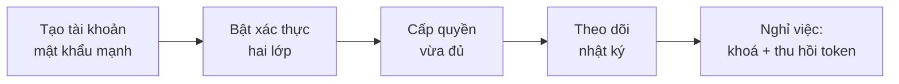

> 🌐 **Ngôn ngữ:** 🇻🇳 Tiếng Việt (hiện tại) · [🇬🇧 English](./security-accounts-and-access.md) · [🇯🇵 日本語](./security-accounts-and-access_ja.md)

# Tài khoản & phân quyền — mật khẩu, xác thực hai lớp, quyền tối thiểu

## Giới thiệu

Trang này hướng dẫn giữ an toàn cho **tài khoản quản trị** của site GP247: thay tài khoản mặc định, đặt chính sách mật khẩu,
bật xác thực hai lớp, cấp quyền vừa đủ, xử lý khi nhân viên nghỉ việc và đọc nhật ký thao tác. Trang dành cho chủ site và quản
trị viên cao nhất. Phần lớn việc làm được ngay trên trang quản trị, không cần dòng lệnh.

## Nhìn nhanh

Một tài khoản quản trị đi qua bốn chặng; mỗi chặng có việc riêng cho bạn:

- **Việc số 1 sau khi cài**: đăng nhập bằng tài khoản quản trị bạn vừa đặt (hoặc mật khẩu lệnh cài in ra) và cất mật khẩu vào nơi an toàn.
  Site cài từ bản cũ có thể vẫn còn tài khoản `admin` / `admin` — thay ngay.
- **Một màn cho mọi loại tài khoản**: **Chính sách mật khẩu** đặt độ mạnh mật khẩu cho quản trị viên, khách hàng (khi có cửa hàng) và
  loại tài khoản do plugin thêm vào. Site cài từ bản cũ có thể còn mức 6 ký tự — nên nâng.
- **Xác thực hai lớp** có qua plugin miễn phí **MFA** — nên bật cho mọi tài khoản quản trị.
- **Ít người giữ Administrator nhất có thể**; người chỉ cần xem thì dùng vai trò **View.all**.

## Tài khoản quản trị đầu tiên

Bản cài mới không còn mật khẩu mặc định ai cũng biết:

| Cách cài | Tài khoản quản trị đầu tiên |
| --- | --- |
| Trình cài đặt trên web | Tên đăng nhập và mật khẩu bạn nhập ở bước 3 (mật khẩu 12–64 ký tự) |
| `php artisan gp247:install` | Mật khẩu ngẫu nhiên **in ra một lần** cuối lệnh — chép lại ngay. Muốn tự đặt: thêm `--admin-password="..."` |
> ℹ️ **Có từ:** gp247/core 3.11.0 — cài bằng bản cũ hơn thì tài khoản đầu tiên là `admin` / `admin` (xem mục dưới).

Sau khi cài, đăng nhập bằng tài khoản đó, đổi email sang email thật (**Thiết lập tài khoản** ở góc trên) và cất mật khẩu vào trình quản
lý mật khẩu.

### Site cài từ bản cũ: thay tài khoản `admin` / `admin`

Site cài trước đây có thể vẫn còn tài khoản `admin`, mật khẩu `admin`, email `admin@gp247.local`. Ai cũng biết thông tin này, nên đây là
thứ máy dò tự động thử đầu tiên; trang **Cảnh báo hệ thống** báo khi còn tài khoản như vậy. Làm ngay:

1. Đăng nhập trang quản trị bằng tài khoản mặc định.
2. Vào **Người dùng**, tạo một tài khoản mới cho chính bạn: tên đăng nhập riêng, email thật, mật khẩu mạnh, vai trò **Administrator**.
3. Đăng xuất, đăng nhập lại bằng tài khoản mới để chắc chắn nó hoạt động.
4. Quay lại **Người dùng**, tắt (đặt trạng thái không hoạt động) hoặc xoá tài khoản `admin`. Nếu muốn giữ, ít nhất đổi mật khẩu
   (**Thiết lập tài khoản** ở góc trên) và đổi email sang email thật.

Nếu thành công, đăng nhập bằng `admin` / `admin` bị từ chối.

> ⚠️ **Lưu ý:** cài bằng trình cài đặt trên web xong, hãy thử đăng nhập bằng `admin` / `admin` một lần. Đăng nhập được thì làm ngay các bước trên,
> dù bạn đã nhập mật khẩu khác trong trình cài đặt. Đồng thời mở `/install`: site đã cài xong thì trang này phải chuyển sang trang đăng nhập.

## Đặt chính sách mật khẩu

Màn **Chính sách mật khẩu** (menu Bảo mật) quyết định mật khẩu phải mạnh tới đâu. Màn có **một khối cho mỗi loại tài khoản**:
**Quản trị viên** luôn có, **Khách hàng** khi site có cửa hàng, và khối của plugin có tài khoản riêng (ví dụ tài khoản người bán).
Chính sách áp cho **mọi chỗ** loại tài khoản đó đặt mật khẩu: tạo tài khoản, đăng ký, đổi mật khẩu, quên mật khẩu, ứng dụng qua API.

| Mục | Quản trị viên (cài mới) | Khách hàng (cài mới) | Nên đặt |
| --- | --- | --- | --- |
| Độ dài tối thiểu | 12 | 8 | Quản trị viên 12 trở lên; khách hàng 8 trở lên |
| Độ dài tối đa | 64 | 64 | 64 — để dùng được cụm mật khẩu dài |
| Bắt buộc chữ cái / chữ hoa và thường / số / ký tự đặc biệt | Tắt | Tắt | Ưu tiên mật khẩu dài; bật chữ và số nếu quy định bạn phải tuân yêu cầu |

- **Site cài từ bản cũ** giữ nguyên giá trị đang chạy (thường 6–16 ký tự cho cả quản trị viên lẫn khách hàng) để không đổi trải nghiệm
  của ai — hãy tự nâng theo bảng trên. Trang **Cảnh báo hệ thống** nhắc khi độ dài tối thiểu của quản trị viên dưới 12.
- Màn từ chối lưu khi tối thiểu dưới 6, tối đa trên 72, hoặc tối thiểu lớn hơn tối đa.

- **Mật khẩu dài dễ nhớ tốt hơn mật khẩu ngắn khó nhớ**: một cụm 4–5 từ ngẫu nhiên mạnh hơn `P@ss123`.
- **Mỗi người một tài khoản** — không dùng chung tài khoản quản trị, nếu không nhật ký không cho biết ai đã làm gì.
- **Dùng trình quản lý mật khẩu** để không phải dùng lại mật khẩu ở site khác.

## Giới hạn đăng nhập và quên mật khẩu

GP247 tự chặn đoán mật khẩu bằng cách giới hạn số lần đăng nhập sai.
- **Mất mật khẩu mà Quên mật khẩu không dùng được** (tài khoản còn email lúc cài, site chưa gửi được mail): người có quyền vào máy chủ chạy `php artisan gp247:admin-password <tên-đăng-nhập>` để đặt mật khẩu mới — lệnh theo chính sách mật khẩu và thu hồi mọi phiên API của tài khoản — có từ gp247/core 3.11.0 ([cách dùng](../system/command-line-reference_vi.md#tài-khoản-quản-trị--gp247admin-password)).

- **Mặc định**: 5 lần mỗi phút cho mỗi tài khoản + IP (`GP247_LOGIN_THROTTLE=5,1`), 20 lần mỗi phút cho mỗi IP (`GP247_LOGIN_IP_THROTTLE=20,1`). Trang đăng nhập quản trị và đăng nhập qua API dùng chung bộ đếm.
- **Muốn chặt hơn**: giảm số lần trong `.env`, rồi chạy `php artisan config:clear`.
- **Quên mật khẩu quản trị** bật sẵn (`GP247_ADMIN_FORGOT_PASSWORD=1`), gửi link qua email của tài khoản. Nếu mọi quản trị viên đều tự khôi phục được qua người khác, đặt `GP247_ADMIN_FORGOT_PASSWORD=0` để bỏ hẳn trang này.
- **Site chạy sau proxy / CDN**: khai `TRUSTED_PROXIES`, nếu không mọi khách bị coi là cùng một IP. Xem [Cấu hình production](./security-production-config_vi.md).

## Bật xác thực hai lớp (MFA)

Xác thực hai lớp đòi thêm một mã 6 số từ ứng dụng trên điện thoại (Google Authenticator, Microsoft Authenticator…). Lộ mật khẩu
thì kẻ gian vẫn không đăng nhập được.

1. Vào **Phần mở rộng → Tiện ích**, cài và bật plugin **MFA** (miễn phí).
2. Mỗi quản trị viên tự đăng ký MFA: quét mã QR bằng ứng dụng xác thực, lưu lại **mã khôi phục** ở nơi an toàn.
3. (Khuyến nghị) Trong cấu hình plugin, **bắt buộc MFA** cho nhóm quản trị viên.

MFA áp cho quản trị viên, khách hàng và người bán (khi dùng plugin sàn), cả đăng nhập trên web lẫn qua API v2. Chi tiết ở README của plugin MFA.

## Cấp quyền vừa đủ

Nguyên tắc: mỗi người chỉ có đúng quyền cho việc của mình. Phân quyền của GP247 theo **địa chỉ màn hình + kiểu thao tác** (xem / thao tác).

- **Administrator** — làm được mọi thứ, bỏ qua mọi kiểm tra. Chỉ chủ site và 1–2 người tin cậy nhất.
- **View.all** — xem mọi màn, không sửa được. Hợp cho kế toán, kiểm tra.
- **Vai trò tự tạo** — cho nhân viên bán hàng, kho, nội dung: chỉ chọn các màn họ cần.
- **Quyền quản lý file và cài plugin là quyền nhạy cảm**: file tải lên được phục vụ công khai trên tên miền của bạn; plugin chạy mã trên máy chủ. Chỉ cấp cho người tin cậy.
- **Quyền chi tiền** (yêu cầu thanh toán, hoàn tiền) tách khỏi quyền vào màn — chỉ cấp cho người được phép chi.

Hướng dẫn tạo quyền, vai trò, người dùng: [Phân quyền](../system/permission-and-role_vi.md).

## Khi nhân viên nghỉ việc

Làm trong ngày người đó nghỉ, theo thứ tự:

1. **Người dùng** → đặt mật khẩu mới cho tài khoản của người đó. Đổi mật khẩu đăng xuất mọi phiên và token REST API của tài khoản ([chi tiết](../api/api-authentication_vi.md)).
2. Cũng ở **Người dùng** → tắt tài khoản (trạng thái không hoạt động). Tài khoản tắt không đăng nhập được, nhưng nhật ký cũ vẫn giữ tên.
3. **Thu hồi token MCP** của người đó ở màn **MCP Server** ([chi tiết](../mcp/mcp-security_vi.md)).
4. **Đổi bí mật người đó từng biết**: mật khẩu hosting, cơ sở dữ liệu, SMTP, khoá cổng thanh toán — nếu người đó có quyền xem.
5. Nếu người đó từng giữ file `.env`: cân nhắc đổi khoá mã hoá theo [Khoá mã hoá & sao lưu](./security-keys-and-backup_vi.md).

## Đọc nhật ký thao tác

Màn **Nhật ký truy cập** (menu Bảo mật) ghi lại thao tác của quản trị viên: ai, lúc nào, địa chỉ nào, IP nào, dữ liệu gửi lên.

- **Bật mặc định** (`GP247_ADMIN_LOG=1`). Mật khẩu, secret, token, license được che trước khi ghi; muốn che thêm trường nào, khai trong `GP247_ADMIN_LOG_EXCEPT`.
- **Thao tác qua API quản trị và qua AI agent (MCP)** cũng được ghi.
- Lần đăng nhập sai được ghi ở màn riêng **Đăng nhập sai** (xem trang **Cơ chế bảo vệ có sẵn**); nhật ký thao tác **không tự xoá bản ghi cũ** — xem định kỳ (mỗi tuần hoặc mỗi tháng) và dọn bớt khi danh sách quá dài.
- **Dấu hiệu cần chú ý**: thao tác vào giờ lạ, IP lạ, tài khoản lẽ ra đã tắt, thay đổi ở màn **Người dùng** / **Nhóm quyền** / cấu hình thanh toán mà không ai nhận.

## Tài khoản khách hàng

Khách đăng ký trên cửa hàng cũng cần được bảo vệ:

- **Đăng nhập khách có giới hạn số lần sai**, mật khẩu lưu dạng băm.
- **Chống đăng ký rác**: cài plugin **GoogleCaptcha**, bật captcha cho đăng ký, quên mật khẩu, thanh toán, liên hệ trong cấu hình cửa hàng.
- **Xác thực hai lớp cho khách** có qua plugin MFA, tuỳ chọn.

## Điều kiện & ràng buộc (hiểu trước khi thao tác)

- **Gán Administrator hoặc View.all sẽ thay mọi vai trò khác của người đó** — vì hai vai trò này đã bao trùm.
- **Tắt hết tài khoản Administrator là tự khoá mình ngoài** — luôn giữ ít nhất một tài khoản Administrator hoạt động, đã thử đăng nhập.
- **Tắt quên mật khẩu (`GP247_ADMIN_FORGOT_PASSWORD=0`)** nghĩa là quản trị viên quên mật khẩu phải nhờ một Administrator khác đặt lại.
- **Bắt buộc MFA** — mỗi quản trị viên phải giữ mã khôi phục; mất điện thoại lẫn mã khôi phục thì phải nhờ Administrator khác gỡ MFA.
- **Chính sách mật khẩu áp khi đặt mật khẩu mới** — mật khẩu cũ yếu vẫn dùng được tới khi đổi; yêu cầu mọi người đổi sau khi nâng chính sách.

## Hỏi & Đáp (Q&A)

**Câu 1: Tôi đã nhập mật khẩu khác trong trình cài đặt, có cần đổi tài khoản `admin` không?**

→ Có, hãy thử đăng nhập bằng `admin` / `admin`. Đăng nhập được thì thay tài khoản theo mục [Thay tài khoản quản trị mặc định](#thay-tài-khoản-quản-trị-mặc-định).

**Câu 2: Đổi tên đăng nhập `admin` được không?**

→ Cách chắc nhất là tạo tài khoản Administrator mới với tên riêng, rồi tắt hoặc xoá `admin`.

**Câu 3: Có bắt buộc cài MFA không?**

→ Không bắt buộc, nhưng rất nên cho tài khoản quản trị. Đây là lớp bảo vệ hiệu quả nhất khi mật khẩu bị lộ.

**Câu 4: Nhân viên dùng chung một tài khoản quản trị có sao không?**

→ Khi có sự cố, nhật ký không cho biết ai đã làm. Người nghỉ việc vẫn biết mật khẩu. Hãy tạo mỗi người một tài khoản.

**Câu 5: Làm sao biết có ai đang thử đoán mật khẩu?**

→ GP247 chặn sau vài lần sai nhưng không ghi lại lần sai. Muốn theo dõi, xem log truy cập của web server hoặc hosting.

**Câu 6: Chỉ cho vài IP vào trang quản trị được không?**

→ Được, bằng plugin **CheckIP** (danh sách cho phép / chặn) hoặc cấu hình ở web server.

**Câu 7: Tôi cấp quyền "toàn bộ" một chức năng cho nhân viên, như vậy có rộng quá không?**

→ Quyền "toàn bộ" cho phép xem lẫn thao tác mọi thứ trong chức năng đó. Nếu nhân viên chỉ cần xem, cấp quyền xem (GET).

**Câu 8: Nhật ký có lưu mật khẩu người dùng nhập không?**

→ Không. Các trường mật khẩu, secret, token, license được che trước khi ghi.

---

📅 **Cập nhật lần cuối:** 2026-11-08 · ✍️ **Tác giả (Author):** GP247
