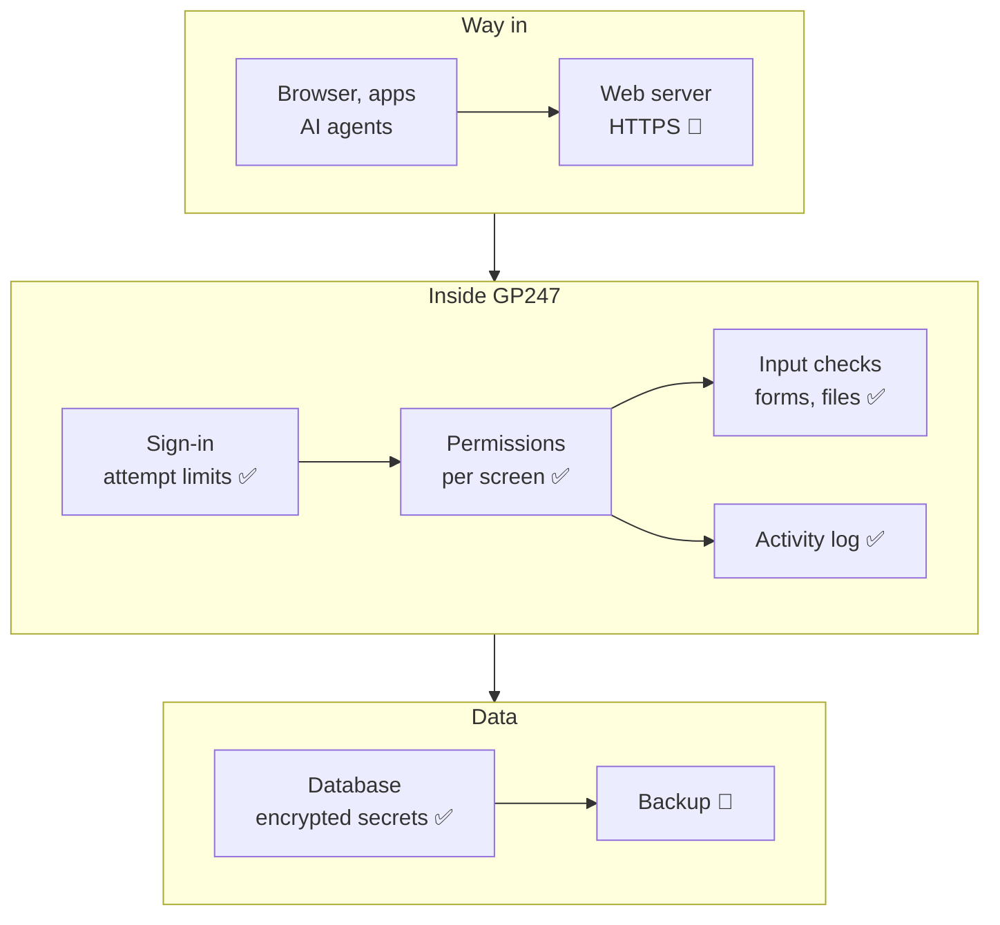

> 🌐 **Language:** [🇻🇳 Tiếng Việt](./security-built-in_vi.md) · 🇬🇧 English (current) · [🇯🇵 日本語](./security-built-in_ja.md)

# What the system protects — built-in protection layers and their limits

## Introduction

This page lists the security mechanisms **built into GP247** (the `gp247/core`, `gp247/front`, `gp247/shop`, `gp247/mcp` packages).
Each mechanism has two parts: **what it does** and **its limits**, meaning the part you must add yourself. The page is for site owners,
technical staff and plugin developers. After reading it you will know which layers are already there and which you must handle yourself.

## At a glance

A request from a browser passes through several layers before it touches data. The diagram shows which layers belong to GP247 and which belong to your server:

- **✅ = GP247 does it, 👤 = you do it.** HTTPS and backups live outside the application, so GP247 cannot do them for you.
- **Safe by default where GP247 has control**: debug turns off automatically in production, MCP is off by default, secrets are never shown again on screen.
- **No layer is absolute**: someone with full server access (both the database and the `.env` file) can still read everything.

## On this page

- [Sign-in & passwords](#sign-in--passwords)
- [Permissions](#permissions)
- [Secrets & encryption](#secrets--encryption)
- [Forms, input data and uploaded files](#forms-input-data-and-uploaded-files)
- [Money, payments and webhooks](#money-payments-and-webhooks)
- [REST API & MCP](#rest-api--mcp)
- [Logs](#logs)
- [Production config & Docker](#production-config--docker)
- [Install & update](#install--update)
- [What GP247 does not do](#what-gp247-does-not-do)

## Sign-in & passwords

This layer stops password guessing and keeps passwords safe if the database leaks.

| Mechanism | What GP247 does | Limits — what you do |
| --- | --- | --- |
| **Failed sign-in limits** | By default 5 attempts/minute per account + IP address, 20 attempts/minute per IP (`GP247_LOGIN_THROTTLE`, `GP247_LOGIN_IP_THROTTLE`). The admin sign-in page and admin sign-in through the API **share the same counter**, so switching channels does not get around it | Cannot stop attacks from a very large number of IPs; use strong passwords + two-factor authentication |
| **Password hashing** | Passwords are stored with bcrypt (one-way); no one can read them back, not even someone who has the database | — |
| **Admin password policy** | The **Password policy** screen sets the minimum length and requires upper/lower case, digits, special characters | By default only 6 characters are required — raise it |
| **Sign-in session** | Creates a new session ID after sign-in; only active accounts can sign in | Cookies are sent only over HTTPS when you set `SESSION_SECURE_COOKIE=true` |
| **Two-factor authentication** | Free **MFA** plugin: TOTP codes for administrators, customers and vendors; also applies to sign-in through API v2 | You must install and enable the plugin; the core does not include it |
| **Captcha** | The **GoogleCaptcha** plugin covers registration, forgotten password, checkout, contact and reviews | You must install it and enable each page in the shop config |

## Permissions

This layer makes sure each person can only open and act on the part assigned to them.

| Mechanism | What GP247 does | Limits — what you do |
| --- | --- | --- |
| **Permissions by address + method** | Each permission is a list of screen addresses with the type of action (view / act). The menu, opening a screen and saving all check the same list; Livewire actions on the screen are checked too | You decide what to grant — if you grant broadly, the system does exactly what you granted. See [Admin permissions](../system/permission-and-role.md) |
| **Special roles** | **Administrator** can do everything; **View.all** can view every screen but not edit | Keep the number of Administrator holders small |
| **Multiple stores** | Store managers only see their own store's data (when using a multi-store plugin) | Assign the right store to each account |
| **API & MCP are never broader than the admin screens** | Calls through the API or an AI agent go through the same permissions of that account | A token carries the permissions of its owner — revoke it when that person leaves |

## Secrets & encryption

This layer keeps secrets (passwords, third-party keys) unreadable if someone gets a copy of the database.

| Mechanism | What GP247 does | Limits — what you do |
| --- | --- | --- |
| **Encrypted config secrets** | SMTP password, captcha secret, OAuth client secret, paid plugin licenses and payment link codes are encrypted in the database with the `GP247_ENCRYPTION_KEY` key (if not set, `APP_KEY` is used) | **Lose the key = lose the secrets**; you must back up `.env`. See [Encryption keys & backup](./security-keys-and-backup.md) |
| **Secrets never shown again** | Secret fields on config screens can only be overwritten; the old value is not shown and not sent to the browser | — |
| **A wrong key does not crash the site** | If a secret cannot be decrypted it is treated as empty, the related feature (sending mail, payment) pauses, and the site keeps running; `gp247:doctor` check `secret_decryptable` points to the broken rows | Silent failure — run `gp247:doctor` after moving servers or changing `.env` |
| **Changing the key without losing data** | The `php artisan gp247:encryption-key-rotate` command re-encrypts every secret with the new key | Follow the exact procedure in [Sensitive data encryption](../system/data-encryption.md) |

> ⚠️ **Note:** the REST API **webhook** signing secret is still encrypted with `APP_KEY`, not with the dedicated key. If you change `APP_KEY`, you must create a new secret for each webhook.

## Forms, input data and uploaded files

This layer stops other sites from faking your actions and stops malicious code from being injected through input.

| Mechanism | What GP247 does | Limits — what you do |
| --- | --- | --- |
| **Form forgery protection (CSRF)** | Every web form has an anti-forgery token; other sites cannot submit on your behalf | — |
| **Output encoding** | Displayed content is HTML-encoded by default; language strings edited by administrators are cleaned when saved | Plugins/templates you write yourself must keep this rule |
| **Uploaded files** | The file manager checks file type and size and blocks `php` and `html` files; delete, rename and move actions only accept requests from the admin itself | Uploaded files are served publicly on the same domain — grant file manager access only to trusted people |
| **Shop input** | Prices, attribute prices and cart quantities are recalculated by the server; numbers sent by the browser are not trusted | — |

## Money, payments and webhooks

This layer stops money from being recorded twice and stops fake payment notifications.

| Mechanism | What GP247 does | Limits — what you do |
| --- | --- | --- |
| **Money recorded once** | Placing orders and recording payments are protected against duplicates; clicking twice does not create two orders | — |
| **Payment links** | Link codes cannot be guessed and are compared safely; the payment and checkout pages limit the number of submissions | — |
| **Incoming webhooks** | Shipping webhook addresses have rate limits | Payment gateway / shipping plugins must verify the provider's signature themselves — choose plugins from trusted sources |
| **Outgoing webhooks** | Signed with HMAC so the receiver can verify; only sent to public HTTPS addresses, never into an internal network | The receiver must check the signature |

## REST API & MCP

These are the two "doors" for outside software. Details are on their own pages; here is a summary of the main protections:

| Mechanism | What GP247 does | Limits — what you do |
| --- | --- | --- |
| **Switches** | `GP247_API_MODE=0` removes all API routes; the **API config** screen turns each part on/off; turning off the master switch also turns off MCP. MCP is off on a fresh install | Turn on only what you use |
| **Tokens** | Stored hashed, have an expiry, can be rotated, can be revoked | One token per application / machine; revoke tokens you do not use |
| **Customer data through MCP** | Customers' personal data is masked by default | Keep the default unless you really need it |

Read more: [Sign-in, tokens and customer accounts through the API](../api/api-authentication.md) · [MCP security & permissions](../mcp/mcp-security.md).

## Logs

This layer helps you know who did what, and when.

| Mechanism | What GP247 does | Limits — what you do |
| --- | --- | --- |
| **Admin activity log** | Records each time an administrator opens a screen, saves, runs a Livewire action, calls the admin API or calls MCP (`GP247_ADMIN_LOG=1`). Passwords, secrets, tokens and licenses are masked in the logged data | **Failed sign-ins are not logged**; old records are not deleted automatically — review and clean up from time to time on the **Log access** screen |
| **Application log file** | Writes errors to `storage/logs/gp247.log`, one file per day, kept for 14 days (`LOG_DAILY_DAYS`) | Set a suitable `LOG_LEVEL` for production; do not let the `storage/` folder be reachable from the web |

## Production config & Docker

This layer reduces the damage when configuration is set wrong by mistake.

| Mechanism | What GP247 does | Limits — what you do |
| --- | --- | --- |
| **Debug turns off automatically** | When `APP_ENV=production`, GP247 forces debug off whatever `APP_DEBUG` says | Only applies when `APP_ENV` is exactly `production` |
| **Environment label** | The admin header shows the running environment and a red "DEBUG ON" label (`GP247_ENV_BADGE`) | If you see it, you must fix it |
| **Docker production** | `docker-compose.prod.yml` pins `APP_ENV=production`, `APP_DEBUG=false` for every service; refuses to start while the sample passwords from `.env.example` remain; turns off unused PHP features; nginx blocks hidden files and internal folders | Turn on HTTPS at the proxy in front; update images regularly |
| **System alerts** | A **System alerts** block at the top of the admin dashboard sums up, in one line, the most severe level and how many items need work; a shield icon in the header counts the critical items. The **System alerts** page (menu **System config** → **Security**, or click the shield / the button on the block) lists each item: debug turned on, the site not on HTTPS or the sign-in cookie not marked `Secure`, the `admin` account still on the default password, a minimum password length under 12 characters, no dedicated encryption key, secrets that cannot be decrypted, MFA not turned on, the API turned on, the version line close to or past the end of support, extensions whose data update has not run or whose static files are missing. Each item shows technical detail and links to a guide; once fixed, the alert clears by itself (or click **Check again** on the page). `gp247:doctor` reports the same items | Only the **Administrator** role sees the block, the page and the menu item. It checks only when someone opens the admin, and sends no email. It does not check the site from the outside for you (whether `.env` can be downloaded, whether `http://` redirects to `https://`) |

> ℹ️ **Available since:** gp247/core 3.10.0 (the System alerts block and page, the security checks of `gp247:doctor`)

## Install & update

This layer stops reinstalls from wiping data and stops update packages from being swapped.

| Mechanism | What GP247 does | Limits — what you do |
| --- | --- | --- |
| **Install** | The `gp247:install` command asks for confirmation and warns about data loss; it refuses to install over an installed site without clear confirmation | After installing, check that `/install` now redirects to the sign-in page, and replace the default account right away |
| **Platform update** | `php artisan gp247:update` only refreshes; it never reruns the data-destroying install step | Back up before updating |
| **Plugin / template update** | Packages are downloaded over a certificate-verified connection (`GP247_UPDATE_VERIFY_SSL`), and the hash is checked when the library provides one; the old version is kept in `storage/backups/extensions/` before overwriting | Install only from trusted sources |

## What GP247 does not do

The tasks below are **not** in GP247 — if you do not do them, no one will:

- **Does not turn on HTTPS, does not send HSTS / CSP headers** — configure these in the web server or proxy.
- **Does not back up the database, `.env` or uploaded images** — see [Encryption keys & backup](./security-keys-and-backup.md).
- **Does not force you to replace the default admin account** — see [Accounts & permissions](./security-accounts-and-access.md).
- **Does not send alerts when nobody opens the admin** — the System alerts block and page only check when someone opens the admin; visit the admin regularly.
- **Does not check the site from the outside** — whether `.env` can be downloaded, whether `http://` redirects to `https://`: check these yourself with [Production config](./security-production-config.md#self-check-in-5-minutes).
- **Does not announce platform security patches inside the admin** — follow the [release page](../release/release.md).
- **Does not patch PHP, the web server or the operating system** — that is your job or your hosting provider's.

## Conditions & Rules (know before you act)

- **Protections apply to the GP247 core** — third-party plugins and templates can ignore these rules; install only from trusted sources.
- **Some mechanisms need a plugin** (two-factor authentication, captcha, IP blocking with the **CheckIP** plugin) — not installed means not there.
- **Default values can be changed in `.env`** — changing sign-in limits or turning off the log is your decision; this doc describes the default values.

## Q&A

**Q1: Do I need any security plugins?**

→ You should install **MFA** (two-factor authentication) for admin accounts, and **GoogleCaptcha** if the shop gets spam registrations. Both are free.

**Q2: Does the log record who failed to sign in?**

→ No. The log records actions by people who have signed in. Failed sign-ins are only limited in number, not recorded.

**Q3: Can someone with a copy of the database read the SMTP password?**

→ No, not without the `.env` file that holds the key. With both, they can — so store the `.env` backup separately from the database backup.

**Q4: Debug already turns off automatically when `APP_ENV=production`, so does `APP_DEBUG` still matter?**

→ Yes. If `APP_ENV` is mistyped (e.g. `prod`, `Production`), GP247 does not force debug off. Set both to be sure: `APP_ENV=production`, `APP_DEBUG=false`.

**Q5: Does GP247 block unknown IPs from the admin?**

→ The core only limits sign-in attempts. To allow only a few IPs, use the **CheckIP** plugin or configure it in the web server.

**Q6: Can an AI agent connected through MCP do more than I can?**

→ No. The agent carries exactly the permissions of the account that created the token, no more. See [MCP security & permissions](../mcp/mcp-security.md).

**Q7: Why does the doc mention "limits" on every row?**

→ So you do not wrongly think "there is a protection layer, so I need to do nothing". The "what you do" part is what decides whether the site is safe.

**Q8: Why can my staff not see the System alerts?**

→ The block is shown only to the **Administrator** role. A list of the site's weak points is what an attacker looks for, so other roles (including **View.all**) see neither the block, the shield icon nor the menu item, and opening the page address directly is refused.

---

📅 **Last updated:** 2026-11-04 · ✍️ **Author:** GP247
