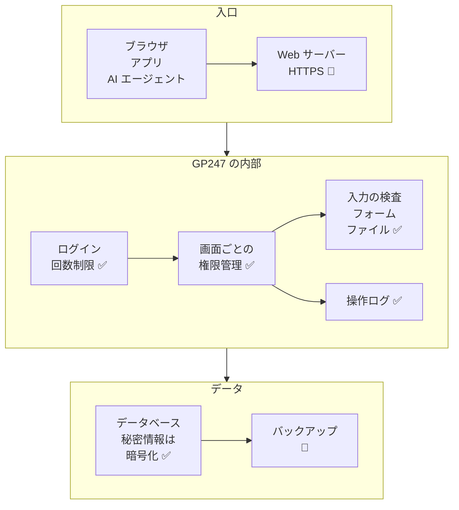

> 🌐 **言語:** [🇻🇳 Tiếng Việt](./security-built-in_vi.md) · [🇬🇧 English](./security-built-in.md) · 🇯🇵 日本語（現在）

# システムが守るもの — 組み込みの保護層とその限界

## はじめに

このページでは、**GP247 に組み込まれている**セキュリティの仕組み（パッケージ `gp247/core`、`gp247/front`、`gp247/shop`、`gp247/mcp`）を一覧にします。
各仕組みについて、**何をするか**と**その限界**、つまりあなたが自分で補うべき部分の 2 点を示します。対象はサイトオーナー、
技術担当者、プラグイン開発者です。読み終えると、どの層がすでにあり、どの層を自分で用意すべきかがわかります。

## ひと目でわかる

ブラウザからのリクエストは、データに届くまでに複数の層を通ります。図は、どの層が GP247 の担当で、どの層があなたのサーバーの担当かを示しています。

- **✅ = GP247 が対応済み、👤 = あなたが行う。** HTTPS とバックアップはアプリケーションの外側にあるため、GP247 が代わりに行うことはできません。
- **GP247 が管理できる部分では初期状態で安全です**：本番運用時はデバッグが自動で無効になり、MCP は初期状態でオフ、秘密情報は画面に再表示されません。
- **絶対に安全な層はありません**：サーバーのすべての権限（データベースと `.env` ファイルの両方）を持つ人は、すべてを読むことができます。

## このページの内容

- [ログインとパスワード](#ログインとパスワード)
- [権限](#権限)
- [秘密情報と暗号化](#秘密情報と暗号化)
- [フォーム、入力データ、アップロードファイル](#フォーム入力データアップロードファイル)
- [お金、決済、Webhook](#お金決済webhook)
- [REST API と MCP](#rest-api-と-mcp)
- [ログ](#ログ)
- [本番運用の設定と Docker](#本番運用の設定と-docker)
- [インストールと更新](#インストールと更新)
- [GP247 が行わないこと](#gp247-が行わないこと)

## ログインとパスワード

この層は、パスワードの推測を防ぎ、データベースが漏れてもパスワードを安全に保ちます。

| 仕組み | GP247 が行うこと | 限界 — あなたが行うこと |
| --- | --- | --- |
| **ログイン失敗回数の制限** | 初期値はアカウント + IP アドレスごとに 1 分間 5 回、IP ごとに 1 分間 20 回（`GP247_LOGIN_THROTTLE`、`GP247_LOGIN_IP_THROTTLE`）。管理画面のログインページと API 経由の管理者ログインは**同じカウンターを共有**するため、経路を変えても回避できません | 非常に多くの IP からの攻撃は防げません。強いパスワード + 二要素認証を使ってください |
| **パスワードのハッシュ化** | パスワードは bcrypt（一方向）で保存され、データベースを持つ人を含め、誰も元に戻せません | — |
| **管理者のパスワードポリシー** | 「**パスワードポリシー**」画面で、最小文字数、大文字／小文字、数字、記号の必須を設定できます | 初期値は 6 文字だけです — 引き上げてください |
| **ログインセッション** | ログイン後に新しいセッション ID を発行。有効なアカウントだけがログインできます | `SESSION_SECURE_COOKIE=true` を設定したときだけ、Cookie は HTTPS 経由でのみ送信されます |
| **二要素認証** | 無料プラグイン **MFA**：管理者、顧客、出店者向けの TOTP コード。API v2 経由のログインにも適用 | プラグインのインストールと有効化が必要です。コアには含まれていません |
| **CAPTCHA** | プラグイン **GoogleCaptcha** を会員登録、パスワード再設定、決済、お問い合わせ、レビューに設置 | インストールし、ショップ設定でページごとに有効にする必要があります |

## 権限

この層は、各人が割り当てられた部分だけにアクセスし、操作できるようにします。

| 仕組み | GP247 が行うこと | 限界 — あなたが行うこと |
| --- | --- | --- |
| **アドレス + メソッドによる権限** | 各権限は、画面のアドレスと操作の種類（閲覧／操作）の一覧です。メニュー、画面へのアクセス、保存のすべてが同じ一覧で確認され、画面上の Livewire 操作も確認されます | 何を付与するかはあなたが決めます — 広く付与すれば、システムはそのとおりに動きます。[GP247 の管理画面の権限管理](../system/permission-and-role_ja.md)を参照してください |
| **特別なロール** | **Administrator** はすべての操作が可能。**View.all** はすべての画面を閲覧できますが編集はできません | Administrator を持つ人数を絞ってください |
| **複数ストア** | ストア管理者は自分のストアのデータだけを閲覧します（複数ストアのプラグイン使用時） | 各アカウントに正しいストアを割り当ててください |
| **API と MCP は管理画面より広い権限を持たない** | API や AI エージェント経由の呼び出しも、そのアカウントと同じ権限チェックを通ります | トークンは作成者の権限を持ちます — その人が退職したら取り消してください |

## 秘密情報と暗号化

この層は、誰かがデータベースのコピーを入手しても、秘密情報（パスワード、サードパーティのキー）を読めないようにします。

| 仕組み | GP247 が行うこと | 限界 — あなたが行うこと |
| --- | --- | --- |
| **設定の秘密情報の暗号化** | SMTP パスワード、CAPTCHA のシークレット、OAuth client secret、有料プラグインのライセンス、決済リンクのコードを、キー `GP247_ENCRYPTION_KEY`（未設定なら `APP_KEY`）でデータベース内に暗号化 | **キーを失う = 秘密情報を失う**。`.env` をバックアップしてください。[暗号化キーとバックアップ](./security-keys-and-backup_ja.md)を参照してください |
| **秘密情報を再表示しない** | 設定画面の秘密情報の欄は上書きのみ可能で、以前の値は表示されず、ブラウザにも送られません | — |
| **キーが違ってもサイトは落ちない** | 復号できない秘密情報は空として扱われ、関連機能（メール送信、決済）は一時停止しますが、サイトは動き続けます。`gp247:doctor` の項目 `secret_decryptable` が壊れた行を示します | エラーは表示されません — サーバー移行や `.env` 変更の後は `gp247:doctor` を実行してください |
| **データを失わずにキーを変更** | コマンド `php artisan gp247:encryption-key-rotate` がすべての秘密情報を新しいキーで暗号化し直します | [GP247 の機密データの暗号化](../system/data-encryption_ja.md)の手順どおりに行う必要があります |

> ⚠️ **注意:** REST API の **Webhook** 署名シークレットは、専用キーではなく今も `APP_KEY` で暗号化されています。`APP_KEY` を変更したら、各 Webhook のシークレットを再生成してください。

## フォーム、入力データ、アップロードファイル

この層は、ほかのサイトがあなたの操作を偽装することや、入力データを通じた悪意あるコードの埋め込みを防ぎます。

| 仕組み | GP247 が行うこと | 限界 — あなたが行うこと |
| --- | --- | --- |
| **フォームの偽造防止（CSRF）** | Web のすべてのフォームに偽造防止コードがあり、ほかのサイトがあなたの代わりに送信することはできません | — |
| **出力のエスケープ** | 表示内容は初期状態で HTML エスケープされます。管理者が編集できる言語文字列は保存時に無害化されます | 自作のプラグイン／テンプレートもこのルールを守る必要があります |
| **アップロードファイル** | ファイルマネージャーはファイルの種類とサイズを検査し、`php` と `html` のファイルをブロックします。削除、名前変更、移動の操作は管理画面自身からのリクエストだけを受け付けます | アップロードファイルは同じドメインで公開配信されます — ファイル管理の権限は信頼できる人だけに付与してください |
| **ショップでの入力データ** | 価格、属性価格、カートの数量はサーバーが再計算し、ブラウザから送られた数値を信用しません | — |

## お金、決済、Webhook

この層は、入金の二重記録と、決済通知の偽装を防ぎます。

| 仕組み | GP247 が行うこと | 限界 — あなたが行うこと |
| --- | --- | --- |
| **入金を一度だけ記録** | 注文と入金の記録には重複防止があり、2 回クリックしても注文は 2 件になりません | — |
| **決済リンク** | リンクのコードは推測できず、安全に照合されます。決済ページと注文ページには送信回数の制限があります | — |
| **受信 Webhook** | 配送 Webhook のアドレスには頻度制限があります | 決済／配送ゲートウェイのプラグインは、各社の署名を自分で検証する必要があります — 信頼できる提供元のプラグインを選んでください |
| **送信 Webhook** | 受信側が検証できるよう HMAC 署名を付与。公開された HTTPS アドレスにだけ送り、内部ネットワークには送りません | 受信側は署名を検証する必要があります |

## REST API と MCP

外部ソフトウェアのための 2 つの「入口」です。詳細は専用ページにあります。主な保護の要約です。

| 仕組み | GP247 が行うこと | 限界 — あなたが行うこと |
| --- | --- | --- |
| **スイッチ** | `GP247_API_MODE=0` で API のルートをすべて削除。「**API設定**」画面で部分ごとにオン／オフ。マスタースイッチをオフにすると MCP もオフ。MCP は新規インストール時にオフ | 使う部分だけを有効にしてください |
| **トークン** | ハッシュで保存、有効期限あり、ローテーション可能、取り消し可能 | アプリ／端末ごとにトークンを 1 つ。使わなくなったら取り消してください |
| **MCP 経由の顧客情報** | 初期状態で顧客の個人情報をマスクします | 本当に必要な場合を除き、初期値のままにしてください |

関連情報：[API によるログイン、トークン、顧客アカウント](../api/api-authentication_ja.md) · [MCP のセキュリティと権限](../mcp/mcp-security_ja.md)。

## ログ

この層で、誰がいつ何をしたかがわかります。

| 仕組み | GP247 が行うこと | 限界 — あなたが行うこと |
| --- | --- | --- |
| **管理操作のログ** | 管理者が画面を開く、保存する、Livewire 操作をする、管理 API を呼ぶ、MCP を呼ぶたびに記録します（`GP247_ADMIN_LOG=1`）。記録データ内のパスワード、シークレット、トークン、ライセンスはマスクされます | **ログイン失敗は記録しません**。古い記録は自動では削除されません — 「**アクセスログ**」画面でときどき確認し、整理してください |
| **アプリケーションのログファイル** | エラーを `storage/logs/gp247.log` に記録。1 日 1 ファイル、14 日間保持（`LOG_DAILY_DAYS`） | 本番運用では適切な `LOG_LEVEL` を設定してください。`storage/` フォルダを Web からアクセスできる状態にしないでください |

## 本番運用の設定と Docker

この層は、設定を誤った場合の被害を小さくします。

| 仕組み | GP247 が行うこと | 限界 — あなたが行うこと |
| --- | --- | --- |
| **デバッグの自動無効化** | `APP_ENV=production` のとき、`APP_DEBUG` の値にかかわらず GP247 がデバッグを強制的に無効にします | `APP_ENV` が正確に `production` のときだけ適用されます |
| **環境ラベル** | 管理画面のヘッダーに実行中の環境と赤い「DEBUG ON」ラベルを表示（`GP247_ENV_BADGE`） | 表示されたら対処してください |
| **Docker 本番環境** | `docker-compose.prod.yml` はすべてのサービスで `APP_ENV=production`、`APP_DEBUG=false` を固定。`.env.example` のサンプルパスワードが残っていれば起動を拒否。使わない PHP 機能を無効化。nginx は隠しファイルと内部フォルダをブロック | 前段のプロキシで HTTPS を有効にしてください。イメージを定期的に更新してください |
| **システムアラート** | 管理画面ダッシュボードの先頭の **システムアラート** ブロックが、最も重いレベルと対応が必要な件数を 1 行にまとめ、ヘッダーの盾アイコンが重大な項目の件数を示します。**システムアラート** ページ（メニュー「システム設定」→「セキュリティ」、または盾アイコン／ブロックのボタン）が各項目を一覧表示します：デバッグが有効、サイトが HTTPS で動いていない／ログイン Cookie に `Secure` が付いていない、`admin` アカウントが初期パスワードのまま、パスワードの最小文字数が 12 未満、専用の暗号化キーが未設定、復号できない秘密情報がある、MFA が無効、API が有効、利用中のバージョン系列のサポート終了が近い／終了済み、データ更新が未実行または静的ファイルが不足している拡張機能。各項目に技術的な詳細と手順へのリンクがあり、修正すればアラートは自動で消えます（またはページの **再確認** をクリック）。`gp247:doctor` も同じ項目を報告します | ブロック、ページ、メニュー項目が表示されるのは **Administrator** ロールのみです。誰かが管理画面を開いたときだけ確認し、メールは送りません。外部からのサイト確認（`.env` をダウンロードできないか、`http://` が `https://` に転送されるか）は代わりに行いません |
| **プロキシ背後の IP とプロトコル** | `TRUSTED_PROXIES` のプロキシから届いたリクエストの場合に限り転送ヘッダーから IP / `https` を受け取り、`X-Forwarded-Host` からドメインを取ることはありません。Docker 構成は初期状態でどのプロキシも信頼せず、構成内の nginx は訪問者の `X-Forwarded-Host` を渡しません。設定がすべての訪問者を信頼している場合はシステムアラートの `trusted_proxies` 項目が警告します | 前段のプロキシの IP 範囲を設定し、プロキシは `Host` ヘッダーを維持する — [本番環境の設定](./security-production-config_ja.md) を参照 |
| **メール内のリンク** | パスワード再設定リンク（管理者、顧客）とメール確認リンクは、リクエストのドメインではなく、常に設定済みのドメイン（`APP_URL`、またはストア独自のドメイン）を指します | `APP_URL` とストアのドメインが正しいこと |

> ℹ️ **対応バージョン:** gp247/core 3.10.0（システムアラートのブロックとページ、`gp247:doctor` のセキュリティ項目）、gp247/core 3.10.3 + gp247/shop 3.8.1（プロキシ背後の IP とプロトコル、メール内のリンク、`trusted_proxies` 項目）

## インストールと更新

この層は、上書きインストールによるデータ消失と、更新パッケージのすり替えを防ぎます。

| 仕組み | GP247 が行うこと | 限界 — あなたが行うこと |
| --- | --- | --- |
| **インストール** | コマンド `gp247:install` は確認を求め、データ消失を警告します。明確な確認がなければ、インストール済みのサイトへの上書きを拒否します | インストール後、`/install` のページがログインページに切り替わったことを確認し、すぐに初期アカウントを変更してください |
| **プラットフォームの更新** | `php artisan gp247:update` は更新だけを行い、データを壊すインストール手順を再実行することはありません | 更新前にバックアップしてください |
| **プラグイン／テンプレートの更新** | パッケージは証明書を検証した接続でダウンロード（`GP247_UPDATE_VERIFY_SSL`）、ライブラリが提供する場合はハッシュを検査。上書きの前に旧版を `storage/backups/extensions/` に保管 | 信頼できる提供元からだけインストールしてください |

## GP247 が行わないこと

次の作業は GP247 に**含まれていません** — あなたが行わなければ、誰も行いません。

- **HTTPS の有効化、HSTS／CSP ヘッダーの送信はしません** — Web サーバーまたはプロキシで設定してください。
- **データベース、`.env`、アップロード画像のバックアップはしません** — [暗号化キーとバックアップ](./security-keys-and-backup_ja.md)を参照してください。
- **初期の管理者アカウントの変更を強制しません** — [アカウントと権限](./security-accounts-and-access_ja.md)を参照してください。
- **誰も管理画面を開かないときにアラートを送りません** — システムアラートのブロックとページは、管理画面が開かれたときだけ確認します。管理画面を定期的に開いてください。
- **外部からサイトを確認しません** — `.env` をダウンロードできないか、`http://` が `https://` に転送されるかは、[本番環境の設定](./security-production-config_ja.md#5-分でできるセルフチェック)に沿って自分で確認してください。
- **プラットフォームのセキュリティパッチを管理画面内で通知しません** — [リリースページ](../release/release_ja.md)を確認してください。
- **PHP、Web サーバー、OS のパッチは当てません** — それはあなた、またはホスティング事業者の作業です。

## 条件と制約（操作の前に確認）

- **保護は GP247 のコア部分に適用されます** — サードパーティのプラグインやテンプレートは、これらのルールを無視する可能性があります。信頼できる提供元からだけインストールしてください。
- **一部の仕組みにはプラグインが必要です**（二要素認証、CAPTCHA、プラグイン **CheckIP** による IP 制限）— インストールしなければ利用できません。
- **初期値は `.env` で変更できます** — ログイン制限の変更やログの無効化はあなたの判断です。このドキュメントは初期値を説明しています。

## よくある質問（Q&A）

**Q1: セキュリティ用のプラグインは必要ですか？**

→ 管理者アカウント用に **MFA**（二要素認証）を、ショップでスパム登録が起きる場合は **GoogleCaptcha** をインストールすることをおすすめします。どちらも無料です。

**Q2: ログには、ログインに失敗した人も記録されますか？**

→ いいえ。ログはログイン済みの人の操作を記録します。ログイン失敗は回数が制限されるだけで、記録はされません。

**Q3: データベースのコピーを手に入れた人は、SMTP パスワードを読めますか？**

→ キーを含む `.env` ファイルを持っていなければ読めません。両方を持っていれば読めます — そのため、`.env` のバックアップはデータベースのバックアップとは別の場所に保管してください。

**Q4: `APP_ENV=production` でデバッグは自動で無効になります。それでも `APP_DEBUG` は重要ですか？**

→ はい。`APP_ENV` を打ち間違えると（例：`prod`、`Production`）、GP247 は強制的に無効にしません。確実にするため両方を設定してください：`APP_ENV=production`、`APP_DEBUG=false`。

**Q5: GP247 は、管理画面への不審な IP からのアクセスをブロックしますか？**

→ コアはログイン回数を制限するだけです。特定の IP だけを許可したい場合は、プラグイン **CheckIP** を使うか、Web サーバーで設定してください。

**Q6: MCP で接続した AI エージェントは、私より多くのことができますか？**

→ いいえ。エージェントはトークンを作成したアカウントとまったく同じ権限を持ち、それ以上にはなりません。[MCP のセキュリティと権限](../mcp/mcp-security_ja.md)を参照してください。

**Q7: なぜドキュメントのどの行にも「限界」が書かれているのですか？**

→ 「保護層があるから何もしなくてよい」と誤解しないためです。サイトが安全かどうかを決めるのは、「あなたが行うこと」の部分です。

**Q8: スタッフにシステムアラートが表示されないのはなぜですか？**

→ このブロックは **Administrator** ロールにだけ表示されます。サイトの弱点の一覧は攻撃者が欲しがる情報なので、ほかのロール（**View.all** を含む）にはブロック、盾アイコン、メニュー項目のいずれも表示されず、ページのアドレスを直接開いても拒否されます。

---

📅 **最終更新:** 2026-11-07 · ✍️ **作成者 (Author):** GP247
