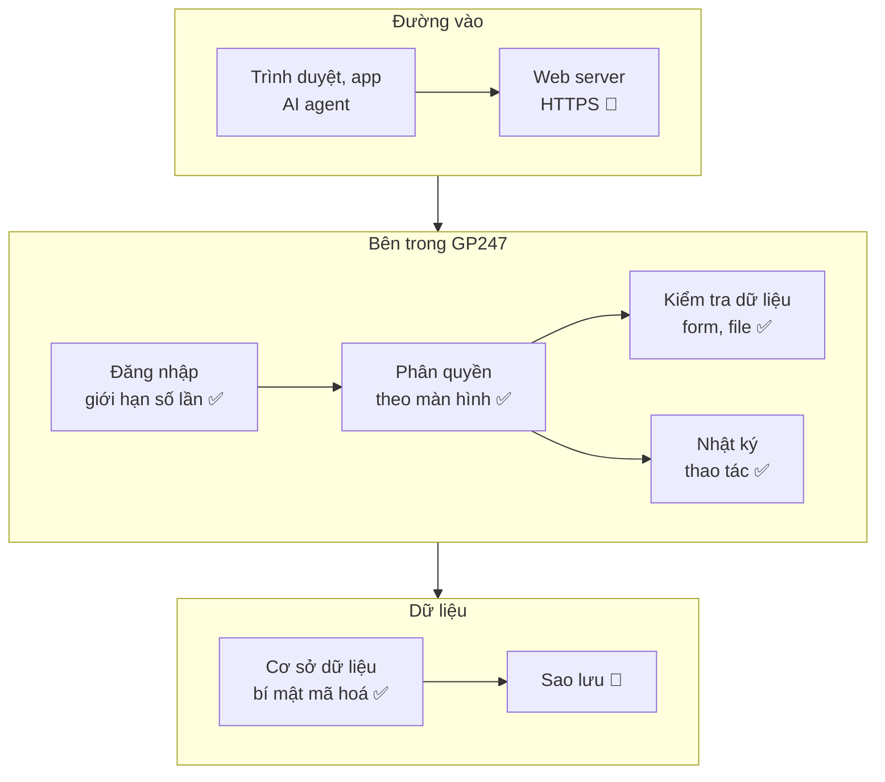

> 🌐 **Ngôn ngữ:** 🇻🇳 Tiếng Việt (hiện tại) · [🇬🇧 English](./security-built-in.md) · [🇯🇵 日本語](./security-built-in_ja.md)

# Hệ thống bảo vệ những gì — các lớp bảo vệ có sẵn và giới hạn

## Giới thiệu

Trang này liệt kê các cơ chế bảo mật **có sẵn trong GP247** (gói `gp247/core`, `gp247/front`, `gp247/shop`, `gp247/mcp`).
Mỗi cơ chế có hai dòng: **nó làm gì** và **giới hạn của nó**, tức phần bạn phải tự bổ sung. Trang dành cho chủ site, người
phụ trách kỹ thuật và lập trình viên plugin. Đọc xong bạn biết lớp nào đã có và lớp nào phải tự lo.

## Nhìn nhanh

Một yêu cầu từ trình duyệt đi qua nhiều lớp trước khi chạm dữ liệu. Sơ đồ cho thấy lớp nào thuộc GP247, lớp nào thuộc máy chủ của bạn:

- **✅ = GP247 làm sẵn, 👤 = bạn làm.** HTTPS và sao lưu nằm ngoài ứng dụng nên GP247 không làm thay được.
- **Mặc định an toàn ở chỗ GP247 kiểm soát được**: debug tự tắt khi chạy production, MCP tắt sẵn, bí mật không hiện lại trên màn hình.
- **Không có lớp nào tuyệt đối**: người có toàn quyền máy chủ (cả cơ sở dữ liệu lẫn file `.env`) vẫn đọc được mọi thứ.

## Trong trang này

- [Đăng nhập & mật khẩu](#đăng-nhập--mật-khẩu)
- [Phân quyền](#phân-quyền)
- [Bí mật & mã hoá](#bí-mật--mã-hoá)
- [Form, dữ liệu vào và file tải lên](#form-dữ-liệu-vào-và-file-tải-lên)
- [Tiền, thanh toán và webhook](#tiền-thanh-toán-và-webhook)
- [REST API & MCP](#rest-api--mcp)
- [Nhật ký](#nhật-ký)
- [Cấu hình chạy thật & Docker](#cấu-hình-chạy-thật--docker)
- [Cài đặt & cập nhật](#cài-đặt--cập-nhật)
- [Những gì GP247 không làm](#những-gì-gp247-không-làm)

## Đăng nhập & mật khẩu

Lớp này chống đoán mật khẩu và giữ mật khẩu an toàn nếu cơ sở dữ liệu bị lộ.

| Cơ chế | GP247 làm gì | Giới hạn — bạn làm |
| --- | --- | --- |
| **Giới hạn đăng nhập sai** | Mặc định 5 lần/phút cho mỗi tài khoản + địa chỉ IP, 20 lần/phút cho mỗi IP (`GP247_LOGIN_THROTTLE`, `GP247_LOGIN_IP_THROTTLE`). Trang đăng nhập quản trị và đăng nhập quản trị qua API **dùng chung bộ đếm**, nên đổi kênh không lách được | Không chặn được tấn công từ rất nhiều IP; nên dùng mật khẩu mạnh + xác thực hai lớp |
| **Băm mật khẩu** | Mật khẩu lưu bằng bcrypt (một chiều), không ai đọc ngược lại được, kể cả người có cơ sở dữ liệu | — |
| **Chính sách mật khẩu quản trị** | Màn **Chính sách mật khẩu** đặt độ dài tối thiểu, bắt buộc chữ hoa/thường, số, ký tự đặc biệt | Mặc định chỉ yêu cầu 6 ký tự — nên nâng lên |
| **Phiên đăng nhập** | Tạo mã phiên mới sau khi đăng nhập; chỉ tài khoản đang hoạt động mới đăng nhập được | Cookie chỉ gửi qua HTTPS khi bạn đặt `SESSION_SECURE_COOKIE=true` |
| **Xác thực hai lớp** | Plugin miễn phí **MFA**: mã TOTP cho quản trị viên, khách hàng, người bán; áp cho cả đăng nhập qua API v2 | Phải cài và bật plugin; lõi không có sẵn |
| **Captcha** | Plugin **GoogleCaptcha** gắn vào đăng ký, quên mật khẩu, thanh toán, liên hệ, đánh giá | Phải cài và bật từng trang ở cấu hình cửa hàng |

## Phân quyền

Lớp này bảo đảm mỗi người chỉ vào và chỉ thao tác được đúng phần được giao.

| Cơ chế | GP247 làm gì | Giới hạn — bạn làm |
| --- | --- | --- |
| **Quyền theo địa chỉ + phương thức** | Mỗi quyền là danh sách địa chỉ màn hình kèm kiểu thao tác (xem / thao tác). Menu, việc vào màn và việc lưu đều kiểm cùng một danh sách; thao tác Livewire trên màn cũng bị kiểm | Bạn quyết định cấp gì — cấp rộng thì hệ thống làm đúng như cấp. Xem [Phân quyền](../system/permission-and-role_vi.md) |
| **Vai trò đặc biệt** | **Administrator** làm được mọi thứ; **View.all** xem được mọi màn nhưng không sửa | Hạn chế số người giữ Administrator |
| **Nhiều cửa hàng** | Quản lý cửa hàng chỉ thấy dữ liệu cửa hàng mình (khi dùng plugin nhiều cửa hàng) | Gán đúng cửa hàng cho từng tài khoản |
| **API & MCP không rộng quyền hơn màn quản trị** | Gọi qua API hay AI agent vẫn đi qua cùng phân quyền của tài khoản đó | Token của ai mang quyền người đó — thu hồi khi người đó nghỉ |

## Bí mật & mã hoá

Lớp này giữ các bí mật (mật khẩu, khoá bên thứ ba) không đọc được nếu ai đó lấy được bản sao cơ sở dữ liệu.

| Cơ chế | GP247 làm gì | Giới hạn — bạn làm |
| --- | --- | --- |
| **Mã hoá bí mật cấu hình** | Mật khẩu SMTP, secret captcha, OAuth client secret, license plugin trả phí, mã link thanh toán được mã hoá trong cơ sở dữ liệu bằng khoá `GP247_ENCRYPTION_KEY` (chưa đặt thì dùng `APP_KEY`) | **Mất khoá = mất bí mật**; phải sao lưu `.env`. Xem [Khoá mã hoá & sao lưu](./security-keys-and-backup_vi.md) |
| **Bí mật không hiện lại** | Ô bí mật trên màn cấu hình chỉ cho ghi đè, không hiện giá trị cũ, không gửi xuống trình duyệt | — |
| **Khoá sai không làm sập site** | Không giải mã được thì bí mật được coi là rỗng, tính năng liên quan (gửi mail, thanh toán) tạm ngừng, site vẫn chạy; `gp247:doctor` mục `secret_decryptable` chỉ ra dòng hỏng | Lỗi im lặng — hãy chạy `gp247:doctor` sau khi chuyển máy chủ hoặc đổi `.env` |
| **Đổi khoá không mất dữ liệu** | Lệnh `php artisan gp247:encryption-key-rotate` mã hoá lại mọi bí mật sang khoá mới | Phải làm đúng quy trình ở [Mã hoá dữ liệu nhạy cảm](../system/data-encryption_vi.md) |

> ⚠️ **Lưu ý:** secret ký **webhook** của REST API vẫn được mã hoá bằng `APP_KEY`, không bằng khoá riêng. Đổi `APP_KEY` thì phải tạo lại secret cho từng webhook.

## Form, dữ liệu vào và file tải lên

Lớp này chống việc trang khác giả mạo thao tác của bạn và chống chèn mã độc qua dữ liệu nhập.

| Cơ chế | GP247 làm gì | Giới hạn — bạn làm |
| --- | --- | --- |
| **Chống giả mạo form (CSRF)** | Mọi form trên web có mã chống giả mạo; trang khác không gửi thay bạn được | — |
| **Mã hoá đầu ra** | Chữ được lưu đúng như người dùng gõ (bỏ ký tự điều khiển; trường chữ thuần bỏ thẻ HTML) và được mã hoá HTML khi hiển thị; chuỗi ngôn ngữ do quản trị viên sửa vẫn được mã hoá khi lưu | Nội dung soạn bằng trình soạn thảo HTML (mô tả, trang, banner) được in nguyên — chỉ cấp quyền sửa cho người tin cậy. Plugin/giao diện tự viết phải in chữ bằng `{{ }}`; mục `raw_output_scan` của `gp247:doctor` chỉ ra chỗ in thô `{!! !!}` |
| **File tải lên** | Trình quản lý file kiểm kiểu file và dung lượng, chặn file `php` và `html`; thao tác xoá, đổi tên, di chuyển chỉ nhận yêu cầu từ chính trang quản trị | File tải lên được phục vụ công khai trên cùng tên miền — chỉ cấp quyền quản lý file cho người tin cậy |
| **Dữ liệu nhập ở cửa hàng** | Giá, giá thuộc tính, số lượng giỏ hàng do máy chủ tính lại, không tin số trình duyệt gửi lên | — |

## Tiền, thanh toán và webhook

Lớp này chống ghi tiền hai lần và chống giả mạo thông báo thanh toán.

| Cơ chế | GP247 làm gì | Giới hạn — bạn làm |
| --- | --- | --- |
| **Ghi tiền một lần** | Đặt hàng và ghi nhận thanh toán có chống trùng; bấm hai lần không tạo hai đơn | — |
| **Link thanh toán** | Mã link không đoán được, so khớp an toàn; trang thanh toán và đặt hàng có giới hạn số lần gửi | — |
| **Webhook nhận vào** | Địa chỉ webhook vận chuyển có giới hạn tần suất | Plugin cổng thanh toán / vận chuyển phải tự xác minh chữ ký của hãng — chọn plugin từ nguồn tin cậy |
| **Webhook gửi đi** | Có chữ ký HMAC để bên nhận kiểm; chỉ gửi tới địa chỉ HTTPS công khai, không gửi vào mạng nội bộ | Bên nhận phải kiểm chữ ký |

## REST API & MCP

Hai "cửa" cho phần mềm bên ngoài. Chi tiết ở trang riêng; tóm tắt các bảo vệ chính:

| Cơ chế | GP247 làm gì | Giới hạn — bạn làm |
| --- | --- | --- |
| **Công tắc** | `GP247_API_MODE=0` gỡ toàn bộ route API; màn **Cấu hình API** bật/tắt từng phần; tắt công tắc tổng là tắt luôn MCP. MCP tắt sẵn khi mới cài | Chỉ bật phần dùng tới |
| **Token** | Lưu dạng băm, có hạn dùng, xoay vòng được, thu hồi được | Mỗi ứng dụng / máy một token; thu hồi khi không dùng |
| **Thông tin khách qua MCP** | Che thông tin cá nhân của khách theo mặc định | Giữ mặc định trừ khi thật cần |

Đọc thêm: [Đăng nhập, token và tài khoản khách qua API](../api/api-authentication_vi.md) · [An toàn & phân quyền của MCP](../mcp/mcp-security_vi.md).

## Nhật ký

Lớp này giúp bạn biết ai đã làm gì, khi nào.

| Cơ chế | GP247 làm gì | Giới hạn — bạn làm |
| --- | --- | --- |
| **Nhật ký thao tác quản trị** | Ghi mỗi lượt quản trị viên mở màn, lưu, thao tác Livewire, gọi API quản trị, gọi MCP (`GP247_ADMIN_LOG=1`). Che mật khẩu, secret, token, license trong dữ liệu ghi | Lần đăng nhập sai nằm ở màn **Đăng nhập sai** (dòng dưới); nhật ký thao tác không tự xoá bản ghi cũ — thỉnh thoảng xem và dọn ở màn **Nhật ký truy cập** |
| **Nhật ký đăng nhập sai** | Ghi mỗi lần đăng nhập sai và mỗi đợt bị chặn vì thử quá nhiều (web và API) vào màn **Đăng nhập sai**, chỉ quản trị viên cấp cao xem; không lưu mật khẩu; giữ 30 ngày (`GP247_LOGIN_FAILURE_KEEP_DAYS`), tự dọn. **Cảnh báo hệ thống** báo khi có dấu hiệu dò mật khẩu trong 24 giờ | Mặc định chỉ ghi tài khoản quản trị — bật thêm khách hàng / người bán trên màn này nếu cần; xem màn khi có cảnh báo |
| **File log ứng dụng** | Ghi lỗi vào `storage/logs/gp247.log`, một file mỗi ngày, giữ 14 ngày (`LOG_DAILY_DAYS`) | Đặt `LOG_LEVEL` phù hợp khi chạy thật; không để thư mục `storage/` truy cập được từ web |

## Cấu hình chạy thật & Docker

Lớp này giảm thiệt hại khi cấu hình lỡ sai.

| Cơ chế | GP247 làm gì | Giới hạn — bạn làm |
| --- | --- | --- |
| **Tự tắt debug** | Khi `APP_ENV=production`, GP247 ép tắt debug dù `APP_DEBUG` đặt gì | Chỉ áp khi `APP_ENV` đúng là `production` |
| **Nhãn môi trường** | Header trang quản trị hiện môi trường đang chạy và nhãn đỏ "DEBUG ON" (`GP247_ENV_BADGE`) | Nhìn thấy thì phải xử lý |
| **Docker production** | `docker-compose.prod.yml` ghim `APP_ENV=production`, `APP_DEBUG=false` cho mọi dịch vụ; từ chối khởi động khi còn mật khẩu mẫu của `.env.example`; tắt các tính năng PHP không dùng; nginx chặn file ẩn và thư mục nội bộ | Bật HTTPS ở proxy phía trước; cập nhật image định kỳ |
| **Cảnh báo hệ thống** | Block **Cảnh báo hệ thống** ở đầu dashboard quản trị tóm tắt trong một dòng mức nặng nhất và số mục cần xử lý; biểu tượng khiên trên header đếm số mục nghiêm trọng. Trang **Cảnh báo hệ thống** (menu **Cấu hình hệ thống** → **Bảo mật**, hoặc bấm khiên / nút ở block) liệt kê từng mục: debug đang bật, site chưa chạy HTTPS hoặc cookie đăng nhập chưa bật `Secure`, tài khoản `admin` còn mật khẩu mặc định, mật khẩu tối thiểu dưới 12 ký tự, chưa đặt khoá mã hoá riêng, có bí mật không giải mã được, chưa bật MFA, API đang bật, dòng phiên bản sắp hết hoặc đã hết hỗ trợ, extension chưa cập nhật dữ liệu hoặc thiếu file tĩnh, template/plugin của site in biến bằng `{!! !!}`, trang quản trị đi qua proxy chưa khai báo trong `TRUSTED_PROXIES`. Mỗi mục có chi tiết kỹ thuật và link hướng dẫn; sửa xong thì cảnh báo tự hết (hoặc bấm **Kiểm tra lại** trên trang). `gp247:doctor` báo cùng các mục này | Chỉ vai trò **Administrator** thấy block, trang và mục menu. Chỉ kiểm khi có người mở trang quản trị, không gửi email. Không kiểm thay bạn từ trình duyệt (file `.env` có tải được không, `http://` có tự chuyển sang `https://` không) |
| **IP và giao thức sau proxy** | Chỉ nhận IP / `https` từ header chuyển tiếp khi request đến từ proxy trong `TRUSTED_PROXIES`; không bao giờ lấy tên miền từ `X-Forwarded-Host`; bộ Docker mặc định không tin proxy nào và nginx của bộ không chuyển `X-Forwarded-Host` của khách; mục `trusted_proxies` của Cảnh báo hệ thống nhắc khi cấu hình tin mọi khách | Khai đúng dải IP của proxy phía trước; proxy phải giữ header `Host` — xem [Cấu hình chạy thật](./security-production-config_vi.md) |
| **Link trong email** | Link đặt lại mật khẩu (quản trị viên, khách) và link xác minh email luôn trỏ về tên miền đã cấu hình (`APP_URL`, hoặc tên miền riêng của cửa hàng), không theo tên miền của request | `APP_URL` và tên miền cửa hàng phải đúng |

> ℹ️ **Có từ:** gp247/core 3.10.0 (block và trang Cảnh báo hệ thống, các mục bảo mật của `gp247:doctor`); gp247/core 3.10.3 + gp247/shop 3.8.1 (IP và giao thức sau proxy, link trong email, mục `trusted_proxies`); gp247/core 3.11.3 (cảnh báo proxy chưa khai báo); gp247/core 3.12.0 + gp247/front 3.8.0 + gp247/shop 3.10.0 (lưu chữ đúng như gõ, mục `raw_output_scan`)

## Cài đặt & cập nhật

Lớp này chống cài đè làm mất dữ liệu và chống gói cập nhật bị thay.

| Cơ chế | GP247 làm gì | Giới hạn — bạn làm |
| --- | --- | --- |
| **Cài đặt** | Lệnh `gp247:install` hỏi xác nhận và cảnh báo mất dữ liệu; từ chối cài đè site đã cài nếu không có xác nhận rõ. Chỉ cài được bằng lệnh — không có trang cài đặt nào trên web; site chưa cài chỉ hiện trang hướng dẫn chạy lệnh cài | Chép mật khẩu quản trị in ra cuối lệnh; site cài từ bản cũ thì thay ngay tài khoản mặc định |
| **Cập nhật nền tảng** | `php artisan gp247:update` chỉ làm mới, không bao giờ chạy lại bước cài phá dữ liệu | Sao lưu trước khi cập nhật |
| **Cập nhật plugin / template** | Gói tải về qua kết nối được kiểm chứng chỉ (`GP247_UPDATE_VERIFY_SSL`), kiểm mã băm khi thư viện cung cấp; giữ bản cũ ở `storage/backups/extensions/` trước khi ghi đè | Chỉ cài từ nguồn tin cậy |

## Những gì GP247 không làm

Các việc dưới đây **không có** trong GP247 — nếu bạn không làm thì không ai làm:

- **Không bật HTTPS, không gửi header HSTS / CSP** — cấu hình ở web server hoặc proxy.
- **Không sao lưu cơ sở dữ liệu, `.env`, ảnh tải lên** — xem [Khoá mã hoá & sao lưu](./security-keys-and-backup_vi.md).
- **Không buộc đổi tài khoản quản trị mặc định** — xem [Tài khoản & phân quyền](./security-accounts-and-access_vi.md).
- **Không gửi cảnh báo khi không ai vào trang quản trị** — block và trang Cảnh báo hệ thống chỉ kiểm khi có người mở trang quản trị; hãy vào trang quản trị định kỳ.
- **Không kiểm site từ bên ngoài** — `.env` có tải được không, `http://` có tự chuyển sang `https://` không: tự kiểm theo [Cấu hình production](./security-production-config_vi.md#tự-kiểm-trong-5-phút).
- **Không báo bản vá bảo mật của nền tảng ngay trong trang quản trị** — theo dõi [trang phát hành](../release/release_vi.md).
- **Không vá PHP, web server, hệ điều hành** — đó là việc của bạn hoặc nhà cung cấp hosting.

## Điều kiện & ràng buộc (hiểu trước khi thao tác)

- **Bảo vệ áp cho phần lõi GP247** — plugin và giao diện của bên thứ ba có thể bỏ qua các quy tắc này; chỉ cài từ nguồn tin cậy.
- **Một số cơ chế cần plugin** (xác thực hai lớp, captcha, chặn IP bằng plugin **CheckIP**) — không cài thì không có.
- **Giá trị mặc định đổi được bằng `.env`** — đổi giới hạn đăng nhập hay tắt nhật ký là quyết định của bạn; tài liệu này mô tả giá trị mặc định.

## Hỏi & Đáp (Q&A)

**Câu 1: Có cần plugin bảo mật nào không?**

→ Nên cài **MFA** (xác thực hai lớp) cho tài khoản quản trị, và **GoogleCaptcha** nếu cửa hàng bị đăng ký rác. Cả hai đều miễn phí.

**Câu 2: Nhật ký có ghi ai đăng nhập sai không?**

→ Có, ở một màn riêng. **Nhật ký thao tác** ghi việc của người đã đăng nhập; **lần đăng nhập sai** được ghi ở màn **Đăng nhập sai** (menu Bảo mật, chỉ quản trị viên cấp cao xem): tên đăng nhập đã gõ, IP, trình duyệt, kênh (web/API), thời điểm — **không bao giờ lưu mật khẩu**. Mặc định chỉ ghi tài khoản quản trị; có thể bật thêm khách hàng hoặc người bán trên chính màn đó. Lưu 30 ngày (`GP247_LOGIN_FAILURE_KEEP_DAYS`), tự dọn, không cần cron. Trang **Cảnh báo hệ thống** báo khi có dấu hiệu dò mật khẩu trong 24 giờ.

**Câu 3: Người lấy được bản sao cơ sở dữ liệu đọc được mật khẩu SMTP không?**

→ Không, nếu họ không có file `.env` chứa khoá. Có cả hai thì đọc được — vì vậy hãy cất bản sao lưu `.env` tách khỏi bản sao lưu cơ sở dữ liệu.

**Câu 4: Debug đã tự tắt khi `APP_ENV=production`, vậy `APP_DEBUG` còn quan trọng không?**

→ Có. Nếu `APP_ENV` gõ sai (vd `prod`, `Production`) thì GP247 không ép tắt. Đặt cả hai cho chắc: `APP_ENV=production`, `APP_DEBUG=false`.

**Câu 5: GP247 có chặn IP lạ vào trang quản trị không?**

→ Lõi chỉ giới hạn số lần đăng nhập. Muốn chỉ cho phép vài IP, dùng plugin **CheckIP** hoặc cấu hình ở web server.

**Câu 6: AI agent kết nối qua MCP có làm được nhiều hơn tôi không?**

→ Không. Agent mang đúng quyền của tài khoản đã tạo token, không hơn. Xem [An toàn & phân quyền của MCP](../mcp/mcp-security_vi.md).

**Câu 7: Vì sao tài liệu nói "giới hạn" ở mọi dòng?**

→ Để bạn không tưởng nhầm "đã có lớp bảo vệ thì khỏi làm gì". Phần "bạn làm" mới là phần quyết định site có an toàn hay không.

**Câu 8: Vì sao nhân viên của tôi không thấy Cảnh báo hệ thống?**

→ Block chỉ hiện với vai trò **Administrator**. Danh sách điểm yếu của site là thông tin kẻ tấn công cần, nên vai trò khác (kể cả **View.all**) không thấy block, biểu tượng khiên hay mục menu, và mở thẳng địa chỉ trang cũng bị từ chối.

---

📅 **Cập nhật lần cuối:** 2026-11-13 · ✍️ **Tác giả (Author):** GP247
