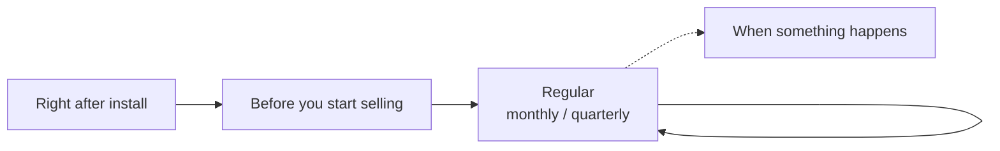

> 🌐 **Language:** [🇻🇳 Tiếng Việt](./security-checklist_vi.md) · 🇬🇧 English (current) · [🇯🇵 日本語](./security-checklist_ja.md)

# Security checklist — by timing, plus common mistakes

## Introduction

This page is a security checklist for a GP247 site, organized by **timing**: right after install, before you start selling, on a regular schedule,
and when something happens (a staff member leaves, you move servers, you suspect a leak). At the end of the page are **common mistakes** with their consequences and how to avoid them.
The page is for site owners and technical staff; print it or copy it into your task tool so you can tick items off. Each item
links to a detailed guide.

## At a glance

Four groups of tasks, following the life of a site:

- **Right after install** — replace the default account, set a dedicated key, back up `.env`.
- **Before you start selling** — HTTPS, debug off, check that `.env` cannot be downloaded, have a backup schedule.
- **Regular** — update, review the log, test a restore.
- **When something happens** — act the same day, in the right order.

## Right after install

- [ ] Copy the admin password the install printed (it is shown only once) and change the account email to a real one; on a site installed from an older version, replace the `admin` account — signing in with `admin` / `admin` must be refused — [Accounts & permissions](./security-accounts-and-access.md#the-first-admin-account)
- [ ] Open `/install` — it must redirect to the sign-in page — [Production config](./security-production-config.md#self-check-in-5-minutes)
- [ ] Set a dedicated `GP247_ENCRYPTION_KEY` and then run `php artisan config:clear` — [Sensitive data encryption](../system/data-encryption.md)
- [ ] Back up the `.env` file to a safe place off the server — [Encryption keys & backup](./security-keys-and-backup.md)
- [ ] Raise the password policy (minimum 12, maximum 64 characters) — [Accounts & permissions](./security-accounts-and-access.md#set-a-password-policy)
- [ ] Run `php artisan gp247:doctor` and fix every FAIL line — [Check and diagnostic commands](../cli/cli-diagnostics.md)

## Before you start selling

- [ ] `APP_ENV=production`, `APP_DEBUG=false`; the admin header has no "DEBUG ON" label — [Production config](./security-production-config.md#why-debug-must-never-be-on-for-a-live-site)
- [ ] HTTPS is on, `http://` redirects to `https://`, `APP_URL` starts with `https://`, `SESSION_SECURE_COOKIE=true` — [Production config](./security-production-config.md#https-and-cookies)
- [ ] The document root points to `public/`; opening `/.env` in a browser must give a 404 or 403 error — [Production config](./security-production-config.md#web-root-and-folder-permissions)
- [ ] `LOG_LEVEL` is `warning` or `error` — [Production config](./security-production-config.md#environment-variables-for-production)
- [ ] The database password and every sample password have been changed — [Production config](./security-production-config.md#environment-variables-for-production)
- [ ] Turn on two-factor authentication (the **MFA** plugin) for every administrator — [Accounts & permissions](./security-accounts-and-access.md#turn-on-two-factor-authentication-mfa)
- [ ] One account per staff member, with just enough permission — [Accounts & permissions](./security-accounts-and-access.md#grant-just-enough-permission)
- [ ] Turn off the REST API / MCP if you do not use them — [What the system protects](./security-built-in.md#rest-api--mcp)
- [ ] Have an automatic backup schedule for the database + `storage/app/` + `app/GP247/`, with one copy off the server — [Encryption keys & backup](./security-keys-and-backup.md#what-you-must-back-up)

## Regular tasks

**Every month**

- [ ] Compare the site's version (`php artisan gp247:info`) with "Recommended versions" on the [release page](../release/release.md); update if it is older — [Updates & incidents](./security-updates-and-incidents.md#updating-gp247-safely)
- [ ] Update PHP, the web server and the operating system (or ask your hosting) — [Updates & incidents](./security-updates-and-incidents.md#updating-php-the-web-server-and-the-operating-system)
- [ ] Review the **Log access** screen: unusual actions, unknown IPs — [Accounts & permissions](./security-accounts-and-access.md#reading-the-activity-log)
- [ ] Review the **Users** screen: disable accounts no longer in use

**Every quarter**

- [ ] Test restoring the backup onto a test site — [Encryption keys & backup](./security-keys-and-backup.md#test-a-restore--the-step-many-people-skip)
- [ ] Review roles and permissions: who holds Administrator, who can manage files, install plugins, spend money
- [ ] Review REST API and MCP tokens: revoke tokens not in use
- [ ] Remove plugins you do not use

## When something happens

**A staff member leaves** — [details](./security-accounts-and-access.md#when-a-staff-member-leaves)

- [ ] Change the password and then disable that person's account; revoke their MCP tokens
- [ ] Change secrets that person knew (hosting, database, SMTP, payment gateway)

**Moving servers or cloning the site** — [details](./security-keys-and-backup.md#moving-servers-or-cloning-the-site)

- [ ] Copy the `.env` file as-is; do not run `php artisan key:generate`
- [ ] Run `php artisan gp247:doctor`; the `secret_decryptable` line must be PASS

**Suspected breach** — [details](./security-updates-and-incidents.md#if-you-suspect-a-breach--steps-in-order)

- [ ] Isolate → back up the current state → change passwords & tokens → change secrets at the provider → change keys if `.env` leaked → investigate → restore

## Common mistakes

The ten mistakes below cause most incidents on live sites. Each one has its consequence and how to avoid it.

| # | Mistake | Consequence | How to avoid |
| --- | --- | --- | --- |
| 1 | **Not backing up `.env`** (it holds the keys) | The server breaks: the SMTP password, payment secrets and licenses become empty and cannot be recovered | Back up `.env` right after install and after every edit — [details](./security-keys-and-backup.md) |
| 2 | **Running `php artisan key:generate` on a running site** | Everyone is signed out; webhook secrets break; without a dedicated key, the config secrets are lost too | Never run it on a live site; change keys following the procedure — [details](../system/data-encryption.md) |
| 3 | **`APP_DEBUG=true` on a live site** | Visitors see paths, queries and config when an error happens | `APP_ENV=production` + `APP_DEBUG=false` — [details](./security-production-config.md#why-debug-must-never-be-on-for-a-live-site) |
| 4 | **Using `.env.example` as-is** | `APP_ENV=local`, `LOG_LEVEL=debug`, sample database password | Edit it following the production variables table — [details](./security-production-config.md#environment-variables-for-production) |
| 5 | **Editing `.env` and forgetting `php artisan config:clear`** | The site keeps running the old config, including the old debug setting | Run `php artisan config:clear` after every edit — [details](./security-production-config.md#installing-the-code-for-production) |
| 6 | **Pushing `.env` to Git or a wrong document root** | Every secret leaks | `.gitignore` has `.env`; the document root is `public/` — [details](./security-production-config.md#web-root-and-folder-permissions) |
| 7 | **Keeping the `admin` / `admin` account** (site installed from an older version) | The admin is taken over within minutes | Replace it now — [details](./security-accounts-and-access.md#site-installed-from-an-older-version-replace-the-admin--admin-account) |
| 8 | **Having backups but never testing a restore** | You only find out the backup is incomplete or broken when you need it | Test a restore every quarter — [details](./security-keys-and-backup.md#test-a-restore--the-step-many-people-skip) |
| 9 | **`docker compose down -v` on production** | Deletes the volume that holds the database | Only use `docker compose down` (without `-v`) — [details](./security-keys-and-backup.md) |
| 10 | **Installing plugins of unknown origin** | The plugin can read `.env` and the database | Install only from the GP247 library or trusted authors — [details](./security-updates-and-incidents.md#plugins-and-templates-install-only-from-trusted-sources) |

## Conditions & Rules (know before you act)

- **The checklist describes the latest release** — a site that has not been updated may lack a few screens or options; update first.
- **Items with a command need server access** — on shared hosting without a command line, ask your technical staff or provider.
- **Ticking every box does not mean safe forever** — the regular items must be repeated.

## Q&A

**Q1: I have no time. What are the bare minimum items?**

→ Three items: replace the `admin` account, back up `.env` + the database off the server, `APP_DEBUG=false`.

**Q2: I use shared hosting. Which items can I do without a command line?**

→ Almost all of them: edit `.env` with the file manager, turn on HTTPS and backups in the hosting control panel, and the tasks in the admin. Only `gp247:doctor`, `gp247:info` and `config:clear` need a command line — without one, ask your hosting.

**Q3: Do I need to redo the "Right after install" checklist when I update?**

→ No. When you update, do the "Regular tasks" items and the process in [Updating GP247 safely](./security-updates-and-incidents.md#updating-gp247-safely).

**Q4: I found I made one of the mistakes in the table. Does that mean the site was hacked?**

→ Not necessarily. Fix that mistake right away, then check the **Log access** and **Users** screens for unusual signs. If you find any, follow the "Suspected breach" section.

**Q5: Can this checklist replace professional security testing?**

→ No. This is the minimum for every site. Large sites, or sites handling a lot of customer data, should hire a security assessment regularly.

---

📅 **Last updated:** 2026-11-08 · ✍️ **Author:** GP247
