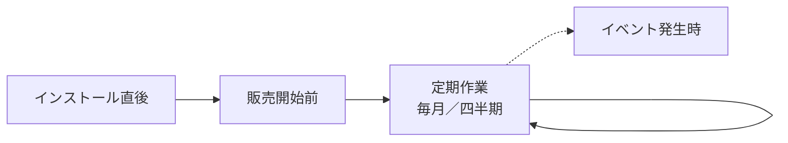

> 🌐 **言語:** [🇻🇳 Tiếng Việt](./security-checklist_vi.md) · [🇬🇧 English](./security-checklist.md) · 🇯🇵 日本語（現在）

# セキュリティチェックリスト — 時期ごとの確認とよくある間違い

## はじめに

このページは GP247 サイトのセキュリティ確認リストで、**時期**ごとに分かれています：インストール直後、販売開始前、定期作業、
イベント発生時（従業員の退職、サーバーの移行、漏えいの疑い）。ページの最後には、**よくある間違い**とその影響、避け方をまとめています。
対象はサイトオーナーと技術担当者です。印刷するか、タスク管理ツールに写してチェックできます。各項目から
詳しい手順のページにリンクしています。

## ひと目でわかる

サイトのライフサイクルに沿った 4 つの作業グループです。

- **インストール直後** — 初期アカウントの置き換え、専用キーの設定、`.env` のバックアップ。
- **販売開始前** — HTTPS、デバッグの無効化、`.env` がダウンロードできないことの確認、バックアップのスケジュール。
- **定期作業** — 更新、ログの確認、復元テスト。
- **イベント発生時** — その日のうちに、正しい順番で行う。

## インストール直後

- [ ] インストール時に表示された管理者パスワード（一度だけ表示）を控え、アカウントのメールを実際のアドレスに変更する。旧バージョンでインストールしたサイトではアカウント `admin` を置き換え、`admin` / `admin` でのログインが拒否されることを確認する — [アカウントと権限](./security-accounts-and-access_ja.md#最初の管理者アカウント)
- [ ] `/install` を開く — ログインページに切り替わることを確認する — [本番環境の設定](./security-production-config_ja.md#5-分でできるセルフチェック)
- [ ] 専用の `GP247_ENCRYPTION_KEY` を設定し、`php artisan config:clear` を実行する — [GP247 の機密データの暗号化](../system/data-encryption_ja.md)
- [ ] `.env` ファイルをサーバー外の安全な場所にバックアップする — [暗号化キーとバックアップ](./security-keys-and-backup_ja.md)
- [ ] パスワードポリシーを引き上げる（最小 12 文字、最大 64 文字） — [アカウントと権限](./security-accounts-and-access_ja.md#パスワードポリシーを設定する)
- [ ] `php artisan gp247:doctor` を実行し、FAIL の行をすべて解消する — [GP247 システムのコマンドライン（CLI）一覧](../system/command-line-reference_ja.md)

## 販売開始前

- [ ] `APP_ENV=production`、`APP_DEBUG=false`。管理画面のヘッダーに「DEBUG ON」ラベルがない — [本番環境の設定](./security-production-config_ja.md#本番サイトでデバッグを有効にしてはいけない理由)
- [ ] HTTPS が有効、`http://` が自動で `https://` に切り替わる、`APP_URL` が `https://` で始まる、`SESSION_SECURE_COOKIE=true` — [本番環境の設定](./security-production-config_ja.md#https-と-cookie)
- [ ] ドキュメントルートが `public/` を指している。ブラウザで `/.env` を開くと 404 または 403 エラーになる — [本番環境の設定](./security-production-config_ja.md#web-のドキュメントルートとフォルダの権限)
- [ ] `LOG_LEVEL` が `warning` または `error` — [本番環境の設定](./security-production-config_ja.md#本番環境の環境変数一覧)
- [ ] データベースのパスワードとすべてのサンプルパスワードを変更した — [本番環境の設定](./security-production-config_ja.md#本番環境の環境変数一覧)
- [ ] すべての管理者で二要素認証（プラグイン **MFA**）を有効にした — [アカウントと権限](./security-accounts-and-access_ja.md#二要素認証mfaを有効にする)
- [ ] スタッフ 1 人に 1 つのアカウント、必要最小限の権限 — [アカウントと権限](./security-accounts-and-access_ja.md#必要最小限の権限を付与する)
- [ ] 使わない場合は REST API／MCP を無効にした — [システムが守るもの](./security-built-in_ja.md#rest-api-と-mcp)
- [ ] データベース + `storage/app/` + `app/GP247/` の自動バックアップのスケジュールがあり、1 つはサーバーの外にある — [暗号化キーとバックアップ](./security-keys-and-backup_ja.md#バックアップが必要なもの)

## 定期作業

**毎月**

- [ ] サイトのバージョン（`php artisan gp247:info`）を[リリースページ](../release/release_ja.md)の「推奨バージョン」と比べる。古ければ更新する — [更新とインシデント対応](./security-updates-and-incidents_ja.md#gp247-を安全に更新する)
- [ ] PHP、Web サーバー、OS を更新する（またはホスティングに確認する） — [更新とインシデント対応](./security-updates-and-incidents_ja.md#phpweb-サーバーos-の更新)
- [ ] 「**アクセスログ**」画面を確認する：不審な操作、見慣れない IP — [アカウントと権限](./security-accounts-and-access_ja.md#操作ログを確認する)
- [ ] 「**ユーザー**」画面を見直す：使われなくなったアカウントは無効にする

**四半期ごと**

- [ ] テストサイトにバックアップの復元を試す — [暗号化キーとバックアップ](./security-keys-and-backup_ja.md#復元テスト--多くの人が飛ばす手順)
- [ ] ロールと権限を見直す：誰が Administrator を持ち、誰がファイル管理、プラグインのインストール、支払いの権限を持つか
- [ ] REST API と MCP のトークンを見直す：使わないトークンを取り消す
- [ ] 使わないプラグインを削除する

## イベント発生時

**従業員の退職** — [詳細](./security-accounts-and-access_ja.md#従業員が退職したとき)

- [ ] パスワードを変更してから、その人のアカウントを無効にする。MCP トークンを取り消す
- [ ] その人が知っていた秘密情報（ホスティング、データベース、SMTP、決済ゲートウェイ）を変更する

**サーバーの移行・サイトの複製** — [詳細](./security-keys-and-backup_ja.md#サーバーの移行サイトの複製)

- [ ] `.env` ファイルをそのままコピーする。`php artisan key:generate` を実行しない
- [ ] `php artisan gp247:doctor` を実行する。`secret_decryptable` の行が PASS であること

**漏えいの疑い** — [詳細](./security-updates-and-incidents_ja.md#漏えいが疑われるとき--順番どおりの手順)

- [ ] 隔離 → 現状のバックアップ → パスワードとトークンの変更 → 提供元での秘密情報の変更 → `.env` が漏れた場合はキーの変更 → 調査 → 復旧

## よくある間違い

次の 10 個の間違いが、実際のサイトで起きる事故の大部分を占めます。それぞれに影響と避け方を示します。

| # | 間違い | 影響 | 避け方 |
| --- | --- | --- | --- |
| 1 | **`.env` をバックアップしない**（キーを含む） | サーバーが故障すると、SMTP パスワード、決済のシークレット、ライセンスが空になり、取り戻せない | インストール直後と、編集するたびに `.env` をバックアップする — [詳細](./security-keys-and-backup_ja.md) |
| 2 | **稼働中のサイトで `php artisan key:generate` を実行する** | 全員がログアウトされる。Webhook のシークレットが壊れる。専用キーがなければ設定の秘密情報も失う | 本番サイトでは絶対に実行しない。キーは手順どおりに変更する — [詳細](../system/data-encryption_ja.md) |
| 3 | **本番サイトで `APP_DEBUG=true`** | エラー時に、訪問者にパス、クエリ、設定が見える | `APP_ENV=production` + `APP_DEBUG=false` — [詳細](./security-production-config_ja.md#本番サイトでデバッグを有効にしてはいけない理由) |
| 4 | **`.env.example` をそのまま使う** | `APP_ENV=local`、`LOG_LEVEL=debug`、サンプルのデータベースパスワード | 本番環境の変数一覧に沿って修正する — [詳細](./security-production-config_ja.md#本番環境の環境変数一覧) |
| 5 | **`.env` を編集して `php artisan config:clear` を忘れる** | サイトが古い設定のまま動く。古いデバッグ設定も含む | 編集するたびに `php artisan config:clear` を実行する — [詳細](./security-production-config_ja.md#本番環境向けのソースコードのインストール) |
| 6 | **`.env` を Git に入れる、またはドキュメントルートの誤り** | すべての秘密情報が漏れる | `.gitignore` に `.env` を入れる。ドキュメントルートは `public/` — [詳細](./security-production-config_ja.md#web-のドキュメントルートとフォルダの権限) |
| 7 | **アカウント `admin` / `admin` を残す**（旧バージョンでインストールしたサイト） | 数分で管理画面を乗っ取られる | すぐに置き換える — [詳細](./security-accounts-and-access_ja.md#旧バージョンからインストールしたサイトアカウント-admin--admin-を置き換える) |
| 8 | **バックアップはあるが一度も復元を試していない** | 必要になって初めて、バックアップの不足や破損に気づく | 四半期ごとに復元を試す — [詳細](./security-keys-and-backup_ja.md#復元テスト--多くの人が飛ばす手順) |
| 9 | **本番環境で `docker compose down -v`** | データベースを含むボリュームが削除される | `docker compose down`（`-v` なし）だけを使う — [詳細](./security-keys-and-backup_ja.md) |
| 10 | **出所のわからないプラグインをインストールする** | プラグインが `.env` とデータベースを読める | GP247 のライブラリまたは信頼できる作者からだけインストールする — [詳細](./security-updates-and-incidents_ja.md#プラグインとテンプレート信頼できる提供元からのみインストール) |

## 条件と制約（操作の前に確認）

- **このチェックリストは最新のリリースを説明しています** — 更新していないサイトでは、一部の画面やオプションがない場合があります。先に更新してください。
- **コマンドラインを使う項目にはサーバーの権限が必要です** — コマンドラインのない共有ホスティングでは、技術担当者またはホスティング事業者に依頼してください。
- **チェックを終えても、ずっと安全というわけではありません** — 定期作業の項目は繰り返し行う必要があります。

## よくある質問（Q&A）

**Q1: 時間がありません。最低限どの項目を行えばよいですか？**

→ 3 つです：アカウント `admin` の置き換え、`.env` + データベースのサーバー外へのバックアップ、`APP_DEBUG=false`。

**Q2: 共有ホスティングを使っています。コマンドラインなしでできる項目はどれですか？**

→ ほぼすべてです：ファイルマネージャーでの `.env` の編集、ホスティングのコントロールパネルでの HTTPS の有効化とバックアップ、管理画面での作業。コマンドラインが必要なのは `gp247:doctor`、`gp247:info`、`config:clear` だけです — 使えなければホスティングに依頼してください。

**Q3: 更新のときに「インストール直後」のチェックリストをもう一度行う必要がありますか？**

→ ありません。更新のときは「定期作業」の項目と、[GP247 を安全に更新する](./security-updates-and-incidents_ja.md#gp247-を安全に更新する)の手順を行ってください。

**Q4: 表の間違いを 1 つしていたことに気づきました。サイトはすでに侵入されているのでしょうか？**

→ 必ずしもそうではありません。すぐにその間違いを直し、「**アクセスログ**」と「**ユーザー**」画面で不審な兆候がないか確認してください。兆候があれば「漏えいの疑い」の項目に沿って対応してください。

**Q5: このチェックリストで、専門家によるセキュリティテストの代わりになりますか？**

→ なりません。これはすべてのサイトに必要な最低限の内容です。大規模なサイトや、多くの顧客データを扱うサイトは、定期的にセキュリティ診断を依頼することをおすすめします。

---

📅 **最終更新:** 2026-11-08 · ✍️ **作成者 (Author):** GP247
