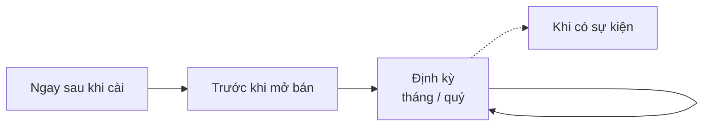

> 🌐 **Ngôn ngữ:** 🇻🇳 Tiếng Việt (hiện tại) · [🇬🇧 English](./security-checklist.md) · [🇯🇵 日本語](./security-checklist_ja.md)

# Checklist bảo mật — theo thời điểm và những lỗi hay gặp

## Giới thiệu

Trang này là danh sách kiểm tra bảo mật cho site GP247, chia theo **thời điểm**: ngay sau khi cài, trước khi mở bán, định kỳ,
và khi có sự kiện (nhân viên nghỉ, chuyển máy chủ, nghi bị lộ). Cuối trang là **những lỗi hay gặp** kèm hậu quả và cách tránh.
Trang dành cho chủ site và người phụ trách kỹ thuật; in ra hoặc chép vào công cụ quản lý công việc để đánh dấu được. Mỗi mục
dẫn tới trang hướng dẫn chi tiết.

## Nhìn nhanh

Bốn nhóm việc, theo vòng đời của một site:

- **Ngay sau khi cài** — thay tài khoản mặc định, đặt khoá riêng, sao lưu `.env`.
- **Trước khi mở bán** — HTTPS, tắt debug, kiểm `.env` không tải được, có lịch sao lưu.
- **Định kỳ** — cập nhật, xem nhật ký, thử khôi phục.
- **Khi có sự kiện** — làm ngay trong ngày, theo đúng thứ tự.

## Ngay sau khi cài

- [ ] Chép mật khẩu quản trị mà lệnh cài in ra (chỉ hiện một lần) và đổi email tài khoản sang email thật; site cài từ bản cũ thì thay tài khoản `admin` — thử đăng nhập `admin` / `admin` phải bị từ chối — [Tài khoản & phân quyền](./security-accounts-and-access_vi.md#tài-khoản-quản-trị-đầu-tiên)
- [ ] Đặt `GP247_ENCRYPTION_KEY` riêng rồi chạy `php artisan config:clear` — [Mã hoá dữ liệu nhạy cảm](../system/data-encryption_vi.md)
- [ ] Sao lưu file `.env` ra nơi an toàn ngoài máy chủ — [Khoá mã hoá & sao lưu](./security-keys-and-backup_vi.md)
- [ ] Nâng chính sách mật khẩu (tối thiểu 12, tối đa 64 ký tự) — [Tài khoản & phân quyền](./security-accounts-and-access_vi.md#đặt-chính-sách-mật-khẩu)
- [ ] Chạy `php artisan gp247:doctor`, xử lý mọi dòng FAIL — [Lệnh kiểm tra và chẩn đoán](../cli/cli-diagnostics_vi.md)

## Trước khi mở bán

- [ ] `APP_ENV=production`, `APP_DEBUG=false`; header trang quản trị không có nhãn "DEBUG ON" — [Cấu hình production](./security-production-config_vi.md#vì-sao-không-được-bật-debug-trên-site-thật)
- [ ] HTTPS bật, `http://` tự chuyển sang `https://`, `APP_URL` bắt đầu bằng `https://`, `SESSION_SECURE_COOKIE=true` — [Cấu hình production](./security-production-config_vi.md#https-và-cookie)
- [ ] Document root trỏ vào `public/`; mở `/.env` trên trình duyệt phải lỗi 404 hoặc 403 — [Cấu hình production](./security-production-config_vi.md#thư-mục-gốc-của-web-và-quyền-thư-mục)
- [ ] `LOG_LEVEL` là `warning` hoặc `error` — [Cấu hình production](./security-production-config_vi.md#bảng-biến-môi-trường-cho-production)
- [ ] Mật khẩu cơ sở dữ liệu và mọi mật khẩu mẫu đã đổi — [Cấu hình production](./security-production-config_vi.md#bảng-biến-môi-trường-cho-production)
- [ ] Bật xác thực hai lớp (plugin **MFA**) cho mọi quản trị viên — [Tài khoản & phân quyền](./security-accounts-and-access_vi.md#bật-xác-thực-hai-lớp-mfa)
- [ ] Mỗi nhân viên một tài khoản, quyền vừa đủ — [Tài khoản & phân quyền](./security-accounts-and-access_vi.md#cấp-quyền-vừa-đủ)
- [ ] Tắt REST API / MCP nếu không dùng — [Hệ thống bảo vệ những gì](./security-built-in_vi.md#rest-api--mcp)
- [ ] Có lịch sao lưu tự động cơ sở dữ liệu + `storage/app/` + `app/GP247/`, có một bản ngoài máy chủ — [Khoá mã hoá & sao lưu](./security-keys-and-backup_vi.md#những-gì-phải-sao-lưu)

## Định kỳ

**Hằng tháng**

- [ ] So phiên bản site (`php artisan gp247:info`) với "Phiên bản nên dùng" ở [trang phát hành](../release/release_vi.md); cập nhật nếu cũ hơn — [Cập nhật & xử lý sự cố](./security-updates-and-incidents_vi.md#cập-nhật-gp247-an-toàn)
- [ ] Cập nhật PHP, web server, hệ điều hành (hoặc hỏi hosting) — [Cập nhật & xử lý sự cố](./security-updates-and-incidents_vi.md#cập-nhật-php-web-server-và-hệ-điều-hành)
- [ ] Xem màn **Nhật ký truy cập**: thao tác lạ, IP lạ — [Tài khoản & phân quyền](./security-accounts-and-access_vi.md#đọc-nhật-ký-thao-tác)
- [ ] Rà màn **Người dùng**: tài khoản không còn dùng thì tắt

**Hằng quý**

- [ ] Thử khôi phục bản sao lưu lên một site thử — [Khoá mã hoá & sao lưu](./security-keys-and-backup_vi.md#thử-khôi-phục--bước-nhiều-người-bỏ-qua)
- [ ] Rà vai trò và quyền: ai giữ Administrator, ai có quyền quản lý file, cài plugin, chi tiền
- [ ] Rà token REST API và MCP: thu hồi token không dùng
- [ ] Gỡ plugin không dùng

## Khi có sự kiện

**Nhân viên nghỉ việc** — [chi tiết](./security-accounts-and-access_vi.md#khi-nhân-viên-nghỉ-việc)

- [ ] Đổi mật khẩu rồi tắt tài khoản của người đó; thu hồi token MCP
- [ ] Đổi bí mật người đó từng biết (hosting, cơ sở dữ liệu, SMTP, cổng thanh toán)

**Chuyển máy chủ hoặc nhân bản site** — [chi tiết](./security-keys-and-backup_vi.md#chuyển-máy-chủ-hoặc-nhân-bản-site)

- [ ] Chép nguyên file `.env`; không chạy `php artisan key:generate`
- [ ] Chạy `php artisan gp247:doctor`; dòng `secret_decryptable` phải PASS

**Nghi bị lộ** — [chi tiết](./security-updates-and-incidents_vi.md#khi-nghi-bị-lộ--các-bước-theo-thứ-tự)

- [ ] Cô lập → sao lưu hiện trạng → đổi mật khẩu & token → đổi bí mật tại nhà cung cấp → đổi khoá nếu `.env` lộ → điều tra → khôi phục

## Những lỗi hay gặp

Mười lỗi dưới đây gây phần lớn sự cố trên site thật. Mỗi lỗi có hậu quả và cách tránh.

| # | Lỗi | Hậu quả | Cách tránh |
| --- | --- | --- | --- |
| 1 | **Không sao lưu `.env`** (chứa khoá) | Máy chủ hỏng: mật khẩu SMTP, secret thanh toán, license thành rỗng, không lấy lại được | Sao lưu `.env` ngay sau khi cài và sau mỗi lần sửa — [chi tiết](./security-keys-and-backup_vi.md) |
| 2 | **Chạy `php artisan key:generate` trên site đang chạy** | Mọi người bị đăng xuất; secret webhook hỏng; chưa có khoá riêng thì mất cả bí mật cấu hình | Không bao giờ chạy trên site thật; đổi khoá theo quy trình — [chi tiết](../system/data-encryption_vi.md) |
| 3 | **`APP_DEBUG=true` trên site thật** | Khách thấy đường dẫn, câu truy vấn, cấu hình khi có lỗi | `APP_ENV=production` + `APP_DEBUG=false` — [chi tiết](./security-production-config_vi.md#vì-sao-không-được-bật-debug-trên-site-thật) |
| 4 | **Dùng nguyên `.env.example`** | `APP_ENV=local`, `LOG_LEVEL=debug`, mật khẩu cơ sở dữ liệu mẫu | Sửa theo bảng biến production — [chi tiết](./security-production-config_vi.md#bảng-biến-môi-trường-cho-production) |
| 5 | **Sửa `.env` mà quên `php artisan config:clear`** | Site vẫn chạy cấu hình cũ, kể cả debug cũ | Chạy `php artisan config:clear` sau mỗi lần sửa — [chi tiết](./security-production-config_vi.md#cài-mã-nguồn-cho-production) |
| 6 | **Đưa `.env` lên Git hoặc document root sai** | Mọi bí mật lộ | `.gitignore` có `.env`; document root là `public/` — [chi tiết](./security-production-config_vi.md#thư-mục-gốc-của-web-và-quyền-thư-mục) |
| 7 | **Giữ tài khoản `admin` / `admin`** (site cài từ bản cũ) | Bị chiếm trang quản trị trong vài phút | Thay ngay — [chi tiết](./security-accounts-and-access_vi.md#site-cài-từ-bản-cũ-thay-tài-khoản-admin--admin) |
| 8 | **Có sao lưu nhưng chưa từng thử khôi phục** | Tới lúc cần mới biết bản sao lưu thiếu hoặc hỏng | Thử khôi phục mỗi quý — [chi tiết](./security-keys-and-backup_vi.md#thử-khôi-phục--bước-nhiều-người-bỏ-qua) |
| 9 | **`docker compose down -v` trên production** | Xoá volume chứa cơ sở dữ liệu | Chỉ dùng `docker compose down` (không `-v`) — [chi tiết](./security-keys-and-backup_vi.md) |
| 10 | **Cài plugin không rõ nguồn** | Plugin đọc được `.env` và cơ sở dữ liệu | Chỉ cài từ thư viện GP247 hoặc tác giả tin cậy — [chi tiết](./security-updates-and-incidents_vi.md#plugin-và-giao-diện-chỉ-cài-từ-nguồn-tin-cậy) |

## Điều kiện & ràng buộc (hiểu trước khi thao tác)

- **Checklist mô tả bản phát hành mới nhất** — site chưa cập nhật có thể thiếu một vài màn hình hoặc tuỳ chọn; cập nhật trước.
- **Mục có dòng lệnh cần quyền máy chủ** — trên shared hosting không có dòng lệnh, nhờ người phụ trách kỹ thuật hoặc nhà cung cấp.
- **Đánh dấu xong không có nghĩa là an toàn mãi** — các mục định kỳ phải lặp lại.

## Hỏi & Đáp (Q&A)

**Câu 1: Tôi không có thời gian, làm ít nhất những mục nào?**

→ Ba mục: thay tài khoản `admin`, sao lưu `.env` + cơ sở dữ liệu ra ngoài máy chủ, `APP_DEBUG=false`.

**Câu 2: Tôi dùng shared hosting, mục nào làm được không cần dòng lệnh?**

→ Gần hết: sửa `.env` bằng trình quản lý file, bật HTTPS và sao lưu ở bảng điều khiển hosting, các việc trên trang quản trị. Chỉ `gp247:doctor`, `gp247:info` và `config:clear` cần dòng lệnh — không có thì nhờ hosting.

**Câu 3: Có cần làm lại checklist "Ngay sau khi cài" khi cập nhật không?**

→ Không. Khi cập nhật, làm mục "Định kỳ" và quy trình ở [Cập nhật GP247 an toàn](./security-updates-and-incidents_vi.md#cập-nhật-gp247-an-toàn).

**Câu 4: Tôi phát hiện đã mắc một lỗi trong bảng, có nghĩa là site đã bị xâm nhập?**

→ Không nhất thiết. Sửa lỗi đó ngay, rồi xem màn **Nhật ký truy cập** và **Người dùng** tìm dấu hiệu lạ. Có dấu hiệu thì làm theo mục "Nghi bị lộ".

**Câu 5: Checklist này có thay được kiểm thử bảo mật chuyên nghiệp không?**

→ Không. Đây là mức tối thiểu cho mọi site. Site lớn hoặc xử lý nhiều dữ liệu khách nên thuê đánh giá bảo mật định kỳ.

---

📅 **Cập nhật lần cuối:** 2026-11-08 · ✍️ **Tác giả (Author):** GP247
