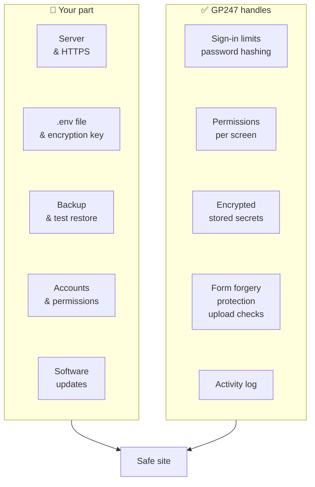

> 🌐 **Language:** [🇻🇳 Tiếng Việt](./security-introduction_vi.md) · 🇬🇧 English (current) · [🇯🇵 日本語](./security-introduction_ja.md)

# GP247 security — what the system handles, what you handle

## Introduction

This is the main page of the **Security** doc set for sites running GP247 / S-Cart. The doc set is for **shop owners**,
**administrators** and **technical staff** (the people who install the site or manage the hosting or server). This page shows what
GP247 already does for you, what **only you can do**, and which page to read next. You do not need to know programming to read it.

> ℹ️ **Why read this:** most incidents on live sites are not caused by software bugs but by **configuration**: forgetting to back up
> the encryption key, leaving debug mode on while the shop is selling, keeping the default admin password, having a backup but never
> testing a restore. Software cannot do those things for you.

## At a glance

Security of a site is a **shared responsibility**. GP247 handles the layers inside the application. The server, keys, backups and
people are your part:

- **If either side is missing, the site is not safe**: no software, however good, can save a leaked `.env` file or a backup that does not exist.
- **Your five most important tasks**: run HTTPS, set `APP_ENV=production` + `APP_DEBUG=false`, back up `.env` (it holds the keys) and the database, replace the default admin account, update when a new version comes out.
- **GP247 is safe by default where it has control**: the public API and MCP have their own switches, secrets are encrypted, every admin action is logged.
- **Fastest way to start**: open the [Security checklist](./security-checklist.md) and tick each item.

## On this page

- [Who does what, by area](#who-does-what-by-area) — table splitting the work between GP247 and you
- [Where to start — reading paths by role](#where-to-start--reading-paths-by-role) — which page to read first
- [The Security doc set](#the-security-doc-set) — list of pages
- [Security pages in other doc sets](#security-pages-in-other-doc-sets) — API, MCP, encryption, permissions, releases
- [Reporting a security vulnerability](#reporting-a-security-vulnerability) — who to send it to, where not to post it

## Who does what, by area

The table below splits the work by area. The "You must do" column lists the tasks **no one else can do for you**. Each row has a detailed guide.

| Area | ✅ GP247 does | 👤 You must do | Read more |
| --- | --- | --- | --- |
| **Server configuration** | Turns debug off automatically when `APP_ENV=production`; the admin header shows the environment label and "DEBUG ON"; the **System alerts** block on the dashboard and the page of the same name report unsafe settings to the Administrator (since gp247/core 3.10.0) | Turn on HTTPS; point the document root to `public/`; `APP_DEBUG=false`; install without dev packages | [Production config](./security-production-config.md) |
| **Keys & backup** | Encrypts secrets (SMTP password, secrets, licenses); keeps a copy of plugins/templates before updating them | Back up `.env`, the database and uploaded images; test a restore; never regenerate the key on a running site | [Encryption keys & backup](./security-keys-and-backup.md) |
| **Accounts & permissions** | Limits failed sign-in attempts; hashes passwords; permissions per screen; activity log | Replace the default account; set a password policy; grant the least permission needed; lock the accounts of people who leave | [Accounts & permissions](./security-accounts-and-access.md) |
| **Updates** | Releases security patches; safe update command; checks downloaded plugin packages | Follow the release page; update GP247, PHP and the web server; install plugins only from trusted sources | [Updates & incidents](./security-updates-and-incidents.md) |
| **API & MCP** | On/off switches; tokens expire and are stored hashed; never broader than the admin screens | Turn on only what you use; one token per application; revoke tokens you no longer use | [API](../api/api-authentication.md) · [MCP](../mcp/mcp-security.md) |
| **Incidents** | Activity log; command to change the encryption key without losing data | Have a response plan; change passwords, revoke tokens and change keys in the right order | [Updates & incidents](./security-updates-and-incidents.md) |

Full list of built-in mechanisms, with the **limits** of each one: [What the system protects](./security-built-in.md).

## Where to start — reading paths by role

Each role only needs to read a few pages, in this order:

| You are | Read in this order |
| --- | --- |
| **Shop owner** (not technical) | [Checklist](./security-checklist.md) → [Accounts & permissions](./security-accounts-and-access.md) → [Encryption keys & backup](./security-keys-and-backup.md) |
| **Technical staff** (install, hosting) | [Production config](./security-production-config.md) → [Encryption keys & backup](./security-keys-and-backup.md) → [Updates & incidents](./security-updates-and-incidents.md) → [Checklist](./security-checklist.md) |
| **Just installed a new site** | [Checklist](./security-checklist.md), the "Right after install" section |
| **Suspect the site was hacked** | [Updates & incidents](./security-updates-and-incidents.md), the "If you suspect a breach" section |
| **Plugin developer** | [What the system protects](./security-built-in.md) → [Sensitive data encryption](../system/data-encryption.md) → [Creating a plugin](../extension/create-plugin.md) |

## The Security doc set

| Page | Helps you |
| --- | --- |
| [What the system protects](./security-built-in.md) | Know exactly which protection layers are built in and their limits, so you do not wrongly think "installed means safe" |
| [Safe production configuration](./security-production-config.md) | Set `.env` correctly for a live site: debug, HTTPS, cookies, document root, folder permissions, Docker |
| [Encryption keys & backup](./security-keys-and-backup.md) | Understand `APP_KEY` and `GP247_ENCRYPTION_KEY`, back up the right things, move servers without losing data |
| [Accounts & permissions](./security-accounts-and-access.md) | Admin accounts, passwords, two-factor authentication, least permission, logs |
| [Updates & incidents](./security-updates-and-incidents.md) | Follow security patches, update safely, steps to take when you suspect a leak |
| [Security checklist](./security-checklist.md) | Checklist by timing plus common mistakes, ready to print and tick |

## Security pages in other doc sets

Some topics already have their own pages. This doc set only summarizes them and links there, without copying:

| Topic | Page |
| --- | --- |
| Changing the encryption key safely, which data is encrypted | [Sensitive data encryption](../system/data-encryption.md) |
| Permissions, roles, admin users | [Admin permissions](../system/permission-and-role.md) |
| Sign-in, tokens and limits of the REST API | [Sign-in, tokens and customer accounts through the API](../api/api-authentication.md) |
| Tokens, permissions and logs of MCP (AI agents) | [MCP security & permissions](../mcp/mcp-security.md) |
| Recommended versions, support lifecycle, PHP / web server patches | [S-Cart releases and security](../release/release.md) |
| Updating GP247 on a running site | [Updating GP247 and S-Cart](../install-upgrade/update.md) |
| The `gp247:doctor` diagnostic command | [CLI command reference](../system/command-line-reference.md) |

## Reporting a security vulnerability

If you find a vulnerability in GP247, please email **support@gp247.net**. **Do not** open a public issue on GitHub,
so the bug is not exposed before a patch exists. Patches are announced on the [release page](../release/release.md).

## Conditions & Rules (know before you act)

- **The doc set describes the latest release**: a site that has not been updated may lack some mechanisms. Check your site's version with `php artisan gp247:info` or the **Server info** screen.
- **Every mechanism has limits**: the [What the system protects](./security-built-in.md) page lists the limits of each one. Do not skip the "You must do" column just because GP247 already has a protection layer in the same area.
- **Third-party plugins and templates run code on your server**: the protections in this doc set apply to the GP247 core. How safe a plugin is depends on whoever wrote it.

## Q&A

**Q1: I am not technical. What should I do first?**

→ Open the [Security checklist](./security-checklist.md) and finish the "Right after install" section. For any task that needs server access, send the checklist to whoever manages your hosting.

**Q2: Once GP247 is installed, is the site safe?**

→ Not yet. GP247 handles the layers inside the application; HTTPS, the `.env` file, backups and passwords are your part. See the [Who does what](#who-does-what-by-area) table.

**Q3: Which task is forgotten most often?**

→ Backing up the `.env` file (it holds the encryption key) and testing a restore of the backup. If you lose the key, the saved SMTP password, payment gateway secrets and licenses all become empty. See [Encryption keys & backup](./security-keys-and-backup.md).

**Q4: How do I know if the site has debug turned on?**

→ Sign in to the admin: the header shows the environment label, plus a red "DEBUG ON" label when debug is on; for the Administrator, the **System alerts** block on the dashboard reports it too. How to turn it off: [Production config](./security-production-config.md).

**Q5: Is there a way to check the site for me?**

→ Yes, two ways, with the same list of checks (since gp247/core 3.10.0):
- **No command line needed**: sign in with an Administrator account — the **System alerts** block at the top of the dashboard shows the most severe level and how many items need work; click **View all alerts** (or the menu **System config** → **Security** → **System alerts**) to see each item — debug, HTTPS, the default `admin` account, the password policy, MFA, the encryption key, the support end date of your version. Each item links to a guide for fixing it.
- **With a command line**: `php artisan gp247:doctor` checks the items above, plus the PHP environment and folder write permissions.

Both read the site's configuration and do not open the site from the outside: whether `.env` can be downloaded through a browser is still yours to check with [Production config](./security-production-config.md#self-check-in-5-minutes).

**Q6: I use shared hosting and have no command-line access. What then?**

→ Most tasks can be done in the hosting control panel (editing `.env`, turning on HTTPS, backups) and in the admin. Any page that needs the command line says so clearly.

**Q7: I want to turn off the API and MCP completely because I do not use them?**

→ Turn off the master switch on the **API config** screen. Turning off the master switch also turns off MCP. See [Sign-in, tokens and customer accounts through the API](../api/api-authentication.md).

**Q8: I found a security bug. Where do I report it?**

→ Email support@gp247.net. Do not open a public issue.

---

📅 **Last updated:** 2026-11-04 · ✍️ **Author:** GP247
