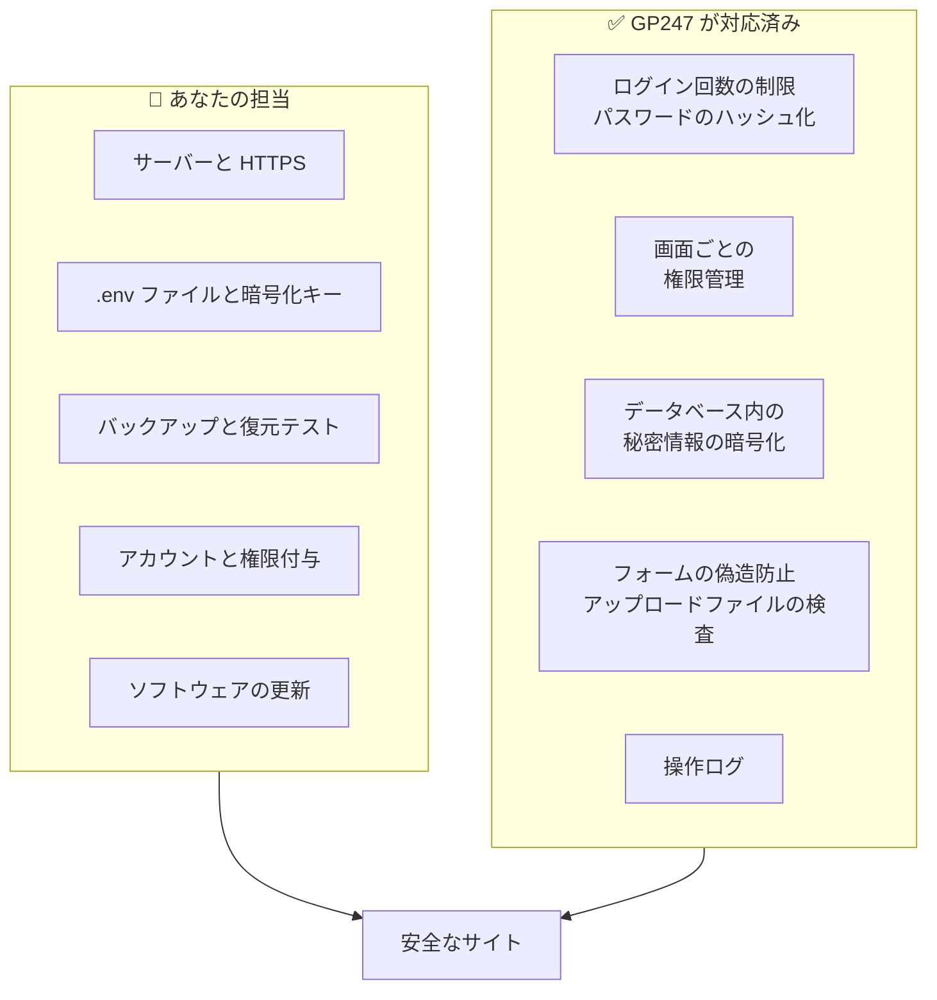

> 🌐 **言語:** [🇻🇳 Tiếng Việt](./security-introduction_vi.md) · [🇬🇧 English](./security-introduction.md) · 🇯🇵 日本語（現在）

# GP247 システムのセキュリティ — システムが担うこと、あなたが担うこと

## はじめに

このページは、GP247 / S-Cart で動くサイトのための**セキュリティ**ガイドの入口です。対象は**ショップオーナー**、
**管理者**、**技術担当者**（インストールやホスティング、サーバーを管理する人）です。このページでは、GP247 があらかじめ
行っていること、**あなたにしかできないこと**、次に読むべきページを紹介します。プログラミングの知識は必要ありません。

> ℹ️ **読むべき理由:** 実際のサイトで起きる事故の多くは、ソフトウェアの不具合ではなく**設定**が原因です。暗号化キーのバックアップを忘れる、
> 販売中のサイトでデバッグモードを有効のままにする、初期の管理者パスワードを使い続ける、バックアップはあるが一度も復元を試していない、などです。
> これらはソフトウェアが代わりに行うことはできません。

## ひと目でわかる

サイトのセキュリティは**共同責任**です。GP247 はアプリケーション内部の層を担い、サーバー、キー、バックアップデータ、
そして人の管理はあなたの担当です。

- **どちらか一方が欠けてもサイトは安全になりません**：どれほど優れたソフトウェアでも、漏れた `.env` ファイルや存在しないバックアップは救えません。
- **あなたが行うべき最も重要な 5 つ**：HTTPS で運用する、`APP_ENV=production` + `APP_DEBUG=false` を設定する、`.env`（キーを含む）とデータベースをバックアップする、初期の管理者アカウントを変更する、新しいリリースが出たら更新する。
- **GP247 は自分で管理できる部分では初期状態で安全です**：公開 API と MCP には専用のスイッチがあり、秘密情報は暗号化され、すべての管理操作がログに記録されます。
- **最も早い始め方**：[セキュリティチェックリスト](./security-checklist_ja.md)を開き、項目を 1 つずつチェックしてください。

## このページの内容

- [分野ごとの役割分担](#分野ごとの役割分担) — GP247 とあなたの作業分担表
- [どこから始めるか — 役割別の読む順番](#どこから始めるか--役割別の読む順番) — 最初に読むページ
- [セキュリティガイドのページ一覧](#セキュリティガイドのページ一覧) — ページの一覧
- [ほかのドキュメントにあるセキュリティのページ](#ほかのドキュメントにあるセキュリティのページ) — API、MCP、暗号化、権限、リリース
- [脆弱性の報告](#脆弱性の報告) — 送り先と、送ってはいけない場所

## 分野ごとの役割分担

下の表は分野ごとに作業を分けたものです。「あなたが行うこと」の列は、**ほかの誰も代わりにできない**作業です。各行に詳しい手順のページがあります。

| 分野 | ✅ GP247 が対応済み | 👤 あなたが行うこと | 詳しくはこちら |
| --- | --- | --- | --- |
| **サーバー設定** | `APP_ENV=production` のときデバッグを自動で無効化。管理画面のヘッダーに環境ラベルと「DEBUG ON」を表示。ダッシュボードの **システムアラート** ブロックと同名のページが、安全でない設定を Administrator に知らせます（gp247/core 3.10.0 以降） | HTTPS を有効にする。ドキュメントルートを `public/` に向ける。`APP_DEBUG=false`。開発用パッケージなしでインストール | [本番環境の設定](./security-production-config_ja.md) |
| **キーとバックアップ** | 秘密情報（SMTP パスワード、シークレット、ライセンス）を暗号化。プラグイン／テンプレートの更新前にそのコピーを保管 | `.env`、データベース、アップロード画像をバックアップする。復元を試す。稼働中のサイトでキーを作り直さない | [暗号化キーとバックアップ](./security-keys-and-backup_ja.md) |
| **アカウントと権限** | ログイン失敗回数の制限。パスワードのハッシュ化。画面ごとの権限管理。操作ログ | 初期アカウントを変更する。パスワードポリシーを設定する。必要最小限の権限を付与する。退職者のアカウントを無効にする | [アカウントと権限](./security-accounts-and-access_ja.md) |
| **更新** | パッチを公開。安全な更新コマンド。ダウンロードしたプラグインパッケージの検査 | リリースページを確認する。GP247、PHP、Web サーバーを更新する。信頼できる提供元のプラグインだけをインストールする | [更新とインシデント対応](./security-updates-and-incidents_ja.md) |
| **API と MCP** | オン／オフのスイッチ。有効期限付きのトークンをハッシュで保存。管理画面より広い権限は持たない | 使う部分だけを有効にする。アプリごとにトークンを 1 つ。使わないトークンは取り消す | [API](../api/api-authentication_ja.md) · [MCP](../mcp/mcp-security_ja.md) |
| **インシデント** | 操作ログ。データを失わずに暗号化キーを変更するコマンド | 対応計画を用意する。パスワード変更、トークン取り消し、キー変更を正しい順番で行う | [更新とインシデント対応](./security-updates-and-incidents_ja.md) |

組み込みの仕組みの一覧と、それぞれの**限界**：[システムが守るもの](./security-built-in_ja.md)。

## どこから始めるか — 役割別の読む順番

役割ごとに、次の順番で数ページ読むだけで十分です。

| あなたは | 読む順番 |
| --- | --- |
| **ショップオーナー**（技術に詳しくない） | [チェックリスト](./security-checklist_ja.md) → [アカウントと権限](./security-accounts-and-access_ja.md) → [暗号化キーとバックアップ](./security-keys-and-backup_ja.md) |
| **技術担当者**（インストール、ホスティング） | [本番環境の設定](./security-production-config_ja.md) → [暗号化キーとバックアップ](./security-keys-and-backup_ja.md) → [更新とインシデント対応](./security-updates-and-incidents_ja.md) → [チェックリスト](./security-checklist_ja.md) |
| **新しいサイトをインストールしたばかり** | [チェックリスト](./security-checklist_ja.md)の「インストール直後」 |
| **サイトへの侵入が疑われる** | [更新とインシデント対応](./security-updates-and-incidents_ja.md)の「漏えいが疑われるとき」 |
| **プラグイン開発者** | [システムが守るもの](./security-built-in_ja.md) → [GP247 の機密データの暗号化](../system/data-encryption_ja.md) → [GP247 のプラグイン作成ガイド](../extension/create-plugin_ja.md) |

## セキュリティガイドのページ一覧

| ページ | 役立つこと |
| --- | --- |
| [システムが守るもの](./security-built-in_ja.md) | 組み込みの保護層とその限界を正確に知り、「インストールすれば安全」と誤解しないようにする |
| [安全な本番環境の設定](./security-production-config_ja.md) | 本番運用時の `.env` を正しく設定する：デバッグ、HTTPS、Cookie、ドキュメントルート、フォルダの権限、Docker |
| [暗号化キーとバックアップ](./security-keys-and-backup_ja.md) | `APP_KEY` と `GP247_ENCRYPTION_KEY` を理解し、必要なものを正しくバックアップし、データを失わずにサーバーを移行する |
| [アカウントと権限](./security-accounts-and-access_ja.md) | 管理者アカウント、パスワード、二要素認証、最小権限、ログ |
| [更新とインシデント対応](./security-updates-and-incidents_ja.md) | パッチの確認、安全な更新、漏えいが疑われるときの手順 |
| [セキュリティチェックリスト](./security-checklist_ja.md) | 時期ごとの確認項目とよくある間違い。印刷してチェックできます |

## ほかのドキュメントにあるセキュリティのページ

一部のテーマには専用のページがあります。このガイドは要約とリンクだけを載せ、内容は繰り返しません。

| テーマ | ページ |
| --- | --- |
| 暗号化キーの安全な変更、暗号化されるデータ | [GP247 の機密データの暗号化](../system/data-encryption_ja.md) |
| 権限、ロール、管理ユーザー | [GP247 の管理画面の権限管理](../system/permission-and-role_ja.md) |
| REST API のログイン、トークン、制限 | [API によるログイン、トークン、顧客アカウント](../api/api-authentication_ja.md) |
| MCP（AI エージェント）のトークン、権限、ログ | [MCP のセキュリティと権限](../mcp/mcp-security_ja.md) |
| 推奨バージョン、サポート期間、PHP／Web サーバーのパッチ | [S-Cart のリリースとセキュリティ](../release/release_ja.md) |
| 稼働中のサイトでの GP247 の更新 | [GP247 アップデートガイド](../system/update-gp247_ja.md) |
| 診断コマンド `gp247:doctor` | [GP247 システムのコマンドライン（CLI）一覧](../system/command-line-reference_ja.md) |

## 脆弱性の報告

GP247 の脆弱性を見つけた場合は、**support@gp247.net** にメールしてください。パッチが出る前に問題が知られないよう、GitHub に
公開の issue を**作らないでください**。パッチは[リリースページ](../release/release_ja.md)で公開されます。

## 条件と制約（操作の前に確認）

- **このガイドは最新のリリースを説明しています**：更新していないサイトでは、一部の仕組みがない場合があります。サイトのバージョンは `php artisan gp247:info` または「**サーバー情報**」画面で確認できます。
- **どの仕組みにも限界があります**：[システムが守るもの](./security-built-in_ja.md)のページに、各仕組みの限界を明記しています。同じ分野に GP247 の保護層があるからといって、「あなたが行うこと」の列を飛ばさないでください。
- **サードパーティのプラグインやテンプレートは、あなたのサーバー上でコードを実行します**：このガイドの保護は GP247 のコア部分に適用されます。プラグインの安全性はプラグインの作者に左右されます。

## よくある質問（Q&A）

**Q1: 技術に詳しくありません。まず何をすればよいですか？**

→ [セキュリティチェックリスト](./security-checklist_ja.md)を開き、「インストール直後」の項目をすべて行ってください。サーバーの権限が必要な作業は、チェックリストをホスティング担当者に渡してください。

**Q2: GP247 をインストールすれば、サイトはもう安全ですか？**

→ それだけでは不十分です。GP247 はアプリケーション内の層を担い、HTTPS、`.env` ファイル、バックアップ、パスワードはあなたの担当です。[役割分担](#分野ごとの役割分担)の表を参照してください。

**Q3: 最も忘れられやすい作業は何ですか？**

→ `.env` ファイル（暗号化キーを含む）のバックアップと、バックアップからの復元テストです。キーを失うと、保存済みの SMTP パスワード、決済ゲートウェイのシークレット、ライセンスがすべて空になります。[暗号化キーとバックアップ](./security-keys-and-backup_ja.md)を参照してください。

**Q4: サイトでデバッグが有効になっているか、どうすればわかりますか？**

→ 管理画面にログインしてください。ヘッダーに環境ラベルが表示され、デバッグが有効なときは赤い「DEBUG ON」ラベルも表示されます。Administrator には、ダッシュボードの **システムアラート** ブロックでも知らされます。無効にする方法は[本番環境の設定](./security-production-config_ja.md)にあります。

**Q5: サイトを自動でチェックする方法はありますか？**

→ あります。確認項目が同じ 2 つの方法があります（gp247/core 3.10.0 以降）：
- **コマンドライン不要**：Administrator アカウントでログインすると、ダッシュボード先頭の **システムアラート** ブロックに最も重いレベルと対応が必要な件数が表示されます。**すべてのアラートを表示**（またはメニュー「システム設定」→「セキュリティ」→「システムアラート」）で各項目を確認します — デバッグ、HTTPS、初期の `admin` アカウント、パスワードポリシー、MFA、暗号化キー、利用中バージョンのサポート終了時期。各項目に修正手順へのリンクがあります。
- **コマンドラインあり**：`php artisan gp247:doctor` が上の項目に加え、PHP 環境とフォルダの書き込み権限を確認します。

どちらもサイトの設定を読むだけで、外部からサイトを開きません。ブラウザから `.env` をダウンロードできないかどうかは、引き続き[本番環境の設定](./security-production-config_ja.md#5-分でできるセルフチェック)に沿って自分で確認してください。

**Q6: 共有ホスティングを使っていて、コマンドラインの権限がありません。どうすればよいですか？**

→ ほとんどの作業は、ホスティングのコントロールパネル（`.env` の編集、HTTPS の有効化、バックアップ）と管理画面で行えます。コマンドラインが必要なページにはその旨を明記しています。

**Q7: API と MCP を使わないので、完全に無効にしたいのですが？**

→ 「**API設定**」画面でマスタースイッチをオフにしてください。マスタースイッチをオフにすると MCP もオフになります。[API によるログイン、トークン、顧客アカウント](../api/api-authentication_ja.md)を参照してください。

**Q8: セキュリティ上の問題を見つけました。どこに報告すればよいですか？**

→ support@gp247.net にメールしてください。公開の issue は作らないでください。

---

📅 **最終更新:** 2026-11-04 · ✍️ **作成者 (Author):** GP247
