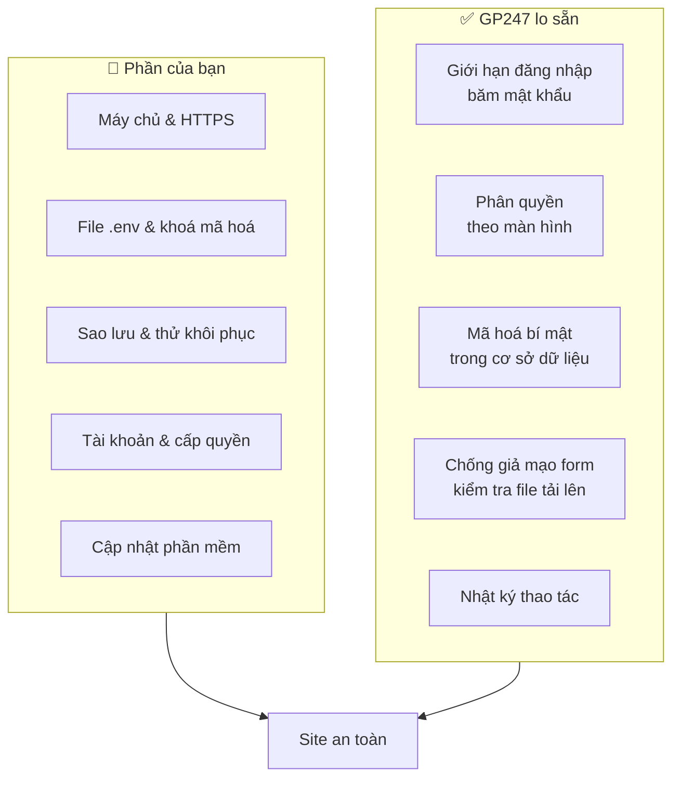

> 🌐 **Ngôn ngữ:** 🇻🇳 Tiếng Việt (hiện tại) · [🇬🇧 English](./security-introduction.md) · [🇯🇵 日本語](./security-introduction_ja.md)

# Bảo mật hệ thống GP247 — hệ thống lo gì, bạn lo gì

## Giới thiệu

Đây là trang chính của bộ tài liệu **Bảo mật** cho site chạy GP247 / S-Cart. Bộ tài liệu dành cho **chủ cửa hàng**,
**quản trị viên** và **người phụ trách kỹ thuật** (người cài đặt, quản lý hosting hoặc máy chủ). Trang này cho biết những việc
GP247 đã tự làm sẵn, những việc **chỉ bạn làm được**, và nên đọc trang nào tiếp theo. Không cần biết lập trình để đọc.

> ℹ️ **Vì sao cần đọc:** phần lớn sự cố trên site thật không do lỗi phần mềm mà do **cấu hình**: quên sao lưu khoá mã hoá,
> để chế độ debug bật trên site đang bán, giữ mật khẩu quản trị mặc định, có bản sao lưu nhưng chưa từng thử khôi phục.
> Những việc đó phần mềm không làm thay bạn được.

## Nhìn nhanh

Bảo mật của một site là **trách nhiệm chia sẻ**. GP247 lo các lớp bên trong ứng dụng, còn máy chủ, khoá, dữ liệu sao lưu và
con người là phần của bạn:

- **Thiếu một trong hai phía là site không an toàn**: phần mềm tốt mấy cũng không cứu được một file `.env` bị lộ hay một bản sao lưu không tồn tại.
- **Năm việc quan trọng nhất của bạn**: chạy HTTPS, đặt `APP_ENV=production` + `APP_DEBUG=false`, sao lưu `.env` (chứa khoá) và cơ sở dữ liệu, đổi tài khoản quản trị mặc định, cập nhật khi có bản mới.
- **GP247 mặc định an toàn ở những chỗ nó kiểm soát được**: API công khai và MCP có công tắc riêng, bí mật được mã hoá, mọi thao tác quản trị được ghi nhật ký.
- **Bắt đầu nhanh nhất**: mở [Checklist bảo mật](./security-checklist_vi.md) và đánh dấu từng mục.

## Trong trang này

- [Ai làm gì, theo từng lĩnh vực](#ai-làm-gì-theo-từng-lĩnh-vực) — bảng chia việc giữa GP247 và bạn
- [Bắt đầu từ đâu — lộ trình theo vai trò](#bắt-đầu-từ-đâu--lộ-trình-theo-vai-trò) — đọc trang nào trước
- [Bộ tài liệu Bảo mật](#bộ-tài-liệu-bảo-mật) — danh sách các trang
- [Trang bảo mật ở các bộ tài liệu khác](#trang-bảo-mật-ở-các-bộ-tài-liệu-khác) — API, MCP, mã hoá, phân quyền, phát hành
- [Báo lỗ hổng bảo mật](#báo-lỗ-hổng-bảo-mật) — gửi cho ai, không gửi ở đâu

## Ai làm gì, theo từng lĩnh vực

Bảng dưới chia việc theo lĩnh vực. Cột "Bạn làm" là những việc **không ai làm thay được**. Mỗi dòng có trang hướng dẫn chi tiết.

| Lĩnh vực | ✅ GP247 làm sẵn | 👤 Bạn phải làm | Đọc chi tiết |
| --- | --- | --- | --- |
| **Cấu hình máy chủ** | Tự tắt debug khi `APP_ENV=production`; header trang quản trị hiện nhãn môi trường và "DEBUG ON" | Bật HTTPS; document root trỏ vào `public/`; `APP_DEBUG=false`; cài bản không có gói dev | [Cấu hình production](./security-production-config_vi.md) |
| **Khoá & sao lưu** | Mã hoá bí mật (mật khẩu SMTP, secret, license); giữ bản sao plugin/template trước khi cập nhật chúng | Sao lưu `.env`, cơ sở dữ liệu, ảnh tải lên; thử khôi phục; không tạo lại khoá trên site đang chạy | [Khoá mã hoá & sao lưu](./security-keys-and-backup_vi.md) |
| **Tài khoản & quyền** | Giới hạn số lần đăng nhập sai; băm mật khẩu; phân quyền theo màn hình; nhật ký thao tác | Đổi tài khoản mặc định; đặt chính sách mật khẩu; cấp quyền tối thiểu; khoá tài khoản người nghỉ việc | [Tài khoản & phân quyền](./security-accounts-and-access_vi.md) |
| **Cập nhật** | Phát hành bản vá; lệnh cập nhật an toàn; kiểm tra gói plugin tải về | Theo dõi trang phát hành; cập nhật GP247, PHP, web server; chỉ cài plugin từ nguồn tin cậy | [Cập nhật & xử lý sự cố](./security-updates-and-incidents_vi.md) |
| **API & MCP** | Công tắc bật/tắt; token có hạn, lưu dạng băm; không rộng quyền hơn màn quản trị | Chỉ bật phần dùng tới; mỗi ứng dụng một token; thu hồi token khi không dùng | [API](../api/api-authentication_vi.md) · [MCP](../mcp/mcp-security_vi.md) |
| **Sự cố** | Nhật ký thao tác; lệnh đổi khoá mã hoá không mất dữ liệu | Có kế hoạch xử lý; đổi mật khẩu, thu hồi token, đổi khoá đúng thứ tự | [Cập nhật & xử lý sự cố](./security-updates-and-incidents_vi.md) |

Danh sách đầy đủ các cơ chế có sẵn, kèm **giới hạn** của từng cơ chế: [Hệ thống bảo vệ những gì](./security-built-in_vi.md).

## Bắt đầu từ đâu — lộ trình theo vai trò

Mỗi vai trò chỉ cần đọc vài trang, theo thứ tự sau:

| Bạn là | Đọc theo thứ tự |
| --- | --- |
| **Chủ cửa hàng** (không rành kỹ thuật) | [Checklist](./security-checklist_vi.md) → [Tài khoản & phân quyền](./security-accounts-and-access_vi.md) → [Khoá mã hoá & sao lưu](./security-keys-and-backup_vi.md) |
| **Người phụ trách kỹ thuật** (cài đặt, hosting) | [Cấu hình production](./security-production-config_vi.md) → [Khoá mã hoá & sao lưu](./security-keys-and-backup_vi.md) → [Cập nhật & xử lý sự cố](./security-updates-and-incidents_vi.md) → [Checklist](./security-checklist_vi.md) |
| **Vừa cài xong site mới** | [Checklist](./security-checklist_vi.md), mục "Ngay sau khi cài" |
| **Nghi site bị xâm nhập** | [Cập nhật & xử lý sự cố](./security-updates-and-incidents_vi.md), mục "Khi nghi bị lộ" |
| **Lập trình viên plugin** | [Hệ thống bảo vệ những gì](./security-built-in_vi.md) → [Mã hoá dữ liệu nhạy cảm](../system/data-encryption_vi.md) → [Hướng dẫn tạo Plugin](../extension/create-plugin_vi.md) |

## Bộ tài liệu Bảo mật

| Trang | Giúp bạn |
| --- | --- |
| [Hệ thống bảo vệ những gì](./security-built-in_vi.md) | Biết chính xác từng lớp bảo vệ có sẵn và giới hạn của nó, để không tưởng nhầm "đã cài là an toàn" |
| [Cấu hình production an toàn](./security-production-config_vi.md) | Đặt đúng `.env` khi chạy thật: debug, HTTPS, cookie, document root, quyền thư mục, Docker |
| [Khoá mã hoá & sao lưu](./security-keys-and-backup_vi.md) | Hiểu `APP_KEY` và `GP247_ENCRYPTION_KEY`, sao lưu đúng thứ cần sao lưu, chuyển máy chủ không mất dữ liệu |
| [Tài khoản & phân quyền](./security-accounts-and-access_vi.md) | Tài khoản quản trị, mật khẩu, xác thực hai lớp, phân quyền tối thiểu, nhật ký |
| [Cập nhật & xử lý sự cố](./security-updates-and-incidents_vi.md) | Theo dõi bản vá, cập nhật an toàn, các bước khi nghi bị lộ |
| [Checklist bảo mật](./security-checklist_vi.md) | Danh sách kiểm tra theo thời điểm và những lỗi hay gặp, in ra đánh dấu được |

## Trang bảo mật ở các bộ tài liệu khác

Một số chủ đề đã có trang riêng. Bộ tài liệu này chỉ tóm tắt và dẫn tới đó, không chép lại:

| Chủ đề | Trang |
| --- | --- |
| Đổi khoá mã hoá an toàn, dữ liệu nào được mã hoá | [Mã hoá dữ liệu nhạy cảm](../system/data-encryption_vi.md) |
| Quyền, vai trò, người dùng quản trị | [Phân quyền](../system/permission-and-role_vi.md) |
| Đăng nhập, token và giới hạn của REST API | [Đăng nhập, token và tài khoản khách qua API](../api/api-authentication_vi.md) |
| Token, phân quyền và nhật ký của MCP (AI agent) | [An toàn & phân quyền của MCP](../mcp/mcp-security_vi.md) |
| Phiên bản nên dùng, vòng đời hỗ trợ, bản vá PHP / web server | [Phát hành và bảo mật S-Cart](../release/release_vi.md) |
| Cập nhật GP247 trên site đang chạy | [Hướng dẫn cập nhật GP247](../system/update-gp247_vi.md) |
| Lệnh chẩn đoán `gp247:doctor` | [Danh sách lệnh CLI](../system/command-line-reference_vi.md) |

## Báo lỗ hổng bảo mật

Nếu bạn phát hiện một lỗ hổng trong GP247, hãy gửi email tới **support@gp247.net**. **Không** mở issue công khai trên GitHub,
để lỗi không bị lộ trước khi có bản vá. Bản vá được công bố qua [trang phát hành](../release/release_vi.md).

## Điều kiện & ràng buộc (hiểu trước khi thao tác)

- **Bộ tài liệu mô tả bản phát hành mới nhất**: site chưa cập nhật có thể thiếu một số cơ chế. Xem phiên bản site bằng `php artisan gp247:info` hoặc màn **Thông tin server**.
- **Mỗi cơ chế có giới hạn**: trang [Hệ thống bảo vệ những gì](./security-built-in_vi.md) ghi rõ giới hạn của từng cơ chế. Đừng bỏ qua cột "Bạn phải làm" chỉ vì GP247 đã có một lớp bảo vệ ở cùng lĩnh vực.
- **Plugin và giao diện của bên thứ ba chạy mã trên máy chủ của bạn**: các bảo vệ trong tài liệu này áp cho phần lõi GP247, còn mức an toàn của plugin phụ thuộc người viết plugin.

## Hỏi & Đáp (Q&A)

**Câu 1: Tôi không rành kỹ thuật, nên làm gì trước?**

→ Mở [Checklist bảo mật](./security-checklist_vi.md), làm hết mục "Ngay sau khi cài". Việc nào cần quyền máy chủ thì gửi checklist cho người phụ trách hosting.

**Câu 2: Cài GP247 xong là site đã an toàn chưa?**

→ Chưa đủ. GP247 lo các lớp trong ứng dụng; HTTPS, file `.env`, sao lưu và mật khẩu là phần của bạn. Xem bảng [Ai làm gì](#ai-làm-gì-theo-từng-lĩnh-vực).

**Câu 3: Việc nào hay bị quên nhất?**

→ Sao lưu file `.env` (chứa khoá mã hoá) và thử khôi phục bản sao lưu. Mất khoá thì mật khẩu SMTP, secret cổng thanh toán, license đã lưu đều thành rỗng. Xem [Khoá mã hoá & sao lưu](./security-keys-and-backup_vi.md).

**Câu 4: Làm sao biết site đang bật debug?**

→ Đăng nhập trang quản trị: header hiện nhãn môi trường, kèm nhãn đỏ "DEBUG ON" khi debug đang bật. Cách tắt ở [Cấu hình production](./security-production-config_vi.md).

**Câu 5: Có lệnh nào tự kiểm tra site không?**

→ Có: `php artisan gp247:doctor` kiểm môi trường, quyền ghi, khoá mã hoá, bí mật còn giải mã được hay không. Lệnh này **không** kiểm HTTPS hay `APP_DEBUG`; hai việc đó tự kiểm theo [Cấu hình production](./security-production-config_vi.md).

**Câu 6: Tôi dùng shared hosting, không có quyền dòng lệnh thì sao?**

→ Phần lớn việc làm được qua bảng điều khiển hosting (sửa `.env`, bật HTTPS, sao lưu) và trang quản trị. Trang nào cần dòng lệnh đều ghi rõ.

**Câu 7: Tôi muốn tắt hẳn API và MCP vì không dùng?**

→ Tắt công tắc tổng ở màn **Cấu hình API**. Tắt công tắc tổng là tắt luôn MCP. Xem [Đăng nhập, token và tài khoản khách qua API](../api/api-authentication_vi.md).

**Câu 8: Tôi thấy lỗi bảo mật, báo ở đâu?**

→ Gửi email tới support@gp247.net, không mở issue công khai.

---

📅 **Cập nhật lần cuối:** 2026-11-04 · ✍️ **Tác giả (Author):** GP247
