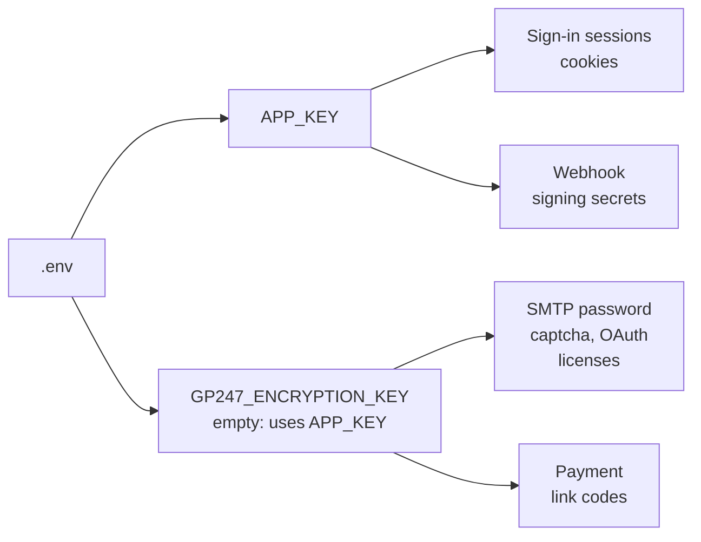

> 🌐 **Language:** [🇻🇳 Tiếng Việt](./security-keys-and-backup_vi.md) · 🇬🇧 English (current) · [🇯🇵 日本語](./security-keys-and-backup_ja.md)

# Encryption keys & backup — don't lose the keys, don't lose the data

## Introduction

This page explains the two most important keys of a GP247 site (`APP_KEY` and `GP247_ENCRYPTION_KEY`): what each key protects, and
what you lose if one is lost or changed by mistake. The page also lists **what you must back up**, what GP247 backs up by itself (very little), and how to
move servers or clone a site without breaking data. The page is for site owners and technical staff.

> ⚠️ **The two hardest disasters to recover from:** (1) losing the encryption key — the saved SMTP password, payment gateway secrets and licenses all become
> empty and **cannot be recovered**; (2) having a backup but never testing a restore — you only find out the backup is broken when you need it.

## At a glance

Each key protects a different group of data. The diagram shows which key holds what:



- **Both keys live in the `.env` file** — backing up `.env` means backing up the keys. Without a `.env` backup there is no spare key.
- **Never run `php artisan key:generate` on a running site** — that command replaces `APP_KEY` with a new key.
- **GP247 does not back up the database, `.env` or uploaded images** — that is your job.
- **A backup is only worth something once a restore has been tested successfully.**

## The two keys: what they protect, what happens if changed or lost

This table shows how far the impact goes if each key is changed or lost.

| Key | Protects | If changed or lost | How to change it correctly |
| --- | --- | --- | --- |
| `APP_KEY` | Sign-in sessions and cookies; REST API webhook signing secrets; config secrets **when** `GP247_ENCRYPTION_KEY` **is not set** | Everyone is signed out; webhook secrets cannot be read (you must create new ones on the **Webhook** screen); if there is no dedicated key, the config secrets are lost too | Put the old key into `APP_PREVIOUS_KEYS` before setting the new key, so old data can still be read |
| `GP247_ENCRYPTION_KEY` | Config secrets: SMTP password, captcha secret, OAuth client secret, paid plugin licenses, payment link codes | Those secrets become empty; sending mail, payments and social sign-in stop until you enter them again. The site **does not crash**, so it is easy not to notice | Put the old key into `GP247_ENCRYPTION_PREVIOUS_KEYS`, set the new key, run `php artisan gp247:encryption-key-rotate` — full steps in [Sensitive data encryption](../system/data-encryption.md) |

> 💡 **Tip:** set a dedicated `GP247_ENCRYPTION_KEY` right after install. Then if you change `APP_KEY` by mistake, you only lose sign-in sessions and webhook secrets,
> not the SMTP password or licenses. `php artisan gp247:doctor` check `encryption_key_dedicated` tells you whether the dedicated key is set.

## What you must back up

This section lists the data of a GP247 site, where it lives, and who backs it up.

| Data | Where it lives | Who backs it up |
| --- | --- | --- |
| **Database** (products, orders, customers, config, encrypted secrets) | MySQL / MariaDB; Docker: the MySQL volume | 👤 You |
| **The `.env` file** (holds both keys and the database password) | The site's root folder | 👤 You — **store it separately**, see below |
| **Uploaded images and files** | `storage/app/public/` | 👤 You |
| **Plugins, templates, custom code** | `app/GP247/`, `resources/views/vendor/`, `public/GP247/` (if edited) | 👤 You (or Git if you manage your code with Git) |
| **The "installed" marker and the system's private files** | `storage/app/private/` | 👤 You |
| **Old copies of plugins / templates before an update** | `storage/backups/extensions/` | ✅ GP247 keeps the last few copies, only when you update plugins/templates |
| **GP247 source code** (`vendor/`) | Can be reinstalled with Composer | Not needed — as long as you have `composer.json` and `composer.lock` |

### Three backup rules

- **Three copies, two places, one copy off the server** — if the server breaks or is hacked, a backup stored on it is lost too.
- **Store `.env` separately from the database backup** — anyone with both can read every secret. Keep `.env` where only the person in charge can open it (a password manager, an encrypted vault).
- **Back up regularly, and before every update** — at least daily for the database of a site that is selling.

## Test a restore — the step many people skip

A backup that has never been restored is a backup you do not know works. Do this regularly (every quarter, or after you change how you back up):

1. Set up a test site (another machine or another folder, **never** over the live site).
2. Restore the database, `storage/app/` and `app/GP247/` from the backup.
3. Copy the exact backed-up `.env` file, changing only `APP_URL` and the database connection details for the test site.
4. Run:

   ```
   php artisan config:clear
   php artisan gp247:doctor
   ```

5. Check that the `secret_decryptable` line is **PASS**, you can sign in to the admin, and product images all show.

If it worked, you know for sure the backup is usable. If `secret_decryptable` reports an error, the backed-up `.env` file does not match the database —
fix your backup method right away; do not wait for an incident.

> ⚠️ **Note:** a test site using the real keys can read the real secrets (SMTP, payment gateway). On the test site, turn off mail sending and switch the payment
> gateway to test mode before doing anything.

## Moving servers or cloning the site

This section helps you move the site to a new server, or create a copy (staging) from the live site, without breaking secrets.

**Moving servers** (keeping the same site):

1. Back up everything in the table above.
2. On the new machine, install the code, restore the data, and copy the old `.env` file **as-is** (only change the database details if they changed).
3. Do **not** run `php artisan key:generate`.
4. Run `php artisan config:clear` then `php artisan gp247:doctor`; the `secret_decryptable` line must be PASS.

**Cloning into a test site (staging)**:

- **If you want the test site to use the real secrets**: keep the same keys — but the test site can then also send real mail and call the real payment gateway. Turn them off on the test site.
- **If you want it fully separate**: set a new `GP247_ENCRYPTION_KEY` on the test site and enter the secrets again using test accounts of the payment gateway / SMTP. The old secrets on the test site will become empty — which is what you want.

## Conditions & Rules (know before you act)

- **If you lose both the key and the `.env` backup, the secrets cannot be recovered** — the only way is to enter each secret again on the config screens.
- **To change a key, declare the old key first** (`APP_PREVIOUS_KEYS`, `GP247_ENCRYPTION_PREVIOUS_KEYS`) — otherwise old data cannot be read.
- **After editing `.env`, run `php artisan config:clear`** — otherwise the site keeps using the old key in the cache.
- **The key change command only handles config secrets and registered columns** — webhook secrets are not included; create new ones on the **Webhook** screen if you change `APP_KEY`.
- **GP247's plugin/template copies only keep the last few versions** and are only made when you update through GP247 — they do not replace your own backups.

## Q&A

**Q1: I ran `php artisan key:generate` on the live site by mistake. What do I do?**

→ Get the old `APP_KEY` from the `.env` backup, put it into `APP_PREVIOUS_KEYS` (or set it back as `APP_KEY`), and run `php artisan config:clear`. If you no longer have the old key, everyone signs in again; create new webhook secrets; and if you had no dedicated `GP247_ENCRYPTION_KEY`, enter the secrets again.

**Q2: Does GP247 back up the database by itself?**

→ No. Use your hosting's backup feature, your database server's tools, or a volume backup schedule if you run Docker.

**Q3: I only back up the database. Is that enough?**

→ No. Without `.env`, the secrets in the database cannot be read; without `storage/app/public/`, you lose product images; without `app/GP247/`, you lose plugins and customized templates.

**Q4: Is it a problem to keep the `.env` backup in the same place as the database backup?**

→ Anyone who gets into that place can read every secret. Store `.env` separately, somewhere fewer people can access.

**Q5: How do I know the secrets are still readable after moving servers?**

→ Run `php artisan gp247:doctor` and look at the `secret_decryptable` line. Without a command line, send a test email from the admin.

**Q6: Does changing `APP_KEY` lose the SMTP password?**

→ No, if you have set a dedicated `GP247_ENCRYPTION_KEY`. If not, yes — set one now.

**Q7: When should I change the encryption key?**

→ When you suspect the key has leaked (the `.env` file was pushed to Git, the server was hacked, the person holding the key left). There is no need to change it regularly if the key has never leaked.

**Q8: Does running `docker compose down -v` lose data?**

→ Yes — the `-v` flag deletes the volume that holds the database. Only use `docker compose down` (without `-v`) on a live site.

---

<sub>📅 **Last updated:** 2026-11-04 · ✍️ **Author:** GP247</sub>
