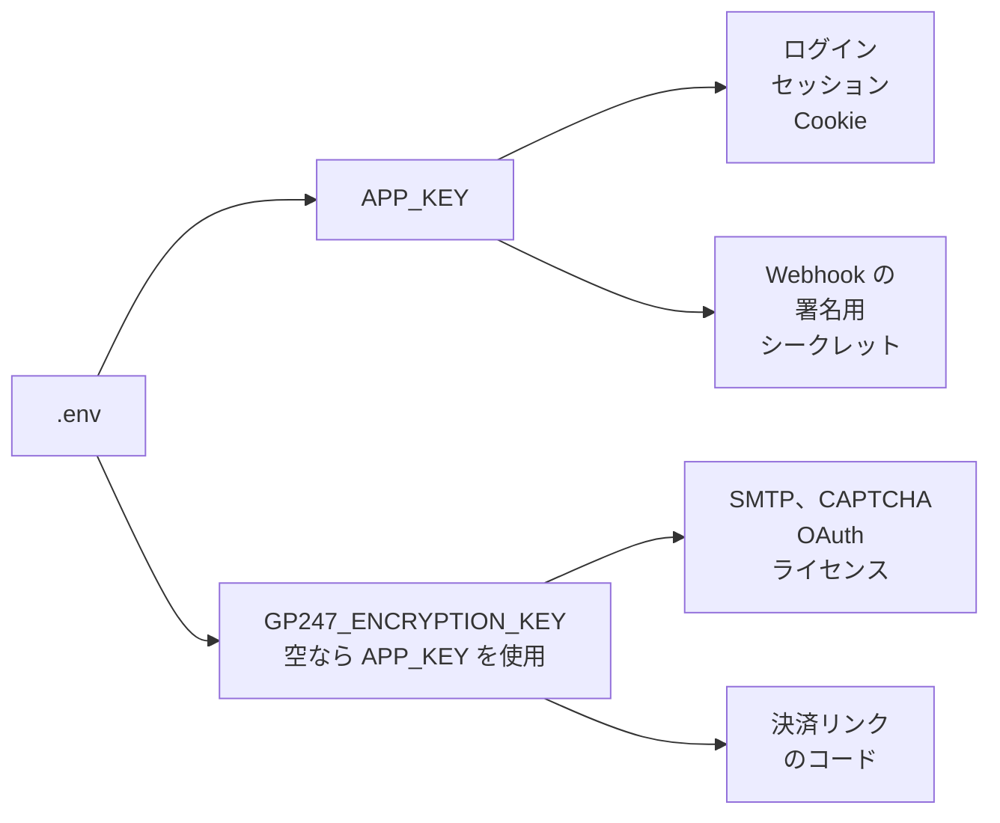

> 🌐 **言語:** [🇻🇳 Tiếng Việt](./security-keys-and-backup_vi.md) · [🇬🇧 English](./security-keys-and-backup.md) · 🇯🇵 日本語（現在）

# 暗号化キーとバックアップ — キーを失わず、データを失わない

## はじめに

このページでは、GP247 サイトで最も重要な 2 つのキー（`APP_KEY` と `GP247_ENCRYPTION_KEY`）について説明します：それぞれが何を守り、
失ったり誤って変更したりすると何を失うか。また、**バックアップすべきもの**、GP247 が自動でバックアップするもの（ごくわずか）、
データを壊さずにサーバーを移行したりサイトを複製したりする方法もまとめています。対象はサイトオーナーと技術担当者です。

> ⚠️ **最も取り返しのつかない 2 つの災害:** (1) 暗号化キーを失う — 保存済みの SMTP パスワード、決済ゲートウェイのシークレット、ライセンスがすべて
> 空になり、**取り戻せません**。(2) バックアップはあるが一度も復元を試していない — 必要になって初めてバックアップが壊れていると気づきます。

## ひと目でわかる

キーごとに守るデータのグループが異なります。図は、どのキーが何を守っているかを示しています。



- **2 つのキーはどちらも `.env` ファイルにあります** — `.env` をバックアップすることがキーのバックアップです。`.env` のバックアップがなければ、予備のキーはありません。
- **稼働中のサイトで `php artisan key:generate` を絶対に実行しないでください** — このコマンドは `APP_KEY` を新しいキーに置き換えます。
- **GP247 はデータベース、`.env`、アップロード画像をバックアップしません** — それはあなたの作業です。
- **バックアップは、復元テストに成功して初めて価値があります。**

## 2 つのキー：何を守り、変更・紛失するとどうなるか

この表で、各キーを変更または紛失した場合の影響範囲がわかります。

| キー | 守るもの | 変更または紛失した場合 | 正しい変更方法 |
| --- | --- | --- | --- |
| `APP_KEY` | ログインセッションと Cookie。REST API の Webhook 署名シークレット。`GP247_ENCRYPTION_KEY` が**未設定のとき**の設定の秘密情報 | 全員がログアウトされます。Webhook のシークレットが読めなくなります（「**Webhook**」画面で再生成が必要）。専用キーがなければ、設定の秘密情報も失われます | 新しいキーを設定する前に、古いキーを `APP_PREVIOUS_KEYS` に入れて、古いデータを読める状態に保ちます |
| `GP247_ENCRYPTION_KEY` | 設定の秘密情報：SMTP パスワード、CAPTCHA のシークレット、OAuth client secret、有料プラグインのライセンス、決済リンクのコード | それらの秘密情報が空になります。メール送信、決済、SNS ログインは再入力するまで停止します。サイトは**落ちない**ため、気づきにくいです | 古いキーを `GP247_ENCRYPTION_PREVIOUS_KEYS` に入れ、新しいキーを設定し、`php artisan gp247:encryption-key-rotate` を実行します — 詳しい手順は [GP247 の機密データの暗号化](../system/data-encryption_ja.md)にあります |

> 💡 **ヒント:** インストール直後に専用の `GP247_ENCRYPTION_KEY` を設定してください。そうすれば、誤って `APP_KEY` を変更しても、失うのはログインセッションと Webhook のシークレットだけで、
> SMTP パスワードやライセンスは失いません。`php artisan gp247:doctor` の項目 `encryption_key_dedicated` で、専用キーが設定済みかどうかがわかります。

## バックアップが必要なもの

この項目では、GP247 サイトのデータ、その保存場所、バックアップの担当者を一覧にします。

| データ | 保存場所 | バックアップの担当 |
| --- | --- | --- |
| **データベース**（商品、注文、顧客、設定、暗号化済みの秘密情報） | MySQL／MariaDB。Docker：MySQL のボリューム | 👤 あなた |
| **`.env` ファイル**（2 つのキーとデータベースのパスワードを含む） | サイトのルートフォルダ | 👤 あなた — **別に保管**してください。下記参照 |
| **画像とアップロードファイル** | `storage/app/public/` | 👤 あなた |
| **プラグイン、テンプレート、カスタマイズしたコード** | `app/GP247/`、`resources/views/vendor/`、`public/GP247/`（編集した場合） | 👤 あなた（Git でコードを管理しているなら Git） |
| **「インストール済み」の目印とシステム固有のファイル** | `storage/app/private/` | 👤 あなた |
| **更新前のプラグイン／テンプレートの旧版** | `storage/backups/extensions/` | ✅ GP247 が直近のいくつかの版を自動で保管。プラグイン／テンプレートを更新したときだけ |
| **GP247 のソースコード**（`vendor/`） | Composer で再インストール可能 | 不要 — `composer.json` と `composer.lock` があれば十分です |

### バックアップの 3 原則

- **3 つのコピー、2 つの場所、1 つはサーバーの外に** — サーバーが故障したり侵入されたりすると、そのサーバー上のバックアップも一緒に失われます。
- **`.env` はデータベースのバックアップとは別に保管する** — 両方を持つ人はすべての秘密情報を読めます。`.env` は担当者だけが開ける場所（パスワードマネージャー、暗号化されたストレージ）に保存してください。
- **定期的に、そして更新のたびにバックアップする** — 販売中のサイトのデータベースは少なくとも毎日です。

## 復元テスト — 多くの人が飛ばす手順

一度も復元を試していないバックアップは、使えるかどうかわからないバックアップです。定期的に（四半期ごと、またはバックアップ方法を変えた後）行ってください。

1. テスト用のサイトを用意します（別のマシンまたは別のフォルダ。本番サイトに上書き**しない**）。
2. バックアップからデータベース、`storage/app/`、`app/GP247/` を復元します。
3. バックアップした `.env` ファイルをそのままコピーし、テストサイト用に `APP_URL` とデータベースの接続情報だけを変更します。
4. 次を実行します：

   ```
   php artisan config:clear
   php artisan gp247:doctor
   ```

5. `secret_decryptable` の行が **PASS** であること、管理画面にログインできること、商品画像がすべて表示されることを確認します。

成功すれば、バックアップが使えることが確実にわかります。`secret_decryptable` がエラーを示す場合、バックアップした `.env` ファイルがデータベースと一致していません —
問題が起きるのを待たず、すぐにバックアップ方法を修正してください。

> ⚠️ **注意:** 本物のキーを使うテストサイトは、本物の秘密情報（SMTP、決済ゲートウェイ）を読めます。テストサイトでは、操作する前にメール送信を無効にし、決済ゲートウェイを
> テストモードに切り替えてください。

## サーバーの移行・サイトの複製

この項目では、秘密情報を壊さずに、サイトを新しいサーバーに移行したり、本番サイトからコピー（ステージング）を作ったりする方法を説明します。

**サーバーの移行**（同じサイトのまま）：

1. 上の表の項目をすべてバックアップします。
2. 新しいマシンでソースコードをインストールし、データを復元し、古い `.env` ファイルを**そのまま**コピーします（変更があればデータベースの情報だけを編集）。
3. `php artisan key:generate` を実行**しない**でください。
4. `php artisan config:clear`、続いて `php artisan gp247:doctor` を実行します。`secret_decryptable` の行が PASS であることを確認します。

**テストサイト（ステージング）として複製する**：

- **テストサイトで本物の秘密情報を使いたい場合**：同じキーを使います — ただし、テストサイトも本物のメールを送り、本物の決済ゲートウェイを呼び出せてしまいます。テストサイトではそれらを無効にしてください。
- **完全に分けたい場合**：テストサイトに新しい `GP247_ENCRYPTION_KEY` を設定し、決済ゲートウェイ／SMTP のテスト用アカウントで秘密情報を入力し直します。テストサイト上の古い秘密情報は空になります — これが意図した動作です。

## 条件と制約（操作の前に確認）

- **キーと `.env` のバックアップの両方を失うと、秘密情報は復元できません** — 設定画面で秘密情報を 1 つずつ入力し直すしかありません。
- **キーを変更する前に、古いキーを設定する必要があります**（`APP_PREVIOUS_KEYS`、`GP247_ENCRYPTION_PREVIOUS_KEYS`）— そうしないと古いデータが読めなくなります。
- **`.env` を編集した後は `php artisan config:clear` を実行する必要があります** — 実行しないと、サイトはキャッシュ内の古いキーを使い続けます。
- **キー変更コマンドが扱うのは設定の秘密情報と登録済みのカラムだけです** — Webhook のシークレットは含まれないため、`APP_KEY` を変更したら「**Webhook**」画面で再生成してください。
- **GP247 によるプラグイン／テンプレートのコピーは直近のいくつかの版だけ**で、GP247 経由で更新したときにだけ作られます — あなたのバックアップの代わりにはなりません。

## よくある質問（Q&A）

**Q1: 本番サイトで誤って `php artisan key:generate` を実行してしまいました。どうすればよいですか？**

→ `.env` のバックアップから古い `APP_KEY` を取り出し、`APP_PREVIOUS_KEYS` に入れて（または `APP_KEY` として設定し直して）、`php artisan config:clear` を実行してください。古いキーがなければ、全員がログインし直す必要があります。Webhook のシークレットを再生成してください。専用の `GP247_ENCRYPTION_KEY` がなかった場合は、秘密情報を入力し直してください。

**Q2: GP247 はデータベースを自動でバックアップしますか？**

→ しません。ホスティングのバックアップ機能、データベースサーバーのツール、または Docker で運用している場合はボリュームのバックアップスケジュールを使ってください。

**Q3: データベースだけをバックアップしています。それで十分ですか？**

→ 十分ではありません。`.env` がなければデータベース内の秘密情報を読めません。`storage/app/public/` がなければ商品画像を失います。`app/GP247/` がなければプラグインとカスタマイズしたテンプレートを失います。

**Q4: `.env` のバックアップをデータベースのバックアップと同じ場所に置いても大丈夫ですか？**

→ その場所を手に入れた人は、すべての秘密情報を読めます。`.env` は、アクセスする人がより少ない別の場所に保管してください。

**Q5: サーバー移行後も秘密情報を読めるかどうか、どうすればわかりますか？**

→ `php artisan gp247:doctor` を実行し、`secret_decryptable` の行を確認してください。コマンドラインがなければ、管理画面からテストメールを送ってください。

**Q6: `APP_KEY` を変更すると SMTP パスワードを失いますか？**

→ 専用の `GP247_ENCRYPTION_KEY` を設定していれば失いません。設定していなければ失います — すぐに設定してください。

**Q7: 暗号化キーはいつ変更すべきですか？**

→ キーの漏えいが疑われるときです（`.env` ファイルが Git に入った、サーバーが侵入された、キーを持っていた人が退職した）。キーが一度も漏れていなければ、定期的に変更する必要はありません。

**Q8: `docker compose down -v` を実行するとデータを失いますか？**

→ 失います — `-v` フラグはデータベースを含むボリュームを削除します。本番サイトでは `docker compose down`（`-v` なし）だけを使ってください。

---

<sub>📅 **最終更新:** 2026-11-04 · ✍️ **作成者 (Author):** GP247</sub>
