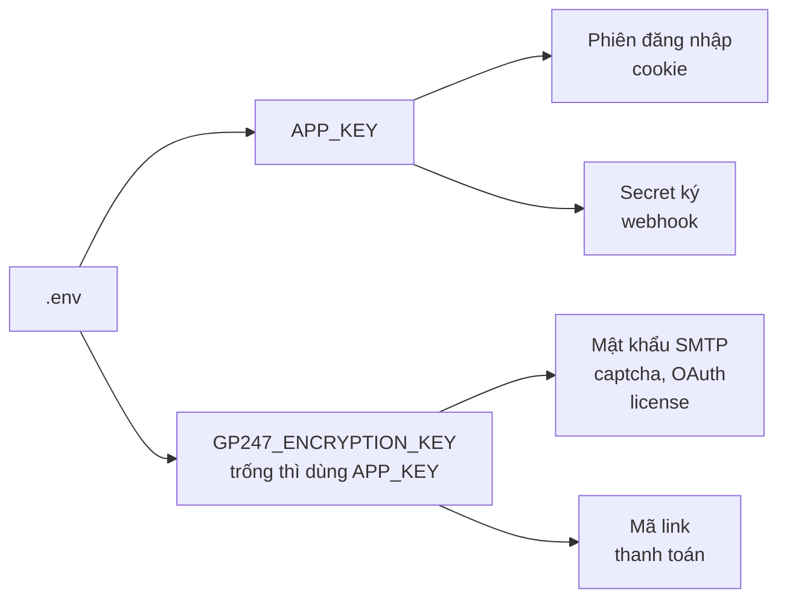

> 🌐 **Ngôn ngữ:** 🇻🇳 Tiếng Việt (hiện tại) · [🇬🇧 English](./security-keys-and-backup.md) · [🇯🇵 日本語](./security-keys-and-backup_ja.md)

# Khoá mã hoá & sao lưu — không mất khoá, không mất dữ liệu

## Giới thiệu

Trang này giải thích hai khoá quan trọng nhất của site GP247 (`APP_KEY` và `GP247_ENCRYPTION_KEY`): mỗi khoá bảo vệ gì, và
mất hay đổi nhầm thì mất gì. Trang cũng liệt kê **những gì phải sao lưu**, những gì GP247 tự sao lưu (rất ít), và cách
chuyển máy chủ hay nhân bản site mà không hỏng dữ liệu. Trang dành cho chủ site và người phụ trách kỹ thuật.

> ⚠️ **Hai thảm hoạ khó cứu nhất:** (1) mất khoá mã hoá — mật khẩu SMTP, secret cổng thanh toán, license đã lưu đều thành
> rỗng và **không lấy lại được**; (2) có bản sao lưu nhưng chưa từng thử khôi phục — tới lúc cần mới biết bản sao lưu hỏng.

## Nhìn nhanh

Mỗi khoá bảo vệ một nhóm dữ liệu khác nhau. Sơ đồ cho thấy khoá nào giữ cái gì:



- **Cả hai khoá nằm trong file `.env`** — sao lưu `.env` là sao lưu khoá. Không có bản sao lưu `.env` thì không có khoá dự phòng.
- **Không bao giờ chạy `php artisan key:generate` trên site đang chạy** — lệnh đó thay `APP_KEY` bằng khoá mới.
- **GP247 không sao lưu cơ sở dữ liệu, `.env` hay ảnh tải lên** — đó là việc của bạn.
- **Bản sao lưu chỉ có giá trị khi đã thử khôi phục thành công.**

## Hai khoá: bảo vệ gì, đổi hay mất thì sao

Bảng này giúp bạn biết đổi hay mất mỗi khoá thì ảnh hưởng tới đâu.

| Khoá | Bảo vệ | Nếu đổi hoặc mất | Cách đổi đúng |
| --- | --- | --- | --- |
| `APP_KEY` | Phiên đăng nhập và cookie; secret ký webhook của REST API; bí mật cấu hình **khi chưa đặt** `GP247_ENCRYPTION_KEY` | Mọi người bị đăng xuất; secret webhook không đọc được (phải tạo lại ở màn **Webhook**); nếu chưa có khoá riêng thì mất cả bí mật cấu hình | Đưa khoá cũ vào `APP_PREVIOUS_KEYS` trước khi đặt khoá mới, để dữ liệu cũ vẫn đọc được |
| `GP247_ENCRYPTION_KEY` | Bí mật cấu hình: mật khẩu SMTP, secret captcha, OAuth client secret, license plugin trả phí, mã link thanh toán | Các bí mật đó thành rỗng; gửi mail, thanh toán, đăng nhập mạng xã hội ngừng tới khi nhập lại. Site **không sập** nên dễ không nhận ra | Đưa khoá cũ vào `GP247_ENCRYPTION_PREVIOUS_KEYS`, đặt khoá mới, chạy `php artisan gp247:encryption-key-rotate` — các bước đầy đủ ở [Mã hoá dữ liệu nhạy cảm](../system/data-encryption_vi.md) |

> 💡 **Mẹo:** đặt `GP247_ENCRYPTION_KEY` riêng ngay sau khi cài. Khi đó lỡ đổi `APP_KEY`, bạn chỉ mất phiên đăng nhập và secret webhook,
> không mất mật khẩu SMTP hay license. `php artisan gp247:doctor` mục `encryption_key_dedicated` cho biết đã đặt khoá riêng chưa.

## Những gì phải sao lưu

Mục này liệt kê dữ liệu của một site GP247, nơi nó nằm, và ai sao lưu nó.

| Dữ liệu | Nằm ở đâu | Ai sao lưu |
| --- | --- | --- |
| **Cơ sở dữ liệu** (sản phẩm, đơn hàng, khách, cấu hình, bí mật đã mã hoá) | MySQL / MariaDB; Docker: volume MySQL | 👤 Bạn |
| **File `.env`** (chứa cả hai khoá và mật khẩu cơ sở dữ liệu) | Thư mục gốc site | 👤 Bạn — **cất riêng**, xem bên dưới |
| **Ảnh và file tải lên** | `storage/app/public/` | 👤 Bạn |
| **Plugin, giao diện, mã tuỳ biến** | `app/GP247/`, `resources/views/vendor/`, `public/GP247/` (nếu có sửa) | 👤 Bạn (hoặc Git nếu bạn quản lý mã bằng Git) |
| **Dấu hiệu "đã cài đặt" và file riêng của hệ thống** | `storage/app/private/` | 👤 Bạn |
| **Bản cũ của plugin / template trước khi cập nhật** | `storage/backups/extensions/` | ✅ GP247 tự giữ vài bản gần nhất, chỉ khi bạn cập nhật plugin/template |
| **Mã nguồn GP247** (`vendor/`) | Cài lại được bằng Composer | Không cần — miễn có `composer.json` và `composer.lock` |

### Ba nguyên tắc sao lưu

- **Ba bản, hai nơi, một bản ngoài máy chủ** — máy chủ hỏng hay bị xâm nhập thì bản sao lưu nằm trên chính nó cũng mất theo.
- **Cất `.env` tách khỏi bản sao lưu cơ sở dữ liệu** — ai có cả hai thì đọc được mọi bí mật. Lưu `.env` ở nơi chỉ người phụ trách mở được (trình quản lý mật khẩu, kho lưu trữ mã hoá).
- **Sao lưu đều đặn, trước mỗi lần cập nhật** — tối thiểu hằng ngày cho cơ sở dữ liệu của site đang bán.

## Thử khôi phục — bước nhiều người bỏ qua

Bản sao lưu chưa từng khôi phục thử là bản sao lưu chưa biết có dùng được không. Làm định kỳ (mỗi quý, hoặc sau khi đổi cách sao lưu):

1. Dựng một site thử (máy khác hoặc thư mục khác, **không** đè lên site thật).
2. Khôi phục cơ sở dữ liệu, `storage/app/`, `app/GP247/` từ bản sao lưu.
3. Chép đúng file `.env` đã sao lưu, chỉ sửa `APP_URL` và thông tin kết nối cơ sở dữ liệu cho site thử.
4. Chạy:

   ```
   php artisan config:clear
   php artisan gp247:doctor
   ```

5. Kiểm dòng `secret_decryptable` là **PASS**, đăng nhập quản trị được, ảnh sản phẩm hiện đủ.

Nếu thành công, bạn biết chắc bản sao lưu dùng được. Nếu `secret_decryptable` báo lỗi, file `.env` sao lưu không khớp với cơ sở dữ liệu —
sửa cách sao lưu ngay, đừng chờ tới lúc có sự cố.

> ⚠️ **Lưu ý:** site thử dùng khoá thật thì đọc được bí mật thật (SMTP, cổng thanh toán). Trên site thử, tắt gửi mail và chuyển cổng thanh
> toán sang chế độ thử trước khi thao tác.

## Chuyển máy chủ hoặc nhân bản site

Mục này giúp bạn chuyển site sang máy chủ mới, hoặc tạo bản sao (staging) từ site thật, mà không làm hỏng bí mật.

**Chuyển máy chủ** (giữ nguyên site):

1. Sao lưu đủ các mục ở bảng trên.
2. Trên máy mới, cài mã nguồn, khôi phục dữ liệu, chép **nguyên** file `.env` cũ (chỉ sửa thông tin cơ sở dữ liệu nếu đổi).
3. **Không** chạy `php artisan key:generate`.
4. Chạy `php artisan config:clear` rồi `php artisan gp247:doctor`; dòng `secret_decryptable` phải PASS.

**Nhân bản thành site thử (staging)**:

- **Muốn site thử dùng được bí mật thật**: giữ cùng khoá — nhưng site thử cũng gửi được mail thật và gọi cổng thanh toán thật. Tắt chúng trên site thử.
- **Muốn tách hẳn**: đặt `GP247_ENCRYPTION_KEY` mới trên site thử rồi nhập lại bí mật bằng tài khoản thử của cổng thanh toán / SMTP. Bí mật cũ trên site thử sẽ thành rỗng — đúng ý muốn.

## Điều kiện & ràng buộc (hiểu trước khi thao tác)

- **Mất cả khoá lẫn bản sao lưu `.env` thì bí mật không khôi phục được** — chỉ còn cách nhập lại từng bí mật ở màn cấu hình.
- **Đổi khoá phải khai khoá cũ trước** (`APP_PREVIOUS_KEYS`, `GP247_ENCRYPTION_PREVIOUS_KEYS`) — nếu không, dữ liệu cũ không đọc được.
- **Sửa `.env` xong phải chạy `php artisan config:clear`** — nếu không, site vẫn dùng khoá cũ trong cache.
- **Lệnh đổi khoá chỉ xử lý bí mật cấu hình và các cột đã đăng ký** — secret webhook không nằm trong đó, phải tạo lại ở màn **Webhook** nếu đổi `APP_KEY`.
- **Bản sao plugin/template của GP247 chỉ giữ vài bản gần nhất** và chỉ tạo khi cập nhật qua GP247 — không thay cho sao lưu của bạn.

## Hỏi & Đáp (Q&A)

**Câu 1: Tôi lỡ chạy `php artisan key:generate` trên site thật, phải làm gì?**

→ Lấy `APP_KEY` cũ từ bản sao lưu `.env`, đưa vào `APP_PREVIOUS_KEYS` (hoặc đặt lại làm `APP_KEY`), chạy `php artisan config:clear`. Không còn khoá cũ thì mọi người đăng nhập lại; tạo lại secret webhook; nếu chưa có `GP247_ENCRYPTION_KEY` riêng thì nhập lại các bí mật.

**Câu 2: GP247 có tự sao lưu cơ sở dữ liệu không?**

→ Không. Dùng tính năng sao lưu của hosting, công cụ của máy chủ cơ sở dữ liệu, hoặc lịch sao lưu volume nếu chạy Docker.

**Câu 3: Tôi chỉ sao lưu cơ sở dữ liệu, có đủ không?**

→ Không. Thiếu `.env` thì bí mật trong cơ sở dữ liệu không đọc được; thiếu `storage/app/public/` thì mất ảnh sản phẩm; thiếu `app/GP247/` thì mất plugin và giao diện đã tuỳ biến.

**Câu 4: Để file `.env` sao lưu chung chỗ với bản sao lưu cơ sở dữ liệu có sao không?**

→ Ai lấy được chỗ đó là đọc được mọi bí mật. Cất `.env` riêng, ở nơi ít người truy cập hơn.

**Câu 5: Làm sao biết bí mật còn đọc được sau khi chuyển máy chủ?**

→ Chạy `php artisan gp247:doctor` và xem dòng `secret_decryptable`. Không có dòng lệnh thì gửi thử một email từ trang quản trị.

**Câu 6: Đổi `APP_KEY` có làm mất mật khẩu SMTP không?**

→ Không, nếu đã đặt `GP247_ENCRYPTION_KEY` riêng. Chưa đặt thì có — hãy đặt ngay.

**Câu 7: Khi nào nên đổi khoá mã hoá?**

→ Khi nghi khoá bị lộ (file `.env` lên Git, máy chủ bị xâm nhập, người giữ khoá nghỉ việc). Không cần đổi định kỳ nếu khoá chưa từng lộ.

**Câu 8: Chạy `docker compose down -v` có mất dữ liệu không?**

→ Có — cờ `-v` xoá volume chứa cơ sở dữ liệu. Chỉ dùng `docker compose down` (không `-v`) trên site thật.

---

<sub>📅 **Cập nhật lần cuối:** 2026-11-04 · ✍️ **Tác giả (Author):** GP247</sub>
