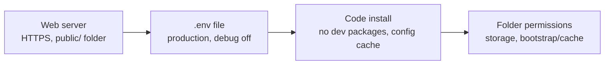

> 🌐 **Language:** [🇻🇳 Tiếng Việt](./security-production-config_vi.md) · 🇬🇧 English (current) · [🇯🇵 日本語](./security-production-config_ja.md)

# Safe production configuration — the `.env` file, HTTPS and the server

## Introduction

This page shows how to configure a GP247 site that is **live** (production) so it stays safe: the `.env` file, debug mode, HTTPS,
cookies, the web root, folder permissions and Docker. The page is for technical staff, and for site owners who install on their own
hosting. After reading it you will have a table of correct values for each variable, know what happens when one is wrong, and know how to self-check in 5 minutes.

> ℹ️ **What is the `.env` file:** a text file in the site's root folder that holds the site's own settings: the database password, the encryption
> key, the run mode… Anyone who can read this file can read every secret of the site.

## At a glance

Four configuration layers must be right at the same time; one wrong layer means a hole:



- **Three required lines in `.env`**: `APP_ENV=production`, `APP_DEBUG=false`, `APP_URL=https://…`.
- **The web root (document root) must be `public/`** — if it points to the project root, the `.env` file may be downloadable through a browser.
- **`.env.example` is a template for developer machines** (`APP_ENV=local`, `LOG_LEVEL=debug`) — do not use it as-is for a live site.
- **After editing `.env`, run `php artisan config:clear`** if the site uses a config cache.

## On this page

- [Environment variables for production](#environment-variables-for-production) — correct values and what happens when they are wrong
- [Why debug must never be on for a live site](#why-debug-must-never-be-on-for-a-live-site)
- [HTTPS and cookies](#https-and-cookies)
- [Web root and folder permissions](#web-root-and-folder-permissions)
- [Installing the code for production](#installing-the-code-for-production)
- [Running with Docker](#running-with-docker)
- [Self-check in 5 minutes](#self-check-in-5-minutes)

## Environment variables for production

This table lists the security-related variables, the value to set for a live site, and what happens if the value is wrong.

| Variable | Production value | Default (`.env.example` / system) | If wrong |
| --- | --- | --- | --- |
| `APP_ENV` | `production` | `local` | GP247 only forces debug off when the value is exactly `production` |
| `APP_DEBUG` | `false` | `false` | If on, error pages show config, paths and queries to everyone |
| `APP_URL` | `https://your-domain` | `http://localhost` | Links in emails and payment links are wrong, or point to `http://` |
| `APP_KEY` | A unique key, **never changed** once the site is running | (created at install) | Changing it signs everyone out and breaks webhook secrets — see [Encryption keys & backup](./security-keys-and-backup.md) |
| `GP247_ENCRYPTION_KEY` | A unique key, set right after install | (empty) | If empty, secrets are tied to `APP_KEY`; `gp247:doctor` check `encryption_key_dedicated` will remind you |
| `LOG_LEVEL` | `warning` or `error` | `debug` | `debug` writes a lot of detail into the log; the file grows large and holds information you do not need |
| `SESSION_SECURE_COOKIE` | `true` (once HTTPS is on) | (not set) | The sign-in cookie may be sent over an unencrypted connection |
| `GP247_ADMIN_PREFIX` | Your own path, e.g. `admin-7k2` | `gp247_admin` | Automated scanners find the default path first |
| `GP247_FINGERPRINT` | `false` if you do not want to advertise the platform | `true` | The site returns a header and a meta tag saying it uses GP247 |
| `DB_PASSWORD` | A strong password, unique to this site | `password` | A sample password everyone knows |
| `GP247_API_MODE` | `0` if you use neither the REST API nor MCP | `1` | Not an error — but turning off unused parts closes one more door |

> 💡 **Tip:** generate a random key value with `php artisan key:generate --show` — the command only prints the key on screen and changes nothing.

## Why debug must never be on for a live site

Debug mode is for development: when an error happens, the page shows every detail so the developer can fix it. On a live site,
**any visitor** who hits an error sees those details: folder paths on the server, database queries, part of the
configuration. Attackers cause errors on purpose to read them.

- **What GP247 protects**: when `APP_ENV=production`, GP247 forces debug off whatever `APP_DEBUG` says; the admin header shows a red **"DEBUG ON"** label when debug is on.
- **What you do**: set **both** `APP_ENV=production` and `APP_DEBUG=false`. If you see the "DEBUG ON" label on a live site, fix `.env` right away and run `php artisan config:clear`.
- **Need to see errors on a live site?** Read the `storage/logs/gp247.log` file instead of turning on debug.

## HTTPS and cookies

HTTPS encrypts the connection between the browser and the site, so passwords and sign-in cookies cannot be read on the way.
GP247 does not turn on HTTPS by itself — you must turn it on in your hosting or web server.

1. Turn on an SSL certificate in the hosting control panel (most offer free Let's Encrypt), or configure it in the web server / proxy.
2. Turn on the `http://` → `https://` redirect in the same place.
3. Edit `.env`:

   ```
   APP_URL=https://your-domain
   SESSION_SECURE_COOKIE=true
   ```

4. If the site uses a config cache, run:

   ```
   php artisan config:clear
   ```

5. (Recommended) Turn on the **HSTS** header in the web server so browsers always use HTTPS. GP247 does not send this header by itself.

If it worked, opening the site with `http://` redirects to `https://` and the browser shows a padlock icon.

> ⚠️ **Note:** a site behind a proxy or CDN (Cloudflare, load balancer) must set `TRUSTED_PROXIES` to the correct proxy address. Otherwise
> GP247 sees every visitor as the same IP and the per-IP sign-in limit stops working. Do not set `*` unless you need to.

## Web root and folder permissions

This section stops sensitive files (`.env`, logs, backups) from being downloaded directly through a browser.

- **The document root must point to the site's `public/` folder**, not the project root. Everything outside `public/` (including `.env`, `storage/`, `vendor/`) is then not reachable from the web.
- **Shared hosting with only `public_html`**: put the code outside `public_html` and copy only the contents of `public/` into `public_html`; or change the domain's document root to `…/public` in the control panel.
- **Write permissions**: only `storage/` and `bootstrap/cache/` need write access (plus `app/GP247/` and `public/GP247/` if you install plugins from the admin). Do not set `777` on the whole site.
- **Quick check**: open `https://your-domain/.env` in a browser. The correct result is a **404 or 403 error**. If you see the file's contents — fix the document root right away and change every password in the file.

## Installing the code for production

This section is for sites installed with Composer, Git or Docker.

- **Install without development packages**: use `composer install --no-dev`. Dev packages (e.g. the debug toolbar) are not needed on a live site.
- **Never push `.env` to Git**: check that `.gitignore` has a `.env` line. If it was already pushed, treat every secret in the file as leaked — change them all (see [Updates & incidents](./security-updates-and-incidents.md)).
- **Config cache** (`php artisan config:cache`) makes the site faster, but after that **every time you edit `.env` you must run** `php artisan config:clear` (or `config:cache`) again. Otherwise the site keeps the old values — including the old `APP_DEBUG`.
- **Do not delete the `storage/app/private/` folder**: it holds the site's "installed" marker.

## Running with Docker

The S-Cart Docker setup has a few built-in protections for production:

- **`docker-compose.prod.yml` pins** `APP_ENV=production` and `APP_DEBUG=false` for every PHP service, no matter what `.env` on the machine says.
- **Refuses to start** while the sample passwords from `.env.example` remain (`DB_PASSWORD=password`, `SC_DOCKER_DB_ROOT_PASSWORD=change_me_root` when using the bundled MySQL).
- **nginx blocks hidden files** (`.env`, `.git`) and internal folders; PHP turns off unused features.

Your part: put **HTTPS at the proxy in front of** the containers (the bundled nginx only listens on port 80), change every sample password, and update images following
the "Security updates" section of [DOCKER.md](https://github.com/gp247net/s-cart/blob/master/DOCKER.md). Never run
`docker compose down -v` on a production machine — that command **deletes the volume that holds the database**.

## Self-check in 5 minutes

Do these in order; each step has a correct result to compare against.

1. **Admin**: sign in and look at the header — the environment label must be production, with **no** red "DEBUG ON" label.
2. **Browser**: open `http://your-domain` — it must redirect to `https://`.
3. **Browser**: open `https://your-domain/.env` — it must be a 404 or 403 error.
4. **Browser**: open `https://your-domain/install` — on an installed site it must redirect to the sign-in page.
5. **Command line** (if you have it): run the command below; every line must be PASS, or a WARN whose reason you understand:

   ```
   php artisan gp247:doctor
   ```

   Pay attention to the `encryption_key_dedicated` and `secret_decryptable` lines — see [Encryption keys & backup](./security-keys-and-backup.md).

> ℹ️ **Info:** `gp247:doctor` checks the PHP environment, write permissions, the encryption key and the database. It does **not** check `APP_DEBUG`, HTTPS or
> cookies — steps 1–3 above do that.

## Conditions & Rules (know before you act)

- **`GP247_DB_PREFIX` cannot be changed after install** — if you change it, the site cannot find its data tables.
- **Changing `GP247_ADMIN_PREFIX` changes the admin address** — tell every administrator the new address; old bookmarks will break.
- **Setting `SESSION_SECURE_COOKIE=true` before HTTPS is on means no one can sign in** — turn on HTTPS first.
- **Editing `.env` when the config is cached** — you must run `php artisan config:clear` for the change to take effect.
- **`APP_ENV` is case-sensitive** — `Production` or `prod` is not treated as production.

## Q&A

**Q1: What if I leave `APP_ENV=local` on a live site?**

→ GP247 does not force debug off, so only `APP_DEBUG` protects you. Change it to `production` and run `php artisan config:clear`.

**Q2: I set `APP_DEBUG=false` but the header still shows "DEBUG ON"?**

→ The site is using an old config cache. Run `php artisan config:clear`. Without a command line, delete the `bootstrap/cache/config.php` file through your hosting's file manager.

**Q3: I can open `/.env` in a browser. What do I do?**

→ Fix the document root to the `public/` folder right away, then treat every secret in the file as leaked: change the database password, the SMTP password and the payment gateway keys. See [Updates & incidents](./security-updates-and-incidents.md).

**Q4: Can changing `GP247_ADMIN_PREFIX` replace a strong password?**

→ No. It only makes it harder for automated scanners to find the admin. Strong passwords and two-factor authentication are the real protection.

**Q5: My shared hosting does not let me change the document root?**

→ Move the code outside `public_html` and copy only the contents of the `public/` folder into `public_html`. Ask your provider if the control panel has no such option.

**Q6: Is `LOG_LEVEL=debug` dangerous?**

→ Nothing leaks outside as long as `storage/` is not reachable from the web, but the log grows large and holds lots of details you do not need. Set `warning` or `error` for a live site.

**Q7: Docker already pins `APP_DEBUG=false`. What else do I need to worry about?**

→ HTTPS at the proxy in front, changing sample passwords, updating images regularly, and backing up the database volume.

**Q8: Why not just set `TRUSTED_PROXIES=*` to save time?**

→ Then anyone can fake their IP address through a header, which makes the per-IP sign-in limit and the IP log worthless. Only list the real proxy address.

---

<sub>📅 **Last updated:** 2026-11-04 · ✍️ **Author:** GP247</sub>
