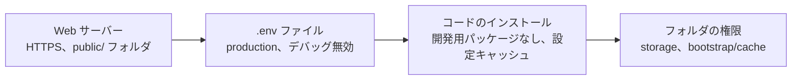

> 🌐 **言語:** [🇻🇳 Tiếng Việt](./security-production-config_vi.md) · [🇬🇧 English](./security-production-config.md) · 🇯🇵 日本語（現在）

# 安全な本番環境の設定 — `.env` ファイル、HTTPS、サーバー

## はじめに

このページでは、**実際に稼働している**（本番環境の）GP247 サイトを安全に設定する方法を説明します：`.env` ファイル、デバッグモード、HTTPS、
Cookie、Web のドキュメントルート、フォルダの権限、Docker。対象は技術担当者と、ホスティングに自分でインストールするサイトオーナーです。
読み終えると、各変数の正しい値の一覧、誤った値にしたときの影響、5 分でできるセルフチェックの方法がわかります。

> ℹ️ **`.env` ファイルとは:** サイトのルートフォルダにあるテキストファイルで、サイト固有の設定を含みます：データベースのパスワード、暗号化
> キー、動作モードなど。このファイルを読める人は、サイトのすべての秘密情報を読めます。

## ひと目でわかる

4 つの設定層がすべて正しくなければなりません。1 つでも誤ると脆弱性になります。



- **`.env` に必須の 3 行**：`APP_ENV=production`、`APP_DEBUG=false`、`APP_URL=https://…`。
- **Web のドキュメントルート（document root）は `public/` でなければなりません** — プロジェクトのルートフォルダを指していると、`.env` ファイルをブラウザからダウンロードされるおそれがあります。
- **`.env.example` は開発マシン用のサンプルです**（`APP_ENV=local`、`LOG_LEVEL=debug`）— 本番サイトにそのまま使わないでください。
- **サイトが設定キャッシュを使っている場合、`.env` を編集した後は `php artisan config:clear` を実行してください。**

## このページの内容

- [本番環境の環境変数一覧](#本番環境の環境変数一覧) — 正しい値と、誤ったときの影響
- [本番サイトでデバッグを有効にしてはいけない理由](#本番サイトでデバッグを有効にしてはいけない理由)
- [HTTPS と Cookie](#https-と-cookie)
- [プロキシや CDN の背後で動くサイト](#プロキシや-cdn-の背後で動くサイト) — 運用の形ごとの `TRUSTED_PROXIES`
- [Web のドキュメントルートとフォルダの権限](#web-のドキュメントルートとフォルダの権限)
- [本番環境向けのソースコードのインストール](#本番環境向けのソースコードのインストール)
- [Docker で運用する](#docker-で運用する)
- [5 分でできるセルフチェック](#5-分でできるセルフチェック)

## 本番環境の環境変数一覧

この表は、セキュリティに関わる変数、本番運用で設定すべき値、誤って設定した場合に起きることをまとめたものです。

| 変数 | 本番環境の値 | 初期値（`.env.example`／システム） | 誤るとどうなるか |
| --- | --- | --- | --- |
| `APP_ENV` | `production` | `local` | 値が正確に `production` のときだけ、GP247 はデバッグを強制的に無効にします |
| `APP_DEBUG` | `false` | `false` | 有効にすると、エラーページに設定、パス、クエリが表示され、誰でも見られます |
| `APP_URL` | `https://your-domain` | `http://localhost` | メール内のリンクや決済リンクが誤る、または `http://` を指してしまいます |
| `APP_KEY` | 固有のキー。運用開始後は**変更しない** | （インストール時に生成） | 変更すると全員がログアウトされ、Webhook のシークレットが壊れます — [暗号化キーとバックアップ](./security-keys-and-backup_ja.md)を参照 |
| `GP247_ENCRYPTION_KEY` | 固有のキー。インストール直後に設定 | （空） | 空の場合、秘密情報は `APP_KEY` に依存します。`gp247:doctor` の項目 `encryption_key_dedicated` が通知します |
| `LOG_LEVEL` | `warning` または `error` | `debug` | `debug` はログに大量の詳細を記録し、ファイルが肥大化し、不要な情報を含みます |
| `SESSION_SECURE_COOKIE` | `true`（HTTPS 導入後） | （未設定） | ログイン Cookie が暗号化されていない接続で送信されるおそれがあります |
| `GP247_ADMIN_PREFIX` | 独自のパス。例：`admin-7k2` | `gp247_admin` | 初期のパスは自動スキャナーに先に見つけられます |
| `GP247_FINGERPRINT` | プラットフォームを公表したくなければ `false` | `true` | サイトが GP247 を使っていることを示すヘッダーと meta タグを返します |
| `TRUSTED_PROXIES` | 空、または前段の**すべての**プロキシの IP 範囲（1 行にまとめる） | （空） | `REMOTE_ADDR` や `*` では誰でも IP を偽装でき、プロキシがあるのに未設定だと全訪問者が同じ IP になります — [プロキシや CDN の背後で動くサイト](#プロキシや-cdn-の背後で動くサイト) を参照 |
| `DB_PASSWORD` | このサイト専用の強いパスワード | `password` | 誰もが知っているサンプルパスワードです |
| `GP247_API_MODE` | REST API も MCP も使わなければ `0` | `1` | エラーではありません — ただ、使わない部分を完全に無効にすれば入口が 1 つ減ります |

> 💡 **ヒント:** キー用のランダムな値は `php artisan key:generate --show` で生成できます — このコマンドはキーを画面に表示するだけで、何も変更しません。

## 本番サイトでデバッグを有効にしてはいけない理由

デバッグモードは開発用です。エラーが起きると、開発者が修正できるようにページにすべての詳細が表示されます。本番サイトでは、
エラーに遭遇した**どの訪問者にも**その詳細が見えてしまいます：サーバー上のフォルダのパス、データベースのクエリ、設定の一部。
攻撃者はわざとエラーを起こしてそれを読み取ります。

- **GP247 が守ること**：`APP_ENV=production` のとき、`APP_DEBUG` の値にかかわらず GP247 がデバッグを強制的に無効にします。デバッグが有効なときは、管理画面のヘッダーに赤い **「DEBUG ON」** ラベルが表示されます。
- **あなたが行うこと**：`APP_ENV=production` と `APP_DEBUG=false` を**両方**設定してください。本番サイトで「DEBUG ON」ラベルが表示されたら、すぐに `.env` を修正し、`php artisan config:clear` を実行してください。
- **本番サイトでエラーを確認したいときは？** デバッグを有効にする代わりに、`storage/logs/gp247.log` ファイルを読んでください。

## HTTPS と Cookie

HTTPS はブラウザとサイトの間の通信を暗号化し、パスワードやログイン Cookie が途中で盗み読みされないようにします。
GP247 は HTTPS を自動では有効にしません — ホスティングまたは Web サーバーで有効にする必要があります。

1. ホスティングのコントロールパネルで SSL 証明書を有効にします（多くの場合、無料の Let's Encrypt があります）。または Web サーバー／プロキシで設定します。
2. 同じ場所で `http://` → `https://` へのリダイレクトを有効にします。
3. `.env` を編集します：

   ```
   APP_URL=https://your-domain
   SESSION_SECURE_COOKIE=true
   ```

4. サイトに設定キャッシュがある場合は、次を実行します：

   ```
   php artisan config:clear
   ```

5. （推奨）ブラウザが常に HTTPS を使うよう、Web サーバーで **HSTS** ヘッダーを有効にします。GP247 はこのヘッダーを自動では送信しません。

成功すると、`http://` でサイトを開くと自動的に `https://` に切り替わり、ブラウザに鍵のアイコンが表示されます。

## プロキシや CDN の背後で動くサイト

GP247 は、`TRUSTED_PROXIES` に設定したプロキシから届いたリクエストの場合に限り、転送ヘッダーから IP とプロトコル（`https`）を受け取ります。
リンクのドメインは常に実際の `Host` ヘッダーから取り、`X-Forwarded-Host` は決して使いません。

| サイトの運用形態 | `TRUSTED_PROXIES` |
| --- | --- |
| ホスティング / VPS（Web サーバーが訪問者を直接受ける） | 空のまま |
| Cloudflare / ロードバランサーの背後 | その IP 範囲（`.env.example` にサンプルあり） |
| Docker（前段に何もない） | 空のまま |
| 同じサーバー上の nginx / Caddy / Traefik の背後の Docker | `172.16.0.0/12` と `SC_DOCKER_APP_PORT=127.0.0.1:8000` |
| 同じサーバー上の nginx / Caddy / Traefik の背後の Docker で、そのサーバーがさらに Cloudflare / ロードバランサーの背後にある | **両方**を 1 行に：`172.16.0.0/12,<Cloudflare / LB の IP 範囲>` と `SC_DOCKER_APP_PORT=127.0.0.1:8000`（完全な行は `.env.example` にあり） |

**すべての段を 1 行に設定します。** GP247 は、サイトに直接つながるプロキシが一覧にある場合に限り転送ヘッダーを読み、
設定済みの段を順に飛ばして訪問者の実際の IP を求めます。1 段でも欠けると、何も設定していないのと同じです。

- `REMOTE_ADDR` や `*` は**決して**使わないでください。Web サーバーが FastCGI で PHP と通信する場合（Docker 構成の nginx を含む）、
  `REMOTE_ADDR` は訪問者自身のアドレスなので、誰でも IP を偽装できます。これらの値では **システムアラート** ページと
  `php artisan gp247:doctor` が `trusted_proxies` 項目を報告します。
- 前段のプロキシは **`Host` ヘッダーを維持**する必要があります（nginx：`proxy_set_header Host $host;`）。
- プロキシがあるのに未設定の場合：すべての訪問者が同じ IP に見え（ログイン制限が 1 つのカウンターを共有）、リンクが `http://` で生成されます。
  HTTPS のサイトでは、ブラウザが管理画面の操作をブロックし、Console に「Mixed Content」と表示されます。
  未設定のプロキシを経由して管理画面が開かれると、**システムアラート** ページと `php artisan gp247:doctor`（`trusted_proxies` 項目）が
  そのプロキシのアドレスとともに知らせます。

  > ℹ️ **対応バージョン:** gp247/core 3.11.3

- **コンテナのポートはサーバー内だけに公開**：`172.16.0.0/12` を設定したままコンテナのポートを外部に公開すると、そのポートを直接呼ぶ人も
  プロキシとみなされ、IP を偽装できます。サーバーのファイアウォールは Docker のポートを防げません。`ss -ltnp | grep 8000` で確認し、
  `127.0.0.1:8000` だけが表示され、`0.0.0.0` や `[::]` がないことが正しい結果です。
- **Docker ネットワークが別の範囲の場合**：`172.16.0.0/12` は一般的な Docker ネットワークを含みますが、多数のスタックを動かすサーバーでは
  `192.168.x.x` が割り当てられることがあります。実際のサブネットを確認し（`scart` はご自身の `SC_DOCKER_INSTANCE` に置き換え）、その値を設定します：
  `docker network inspect scart-prod_scart -f '{{range .IPAM.Config}}{{.Subnet}}{{end}}'`。

## Web のドキュメントルートとフォルダの権限

この項目は、機密ファイル（`.env`、ログ、バックアップ）がブラウザから直接ダウンロードされるのを防ぎます。

- **ドキュメントルートはサイトの `public/` フォルダを指す必要があります**。プロジェクトのルートフォルダではありません。そうすれば、`public/` の外にあるもの（`.env`、`storage/`、`vendor/` を含む）は Web からアクセスできなくなります。
- **共有ホスティングに `public_html` しかない場合**：ソースコードを `public_html` の外に置き、`public/` の中身だけを `public_html` に入れます。またはコントロールパネルで、ドメインのドキュメントルートを `…/public` に変更します。
- **書き込み権限**：書き込みが必要なのは `storage/` と `bootstrap/cache/` だけです（管理画面からプラグインをインストールする場合は `app/GP247/`、`public/GP247/` も）。サイト全体に `777` を設定しないでください。
- **簡単な確認**：ブラウザで `https://your-domain/.env` を開きます。正しい結果は **404 または 403 エラー**です。ファイルの中身が表示されたら — すぐにドキュメントルートを修正し、ファイル内のすべてのパスワードを変更してください。

## 本番環境向けのソースコードのインストール

この項目は、Composer、Git、Docker でインストールしたサイト向けです。

- **開発用パッケージなしでインストールする**：`composer install --no-dev` を使います。開発用パッケージ（例：デバッグツールバー）は本番サイトには不要です。
- **`.env` を Git に入れない**：`.gitignore` に `.env` の行があるか確認してください。誤って入れてしまった場合は、ファイル内のすべての秘密情報が漏れたものとみなし、すべて変更してください（[更新とインシデント対応](./security-updates-and-incidents_ja.md)を参照）。
- **設定キャッシュ**（`php artisan config:cache`）はサイトを速くしますが、その後は**`.env` を編集するたびに** `php artisan config:clear`（または `config:cache`）を再実行する必要があります。実行しないと、サイトは古い値を使い続けます — 古い `APP_DEBUG` も含めてです。
- **`storage/app/private/` フォルダを削除しない**：サイトの「インストール済み」の目印が入っています。

## Docker で運用する

S-Cart の Docker 構成には、本番環境向けの保護層がいくつか組み込まれています。

- **`docker-compose.prod.yml` は**すべての PHP サービスで `APP_ENV=production` と `APP_DEBUG=false` を**固定**し、マシン上の `.env` に依存しません。
- `.env.example` のサンプルパスワードが残っていると**起動を拒否します**（`DB_PASSWORD=password`、同梱の MySQL を使う場合は `SC_DOCKER_DB_ROOT_PASSWORD=change_me_root`）。
- **nginx は隠しファイル**（`.env`、`.git`）と内部フォルダをブロックし、PHP は使わない機能を無効にしています。

あなたが行うこと：コンテナの**前段のプロキシで HTTPS を設定する**（構成内の nginx はポート 80 だけを待ち受けます）、すべてのサンプルパスワードを変更する、
[DOCKER.md](https://github.com/gp247net/s-cart/blob/master/DOCKER.md) の「Security updates」の項目に沿ってイメージを更新する。本番マシンで
`docker compose down -v` を実行しないでください — このコマンドは**データベースを含むボリュームを削除します**。同じサーバー上の HTTPS プロキシを
使う場合は、[プロキシや CDN の背後で動くサイト](#プロキシや-cdn-の背後で動くサイト) のとおり `TRUSTED_PROXIES` を設定してください。

## 5 分でできるセルフチェック

順番に行ってください。各手順に、照らし合わせるための正しい結果があります。

1. **管理画面**：ログインしてヘッダーを見ます — 環境ラベルが production で、赤い「DEBUG ON」ラベルが**ない**ことを確認します。Administrator アカウントでは、ダッシュボード先頭の **システムアラート** ブロックが**重大**な問題を報告していないことも確認します（詳細は **システムアラート** ページ）。
2. **ブラウザ**：`http://your-domain` を開きます — 自動的に `https://` に切り替わるはずです。
3. **ブラウザ**：`https://your-domain/.env` を開きます — 404 または 403 エラーになるはずです。
4. **コマンドライン**（使える場合）：次のコマンドを実行します。すべての行が PASS、または理由を理解している WARN であることを確認します：

   ```
   php artisan gp247:doctor
   ```

   `encryption_key_dedicated` と `secret_decryptable` の行に注意してください — [暗号化キーとバックアップ](./security-keys-and-backup_ja.md)を参照してください。

> ℹ️ **情報:** `gp247:doctor` は PHP 環境、書き込み権限、暗号化キー、データベースに加え、（インストール済みのサイトでは）システムアラート
> ブロックと同じ項目を確認します：デバッグが有効（`app_debug`）、`APP_URL` が `https://` で始まらない／`SESSION_SECURE_COOKIE` が無効（`https`）、
> `admin` の初期パスワード、MFA、バージョン系列のサポート終了時期。このコマンドは**設定を読むだけで、ネットワーク経由でサイトを開きません**。
> そのため `http://` が `https://` に転送されるか、`.env` をダウンロードできるかはわかりません — 上の手順 2〜3 がその役割を担います。
>
> ℹ️ **対応バージョン:** gp247/core 3.10.0（システムアラートのブロックとページ、`gp247:doctor` のセキュリティ項目）

## 条件と制約（操作の前に確認）

- **`GP247_DB_PREFIX` はインストール後に変更できません** — 変更するとサイトがデータテーブルを見つけられなくなります。
- **`GP247_ADMIN_PREFIX` を変更すると管理画面のアドレスが変わります** — すべての管理者に新しいアドレスを伝えてください。古いブックマークは使えなくなります。
- **HTTPS がないまま `SESSION_SECURE_COOKIE=true` を設定するとログインできません** — 先に HTTPS を有効にしてください。
- **設定キャッシュがある状態で `.env` を編集した場合** — `php artisan config:clear` を実行しないと変更は反映されません。
- **`APP_ENV` は大文字と小文字を区別します** — `Production` や `prod` は production とみなされません。

## よくある質問（Q&A）

**Q1: 本番サイトで `APP_ENV=local` のままにするとどうなりますか？**

→ GP247 はデバッグを強制的に無効にしないため、守りは `APP_DEBUG` だけになります。`production` に変更し、`php artisan config:clear` を実行してください。

**Q2: `APP_DEBUG=false` を設定したのに、ヘッダーに「DEBUG ON」が表示されます。**

→ サイトが古い設定キャッシュを使っています。`php artisan config:clear` を実行してください。コマンドラインがない場合は、ホスティングのファイルマネージャーで `bootstrap/cache/config.php` ファイルを削除してください。

**Q3: ブラウザで `/.env` を開けてしまいました。どうすればよいですか？**

→ すぐにドキュメントルートを `public/` フォルダに修正し、ファイル内のすべての秘密情報が漏れたものとみなしてください：データベース、SMTP のパスワードと、決済ゲートウェイのキーを変更します。[更新とインシデント対応](./security-updates-and-incidents_ja.md)を参照してください。

**Q4: `GP247_ADMIN_PREFIX` を変更すれば、強いパスワードの代わりになりますか？**

→ なりません。自動スキャナーに見つかりにくくなるだけです。主な保護は強いパスワードと二要素認証です。

**Q5: 共有ホスティングでドキュメントルートを変更できない場合は？**

→ ソースコードを `public_html` の外に移し、`public/` フォルダの中身だけを `public_html` にコピーしてください。コントロールパネルにこの選択肢がなければ、ホスティング事業者に問い合わせてください。

**Q6: `LOG_LEVEL=debug` は危険ですか？**

→ `storage/` が Web からアクセスできなければ外部には漏れませんが、ログが肥大化し、不要な詳細を多く含みます。本番運用では `warning` または `error` を設定してください。

**Q7: Docker で `APP_DEBUG=false` が固定されています。ほかに気をつけることはありますか？**

→ 前段のプロキシでの HTTPS、サンプルパスワードの変更、イメージの定期的な更新、データベースのボリュームのバックアップです。

**Q8: 手軽に `TRUSTED_PROXIES=*` を設定してはいけないのはなぜですか？**

→ そうすると誰でもヘッダーで IP アドレスを偽装でき、IP ごとのログイン制限やログの IP が意味をなさなくなります。PHP が FastCGI で動く場合は `REMOTE_ADDR` も同じです。実際のプロキシの IP 範囲だけを設定してください。

---

<sub>📅 **最終更新:** 2026-11-12 · ✍️ **作成者 (Author):** GP247</sub>
