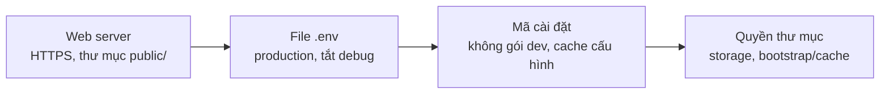

> 🌐 **Ngôn ngữ:** 🇻🇳 Tiếng Việt (hiện tại) · [🇬🇧 English](./security-production-config.md) · [🇯🇵 日本語](./security-production-config_ja.md)

# Cấu hình production an toàn — file `.env`, HTTPS và máy chủ

## Giới thiệu

Trang này hướng dẫn cấu hình một site GP247 **đang chạy thật** (production) cho an toàn: file `.env`, chế độ debug, HTTPS,
cookie, thư mục gốc của web, quyền thư mục và Docker. Trang dành cho người phụ trách kỹ thuật, và cho chủ site tự cài trên
hosting. Đọc xong bạn có bảng giá trị đúng cho từng biến, biết hậu quả khi đặt sai, và cách tự kiểm trong 5 phút.

> ℹ️ **File `.env` là gì:** một file chữ ở thư mục gốc site, chứa cấu hình riêng của site: mật khẩu cơ sở dữ liệu, khoá mã
> hoá, chế độ chạy… Ai đọc được file này là đọc được mọi bí mật của site.

## Nhìn nhanh

Bốn lớp cấu hình phải đúng cùng lúc; sai một lớp là có lỗ hổng:



- **Ba dòng bắt buộc trong `.env`**: `APP_ENV=production`, `APP_DEBUG=false`, `APP_URL=https://…`.
- **Thư mục gốc của web (document root) phải là `public/`** — nếu trỏ vào thư mục gốc dự án, file `.env` có thể bị tải về qua trình duyệt.
- **`.env.example` là mẫu cho máy lập trình** (`APP_ENV=local`, `LOG_LEVEL=debug`) — không dùng nguyên cho site thật.
- **Sửa `.env` xong phải chạy `php artisan config:clear`** nếu site đang dùng cache cấu hình.

## Trong trang này

- [Bảng biến môi trường cho production](#bảng-biến-môi-trường-cho-production) — giá trị đúng và hậu quả khi sai
- [Vì sao không được bật debug trên site thật](#vì-sao-không-được-bật-debug-trên-site-thật)
- [HTTPS và cookie](#https-và-cookie)
- [Thư mục gốc của web và quyền thư mục](#thư-mục-gốc-của-web-và-quyền-thư-mục)
- [Cài mã nguồn cho production](#cài-mã-nguồn-cho-production)
- [Chạy bằng Docker](#chạy-bằng-docker)
- [Tự kiểm trong 5 phút](#tự-kiểm-trong-5-phút)

## Bảng biến môi trường cho production

Bảng này liệt kê các biến liên quan bảo mật, giá trị nên đặt khi chạy thật, và chuyện gì xảy ra nếu đặt sai.

| Biến | Giá trị production | Mặc định (`.env.example` / hệ thống) | Nếu sai thì sao |
| --- | --- | --- | --- |
| `APP_ENV` | `production` | `local` | GP247 chỉ tự ép tắt debug khi giá trị đúng là `production` |
| `APP_DEBUG` | `false` | `false` | Bật thì trang lỗi hiện cấu hình, đường dẫn, câu truy vấn cho mọi người xem |
| `APP_URL` | `https://ten-mien-cua-ban` | `http://localhost` | Link trong email và link thanh toán sai, hoặc trỏ về `http://` |
| `APP_KEY` | Một khoá riêng, **không đổi** sau khi chạy | (tạo lúc cài) | Đổi thì mọi người bị đăng xuất, secret webhook hỏng — xem [Khoá mã hoá & sao lưu](./security-keys-and-backup_vi.md) |
| `GP247_ENCRYPTION_KEY` | Một khoá riêng, đặt ngay sau khi cài | (trống) | Trống thì bí mật gắn vào `APP_KEY`; `gp247:doctor` mục `encryption_key_dedicated` sẽ nhắc |
| `LOG_LEVEL` | `warning` hoặc `error` | `debug` | `debug` ghi rất nhiều chi tiết vào log, file phình to và chứa thông tin không cần thiết |
| `SESSION_SECURE_COOKIE` | `true` (khi đã có HTTPS) | (không đặt) | Cookie đăng nhập có thể bị gửi qua kết nối không mã hoá |
| `GP247_ADMIN_PREFIX` | Một đường dẫn riêng, vd `quan-tri-7k2` | `gp247_admin` | Đường dẫn mặc định bị máy quét tự động tìm ra trước |
| `GP247_FINGERPRINT` | `false` nếu không muốn quảng bá nền tảng | `true` | Site trả header và thẻ meta cho biết dùng GP247 |
| `DB_PASSWORD` | Mật khẩu mạnh, riêng cho site này | `password` | Mật khẩu mẫu ai cũng biết |
| `GP247_API_MODE` | `0` nếu không dùng REST API lẫn MCP | `1` | Không phải lỗi — nhưng tắt hẳn phần không dùng là bớt một cửa |

> 💡 **Mẹo:** sinh giá trị ngẫu nhiên cho khoá bằng `php artisan key:generate --show` — lệnh chỉ in khoá ra màn hình, không sửa gì.

## Vì sao không được bật debug trên site thật

Chế độ debug dành cho lúc lập trình: khi có lỗi, trang hiển thị toàn bộ chi tiết để lập trình viên sửa. Trên site thật,
**bất kỳ khách nào** gặp lỗi cũng thấy những chi tiết đó: đường dẫn thư mục trên máy chủ, câu truy vấn cơ sở dữ liệu, một phần
cấu hình. Kẻ tấn công cố tình gây lỗi để đọc chúng.

- **GP247 bảo vệ gì**: khi `APP_ENV=production`, GP247 ép tắt debug dù `APP_DEBUG` đặt gì; header trang quản trị hiện nhãn đỏ **"DEBUG ON"** khi debug đang bật.
- **Bạn làm gì**: đặt **cả hai** `APP_ENV=production` và `APP_DEBUG=false`. Nếu thấy nhãn "DEBUG ON" trên site thật, sửa `.env` ngay rồi chạy `php artisan config:clear`.
- **Cần xem lỗi trên site thật?** Đọc file `storage/logs/gp247.log` thay vì bật debug.

## HTTPS và cookie

HTTPS mã hoá đường truyền giữa trình duyệt và site, để mật khẩu và cookie đăng nhập không bị đọc trộm trên đường đi.
GP247 không tự bật HTTPS — phải bật ở hosting hoặc web server.

1. Bật chứng chỉ SSL ở bảng điều khiển hosting (đa số có Let's Encrypt miễn phí), hoặc cấu hình ở web server / proxy.
2. Bật chuyển hướng `http://` → `https://` ở cùng nơi đó.
3. Sửa `.env`:

   ```
   APP_URL=https://ten-mien-cua-ban
   SESSION_SECURE_COOKIE=true
   ```

4. Nếu site có cache cấu hình, chạy:

   ```
   php artisan config:clear
   ```

5. (Khuyến nghị) Bật header **HSTS** ở web server để trình duyệt luôn dùng HTTPS. GP247 không tự gửi header này.

Nếu thành công, mở site bằng `http://` sẽ tự chuyển sang `https://` và trình duyệt hiện biểu tượng ổ khoá.

> ⚠️ **Lưu ý:** site chạy sau proxy hoặc CDN (Cloudflare, load balancer) phải khai `TRUSTED_PROXIES` đúng địa chỉ proxy, nếu không
> GP247 thấy mọi khách cùng một IP và giới hạn đăng nhập theo IP mất tác dụng. Không đặt `*` khi không cần.

## Thư mục gốc của web và quyền thư mục

Mục này chặn việc tải trực tiếp các file nhạy cảm (`.env`, log, bản sao lưu) qua trình duyệt.

- **Document root phải trỏ vào thư mục `public/`** của site, không phải thư mục gốc dự án. Mọi thứ ngoài `public/` (gồm `.env`, `storage/`, `vendor/`) khi đó không truy cập được từ web.
- **Shared hosting chỉ có `public_html`**: đặt mã nguồn ngoài `public_html`, chỉ đưa nội dung `public/` vào `public_html`; hoặc đổi document root của tên miền sang `…/public` trong bảng điều khiển.
- **Quyền ghi**: chỉ `storage/` và `bootstrap/cache/` cần ghi (thêm `app/GP247/`, `public/GP247/` nếu cài plugin qua trang quản trị). Không đặt `777` cho cả site.
- **Kiểm tra nhanh**: mở `https://ten-mien-cua-ban/.env` trong trình duyệt. Kết quả đúng là **lỗi 404 hoặc 403**. Nếu thấy nội dung file — sửa document root ngay và đổi mọi mật khẩu trong file.

## Cài mã nguồn cho production

Mục này dành cho site cài bằng Composer, Git hoặc Docker.

- **Cài không kèm gói lập trình**: dùng `composer install --no-dev`. Gói dev (vd thanh công cụ debug) không cần trên site thật.
- **Không đưa `.env` lên Git**: kiểm `.gitignore` có dòng `.env`. Lỡ đưa lên rồi thì coi như mọi bí mật trong file đã lộ — đổi hết (xem [Cập nhật & xử lý sự cố](./security-updates-and-incidents_vi.md)).
- **Cache cấu hình** (`php artisan config:cache`) giúp site nhanh hơn, nhưng sau đó **mỗi lần sửa `.env` phải chạy lại** `php artisan config:clear` (hoặc `config:cache`), nếu không site vẫn dùng giá trị cũ — kể cả `APP_DEBUG` cũ.
- **Không xoá thư mục `storage/app/private/`**: nó chứa dấu hiệu "đã cài đặt" của site.

## Chạy bằng Docker

Bộ Docker của S-Cart có sẵn vài lớp bảo vệ cho production:

- **`docker-compose.prod.yml` ghim** `APP_ENV=production` và `APP_DEBUG=false` cho mọi dịch vụ PHP, không phụ thuộc `.env` trên máy.
- **Từ chối khởi động** khi còn mật khẩu mẫu của `.env.example` (`DB_PASSWORD=password`, `SC_DOCKER_DB_ROOT_PASSWORD=change_me_root` khi dùng MySQL đóng gói).
- **nginx chặn file ẩn** (`.env`, `.git`) và thư mục nội bộ; PHP tắt các tính năng không dùng.

Phần bạn làm: đặt **HTTPS ở proxy phía trước** container (nginx trong bộ chỉ nghe cổng 80), đổi mọi mật khẩu mẫu, cập nhật image theo
mục "Cập nhật bản vá bảo mật" của [DOCKER_vi.md](https://github.com/gp247net/s-cart/blob/master/DOCKER_vi.md). Không chạy
`docker compose down -v` trên máy production — lệnh đó **xoá volume chứa cơ sở dữ liệu**.

## Tự kiểm trong 5 phút

Làm lần lượt; mỗi bước có kết quả đúng để đối chiếu.

1. **Trang quản trị**: đăng nhập, nhìn header — phải thấy nhãn môi trường là production, **không** có nhãn đỏ "DEBUG ON".
2. **Trình duyệt**: mở `http://ten-mien-cua-ban` — phải tự chuyển sang `https://`.
3. **Trình duyệt**: mở `https://ten-mien-cua-ban/.env` — phải là lỗi 404 hoặc 403.
4. **Trình duyệt**: mở `https://ten-mien-cua-ban/install` — site đã cài thì phải chuyển sang trang đăng nhập.
5. **Dòng lệnh** (nếu có): chạy lệnh dưới, mọi dòng phải là PASS hoặc WARN đã hiểu lý do:

   ```
   php artisan gp247:doctor
   ```

   Chú ý dòng `encryption_key_dedicated` và `secret_decryptable` — xem [Khoá mã hoá & sao lưu](./security-keys-and-backup_vi.md).

> ℹ️ **Thông tin:** `gp247:doctor` kiểm môi trường PHP, quyền ghi, khoá mã hoá, cơ sở dữ liệu. Lệnh **không** kiểm `APP_DEBUG`, HTTPS hay
> cookie — các bước 1–3 ở trên làm việc đó.

## Điều kiện & ràng buộc (hiểu trước khi thao tác)

- **`GP247_DB_PREFIX` không đổi được sau khi cài** — đổi là site không tìm thấy bảng dữ liệu.
- **Đổi `GP247_ADMIN_PREFIX` làm đổi địa chỉ trang quản trị** — báo cho mọi quản trị viên địa chỉ mới; bookmark cũ sẽ hỏng.
- **Đặt `SESSION_SECURE_COOKIE=true` khi chưa có HTTPS là không đăng nhập được** — bật HTTPS trước.
- **Sửa `.env` khi đã cache cấu hình** — phải chạy `php artisan config:clear` thì thay đổi mới có hiệu lực.
- **`APP_ENV` phân biệt chữ hoa/thường** — `Production` hay `prod` không được coi là production.

## Hỏi & Đáp (Q&A)

**Câu 1: Tôi để `APP_ENV=local` trên site thật thì sao?**

→ GP247 không tự ép tắt debug, nên chỉ còn `APP_DEBUG` bảo vệ bạn. Đổi thành `production` rồi chạy `php artisan config:clear`.

**Câu 2: Tôi đã đặt `APP_DEBUG=false` mà header vẫn hiện "DEBUG ON"?**

→ Site đang dùng cache cấu hình cũ. Chạy `php artisan config:clear`. Không có dòng lệnh thì xoá file `bootstrap/cache/config.php` qua trình quản lý file của hosting.

**Câu 3: Mở được `/.env` trên trình duyệt, phải làm gì?**

→ Sửa document root về thư mục `public/` ngay, rồi coi mọi bí mật trong file đã lộ: đổi mật khẩu cơ sở dữ liệu, SMTP, khoá cổng thanh toán. Xem [Cập nhật & xử lý sự cố](./security-updates-and-incidents_vi.md).

**Câu 4: Đổi `GP247_ADMIN_PREFIX` có thay được mật khẩu mạnh không?**

→ Không. Nó chỉ làm máy quét tự động khó tìm hơn. Mật khẩu mạnh và xác thực hai lớp mới là bảo vệ chính.

**Câu 5: Shared hosting không cho đổi document root?**

→ Đưa mã nguồn ra ngoài `public_html` và chỉ chép nội dung thư mục `public/` vào `public_html`. Hỏi nhà cung cấp nếu bảng điều khiển không có lựa chọn này.

**Câu 6: `LOG_LEVEL=debug` có nguy hiểm không?**

→ Không lộ ra ngoài nếu `storage/` không truy cập được từ web, nhưng log phình to và chứa nhiều chi tiết không cần. Đặt `warning` hoặc `error` khi chạy thật.

**Câu 7: Docker đã ghim `APP_DEBUG=false`, tôi còn phải lo gì?**

→ HTTPS ở proxy phía trước, đổi mật khẩu mẫu, cập nhật image định kỳ, và sao lưu volume cơ sở dữ liệu.

**Câu 8: Vì sao không đặt `TRUSTED_PROXIES=*` cho nhanh?**

→ Khi đó ai cũng giả được địa chỉ IP qua header, làm giới hạn đăng nhập theo IP và nhật ký IP mất giá trị. Chỉ khai đúng địa chỉ proxy thật.

---

<sub>📅 **Cập nhật lần cuối:** 2026-11-04 · ✍️ **Tác giả (Author):** GP247</sub>
