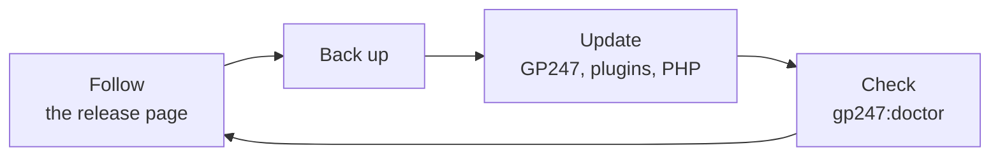
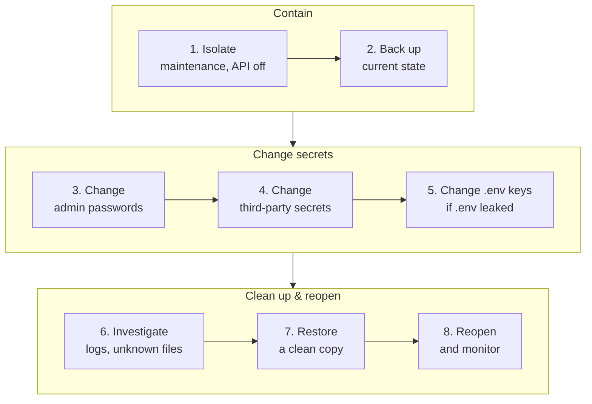

> 🌐 **Language:** [🇻🇳 Tiếng Việt](./security-updates-and-incidents_vi.md) · 🇬🇧 English (current) · [🇯🇵 日本語](./security-updates-and-incidents_ja.md)

# Updates & incidents — keep the site patched and know what to do when you suspect a leak

## Introduction

This page has two parts. The first part is about **keeping the site patched**: GP247, plugins, PHP, the web server. The second part is **the steps to take when you suspect
the site was hacked or secrets leaked**, in the right order. The page is for site owners and technical staff. Read the second part **before**
an incident happens, so you do not have to guess when you need it.

## At a glance

Keeping a site safe is a regular loop; handling an incident is a series of steps in order:



- **One source to follow**: the [S-Cart release page](../release/release.md) lists the recommended versions and the support lifecycle.
- **Always back up before updating** — if an update fails, you can go back.
- **PHP and the web server are patched by you or your hosting**, not by the GP247 release.
- **When you suspect a leak: isolate → back up the current state → change passwords & tokens → change secrets → investigate → restore**.

## Tracking security patches

GP247 ships patches in S-Cart releases. You only need to follow one place:

- **[S-Cart releases and security](../release/release.md)** — the "Recommended versions" table for each package (core, front, shop, mcp), the support lifecycle of each version line, PHP / web server patches.
- **Check the version your site runs**: `php artisan gp247:info`, or the **Server info** screen in the admin. Compare it with the "Recommended versions" table.
- **Version lines that are no longer supported** get no more patches — move to a new line following the update guide.

## Updating GP247 safely

This section summarizes the process; details of each option are in [Updating GP247 and S-Cart](../install-upgrade/update.md).

1. **Back up** the database, `.env`, `storage/app/` and `app/GP247/` (see [Encryption keys & backup](./security-keys-and-backup.md)).
2. In the site's root folder, update the code:

   ```
   composer update
   ```

3. Run the data and cache refresh step:

   ```
   php artisan gp247:update
   ```

4. Check:

   ```
   php artisan gp247:doctor
   ```

   Every line must be PASS, or a WARN whose reason you understand.

> ⚠️ **Note:** do not add `--publish=all` or data-destroying publish tokens before you have a backup — they overwrite customized templates. Never run
> `php artisan gp247:install` on a running site: the install command recreates the tables and **deletes data**.

## Updating PHP, the web server and the operating system

Bugs in PHP, nginx/Apache, MySQL and the operating system are patched by their own vendors, not in the GP247 release.

- **Hosting with a control panel**: choose the newest PHP version of the branch you use; ask your provider when a serious bug is announced.
- **VPS**: install operating system updates regularly.
- **Docker**: follow the "Security updates" section in [DOCKER.md](https://github.com/gp247net/s-cart/blob/master/DOCKER.md) — `docker compose up -d --build` does not re-download patched base images by itself.
- Important PHP / web server patches are listed in the "Server software" section of the [release page](../release/release.md).

## Plugins and templates: install only from trusted sources

Plugins and templates **run code on your server with the full rights of the site**. A malicious plugin can read `.env` and the database.

- **Install from the GP247 library** (the **Extension** screen) or from authors you trust. Do not install `.zip` files of unknown origin.
- **Update plugins** on the **Extension** screen. Before overwriting, GP247 keeps the old version in `storage/backups/extensions/`, verifies the certificate of the download connection, and checks the package hash when the library provides one.
- **Remove plugins you do not use** — less code running means fewer places for bugs.
- **Plugins you write yourself**: keep the rules in [What the system protects](./security-built-in.md) and [Creating a plugin](../extension/create-plugin.md).

## If you suspect a breach — steps in order

Common signs: unknown admin accounts, payment config changes no one owns up to, unknown files in `public/`, customers reporting phishing emails
in the shop's name, a `.env` file that was pushed to Git or could be downloaded from the web. Follow this order — **the order matters**.



1. **Isolate.** Turn on maintenance mode on the **Website information** screen, or run `php artisan down`. Turn off the master switch on the **API config** screen (this also turns off MCP).
2. **Back up the current state** (database + files) to a separate place **before fixing anything** — for the investigation, and so you do not lose the latest order data.
3. **Change the password of every admin account** on the **Users** screen (changing a password signs out every session and REST API token of the account). Revoke every token on the **MCP Server** screen. Disable unknown accounts.
4. **Change third-party secrets right at the provider**: database password, SMTP password, payment gateway API keys, OAuth client secret. Then enter the new values in GP247. Changing the encryption key alone does **not** make leaked secrets stop working.
5. **If the `.env` file leaked**: set a new `APP_KEY` (everyone is signed out — which is what you want), create new secrets on the **Webhook** screen, and change `GP247_ENCRYPTION_KEY` following the [key change procedure](../system/data-encryption.md).
6. **Investigate**: the **Log access** screen (unusual actions, unknown IPs), the **Login failures** screen (addresses and usernames tried most; the `login_failures` item on **System alerts**), the **Users** and **Roles** screens (new accounts, new permissions), the **Extension** screen (unknown plugins), new files in `public/` and `app/GP247/`, the web server log.
7. **Restore**: if there is unknown code, restore the code from a clean copy (Git or a backup from before the incident) and reinstall `vendor/` with Composer; update to the recommended version.
8. **Reopen** (`php artisan up` or turn off maintenance), run `php artisan gp247:doctor`, and watch the log for a few days.

> ℹ️ **Info:** if customers' personal data may have leaked, check your notification obligations under the law where you do business.

## Reporting a GP247 vulnerability

If the cause is a bug in GP247 (not configuration), email **support@gp247.net** with the version (`php artisan gp247:info`) and
how to reproduce it. **Do not** open a public issue on GitHub, so the bug cannot be exploited before a patch exists.

## Conditions & Rules (know before you act)

- **Back up the current state before restoring** — restoring an old backup over it loses orders and data created after that backup.
- **Changing `APP_KEY` during an incident signs everyone out** — including you; have an Administrator account ready whose password you know.
- **To change `GP247_ENCRYPTION_KEY`, declare the old key first** — doing it wrong loses the secrets; see the [key change procedure](../system/data-encryption.md).
- **Two different kinds of maintenance**: maintenance on the **Website information** screen only closes the shop, and the admin stays reachable; `php artisan down` closes the admin **too** — only use it if you have a command line to run `php artisan up`.
- **`php artisan gp247:install` is not a repair command** — it deletes the shop's data.

## Q&A

**Q1: How often should I update?**

→ Whenever the release page has a new version for the line you use — immediately if that version has a security patch. Usually checking once a month is enough.

**Q2: How do I update on shared hosting without a command line?**

→ Ask your technical staff or hosting provider to run `composer update` and `php artisan gp247:update`. See [Updating GP247 and S-Cart](../install-upgrade/update.md).

**Q3: I pushed the `.env` file to GitHub by mistake. Is deleting the commit enough?**

→ No. Treat every secret in the file as leaked: do steps 3–5 in [If you suspect a breach](#if-you-suspect-a-breach--steps-in-order).

**Q4: Is changing the encryption key enough when the SMTP password has leaked?**

→ No. The key only protects the copy stored in the database. A leaked password must be changed right away at the SMTP provider.

**Q5: Is there a way to block all access from outside applications immediately?**

→ Turn off the master switch on the **API config** screen. The REST API and MCP both stop.

**Q6: How dangerous is a plugin from an unknown source?**

→ A plugin runs with the full rights of the site: it can read `.env` and the database, and send data out. Install only from the GP247 library or authors you trust.

**Q7: The site breaks after an update. What do I do?**

→ Read `storage/logs/gp247.log` and run `php artisan gp247:doctor`. If you cannot fix it, restore the backup you made in step 1 of the update section.

**Q8: Who is responsible for patching PHP on my hosting?**

→ Shared hosting: the provider. VPS or your own server: you. Docker: you, by pulling the images again.

---

<sub>📅 **Last updated:** 2026-11-04 · ✍️ **Author:** GP247</sub>
