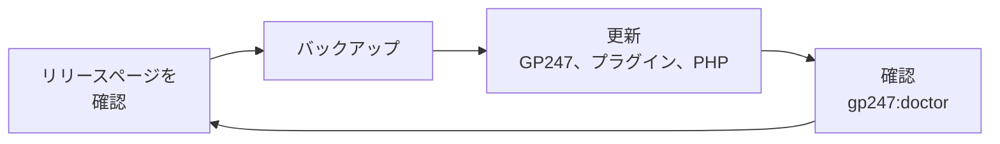
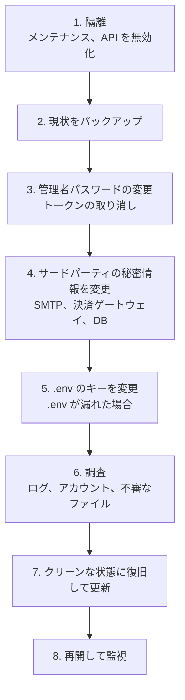

> 🌐 **言語:** [🇻🇳 Tiếng Việt](./security-updates-and-incidents_vi.md) · [🇬🇧 English](./security-updates-and-incidents.md) · 🇯🇵 日本語（現在）

# 更新とインシデント対応 — サイトにパッチを当て続け、漏えいが疑われるときの対処を知る

## はじめに

このページは 2 つの部分に分かれています。前半は**サイトに常にパッチを当てておくこと**：GP247、プラグイン、PHP、Web サーバー。後半は**サイトへの
侵入や秘密情報の漏えいが疑われるときの手順**を、正しい順番で説明します。対象はサイトオーナーと技術担当者です。必要なときに迷わないよう、
後半は問題が起きる**前に**読んでおいてください。

## ひと目でわかる

サイトを安全に保つことは定期的な繰り返しです。インシデント対応は順番の決まった一連の手順です。



- **確認する場所は 1 つ**：[S-Cart のリリースページ](../release/release_ja.md)に、推奨バージョンとサポート期間が載っています。
- **更新の前に必ずバックアップする** — 更新に失敗しても元に戻せます。
- **PHP と Web サーバーのパッチはあなたまたはホスティングが当てます**。GP247 のリリースには含まれません。
- **漏えいが疑われるとき：隔離 → 現状のバックアップ → パスワードとトークンの変更 → 秘密情報の変更 → 調査 → 復旧**。

## パッチを追跡する

GP247 は S-Cart のリリースでパッチを公開します。確認するのは 1 か所だけです。

- **[S-Cart のリリースとセキュリティ](../release/release_ja.md)** — 各パッケージ（core、front、shop、mcp）の「推奨バージョン」の表、各バージョン系列のサポート期間、PHP／Web サーバーのパッチ。
- **稼働中のサイトのバージョンを確認する**：`php artisan gp247:info`、または管理画面の「**サーバー情報**」画面。「推奨バージョン」の表と比べてください。
- **サポートが終了したバージョン系列**にはパッチが提供されません — 更新ガイドに沿って新しい系列に移行してください。

## GP247 を安全に更新する

この項目は手順の要約です。各オプションの詳細は [GP247 アップデートガイド](../system/update-gp247_ja.md)にあります。

1. データベース、`.env`、`storage/app/`、`app/GP247/` を**バックアップ**します（[暗号化キーとバックアップ](./security-keys-and-backup_ja.md)を参照）。
2. サイトのルートフォルダで、コードを更新します：

   ```
   composer update
   ```

3. データとキャッシュを更新する手順を実行します：

   ```
   php artisan gp247:update
   ```

4. 確認します：

   ```
   php artisan gp247:doctor
   ```

   すべての行が PASS、または理由を理解している WARN であることを確認します。

> ⚠️ **注意:** バックアップの前に、`--publish=all` やデータを壊す publish トークンを付けないでください — カスタマイズしたテンプレートが上書きされます。稼働中のサイトで
> `php artisan gp247:install` を実行しないでください：インストールコマンドはテーブルを作り直し、**データを削除します**。

## PHP、Web サーバー、OS の更新

PHP、nginx／Apache、MySQL、OS の不具合は、それぞれの提供元がパッチを当てるもので、GP247 のリリースには含まれません。

- **コントロールパネルのあるホスティング**：使用中の系列で最新の PHP バージョンを選びます。深刻な不具合が公表されたら、事業者に問い合わせてください。
- **VPS**：OS の更新を定期的にインストールします。
- **Docker**：[DOCKER.md](https://github.com/gp247net/s-cart/blob/master/DOCKER.md) の「Security updates」の項目に従ってください — `docker compose up -d --build` では、パッチ済みのベースイメージは自動で再取得されません。
- 重要な PHP／Web サーバーのパッチは、[リリースページ](../release/release_ja.md)の「サーバーソフトウェア」の項目に記載されます。

## プラグインとテンプレート：信頼できる提供元からのみインストール

プラグインとテンプレートは、**サイトのすべての権限を持ってあなたのサーバー上でコードを実行します**。悪意のあるプラグインは `.env` とデータベースを読めます。

- **GP247 のライブラリ**（「**拡張機能**」画面）または信頼できる作者から**インストールしてください**。出所のわからない `.zip` ファイルはインストールしないでください。
- **プラグインの更新**は「**拡張機能**」画面で行います。上書きの前に、GP247 は旧版を `storage/backups/extensions/` に保管し、ダウンロード接続の証明書と、ライブラリが提供する場合はパッケージのハッシュを検査します。
- **使わないプラグインは削除する** — 動くコードが少ないほど、不具合の余地も少なくなります。
- **自作のプラグイン**：[システムが守るもの](./security-built-in_ja.md)と [GP247 のプラグイン作成ガイド](../extension/create-plugin_ja.md)のルールを守ってください。

## 漏えいが疑われるとき — 順番どおりの手順

よくある兆候：見慣れない管理者アカウント、誰も心当たりのない決済設定の変更、`public/` 内の見慣れないファイル、ショップ名を騙った詐欺メールが届いたという
顧客からの報告、`.env` ファイルが Git に入った、または Web からダウンロードできた。次の順番で行ってください — **順番が重要です**。



1. **隔離する。** 「**サイト情報**」画面でメンテナンスモードを有効にするか、`php artisan down` を実行します。「**API設定**」画面でマスタースイッチをオフにします（MCP もオフになります）。
2. **現状を**（データベース + ファイル）別の場所に**修正の前に**バックアップします — 調査のためと、最新の注文データを失わないためです。
3. 「**ユーザー**」画面で**すべての管理者アカウントのパスワードを変更します**（パスワードを変更すると、そのアカウントのすべてのセッションと REST API トークンがログアウトされます）。「**MCP Server**」画面ですべてのトークンを取り消します。見慣れないアカウントを無効化します。
4. **サードパーティの秘密情報を提供元ですぐに変更します**：データベースのパスワード、SMTP のパスワード、決済ゲートウェイの API キー、OAuth client secret。その後、新しい値を GP247 に入力します。暗号化キーを変更するだけでは、漏れた秘密情報は無効に**なりません**。
5. **`.env` ファイルが漏れた場合**：新しい `APP_KEY` を設定し（全員がログアウトされます — これが目的です）、「**Webhook**」画面でシークレットを再生成し、[キー変更の手順](../system/data-encryption_ja.md)に沿って `GP247_ENCRYPTION_KEY` を変更します。
6. **調査する**：「**アクセスログ**」画面（不審な操作、見慣れない IP）、「**ユーザー**」と「**ロール**」画面（新しいアカウントや権限）、「**拡張機能**」画面（見慣れないプラグイン）、`public/` と `app/GP247/` 内の新しいファイル、Web サーバーのログ。
7. **復旧する**：不審なコードがあれば、クリーンな状態（Git またはインシデント前のバックアップ）からコードを復元し、Composer で `vendor/` を再インストールします。推奨バージョンに更新します。
8. **再開し**（`php artisan up` またはメンテナンスを解除）、`php artisan gp247:doctor` を実行し、数日間ログを監視します。

> ℹ️ **情報:** 顧客の個人データが漏れた可能性がある場合は、事業を行う地域の法律に基づく通知義務を確認してください。

## GP247 の脆弱性の報告

原因が GP247 の不具合（設定ではなく）である場合は、バージョン（`php artisan gp247:info`）と再現手順を添えて **support@gp247.net** にメールしてください。
パッチが出る前に悪用されないよう、GitHub に公開の issue を**作らないでください**。

## 条件と制約（操作の前に確認）

- **復旧の前に現状をバックアップする** — 古いバックアップで上書きすると、そのバックアップ以降に発生した注文やデータを失います。
- **インシデント対応中に `APP_KEY` を変更すると、全員がログアウトされます** — あなた自身も含みます。パスワードがわかっている Administrator アカウントを用意しておいてください。
- **`GP247_ENCRYPTION_KEY` を変更する前に、古いキーを設定する必要があります** — 誤ると秘密情報を失います。[キー変更の手順](../system/data-encryption_ja.md)を参照してください。
- **メンテナンスには 2 種類あります**：「**サイト情報**」画面のメンテナンスはショップだけを閉じ、管理画面には入れます。`php artisan down` は管理画面**も**閉じます — `php artisan up` を実行できるコマンドラインがある場合だけ使ってください。
- **`php artisan gp247:install` は修復コマンドではありません** — ショップのデータを削除します。

## よくある質問（Q&A）

**Q1: どのくらいの頻度で更新すべきですか？**

→ 使用中の系列の新しいリリースがリリースページに出たときです — そのリリースにセキュリティパッチが含まれていればすぐに。通常は月に 1 回確認すれば十分です。

**Q2: コマンドラインのない共有ホスティングでは、どうやって更新しますか？**

→ 技術担当者またはホスティング事業者に、`composer update` と `php artisan gp247:update` の実行を依頼してください。[GP247 アップデートガイド](../system/update-gp247_ja.md)を参照してください。

**Q3: 誤って `.env` ファイルを GitHub に入れてしまいました。コミットを削除すれば済みますか？**

→ 済みません。ファイル内のすべての秘密情報が漏れたものとみなし、[漏えいが疑われるとき](#漏えいが疑われるとき--順番どおりの手順)の手順 3〜5 を行ってください。

**Q4: SMTP パスワードが漏れた場合、暗号化キーの変更だけで十分ですか？**

→ 十分ではありません。キーが守るのはデータベース内の保存データだけです。漏れたパスワードは SMTP の提供元ですぐに変更する必要があります。

**Q5: 外部アプリからのアクセスをすぐにすべて止める方法はありますか？**

→ 「**API設定**」画面でマスタースイッチをオフにしてください。REST API と MCP が同時に停止します。

**Q6: 出所のわからないプラグインはどれほど危険ですか？**

→ プラグインはサイトのすべての権限で動作します：`.env` やデータベースを読み、データを外部に送信できます。GP247 のライブラリまたは信頼できる作者からだけインストールしてください。

**Q7: 更新後にサイトでエラーが出ます。どうすればよいですか？**

→ `storage/logs/gp247.log` を読み、`php artisan gp247:doctor` を実行してください。解決できなければ、更新手順の手順 1 で取ったバックアップを復元してください。

**Q8: 私のホスティングの PHP にパッチを当てるのは誰の責任ですか？**

→ 共有ホスティング：事業者です。VPS または専用サーバー：あなたです。Docker：あなたで、イメージを再取得して行います。

---

<sub>📅 **最終更新:** 2026-11-04 · ✍️ **作成者 (Author):** GP247</sub>
