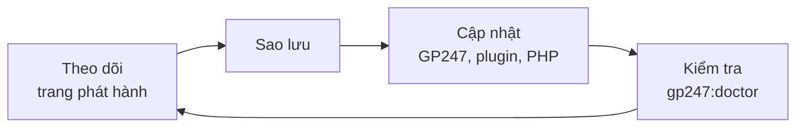
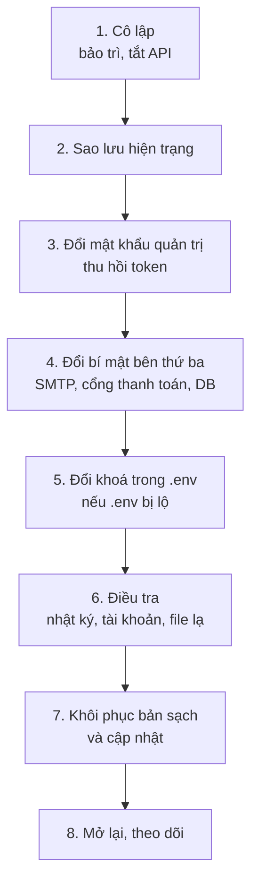

> 🌐 **Ngôn ngữ:** 🇻🇳 Tiếng Việt (hiện tại) · [🇬🇧 English](./security-updates-and-incidents.md) · [🇯🇵 日本語](./security-updates-and-incidents_ja.md)

# Cập nhật & xử lý sự cố — giữ site được vá và biết làm gì khi nghi bị lộ

## Giới thiệu

Trang này gồm hai phần. Phần đầu là **giữ site luôn được vá**: GP247, plugin, PHP, web server. Phần sau là **các bước khi nghi
site bị xâm nhập hoặc lộ bí mật**, theo đúng thứ tự. Trang dành cho chủ site và người phụ trách kỹ thuật. Nên đọc phần sau **trước**
khi có sự cố, để lúc cần không phải đoán.

## Nhìn nhanh

Giữ site an toàn là một vòng lặp đều đặn; xử lý sự cố là một chuỗi bước có thứ tự:



- **Một nguồn để theo dõi**: [trang phát hành S-Cart](../release/release_vi.md) ghi phiên bản nên dùng và vòng đời hỗ trợ.
- **Luôn sao lưu trước khi cập nhật** — cập nhật lỗi thì quay lại được.
- **PHP và web server do bạn hoặc hosting vá**, không nằm trong bản phát hành GP247.
- **Khi nghi bị lộ: cô lập → sao lưu hiện trạng → đổi mật khẩu & token → đổi bí mật → điều tra → khôi phục**.

## Theo dõi bản vá

GP247 phát hành bản vá trong các bản S-Cart. Bạn chỉ cần theo dõi một nơi:

- **[Phát hành và bảo mật S-Cart](../release/release_vi.md)** — bảng "Phiên bản nên dùng" cho từng gói (core, front, shop, mcp), vòng đời hỗ trợ của từng dòng phiên bản, bản vá PHP / web server.
- **Xem phiên bản site đang chạy**: `php artisan gp247:info`, hoặc màn **Thông tin server** trên trang quản trị. So với bảng "Phiên bản nên dùng".
- **Dòng phiên bản đã ngừng hỗ trợ** không nhận bản vá nữa — lên dòng mới theo hướng dẫn cập nhật.

## Cập nhật GP247 an toàn

Mục này tóm tắt quy trình; chi tiết từng tuỳ chọn ở [Hướng dẫn cập nhật GP247](../system/update-gp247_vi.md).

1. **Sao lưu** cơ sở dữ liệu, `.env`, `storage/app/`, `app/GP247/` (xem [Khoá mã hoá & sao lưu](./security-keys-and-backup_vi.md)).
2. Ở thư mục gốc site, cập nhật mã:

   ```
   composer update
   ```

3. Chạy bước làm mới dữ liệu và cache:

   ```
   php artisan gp247:update
   ```

4. Kiểm tra:

   ```
   php artisan gp247:doctor
   ```

   Mọi dòng phải là PASS, hoặc WARN mà bạn đã hiểu lý do.

> ⚠️ **Lưu ý:** không thêm `--publish=all` hay token publish phá dữ liệu khi chưa sao lưu — chúng ghi đè giao diện đã tuỳ biến. Không chạy
> `php artisan gp247:install` trên site đang chạy: lệnh cài đặt tạo lại bảng và **xoá dữ liệu**.

## Cập nhật PHP, web server và hệ điều hành

Lỗi của PHP, nginx/Apache, MySQL, hệ điều hành do chính nhà phát hành của chúng vá, không nằm trong bản GP247.

- **Hosting có bảng điều khiển**: chọn phiên bản PHP mới nhất của nhánh đang dùng; hỏi nhà cung cấp khi có lỗi nghiêm trọng được công bố.
- **VPS**: cài bản cập nhật của hệ điều hành định kỳ.
- **Docker**: làm theo mục "Cập nhật bản vá bảo mật" trong [DOCKER_vi.md](https://github.com/gp247net/s-cart/blob/master/DOCKER_vi.md) — `docker compose up -d --build` không tự tải lại image gốc đã vá.
- Bản vá PHP / web server quan trọng được ghi ở mục "Phần mềm máy chủ" của [trang phát hành](../release/release_vi.md).

## Plugin và giao diện: chỉ cài từ nguồn tin cậy

Plugin và giao diện **chạy mã trên máy chủ của bạn với toàn quyền của site**. Một plugin độc hại đọc được `.env` và cơ sở dữ liệu.

- **Cài từ thư viện GP247** (màn **Phần mở rộng**) hoặc từ tác giả bạn tin. Không cài file `.zip` không rõ nguồn.
- **Cập nhật plugin** ở màn **Phần mở rộng**. Trước khi ghi đè, GP247 giữ bản cũ ở `storage/backups/extensions/`, kiểm chứng chỉ kết nối tải về và mã băm của gói khi thư viện cung cấp.
- **Gỡ plugin không dùng** — ít mã chạy thì ít chỗ lỗi.
- **Plugin tự viết**: giữ các quy tắc ở [Hệ thống bảo vệ những gì](./security-built-in_vi.md) và [Hướng dẫn tạo Plugin](../extension/create-plugin_vi.md).

## Khi nghi bị lộ — các bước theo thứ tự

Dấu hiệu thường gặp: tài khoản quản trị lạ, thay đổi cấu hình thanh toán không ai nhận, file lạ trong `public/`, khách báo email
lừa đảo mang tên cửa hàng, file `.env` từng bị đưa lên Git hoặc tải được qua web. Làm theo thứ tự sau — **thứ tự quan trọng**.



1. **Cô lập.** Bật chế độ bảo trì ở màn **Thông tin website**, hoặc chạy `php artisan down`. Tắt công tắc tổng ở màn **Cấu hình API** (tắt luôn MCP).
2. **Sao lưu hiện trạng** (cơ sở dữ liệu + file) vào một chỗ riêng **trước khi sửa** — để điều tra, và để không mất dữ liệu đơn hàng mới nhất.
3. **Đổi mật khẩu mọi tài khoản quản trị** ở màn **Người dùng** (đổi mật khẩu đăng xuất mọi phiên và token REST API của tài khoản). Thu hồi mọi token ở màn **MCP Server**. Tắt tài khoản lạ.
4. **Đổi bí mật bên thứ ba ngay tại nhà cung cấp**: mật khẩu cơ sở dữ liệu, mật khẩu SMTP, khoá API cổng thanh toán, OAuth client secret. Rồi nhập giá trị mới vào GP247. Chỉ đổi khoá mã hoá **không** làm bí mật đã lộ hết hiệu lực.
5. **Nếu file `.env` bị lộ**: đặt `APP_KEY` mới (mọi người bị đăng xuất — đúng điều cần), tạo lại secret ở màn **Webhook**, đổi `GP247_ENCRYPTION_KEY` theo [quy trình đổi khoá](../system/data-encryption_vi.md).
6. **Điều tra**: màn **Nhật ký truy cập** (thao tác lạ, IP lạ), màn **Người dùng** và **Nhóm quyền** (tài khoản, quyền mới), màn **Phần mở rộng** (plugin lạ), file mới trong `public/` và `app/GP247/`, log của web server.
7. **Khôi phục**: có mã lạ thì khôi phục mã từ bản sạch (Git hoặc bản sao lưu trước sự cố), cài lại `vendor/` bằng Composer; cập nhật lên phiên bản nên dùng.
8. **Mở lại** (`php artisan up` hoặc tắt bảo trì), chạy `php artisan gp247:doctor`, theo dõi nhật ký vài ngày.

> ℹ️ **Thông tin:** nếu dữ liệu cá nhân của khách có thể đã bị lộ, kiểm tra nghĩa vụ thông báo theo luật nơi bạn kinh doanh.

## Báo lỗ hổng của GP247

Nếu nguyên nhân là lỗi của GP247 (không phải cấu hình), gửi email tới **support@gp247.net** kèm phiên bản (`php artisan gp247:info`) và
cách tái hiện. **Không** mở issue công khai trên GitHub để lỗi không bị lợi dụng trước khi có bản vá.

## Điều kiện & ràng buộc (hiểu trước khi thao tác)

- **Sao lưu hiện trạng trước khi khôi phục** — khôi phục bản cũ đè lên sẽ mất đơn hàng và dữ liệu phát sinh sau lần sao lưu đó.
- **Đổi `APP_KEY` khi đang xử lý sự cố là đăng xuất mọi người** — kể cả bạn; chuẩn bị sẵn tài khoản Administrator đã biết mật khẩu.
- **Đổi `GP247_ENCRYPTION_KEY` phải khai khoá cũ trước** — làm sai thì mất bí mật; xem [quy trình đổi khoá](../system/data-encryption_vi.md).
- **Hai kiểu bảo trì khác nhau**: bảo trì ở màn **Thông tin website** chỉ đóng cửa hàng, trang quản trị vẫn vào được; `php artisan down` đóng **cả** trang quản trị — chỉ dùng khi bạn có dòng lệnh để chạy `php artisan up`.
- **`php artisan gp247:install` không phải lệnh sửa lỗi** — nó xoá dữ liệu cửa hàng.

## Hỏi & Đáp (Q&A)

**Câu 1: Bao lâu nên cập nhật một lần?**

→ Khi trang phát hành có bản mới cho dòng bạn đang dùng — ngay lập tức nếu bản đó có bản vá bảo mật. Thường thì mỗi tháng kiểm một lần là đủ.

**Câu 2: Shared hosting không có dòng lệnh thì cập nhật thế nào?**

→ Nhờ người phụ trách kỹ thuật hoặc nhà cung cấp hosting chạy `composer update` và `php artisan gp247:update`. Xem [Hướng dẫn cập nhật GP247](../system/update-gp247_vi.md).

**Câu 3: Tôi lỡ đưa file `.env` lên GitHub, xoá commit là xong?**

→ Không. Coi như mọi bí mật trong file đã lộ: làm bước 3–5 ở mục [Khi nghi bị lộ](#khi-nghi-bị-lộ--các-bước-theo-thứ-tự).

**Câu 4: Đổi khoá mã hoá có đủ khi mật khẩu SMTP bị lộ không?**

→ Không. Khoá chỉ bảo vệ bản lưu trong cơ sở dữ liệu. Mật khẩu đã lộ phải đổi ngay tại nhà cung cấp SMTP.

**Câu 5: Có cách nào chặn mọi truy cập từ ứng dụng bên ngoài ngay lập tức không?**

→ Tắt công tắc tổng ở màn **Cấu hình API**. REST API và MCP cùng ngừng.

**Câu 6: Plugin từ nguồn lạ nguy hiểm tới mức nào?**

→ Plugin chạy với toàn quyền của site: đọc được `.env`, cơ sở dữ liệu, gửi dữ liệu ra ngoài. Chỉ cài từ thư viện GP247 hoặc tác giả bạn tin.

**Câu 7: Site bị lỗi sau khi cập nhật, làm gì?**

→ Đọc `storage/logs/gp247.log`, chạy `php artisan gp247:doctor`. Không sửa được thì khôi phục bản sao lưu đã làm ở bước 1 của mục cập nhật.

**Câu 8: Ai chịu trách nhiệm vá PHP trên hosting của tôi?**

→ Shared hosting: nhà cung cấp. VPS hoặc máy chủ riêng: bạn. Docker: bạn, bằng cách tải lại image.

---

<sub>📅 **Cập nhật lần cuối:** 2026-11-04 · ✍️ **Tác giả (Author):** GP247</sub>
