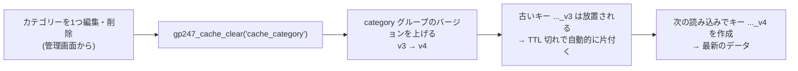

> 🌐 **言語:** [🇻🇳 Tiếng Việt](./cache-system_vi.md) · [🇬🇧 English](./cache-system.md) · 🇯🇵 日本語（現在）

# GP247 のキャッシュの扱い

## はじめに
このドキュメントでは、**GP247 のキャッシュの仕組み**を説明します。管理画面の「Config Cache Manager」（キャッシュ設定）画面の内容、GP247 が**何をキャッシュし、何をキャッシュしないか**、**正しいキャッシュ削除**の仕組み、そして開発者向けのキャッシュ関数の使い方を解説します。サイト運営者と開発者向けです。読み終えると、キャッシュを安全にオン／オフする方法、データが「古い」ときにキャッシュを削除する方法、そして商品の価格や在庫がキャッシュ**されない**理由がわかります。

## キャッシュとは、GP247 はどこで使うか

キャッシュとは、計算や問い合わせの結果の一時的なコピーです。**次回すばやく取得する**ために保存し、データベースに問い合わせ直さずに済むようにします。その代わり、キャッシュ内のデータは、期限切れになるか削除されるまで**古い（stale）**ままになる可能性があります。

GP247 では、**管理画面のあまり変わらないいくつかの一覧**に限って、キャッシュを選択的に使っています。

- **カテゴリーの見出し一覧**（カテゴリーの追加・編集時に親カテゴリーを選ぶドロップダウン）。
- **CMS ページの見出し一覧**（ページを選ぶドロップダウン）。
- **国の一覧**（多くのフォームで使用）。

> ⚠️ **GP247 はストアフロントのページをキャッシュせず、商品の価格と在庫もキャッシュしません。** これらはリアルタイムである必要があります。「キャッシュすべきでないもの」の項を参照してください。

## キャッシュドライバー — GP247 はキャッシュをどこに保存するか

GP247 は Laravel のキャッシュの仕組みを使います。キャッシュの保存先は、`.env` ファイルの変数 `CACHE_STORE` で決まります。既定値は次のとおりです。

```
CACHE_STORE=database
```

これは、キャッシュが**データベースのテーブル**に保存されることを意味します。Redis／Memcached のない共有ホスティングを含め、**どの環境でも**動きます。最も安全な選択肢であり、GP247 の既定値です。

| 環境 | おすすめの `CACHE_STORE` | 備考 |
| --- | --- | --- |
| 共有ホスティング | `database`（既定） | 追加でインストールするものはありません |
| VPS / Docker | `database` または `redis` | 使える場合は `redis` のほうが高速です |
| テストの実行 | `array` | キャッシュは1リクエストの間だけメモリ上にあります |

> **重要な技術メモ:** `database`（および `file`）ドライバーは、**パターン（ワイルドカード）やタグによるキャッシュ削除に対応していません**。これが、GP247 がキャッシュの削除に「version-bump」の仕組みを使う理由です。下の章を参照してください。

## 「Config Cache Manager」画面 — 各値の説明

**管理画面 →「システム設定」→「キャッシュ」**（Config Cache Manager）を開きます。この画面は設定に直接書き込むため、変更はすぐに反映されます。項目は次のとおりです。

| 項目 | 形式 | 意味 |
| --- | --- | --- |
| **「ステータス」**（Status、`cache_status`） | オン／オフ | **マスタースイッチです。** オフ → 下のすべてのキャッシュが停止します（常に DB から読みます）。 |
| **「キャッシュ時間（秒）」**（Cache time、`cache_time`） | 秒数 | キャッシュ項目の既定の有効期間（TTL）です。既定は **600**（10分）です。0以下や数値以外を入力すると、自動で **600** に戻ります。 |
| **「カテゴリーのキャッシュ」**（Cache category、`cache_category`） | オン／オフ | 管理画面の**カテゴリー**の見出し一覧のキャッシュをオンにします。 |
| **「ページのキャッシュ」**（Cache page、`cache_page`） | オン／オフ | 管理画面の **CMS ページ**の見出し一覧のキャッシュをオンにします。 |
| **「国のキャッシュ」**（Cache country、`cache_country`） | オン／オフ | **国**の一覧のキャッシュをオンにします。 |

**キャッシュが動く条件:** `cache_status`（マスター）**と**そのグループ専用のフラグの**両方**がオンである必要があります。例えば、カテゴリーがキャッシュされるのは、`cache_status` **と** `cache_category` の両方がオンのときだけです。

> 📌 2026-08-12 の更新から、効果のなくなった古い4つのフラグが**画面から削除**されました: `cache_product`、`cache_news`、`cache_category_cms`、`cache_content_cms`。古いバージョンでまだ表示されている場合、それらは「死んだ」フラグです（どこからも読まれません）。

## キャッシュするもの、キャッシュすべきでないもの

キャッシュを**本番環境の基準どおりに**正しく使うために、最も重要な部分です。

### ✅ キャッシュしても安全（GP247 がキャッシュしているもの）
**ほとんど変わらず**、**見出しだけを含む**（id ＋ 名前）一覧だけです。
- カテゴリーの見出し、CMS ページの見出し、国の一覧。

これらが安全な理由: めったに変わらず、**価格や在庫を含まない**ため、数分古くても業務上の誤りにはなりません。

### ❌ キャッシュすべきでないもの
- **商品の価格と在庫。** これは**リアルタイム**のデータです。価格はセールで変わり、在庫は**注文ごとに**減ります。キャッシュすると、変更直後に管理者や顧客が古い価格や誤った在庫を目にする可能性があります。このリスクは表示だけでなく**お金**に関わるため、GP247 は商品をキャッシュ**しません**。
- **ストアフロントのページ、カート、注文、在庫** — 時点やユーザーごとに変わるものすべて。

> 要約した原則: **あまり変わらず、お金や在庫に関係しないものだけをキャッシュする。** 迷ったらキャッシュしないでください。速さより正しさが大切です。

## キャッシュ削除の仕組み：「version-bump」

`database` ドライバーはパターンでキャッシュを削除できないため、GP247 は**バージョン番号（version）を付ける**工夫を使います。

- 各キャッシュグループは、個別に保存された「バージョン番号」を持ちます（例: `category` グループ）。
- キャッシュのキーは、名前に**バージョン番号を埋め込みます**: `{store}_cache_category_{locale}_v{version}`。
- **キャッシュの削除 ＝ バージョン番号を1つ増やす**ことです。古い番号を持つすべてのキーはすぐに「誰も参照しない」状態になり、TTL が切れると自動で片付けられます。

利点: **番号を1回増やすだけ**で、**すべてのストア × すべての言語**のキャッシュを同時に無効にできます。キーを1つずつ列挙する必要はありません。



キャッシュが**自動で**削除されるタイミング:
- **カテゴリー**を編集・削除 → `category` グループのバージョンを上げます。
- **CMS ページ**を編集・削除 → `page` グループのバージョンを上げます。

`country` グループはフラットなキーを使うため、直接削除されます。

> **「すべてのキャッシュを削除」（`cache_all`）は、GP247 のキャッシュグループ**（`category`、`page`、`country`）**だけを削除します。** 以前のようにシステム全体のキャッシュを削除することは**もうありません**（SEO／sitemap のキャッシュや、更新管理のキャッシュなどを誤って削除しないようにするためです）。

## 開発者向け：キャッシュ関数

GP247 には、すぐに使えるヘルパー関数が用意されています（`vendor/gp247/core/src/Library/Helpers/cache.php` で定義）。

1. **値をキャッシュに保存する**（設定 `cache_time` の TTL を使用。既定は 600 秒）:

   ```php
   gp247_cache_set('my_cache_key', $data);
   // または独自の TTL（秒）を指定:
   gp247_cache_set('my_cache_key', $data, 3600);
   ```

2. **キャッシュグループを削除（無効化）する:**

   ```php
   gp247_cache_clear('cache_category'); // category グループのバージョンを上げる
   gp247_cache_clear('cache_page');     // page グループのバージョンを上げる
   gp247_cache_clear('cache_country');  // country のキーを削除する
   gp247_cache_clear('cache_all');      // GP247 のすべてのグループを削除する (システム全体は flush しない)
   ```

3. **自分のデータにバージョン付きのキャッシュを作る**（ストア × 言語ごとにまとめて無効化したい場合）:

   ```php
   // グループの現在のバージョン番号を読む (既定は 1)
   $ver = gp247_cache_version('my_group');

   // キーにバージョンを埋め込む
   $key = 'my_group_' . $storeId . '_' . gp247_get_locale() . '_v' . $ver;

   // データが変わったら、バージョンを上げて古いキーをすべて無効にする
   gp247_cache_bump('my_group');
   ```

> GP247 にヘルパー関数を定義させずに「ロック」したい場合（自分で上書きするため）は、関数名を配列 `config('gp247_functions_except')` に追加してください。上のすべての関数がこの仕組みに対応しています。

## よくあるトラブルへの対処

- **編集後にデータが「古い」:** キャッシュ画面で該当するグループの削除をクリックするか、Laravel のキャッシュ削除コマンドを実行します。

  ```
  php artisan cache:clear
  ```

- **確認のためにキャッシュを完全にオフにしたい:** キャッシュ画面の**「ステータス」**（Status、`cache_status`）スイッチをオフにします。すべてが DB から直接読まれるようになります。
- **新しいコードをデプロイした後:** Laravel の設定・ルート・view のキャッシュを削除することをおすすめします。

  ```
  php artisan optimize:clear
  ```

## よくある質問（Q&A）

**Q1: キャッシュをオンにすると、サイトはかなり速くなりますか？**

→ ほとんどのサイトでは、キャッシュされる部分（管理画面のいくつかの見出し一覧）は小さいため、効果は控えめです。GP247 のキャッシュは**繰り返しの問い合わせを減らす**ためのもので、ストアフロントを高速化するためのものではありません。ストアフロントの速さは、他の要素（サーバー、画像、問い合わせの数）で決まります。

**Q2: 商品をキャッシュするオプションがないのはなぜですか？**

→ 商品は、リアルタイムである必要がある**価格と在庫**に結び付いているためです。キャッシュすると、変更後や注文のたびに、古い価格や誤った在庫が表示されやすくなります。これはお金に関わるリスクなので、GP247 は意図的に商品をキャッシュしません。

**Q3: カテゴリー名を変更したのに、ドロップダウンに古い名前が表示されます。なぜですか？**

→ 2026-08-12 のバージョンから、カテゴリーを編集・削除すると、キャッシュが**自動で**正しく削除されます。それでも古いままの場合（古いバージョン、または管理画面以外でデータを変更した場合）は、キャッシュ画面で削除をクリックするか、`php artisan cache:clear` を実行してください。

**Q4:「キャッシュ時間」はどのくらいに設定すればよいですか？**

→ 既定の **600秒（10分）**が妥当です。データがほとんど変わらない場合は長く、早く最新にしたい場合は短く設定します。0や負の数を入力すると、意図しない「永久キャッシュ」を防ぐため、自動で 600 に戻ります。

**Q5:「すべてのキャッシュを削除」で、重要なデータを誤って削除してしまうことはありますか？**

→ ありません。`cache_all` は GP247 のキャッシュグループ（`category`、`page`、`country`）だけを削除します。システム全体のキャッシュを flush **しない**ため、SEO／sitemap のキャッシュやその他のキャッシュには触れません。

**Q6: 私の共有ホスティングには Redis がありません。キャッシュは動きますか？**

→ はい。既定の `CACHE_STORE=database` はキャッシュを DB のテーブルに保存するため、どの共有ホスティングでも問題なく動きます。追加でインストールするものはありません。

**Q7: 開発者として、独自のデータをキャッシュしたい場合は何を使えばよいですか？**

→ 保存には `gp247_cache_set()` を使います。ストア／言語ごとにまとめて無効化する必要がある場合は、「開発者向け」の章の例のように `gp247_cache_version()` ＋ `gp247_cache_bump()` の組み合わせを使います。

**Q8: `cache_status` をオフにすると、何か悪い影響はありますか？**

→ エラーにはなりません。すべての一覧が DB から直接読まれる（問い合わせが少し増える）だけです。最新のデータを確認したいときは、安全にオフにできます。

---

<sub>📅 **最終更新:** 2026-10-22 · ✍️ **作成者 (Author):** GP247</sub>
