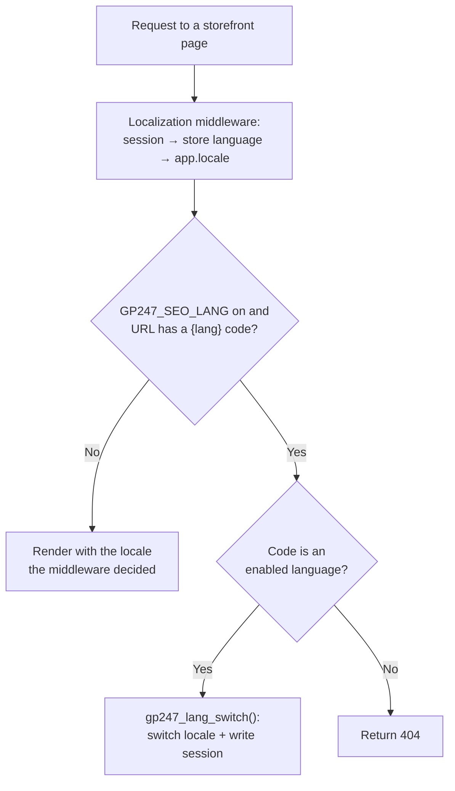

> 🌐 **Language:** [🇻🇳 Tiếng Việt](./language-system_vi.md) · 🇬🇧 English (current) · [🇯🇵 日本語](./language-system_ja.md)

# Using languages (multi-language / i18n) in the GP247 system

## Introduction

This document explains how the **GP247 multi-language (i18n) system** works: where translation
strings live, in what priority order the system picks the display language, and how you **add a new
language, edit individual strings, and update translations** when upgrading packages. It targets
GP247 developers and site administrators. After reading it, you will understand the mechanism and
know exactly where to go to change any text shown on the storefront or admin.

> ℹ️ **Quick terms:** *locale* = a short language code such as `vi`, `en`. *Translation string* = a
> "key → text" pair (e.g. `action.save` → `Save`). *Admin* = the site administration area.

---

## 1. How it works

GP247 uses a **database-first (DB-first)** model. There are **two distinct concepts**, matching two
database tables:

| Table | Role | Example content |
| --- | --- | --- |
| `admin_language` | The **list of installed languages** on the site (on/off, order, flag, RTL) | `vi` — Tiếng Việt · `en` — English |
| `languages` | The **actual string store** (key → text, per locale) | `action.save` / `en` → `Save` |

*(Real table names carry the `GP247_DB_PREFIX` prefix, `gp247_` by default — e.g. `gp247_languages`.)*

### 1.1. Where do translation strings live?

- **The primary source is the `languages` table in the DB.** This is where every string is read
  from for display.
- **On-disk language files are only a fallback.** Each package ships a `Lang/{en,vi}/` directory
  (e.g. `vendor/gp247/core/src/Lang/`), registered with Laravel under the `gp247::` namespace. They
  are used **only** when a matching key is **not** present in the DB.
- The initial data for the `languages` table comes from each package's **seeder** (not from the lang
  files); see section [4](#4-how-to-update).

Columns of the `languages` table:

```
code       // translation key, e.g. "action.save"        (unique together with location)
text       // translated value, e.g. "Save"
position   // group/section, e.g. "action", "store.admin"  (used for filtering in admin)
location   // locale, e.g. "en" or "vi"
```

Columns of the `admin_language` table: `name` (display name), `code` (locale code, unique), `icon`
(flag), `status` (1 = enabled), `rtl` (1 = right-to-left layout), `sort` (ordering).

### 1.2. How a string is rendered

In code/views, strings are fetched through the helper **`gp247_language_render()`**:

```php
gp247_language_render('action.save');            // -> "Save" (when the current locale is en)
gp247_language_render('welcome', ['name' => 'An']); // replaces :name in the string with "An"
```

This function runs in the following order:

1. Resolve the current locale via `gp247_get_locale()` (which is Laravel's `app()->getLocale()`).
2. Load all strings for that locale from the DB: `Languages::getListAll($locale)` → returns a
   `code => text` map. The result is **cached within a single request** (not re-queried repeatedly
   during the same page load).
3. **If the key exists in the DB** → return that `text` (and substitute any `:key` parameters).
4. **If it does not exist** → fall back to Laravel's `trans($string)` (reads on-disk lang files).

Related helper functions:

| Function | Purpose |
| --- | --- |
| `gp247_language_render($key, $replace, $locale)` | Get a string by key (most common) |
| `gp247_language_quickly($key, $default)` | Same as above, but allows a default value |
| `gp247_get_locale()` | Get the currently displayed locale |
| `gp247_lang_switch($code)` | Switch the current language (validates + writes to session; a code that is not an enabled language → 404) |
| `gp247_language_all()` | Get the list of enabled languages (from `admin_language`) |

> ⚠️ **Technical note:** do not call the language functions inside `__construct` or an
> early-running middleware — the locale may not be set yet at that point, leading to the wrong
> display language.

---

## 2. Priority order

There are **two layers of priority** to distinguish.

### 2.1. Display-locale priority (which language is active for this request)

In order **from highest to lowest**:

1. **The language code in the URL** (e.g. `/en/...`) — **only when `GP247_SEO_LANG` is on**, see
   [section 2.3](#23-language-code-in-the-url-gp247_seo_lang). When it is off (the default), URLs carry
   no language code and this level is skipped.
2. **`session('locale')`** — the language the user picked earlier (still in session).
3. **`gp247_store_info('language')`** — the store's configured default language.
4. **`config('app.locale')`** — Laravel's default locale (in `.env` / `config/app.php`).

Levels 2–4 are decided by the `Localization` middleware
(`vendor/gp247/core/src/Middleware/Localization.php`) at the start of every request: the chosen value
is **re-validated** against the list of enabled languages (`admin_language`, `status = 1`); if invalid
→ the **first enabled language** by `sort` is used. The middleware then calls `app()->setLocale(...)`
and writes it back to the `session`.

Level 1 runs **after** the middleware: the page's controller reads the `{lang}` code from the URL and
calls `gp247_lang_switch()`, which overrides the locale just decided and saves it to the session for
later requests.



While `GP247_SEO_LANG` is off, users change the language through the language switcher in the UI
(route `locale/{code}`), and the new value is saved to the session for later requests.

### 2.2. String-source priority (where the text comes from for a key)

For the **same key**:

1. **The DB row** (`languages`, matching `location` + `code`) — highest priority.
2. **The on-disk lang file** via `trans()` — used only when the DB has no such key.

→ Important consequence: **to change a string, edit it in the DB (via admin)**, because the DB
version always wins over the file. Editing lang files under `vendor/` is usually ineffective when the
DB already has the matching key.

### 2.3. Language code in the URL (`GP247_SEO_LANG`)

By default, storefront URLs carry **no** language code, and every language shares the same address.
Turn on `GP247_SEO_LANG` to give each language its own URL, so search engines can index each language
version:

```dotenv
GP247_SEO_LANG=1
```

| | `GP247_SEO_LANG=0` (default) | `GP247_SEO_LANG=1` |
| --- | --- | --- |
| URL shape | `domain.com/product.html` | `domain.com/en/product.html`, `domain.com/vi/product.html` |
| Locale taken from | session → store language → `app.locale` | **the code in the URL** first, then the order above |
| Wrong code in the URL (e.g. `/xx/...`) | — | Returns **404** (the code is not an enabled language) |
| Sitemap | One shared version | Adds per-language versions (`/sitemap-{type}-{code}-{page}.xml`) when **2 or more languages are enabled** |

What to know when it is on:

- **Generated links carry the language code automatically.** Every link built with
  `gp247_route_front()` gets the current locale's code. Custom plugins and templates must build links
  through this function, not by concatenating URL strings by hand.
- **Some routes carry no language code:** the home page `/` (`front.home`), the language-switch route
  `locale/{code}` (`front.locale`) and `front.banner.click`. Add other routes to this list with the
  `GP247_ROUTE_EXCLUDE_LANGUAGE` variable (route names, comma-separated), for example
  `GP247_ROUTE_EXCLUDE_LANGUAGE=front.contact`.
- **The language switcher** (`locale/{code}`) replaces the `/{old code}/` segment with `/{new code}/` in
  the current URL and redirects, so the user stays on the same page.
- **Plugins with storefront pages** (e.g. News, MultiVendor, ProductFlashSale) read this variable too:
  their routes gain `{lang?}/` when it is on.

> ⚠️ **Turning it on or off on a live site changes every storefront URL.** Old links already indexed by
> search engines, shared on social media or printed on material will no longer match. Decide this when
> you set the site up; if you must change it later, prepare 301 redirects from the old URLs and resubmit
> the sitemap.

> ℹ️ After editing `.env` on a site that ran `php artisan config:cache`, run `php artisan config:cache`
> again (or `config:clear`) for the new value to take effect.

---

## 3. How to add & edit

There are two different tasks: **adding/editing a language** (a row in `admin_language`) and
**adding/editing strings** (rows in `languages`). Both are done in the Admin area.

### 3.1. Add a new language

1. Log in to Admin and go to the **Language** screen (path `/{admin_prefix}/language`).
2. Click the add button and fill in:
   - **Name** — display name (e.g. `日本語`).
   - **Code** — locale code, lowercase, unique (e.g. `ja`).
   - **Icon** — flag/icon (optional).
   - **RTL** — enable for right-to-left languages (e.g. Arabic).
   - **Sort** — display order; **Status** — enable (1) to make the language active.
3. Save. If successful, the new language appears in the list and in the storefront language switcher.

> At this point the new language has **no strings yet** in `languages`. Go to step 3.3 to enter the
> translations.

### 3.2. Edit / enable-disable / delete a language

- Go back to the **Language** screen and choose **Edit** on the relevant row to change
  name/flag/order or toggle `Status`.
- **Safety constraints:**
  - The system **always keeps at least 1 enabled language** — you cannot disable them all.
  - You **cannot delete** the two base languages `vi` and `en` (protected by the `GP247_GUARD_LANGUAGE`
    constant).

### 3.3. Add / edit strings (translations)

1. Go to the **Language string manager** screen (path `/{admin_prefix}/language_manager`).
2. Pick the **language** to edit; you can filter by **position** (group) or type a **keyword** to
   search quickly. When viewing a language other than `en`, the screen shows the **English source**
   side by side for reference.
3. **Edit an existing string:** edit the text field directly and save. The system upserts the exact
   row by the `location` + `code` pair.
4. **Add a new string:** click add, enter the `code` (key) and `text`.
   - ⚠️ A newly added string is **always created for the `en` locale** first (the `code` is unique).
     Then open each other language and fill in the translation for that same key as in step 3.

> **Expected result:** after saving, reload the corresponding page on the storefront/admin — the new
> string shows immediately (the DB is read first). If you don't see the change, check that you are
> editing the **correct locale** that is currently being displayed (see
> [section 2.1](#21-display-locale-priority-which-language-is-active-for-this-request)).

---

## 4. How to update

"Updating languages" here means **refreshing the package's default strings** into the DB (e.g. after
`composer update` brings new or changed strings). There are two modes, differing in **whether they
overwrite your edits**:

| How to run | Mode | Effect |
| --- | --- | --- |
| `gp247:install` / `gp247:update` | **insertOrIgnore** (safe) | Only **adds** missing keys; **keeps** every string you edited |
| `gp247:language-update` | **upsert** (overwrite) | **Overwrites** text back to the package defaults for every key |

### Safe update (keeps your edits)

Run after updating packages with Composer:

```bash
php artisan gp247:update
```

The language step of this command adds the **missing** strings without touching the text you
customized in admin.

### Overwrite update (reset to package defaults)

```bash
php artisan gp247:language-update
```

- The command runs **core → front → shop** in turn; any package not installed is skipped.
- ⚠️ **Caution:** this command **overwrites** every string you edited in admin, resetting them to the
  package's latest defaults. If you customized a lot, **back up the `languages` table first**.

> ℹ️ **There is no `vendor:publish` for language files.** Translation strings are delivered via **DB
> seeders**, not through published lang files. So the standard way to update is the two artisan
> commands above.

---

## Q&A

**Q1: I edited a lang file in `vendor/gp247/core/src/Lang/vi/...` but the site text didn't change?**

→ That's by design. The DB version (`languages`) **always takes priority** over files. Edit the string
in Admin → *Language string manager* instead of editing the file.

**Q2: Where is the fastest place to change a string?**

→ Admin → **Language string manager** (`/language_manager`), filter by keyword, edit inline and save.
No deploy or command needed.

**Q3: What's the difference between `gp247:update` and `gp247:language-update`?**

→ `gp247:update` is **safe** — its language step only adds missing keys and keeps your edits.
`gp247:language-update` **overwrites** every string back to the package defaults. To keep
customizations → use `gp247:update`; to reset to the latest defaults → run `gp247:language-update`
(or `gp247:update --overwrite-lang`) — back up first.

**Q4: I added a new language but the site is still blank in that language?**

→ Adding a language only creates a row in `admin_language`; there are **no** translations yet. You must
enter the strings for that locale in the *Language string manager* (section 3.3), or provide your own
seeder.

**Q5: Why can't I delete Vietnamese / English?**

→ The two base languages are protected by the `GP247_GUARD_LANGUAGE` constant so the system always has
a standard language to fall back to. The constant locks **ids** `1` and `2` of the `admin_language`
table — `vi` and `en` on a default install. You can hide them elsewhere, but not remove them from the
list.

**Q6: Where do I change the site's default language?**

→ Adjust the store's default language (store configuration) and/or `APP_LOCALE` in `.env`. This is the
language used when the visitor has not picked one yet (empty session) and the URL carries no language
code. When `GP247_SEO_LANG` is on, the code in the URL always wins — see
[section 2.1](#21-display-locale-priority-which-language-is-active-for-this-request).

**Q7: Does GP247 detect language from the URL like `/vi/...`?**

→ Yes, when `GP247_SEO_LANG=1` is set in `.env` (off by default). Storefront URLs then carry the language
code, and that code has the highest priority; a code that is not an enabled language returns 404. Details
in [section 2.3](#23-language-code-in-the-url-gp247_seo_lang).

**Q8: What is `position` in the `languages` table for?**

→ It is a **grouping label** that helps filter/search strings in admin (e.g. `action`, `store.admin`).
It does not affect which string is displayed — that is decided by the `code` + `location` pair.

**Q9: Are translation strings cached long-term?**

→ No. There is only a **per-request cache** (each locale queries the DB once per page load). Edits in
admin take effect on the very next page load.

**Q10: The `shop` package has no on-disk lang directory — where does its text come from?**

→ All shop strings live in the DB (`languages`), loaded by `DataShopLanguageSeeder` at install/update
time. That is why `shop` needs no on-disk lang files.

---

<sub>📅 **Last updated:** 2026-11-10 · ✍️ **Author:** GP247</sub>
