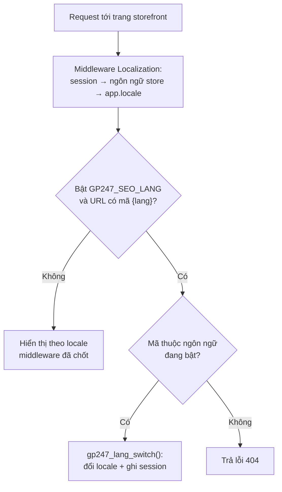

> 🌐 **Ngôn ngữ:** 🇻🇳 Tiếng Việt (hiện tại) · [🇬🇧 English](./language-system.md) · [🇯🇵 日本語](./language-system_ja.md)

# Cách sử dụng ngôn ngữ (đa ngôn ngữ / i18n) trong hệ thống GP247

## Giới thiệu

Tài liệu này giải thích **hệ thống đa ngôn ngữ (i18n) của GP247** hoạt động ra sao: chuỗi dịch được
lưu ở đâu, hệ thống chọn ngôn ngữ hiển thị theo thứ tự ưu tiên nào, và cách bạn **thêm ngôn ngữ mới,
chỉnh sửa từng câu chữ, cũng như cập nhật lại chuỗi dịch** khi nâng cấp gói. Tài liệu dành cho lập
trình viên và người quản trị site GP247. Đọc xong bạn hiểu rõ cơ chế và biết chính xác vào đâu để
đổi một dòng chữ hiển thị trên site/admin.

> ℹ️ **Thuật ngữ nhanh:** *locale* = mã ngôn ngữ ngắn như `vi`, `en`. *Chuỗi dịch (translation
> string)* = một cặp "mã → câu chữ" (ví dụ `action.save` → `Lưu`). *Admin* = khu vực quản trị site.

---

## 1. Cách thức hoạt động

GP247 dùng mô hình **ưu tiên cơ sở dữ liệu (DB-first)**. Có **hai khái niệm tách biệt**, tương ứng
hai bảng trong DB:

| Bảng | Vai trò | Ví dụ nội dung |
| --- | --- | --- |
| `admin_language` | **Danh sách các ngôn ngữ đã cài** trên site (bật/tắt, thứ tự, cờ, RTL) | `vi` — Tiếng Việt · `en` — English |
| `languages` | **Kho câu chữ thực tế** (mã → text, theo từng locale) | `action.save` / `vi` → `Lưu` |

*(Tên bảng thật có tiền tố theo `GP247_DB_PREFIX`, mặc định `gp247_` — ví dụ `gp247_languages`.)*

### 1.1. Chuỗi dịch nằm ở đâu?

- **Nguồn chính là bảng `languages` trong DB.** Đây là nơi mọi câu chữ được đọc ra để hiển thị.
- **File ngôn ngữ trên ổ đĩa chỉ là phương án dự phòng.** Mỗi gói có sẵn thư mục `Lang/{en,vi}/`
  (ví dụ `vendor/gp247/core/src/Lang/`), đăng ký qua Laravel dưới namespace `gp247::`. Chúng chỉ
  được dùng khi trong DB **không có** mã tương ứng.
- Dữ liệu ban đầu cho bảng `languages` đến từ **seeder** của từng gói (không phải từ file lang),
  xem mục [4](#4-cách-cập-nhật).

Cột của bảng `languages`:

```
code       // mã chuỗi dịch, ví dụ "action.save"        (unique cùng với location)
text       // câu chữ đã dịch, ví dụ "Lưu"
position   // nhóm/khu vực, ví dụ "action", "store.admin" (dùng để lọc trong admin)
location   // locale, ví dụ "en" hoặc "vi"
```

Cột của bảng `admin_language`: `name` (tên hiển thị), `code` (mã locale, duy nhất), `icon` (cờ),
`status` (1 = đang bật), `rtl` (1 = bố cục phải-sang-trái), `sort` (thứ tự sắp xếp).

### 1.2. Luồng hiển thị một câu chữ

Trong code/view, câu chữ được lấy ra qua hàm helper **`gp247_language_render()`**:

```php
gp247_language_render('action.save');            // -> "Lưu" (nếu locale hiện tại là vi)
gp247_language_render('welcome', ['name' => 'An']); // thay :name trong chuỗi bằng "An"
```

Hàm này chạy theo trình tự:

1. Xác định locale hiện tại bằng `gp247_get_locale()` (chính là `app()->getLocale()` của Laravel).
2. Lấy toàn bộ chuỗi của locale đó từ DB: `Languages::getListAll($locale)` → trả về map `code => text`.
   Kết quả được **cache trong phạm vi một request** (không truy vấn lại nhiều lần trong cùng lần tải trang).
3. **Nếu mã có trong DB** → trả về `text` đó (và thay các tham số `:key` nếu có).
4. **Nếu không có** → dự phòng bằng `trans($string)` của Laravel (đọc file lang trên ổ đĩa).

Các hàm helper liên quan:

| Hàm | Công dụng |
| --- | --- |
| `gp247_language_render($key, $replace, $locale)` | Lấy câu chữ theo mã (dùng phổ biến nhất) |
| `gp247_language_quickly($key, $default)` | Như trên nhưng cho phép đặt giá trị mặc định |
| `gp247_get_locale()` | Lấy locale đang hiển thị |
| `gp247_lang_switch($code)` | Đổi ngôn ngữ hiện tại (kiểm tra hợp lệ + ghi vào session; mã không thuộc ngôn ngữ đang bật → 404) |
| `gp247_language_all()` | Lấy danh sách ngôn ngữ đang bật (từ `admin_language`) |

> ⚠️ **Lưu ý kỹ thuật:** không gọi các hàm ngôn ngữ trong `__construct` hoặc middleware chạy sớm —
> lúc đó locale có thể chưa được thiết lập, dẫn tới hiển thị sai ngôn ngữ.

---

## 2. Thứ tự ưu tiên

Có **hai tầng ưu tiên** cần phân biệt.

### 2.1. Ưu tiên chọn locale hiển thị (ngôn ngữ nào đang bật cho request này)

Thứ tự **từ cao xuống thấp**:

1. **Mã ngôn ngữ trên URL** (ví dụ `/vi/...`) — **chỉ khi bật `GP247_SEO_LANG`**, xem
   [mục 2.3](#23-mã-ngôn-ngữ-trên-url-gp247_seo_lang). Khi tắt (mặc định), URL không mang mã ngôn ngữ
   và bậc này bị bỏ qua.
2. **`session('locale')`** — ngôn ngữ người dùng đã chọn trước đó (session còn giữ).
3. **`gp247_store_info('language')`** — ngôn ngữ mặc định cấu hình cho store.
4. **`config('app.locale')`** — locale mặc định của Laravel (trong `.env` / `config/app.php`).

Bậc 2–4 do middleware `Localization` (`vendor/gp247/core/src/Middleware/Localization.php`) quyết định
ở đầu mỗi request: giá trị chọn được sẽ **kiểm tra lại** với danh sách ngôn ngữ đang bật
(`admin_language`, `status = 1`); không hợp lệ → lấy **ngôn ngữ đang bật đầu tiên** theo thứ tự `sort`.
Sau đó middleware gọi `app()->setLocale(...)` và ghi lại vào `session`.

Bậc 1 chạy **sau** middleware: controller của trang đọc mã `{lang}` trên URL và gọi
`gp247_lang_switch()`, ghi đè locale vừa chốt và lưu vào session cho các request sau.



Khi chưa bật `GP247_SEO_LANG`, người dùng đổi ngôn ngữ qua nút chuyển ngôn ngữ trên giao diện
(route `locale/{code}`), giá trị mới được lưu vào session cho các request sau.

### 2.2. Ưu tiên nguồn câu chữ (lấy text ở đâu cho một mã)

Với **cùng một mã** chuỗi dịch:

1. **Bản ghi trong DB** (`languages`, khớp `location` + `code`) — ưu tiên cao nhất.
2. **File lang trên ổ đĩa** qua `trans()` — chỉ dùng khi DB không có mã đó.

→ Hệ quả quan trọng: **muốn đổi một câu chữ, hãy sửa trong DB (qua admin)**, vì bản DB luôn thắng
bản file. Sửa file lang trong `vendor/` thường vô tác dụng nếu DB đã có mã tương ứng.

### 2.3. Mã ngôn ngữ trên URL (`GP247_SEO_LANG`)

Mặc định URL storefront **không** mang mã ngôn ngữ, và mọi ngôn ngữ dùng chung một địa chỉ. Bật biến
`GP247_SEO_LANG` để mỗi ngôn ngữ có URL riêng, giúp công cụ tìm kiếm lập chỉ mục từng bản ngôn ngữ:

```dotenv
GP247_SEO_LANG=1
```

| | `GP247_SEO_LANG=0` (mặc định) | `GP247_SEO_LANG=1` |
| --- | --- | --- |
| Dạng URL | `domain.com/san-pham.html` | `domain.com/vi/san-pham.html`, `domain.com/en/san-pham.html` |
| Locale lấy từ | session → ngôn ngữ store → `app.locale` | **mã trên URL** trước, rồi mới tới thứ tự trên |
| Mã sai trên URL (vd `/xx/...`) | — | Trả **404** (mã không thuộc ngôn ngữ đang bật) |
| Sitemap | Một bản chung | Thêm bản theo từng ngôn ngữ (`/sitemap-{loại}-{mã}-{trang}.xml`) khi có **từ 2 ngôn ngữ đang bật** |

Những điểm cần biết khi bật:

- **Link được sinh tự động có mã ngôn ngữ.** Mọi link tạo bằng `gp247_route_front()` tự gắn mã của
  locale hiện tại. Plugin và template tự viết phải sinh link qua hàm này, không ghép chuỗi URL bằng tay.
- **Một số route không mang mã ngôn ngữ:** trang chủ `/` (`front.home`), route đổi ngôn ngữ
  `locale/{code}` (`front.locale`) và `front.banner.click`. Thêm route khác vào danh sách này bằng biến
  `GP247_ROUTE_EXCLUDE_LANGUAGE` (tên route, cách nhau bằng dấu phẩy), ví dụ
  `GP247_ROUTE_EXCLUDE_LANGUAGE=front.contact`.
- **Nút chuyển ngôn ngữ** (`locale/{code}`) đổi đoạn `/{mã cũ}/` thành `/{mã mới}/` trong URL đang
  xem rồi chuyển hướng, nên người dùng ở lại đúng trang.
- **Plugin có trang storefront** (ví dụ News, MultiVendor, ProductFlashSale) cũng đọc biến này: route
  của chúng có thêm `{lang?}/` khi bật.

> ⚠️ **Bật hoặc tắt trên site đang chạy làm đổi toàn bộ URL storefront.** Link cũ đã được công cụ tìm
> kiếm lập chỉ mục, chia sẻ trên mạng xã hội hay in trên ấn phẩm sẽ không còn khớp. Nên quyết định từ
> lúc dựng site; nếu phải đổi giữa chừng, chuẩn bị chuyển hướng 301 từ URL cũ và gửi lại sitemap.

> ℹ️ Sau khi sửa `.env` trên site đã chạy `php artisan config:cache`, chạy lại `php artisan config:cache`
> (hoặc `config:clear`) để giá trị mới có hiệu lực.

---

## 3. Cách thêm & chỉnh sửa

Có hai việc khác nhau: **thêm/sửa một ngôn ngữ** (dòng trong `admin_language`) và **thêm/sửa câu
chữ** (dòng trong `languages`). Cả hai làm trong khu vực Admin.

### 3.1. Thêm một ngôn ngữ mới

1. Đăng nhập Admin, vào màn hình **Ngôn ngữ** (đường dẫn `/{admin_prefix}/language`).
2. Bấm nút thêm mới, điền:
   - **Name** — tên hiển thị (ví dụ `日本語`).
   - **Code** — mã locale, viết thường, duy nhất (ví dụ `ja`).
   - **Icon** — cờ/biểu tượng (tùy chọn).
   - **RTL** — bật nếu ngôn ngữ đọc từ phải sang trái (ví dụ tiếng Ả Rập).
   - **Sort** — thứ tự sắp xếp; **Status** — bật (1) để ngôn ngữ có hiệu lực.
3. Lưu lại. Nếu thành công, ngôn ngữ mới xuất hiện trong danh sách và ở nút chuyển ngôn ngữ ngoài site.

> Lúc này ngôn ngữ mới **chưa có câu chữ nào** trong `languages`. Sang bước 3.3 để nhập bản dịch.

### 3.2. Sửa / bật-tắt / xóa một ngôn ngữ

- Vào lại màn hình **Ngôn ngữ**, chọn **Edit** ở dòng tương ứng để đổi tên/cờ/thứ tự hoặc bật-tắt `Status`.
- **Ràng buộc an toàn:**
  - Hệ thống **luôn giữ tối thiểu 1 ngôn ngữ đang bật** — không thể tắt hết.
  - **Không thể xóa** hai ngôn ngữ gốc `vi` và `en` (được bảo vệ bởi hằng `GP247_GUARD_LANGUAGE`).

### 3.3. Thêm / sửa câu chữ (bản dịch)

1. Vào màn hình **Quản lý chuỗi ngôn ngữ** (đường dẫn `/{admin_prefix}/language_manager`).
2. Chọn **ngôn ngữ** cần sửa, có thể lọc theo **position** (nhóm) hoặc gõ **từ khóa** để tìm nhanh.
   Khi xem ngôn ngữ khác `en`, màn hình hiển thị **kèm bản gốc tiếng Anh** bên cạnh để đối chiếu.
3. **Sửa câu chữ có sẵn:** sửa trực tiếp ô text rồi lưu. Hệ thống ghi đè (upsert) đúng dòng theo
   cặp `location` + `code`.
4. **Thêm câu chữ mới:** bấm thêm mới, nhập `code` (mã) và `text`.
   - ⚠️ Câu chữ thêm mới **luôn được tạo cho locale `en`** trước (mã `code` là duy nhất). Sau đó bạn
     mở từng ngôn ngữ khác và điền bản dịch cho cùng mã đó ở bước 3.

> **Kết quả mong đợi:** sau khi lưu, tải lại trang tương ứng trên site/admin — câu chữ mới sẽ hiển
> thị ngay (vì DB được đọc ưu tiên). Nếu chưa thấy đổi, kiểm tra bạn có đang sửa **đúng locale** đang
> hiển thị không (xem [mục 2.1](#21-ưu-tiên-chọn-locale-hiển-thị-ngôn-ngữ-nào-đang-bật-cho-request-này)).

---

## 4. Cách cập nhật

"Cập nhật ngôn ngữ" ở đây nghĩa là **làm mới các chuỗi dịch mặc định của gói** vào DB (ví dụ sau khi
`composer update` mang về câu chữ mới hoặc chuỗi đã chỉnh). Có hai chế độ, khác nhau ở việc **có ghi
đè chỉnh sửa của bạn hay không**:

| Cách chạy | Chế độ | Ảnh hưởng |
| --- | --- | --- |
| `gp247:install` / `gp247:update` | **insertOrIgnore** (an toàn) | Chỉ **thêm** mã còn thiếu; **giữ nguyên** mọi câu chữ bạn đã sửa |
| `gp247:language-update` | **upsert** (ghi đè) | **Ghi đè** text về đúng bản mặc định của gói cho mọi mã |

### Cập nhật an toàn (giữ chỉnh sửa)

Chạy sau khi cập nhật gói bằng Composer:

```bash
php artisan gp247:update
```

Bước xử lý ngôn ngữ của lệnh này bổ sung các chuỗi dịch **còn thiếu** mà không đụng tới câu chữ bạn đã
tùy biến trong admin.

### Cập nhật ghi đè (lấy lại bản chuẩn của gói)

```bash
php artisan gp247:language-update
```

- Lệnh tự chạy lần lượt **core → front → shop**; gói nào chưa cài thì bỏ qua.
- ⚠️ **Cẩn trọng:** lệnh này **ghi đè** mọi câu chữ bạn từng chỉnh trong admin, đưa về đúng bản mặc
  định mới nhất của gói. Nếu đã tùy biến nhiều, hãy **sao lưu bảng `languages` trước** khi chạy.

> ℹ️ **Không có `vendor:publish` cho file ngôn ngữ.** Chuỗi dịch được phân phối qua **seeder ghi vào
> DB**, không phải qua file lang publish ra ngoài. Vì vậy cách cập nhật chuẩn là hai lệnh artisan ở trên.

---

## Hỏi & Đáp (Q&A)

**Câu 1: Tôi sửa file lang trong `vendor/gp247/core/src/Lang/vi/...` mà site không đổi chữ?**

→ Đúng như thiết kế. Bản trong DB (`languages`) **luôn được ưu tiên** hơn file. Hãy sửa câu chữ trong
Admin → *Quản lý chuỗi ngôn ngữ* thay vì sửa file.

**Câu 2: Đổi một câu chữ thì làm ở đâu nhanh nhất?**

→ Admin → **Quản lý chuỗi ngôn ngữ** (`/language_manager`), lọc theo từ khóa, sửa trực tiếp rồi lưu.
Không cần deploy hay chạy lệnh.

**Câu 3: Khác nhau giữa `gp247:update` và `gp247:language-update`?**

→ `gp247:update` **an toàn** — bước ngôn ngữ chỉ thêm mã còn thiếu, giữ nguyên chỉnh sửa của bạn.
`gp247:language-update` **ghi đè** mọi chuỗi về bản mặc định của gói. Muốn giữ tùy biến → dùng
`gp247:update`; muốn lấy lại bản chuẩn mới nhất → chạy `gp247:language-update` (hoặc
`gp247:update --overwrite-lang`) — nhớ sao lưu trước.

**Câu 4: Thêm ngôn ngữ mới nhưng site vẫn trống chữ ở ngôn ngữ đó?**

→ Thêm ngôn ngữ chỉ tạo dòng trong `admin_language`, **chưa có** bản dịch. Bạn phải nhập câu chữ cho
locale đó trong *Quản lý chuỗi ngôn ngữ* (mục 3.3), hoặc cung cấp seeder riêng.

**Câu 5: Vì sao không xóa được tiếng Việt / tiếng Anh?**

→ Hai ngôn ngữ gốc được bảo vệ bởi hằng `GP247_GUARD_LANGUAGE` để hệ thống luôn có ngôn ngữ chuẩn để
dự phòng. Hằng này khoá theo **id** `1` và `2` của bảng `admin_language` — trên bản cài mặc định là
`vi` và `en`. Bạn có thể tắt hiển thị chúng ở chỗ khác, nhưng không xóa khỏi danh sách.

**Câu 6: Đổi ngôn ngữ mặc định của site ở đâu?**

→ Chỉnh ngôn ngữ mặc định của store (cấu hình store) và/hoặc `APP_LOCALE` trong `.env`. Đây là ngôn ngữ
dùng khi khách chưa chọn ngôn ngữ nào (session trống) và URL không mang mã ngôn ngữ. Khi bật
`GP247_SEO_LANG`, mã trên URL luôn thắng — xem [mục 2.1](#21-ưu-tiên-chọn-locale-hiển-thị-ngôn-ngữ-nào-đang-bật-cho-request-này).

**Câu 7: GP247 có nhận ngôn ngữ theo URL kiểu `/vi/...` không?**

→ Có, khi bật `GP247_SEO_LANG=1` trong `.env` (mặc định tắt). Lúc đó URL storefront mang mã ngôn ngữ và
mã này được ưu tiên cao nhất; mã không thuộc ngôn ngữ đang bật trả 404. Chi tiết ở
[mục 2.3](#23-mã-ngôn-ngữ-trên-url-gp247_seo_lang).

**Câu 8: `position` trong bảng `languages` để làm gì?**

→ Nó là **nhãn nhóm** giúp lọc/tìm câu chữ trong admin (ví dụ `action`, `store.admin`). Nó không ảnh
hưởng tới việc câu chữ nào được hiển thị — việc đó do cặp `code` + `location` quyết định.

**Câu 9: Chuỗi dịch có được cache lâu dài không?**

→ Không. Chỉ có **cache trong phạm vi một request** (mỗi locale truy vấn DB một lần cho mỗi lần tải
trang). Sửa trong admin có hiệu lực ngay ở lần tải trang kế tiếp.

**Câu 10: Gói `shop` không có thư mục lang trên ổ đĩa, vậy chữ ở đâu ra?**

→ Toàn bộ chuỗi của shop nằm trong DB (`languages`), do `DataShopLanguageSeeder` nạp vào khi cài/cập
nhật. Đây là lý do `shop` không cần file lang trên ổ đĩa.

---

<sub>📅 **Cập nhật lần cuối:** 2026-11-10 · ✍️ **Tác giả (Author):** GP247</sub>
