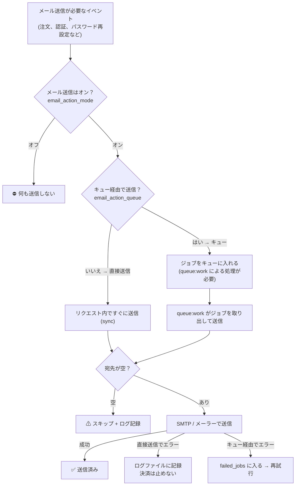
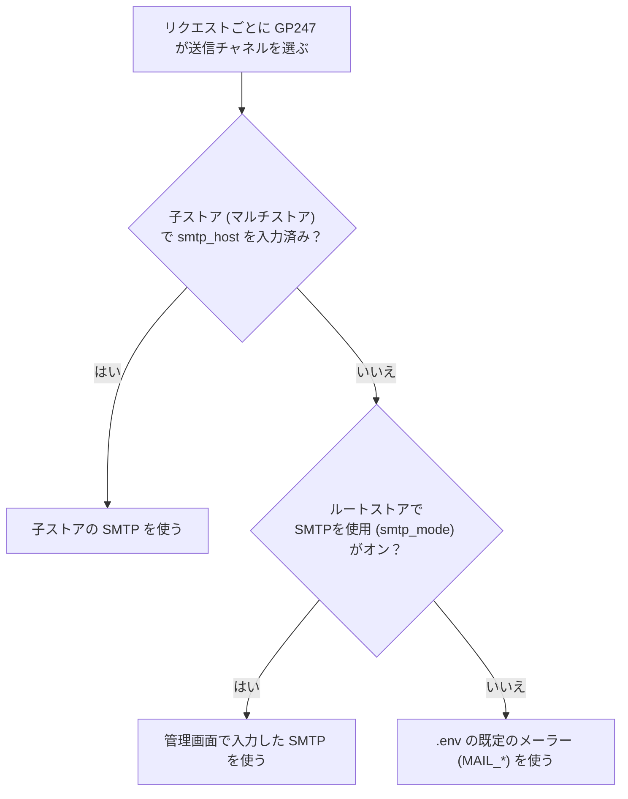

> 🌐 **言語:** [🇻🇳 Tiếng Việt](./mail-system_vi.md) · [🇬🇧 English](./mail-system.md) · 🇯🇵 日本語（現在）

# GP247 のメール送信システム

## はじめに
このドキュメントでは、**GP247 がどのようにメールを送信するか**（注文確認メール、アカウント認証、パスワード再設定など）を、**フロー図**でイメージしやすく説明します。サイト運営者と導入担当者向けで、技術に詳しくない方も対象です。読み終えると、メールがどの段階を通るか、オン／オフのスイッチがどこにあるか、GP247 がいつあなたの SMTP を使い、いつ既定のメーラーを使うか、そして正しい設定方法がわかります。**キュー＋cron** でメールを送る方法は、別のドキュメント [スケジュールとキュー（Schedule & Queue）](./schedule-and-queue_ja.md) で説明しています。

## 1枚の図で見る全体像

これは GP247 でのメール1通の道のりの全体です。この図を見れば全体像がつかめます。

**図の読み方:** メールが先に進むのは、**メール送信がオン**のときだけです。その後の道は2つあります。**直接送信**（顧客がボタンを押したその場で送る）か、**キュー経由**（後で送るので顧客を待たせない）です。送信前に、GP247 は宛先が空かどうかを確認します。送信に失敗した場合、「直接送信」ではログに記録しますが、注文は壊しません。「キュー」ではエラーの一覧に入れて再試行します。

## 3つの主なスイッチ

すべて **管理画面 →「サイト設定」→「メール & SMTP」** で設定し、ストアごとに保存されます。

| スイッチ | 意味 | 目安 |
| --- | --- | --- |
| **email_action_mode** | メール送信機能**全体**のオン／オフ | メールを送るには**オン**にする必要があります |
| **email_action_queue** | **キュー経由**（後で送る）か、**直接送信**（すぐに送る）か | 小規模サイトは**直接**、メールが多いサイトは**キュー**（スケジュールとキューのドキュメントを参照） |
| **smtp_mode**（「SMTPを使用」） | **管理画面で入力した SMTP** を使うか、**`.env` の既定のメーラー**を使うか | 独自の SMTP サーバー（Gmail、SendGrid など）を入力したい場合はオンにします |

## GP247 はどの「送信チャネル」を選ぶか？

GP247 は送信のたびに、管理画面で入力した SMTP を使うか、`.env` ファイルの既定のメーラーを使うかを自動で決めます。図にすると次のとおりです。

> ⚠️ **ストアが1つのサイトでよくある落とし穴:** 「SMTPを使用」を**オンにしておらず**、`.env` に `MAIL_MAILER=smtp` も設定していない場合、GP247 は Laravel の既定のメーラー `log` を使います。つまり、メールは**ログファイルに書き込まれるだけで、実際には送信されません**。実際に送信するには、「SMTPを使用」をオンにしてサーバーを入力するか、`.env` で `MAIL_*` を設定してください。

## SMTP の設定（「SMTPを使用」をオンにしたとき）

「メール & SMTP」画面で次の欄を入力します。

| 入力欄 | 意味 |
| --- | --- |
| `smtp_host` | SMTP サーバー（例: `smtp.gmail.com`） |
| `smtp_user` / `smtp_password` | SMTP のログインアカウント（パスワードは ●●● で隠され、**at-rest 暗号化**されます。下の「暗号化して保存される機密情報」を参照） |
| `smtp_security` | セキュリティの種類: `ssl` / `tls` / 空欄 |
| `smtp_port` | ポート。**空欄**にすると、GP247 が下の表に従って自動で選びます |
| `smtp_name` / `smtp_from` | 送信者の名前とアドレス（空欄 → ストアの名前とメールアドレスを使用） |

**セキュリティ → ポートの対応表**（GP247 が標準に従って自動で適用します）:

| `smtp_security` | 接続の種類 | 既定のポート |
| --- | --- | --- |
| `ssl` | 最初から暗号化（implicit TLS） | 465 |
| `tls` | 暗号化に切り替え（STARTTLS） | 587 |
| 空欄 | 暗号化なし／自動ネゴシエーション | 587 |

## 暗号化して保存される機密情報

SMTP パスワード、そして OAuth クライアントシークレット、captcha のシークレット、プラグインのライセンスなどの
その他の機密情報は、専用鍵 `GP247_ENCRYPTION_KEY` を使って**データベース内で暗号化**されます
（`enc:v2:…` の形式で保存され、平文で保存されることはありません）。**この鍵をバックアップしてください。** そして
**鍵の変更は必ず `php artisan gp247:encryption-key-rotate` コマンドで行ってください**（手で書き換えないでください）。
安全に鍵を変更する手順を含む詳しい説明は、[機密データの暗号化](./data-encryption_ja.md) を参照してください。

## 環境に応じた送信方法の選び方

- **シンプルな共有ホスティング（cron なし）:** **直接送信**（キューをオフ）にします。追加でインストールするものはありません。
- **メールが多い／顧客を待たせたくない:** **キュー**をオンにします。その場合は「キューを処理する」仕組みが必要です。詳しくは [スケジュールとキュー](./schedule-and-queue_ja.md) を参照してください。

## 設定画面のお知らせパネル

「メール & SMTP」画面の上部に、GP247 は設定に応じて自動で変わる**お知らせパネル**を表示します。状態は4つあります。

| 状態 | 意味 | 必要な作業 |
| --- | --- | --- |
| **direct** | 直接送信中 | cron／ワーカーは不要です |
| **queue_sync** | キューはオンだが `QUEUE_CONNECTION=sync` | すぐに送信されます。バックグラウンドで処理したい場合は `database` に変更し、cron を追加します |
| **queue_auto** | キュー＋GP247 がスケジュールを自動管理 | **cron を1行**追加するだけです（パネルにコピー用の行が表示されます） |
| **queue_manual** | キュー＋自分でワーカーを実行 | supervisor で `queue:work` を実行します |

## メールの送信に失敗したら？

- **直接送信:** エラーは**ログファイルに記録**されます（`storage/logs/gp247.log`）が、顧客の注文・登録は**壊れません**。
- **キュー経由:** エラーになったジョブは、自動で再試行するために **`failed_jobs` テーブルに入ります**。状況を確認でき、「見かけだけの成功」にはなりません。

## よくある質問（Q&A）

**Q1: メール送信をオンにしたのに、顧客にメールが届きません。なぜですか？**

→ 3点を確認してください。(1) **email_action_mode** をオンにしたか。(2)「SMTPを使用」を**オンにしていない**場合、`.env` に `MAIL_MAILER=smtp` があるか（ないとメールはログに書かれるだけです）。(3) **キュー**をオンにしている場合、キューを処理する仕組みがあるか（スケジュールとキューのドキュメントを参照）。あわせて `storage/logs/gp247.log` も確認してください。

**Q2: `ssl` と `tls` のどちらを選ぶべきですか？**

→ プロバイダーによります。一般的には、Gmail／SMTP は `ssl` でポート 465、または `tls` でポート 587 を使います。ポートは空欄のままで大丈夫です。GP247 がセキュリティの表に従って正しく入力します。

**Q3: メールがログに書かれるだけで、送信されないのはなぜですか？**

→ Laravel の既定のメーラーが `log` だからです。「SMTPを使用」をオンにしてサーバーを入力するか、`.env` に `MAIL_MAILER=smtp` と `MAIL_*` を設定してください。

**Q4: 「キュー」（queue）はオンにすべきですか？**

→ メールが少ないサイトでは不要です（直接送信のほうがシンプルです）。メールが多いサイトや SMTP が遅い場合は、顧客を待たせないためにオンにすることをおすすめします。ただし、cron／ワーカーの設定が必要です（スケジュールとキューのドキュメントを参照）。

**Q5: SMTP パスワードは管理画面で見えてしまいますか？**

→ 平文では表示されません。パスワード欄は ●●● で隠され、データベース内では **at-rest 暗号化**されています（`enc:v2:…`）。バックアップや鍵の変更については [機密データの暗号化](./data-encryption_ja.md) を参照してください。

**Q6: 複数ストア（マルチストア）のサイトでは、どこから送信されますか？**

→ 各子ストアが**独自の SMTP を入力**します。`smtp_host` を入力していないストアは、自動で `.env` の既定のメーラーを使います。

**Q7: 顧客向けと管理者向けのメールは何が違いますか？**

→ 注文の概要という内容は同じで、宛先が違います。管理者はストアのメールアドレスで受け取り、顧客は自分のメールアドレスで受け取ります（`replyTo` はストアのメールアドレスになります）。対応するフラグ（`order_success_to_admin` / `order_success_to_customer`）がオンのときだけ送信されます。

**Q8: 以前は `ssl` に設定していました。更新すると影響がありますか？**

→ 影響する可能性があります。新しいバージョンでは、`ssl` に対して実際に暗号化接続 `smtps` を使います（以前は正しく暗号化されていなかった可能性があります）。更新後は**テストメールを1通送って**、SMTP に引き続き接続できることを確認してください。

**Q9: メールの送信に失敗したことは、どうすればわかりますか？**

→ `storage/logs/gp247.log` を確認してください（送信エラーはすべてここに記録されます）。キューを使っている場合は、`failed_jobs` テーブルも確認してください。

**Q10: SMTP のパスワードやホスト名を変更した後、何かを再起動する必要がありますか？**

→ いいえ。設定はリクエストごとに読み込まれるため、すぐに反映されます。ただしキューを使っている場合、**すでにキューに入っている**ジョブは、処理される時点の情報で実行されます。

---

📅 **最終更新:** 2026-10-22 · ✍️ **作成者 (Author):** GP247
