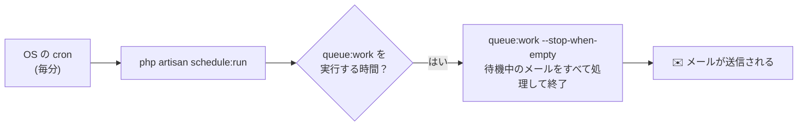

> 🌐 **言語:** [🇻🇳 Tiếng Việt](./schedule-and-queue_vi.md) · [🇬🇧 English](./schedule-and-queue.md) · 🇯🇵 日本語（現在）

# スケジュールとキュー（schedule:run と queue:work）

## はじめに
このドキュメントでは、GP247／Laravel で**混同されやすい2つのコマンド**、`queue:work` と `schedule:run` について説明します。両者の違い、関係、そして**環境ごとの設定方法**（cron あり／なしの共有ホスティング、VPS）を解説します。サイト運営者と導入担当者向けです。読み終えると、キュー経由のメール（およびその他のバックグラウンド処理）を実際に動かすために、**どの cron** を設定すればよいかがわかります。メール送信の流れについては、[メール送信システム](./mail-system_ja.md) のドキュメントを参照してください。

## 2つの概念、2つの別々の仕組み

### `queue:work` — バックグラウンドの作業を処理する担当（キュー）
後で行う作業（例えばメールを1通送る）があると、GP247 は**「ジョブ」をキューに入れ**、すぐにページを返します。`queue:work` は、キューを見張り、ジョブがあれば取り出して処理する**ワーカープロセス**です。既定では**継続的に**動きます。**`queue:work` を誰も実行していない → ジョブはずっと残ったまま**になります。

> たとえるなら: `queue:work` ＝ **待機している郵便配達員**。手紙があれば届けに行きます。

### `schedule:run` — スケジュールを動かす時計
`schedule:run` は、**呼ばれたその時点で**、期限が来た定時タスクがあるかを確認します。あれば実行し、そして**終了**します。これは、**OS の cron から毎分呼ばれる**ことを前提に、**ちょうど1行**で設定するように作られています。

> たとえるなら: `schedule:run` ＝ **毎分鳴る時計**。「そろそろ何かをする時間かな？」と確認します。

### 2つのコマンドの関係
両者は**独立しています**。`schedule:run` だけではキューを**処理しません**。ただし、その中で **`queue:work` をスケジュールに登録**した場合は別です。GP247 はまさにこの方法を使っています。



## GP247 がスケジュールを自動管理 — 必要な cron は1つだけ

GP247 は、`queue:work` タスクをスケジューラーに**自動で登録**します。そのため、共有ホスティングでは**標準の cron を1行だけ設定**すれば、キュー経由のメールが送信されます。常に動き続けるバックグラウンドプロセスは不要です。

- **自動登録されるのは**、キューが実際に使われていて（`QUEUE_CONNECTION` が `sync` 以外）**かつ**フラグがオンのときだけです。
- **オフにするフラグ（opt-out）:** supervisor で**独自のワーカーを実行**している場合（主に VPS）は、重複して動かないように `.env` で `GP247_SCHEDULE_QUEUE_WORK=false` を設定します。

## 環境ごとの設定

### A. cron が使えない共有ホスティング（最も簡単）
1. **管理画面 →「サイト設定」→「メール & SMTP」**を開き、「メール送信キューを使用」（email_action_queue）を**オフ**にします。
2. これで完了です。メールは直接送信され、**cron もワーカーも不要**です。

> この環境ではキューを使わないでください。キューを処理する手段がないため、メールが滞留します。

### B. cron が使える共有ホスティング（中規模サイトにおすすめ）
1. **管理画面 →「サイト設定」→「メール & SMTP」**を開き、「メール送信キューを使用」を**オン**にします。
2. `.env` ファイルで次のように設定します（`sync` は使いません）。

   ```
   QUEUE_CONNECTION=database
   ```

3. ホスティングの cron 管理画面（cPanel → **Cron Jobs**）を開き、**毎分**実行する行を**1つ**追加します（`/path-to-project` は正しいパスに置き換えてください）。

   ```
   * * * * * cd /path-to-project && php artisan schedule:run >> /dev/null 2>&1
   ```

   成功すると、最大1分以内にキュー内のメールが送信されます。内部の `queue:work` は GP247 が自動で処理します。

> 「メール & SMTP」画面のパネル（状態 **queue_auto**）に、コピー用のこの cron の行が表示されます。

### C. VPS / Docker（最適）
1. 「メール送信キューを使用」をオンにし、`QUEUE_CONNECTION=database`（または `redis`）を設定します。
2. supervisor で**常駐ワーカー**を実行します（`queue:work` をバックグラウンドで動かし続けます）。

   ```
   php artisan queue:work --tries=3
   ```

3. 重複して動かないように、`.env` で GP247 の自動登録をオフにします。

   ```
   GP247_SCHEDULE_QUEUE_WORK=false
   ```

> GP247 の Docker には、この目的のための `queue` と `scheduler` のサービスが最初から用意されています。

## 「重複実行」でメールが2回送られますか？

**いいえ。** 誤って常駐ワーカー**と**自動登録されたスケジュールの**両方**を動かしてしまっても、メールが**2回送られることはありません**。キューは**各ジョブを1つのワーカーだけにロック**するためです（アトミックな仕組み）。複数のワーカーはジョブを**分担**するだけです。唯一の影響は、**毎分、軽いプロセスが1つ余分に動く**ことです。フラグ `GP247_SCHEDULE_QUEUE_WORK=false` でその余分な部分をオフにできます。

## よくある質問（Q&A）

**Q1: `schedule:run` と `queue:work` は何が違いますか？**

→ `queue:work` は**バックグラウンドの作業を処理する**ワーカーです（メール送信）。`schedule:run` は**定時の時計**で、毎分、期限が来たタスクがあるかを確認します。両者は独立しています。`schedule:run` がキューに関わるのは、GP247 がその中に `queue:work` をスケジュール登録しているからです。

**Q2: `schedule:run` の cron を設定したのに、メールが送信されません。なぜですか？**

→ 次を確認してください。(1) `QUEUE_CONNECTION` が `sync` **以外**か（例: `database`）。(2) フラグ `GP247_SCHEDULE_QUEUE_WORK` が `false` に設定されていないか。(3) cron の行のパスが正しいプロジェクトのフォルダーを指しているか。(4) 管理画面で「メール送信キューを使用」をオンにしているか。

**Q3: 私の共有ホスティングではバックグラウンドプロセスを実行できません。問題ありますか？**

→ 問題ありません。**方法 B**（`schedule:run` の cron を1つ）を使えば、バックグラウンドプロセスは不要です。または**方法 A**（キューを使わない直接送信）を使ってください。

**Q4: `schedule:run` だけで十分で、`queue:work` のコマンドを自分で書く必要はないのですか？**

→ そのとおりです。GP247 が `queue:work` をスケジュールに自動で登録しているため、標準の `schedule:run` の cron を1つ設定するだけで済みます。

**Q5: VPS ですでに supervisor で `queue:work` を実行しています。何かをオフにする必要がありますか？**

→ GP247 が `queue:work` をもう1つスケジュール登録しないように（プロセスの重複を避けるため）、`GP247_SCHEDULE_QUEUE_WORK=false` を設定することをおすすめします。オフにしなくても**メールが重複して送られることはなく**、リソースが少し無駄になるだけです。

**Q6: `--stop-when-empty` はどういう意味ですか？**

→ `queue:work` が待機中の作業を**すべて処理**してから**自動で終了する**（動き続けない）という意味です。共有ホスティングの cron に最適です。毎分1回だけ処理して、終了します。

**Q7: cron が毎分実行される場合、メールは最大1分遅れますか？**

→ 最大で約1分遅れる可能性があります。ほとんどのサイトでは許容範囲です。より即時性が必要な場合は、**方法 C**（VPS の常駐ワーカー）を使ってください。

**Q8: メールが非常に多いサイトでも、毎分の cron で間に合いますか？**

→ メールの量が非常に多い場合、1分に1回の処理では追いつかないことがあります。その場合は、cron の代わりに**常駐ワーカー**（方法 C）を使ってください。

---

<sub>📅 **最終更新:** 2026-10-22 · ✍️ **作成者 (Author):** GP247</sub>
